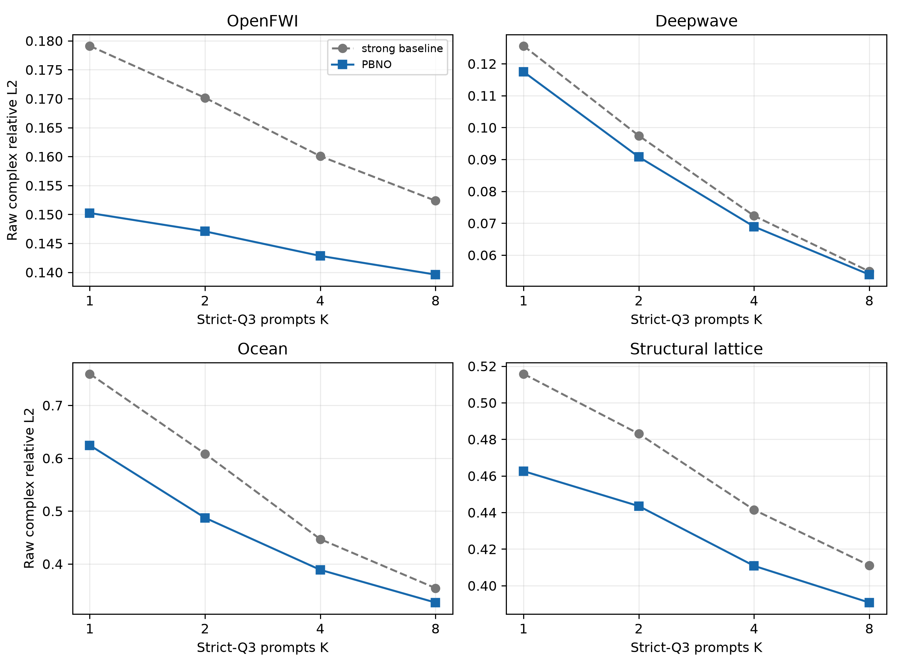
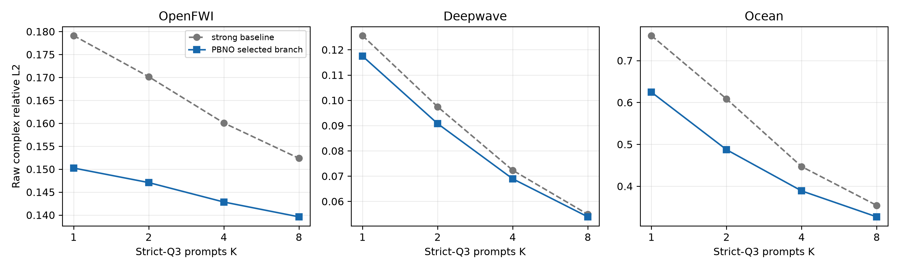
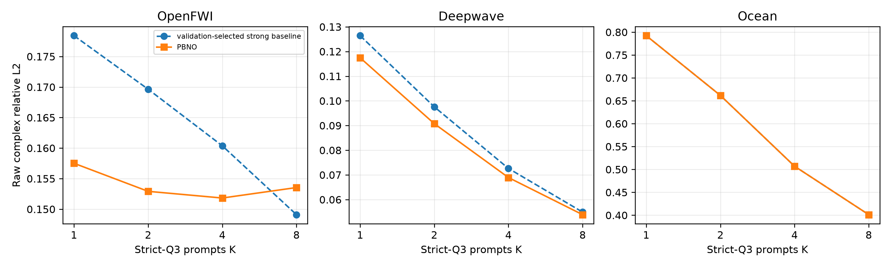
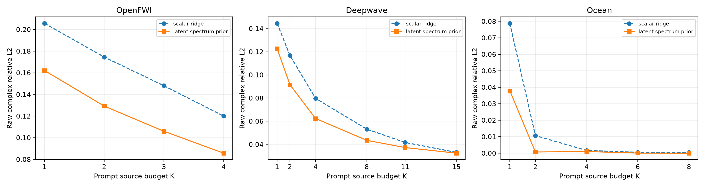
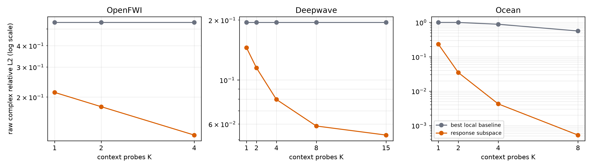
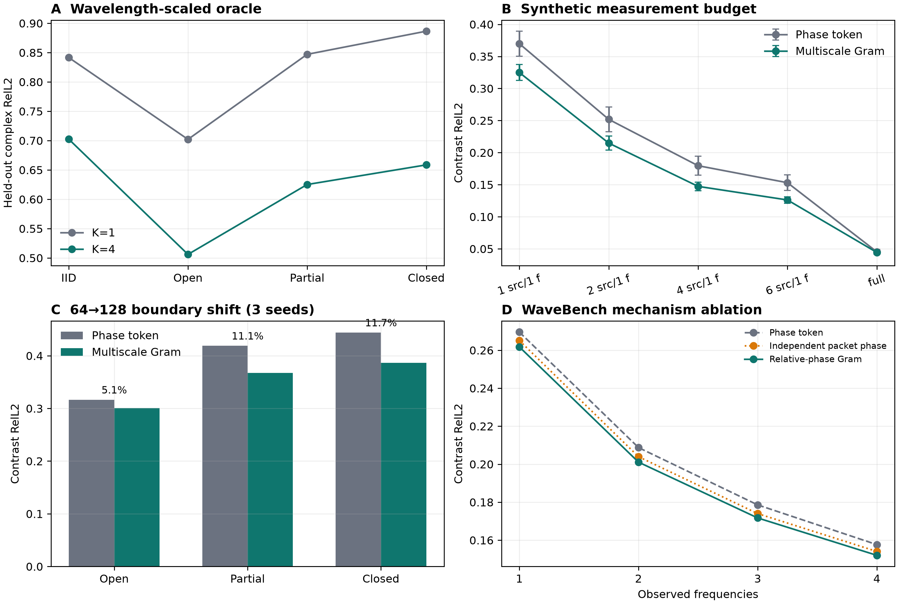
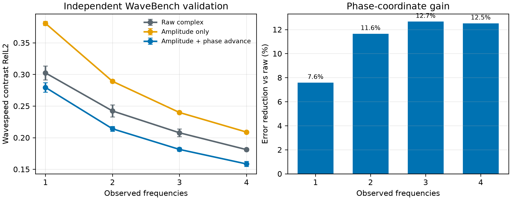
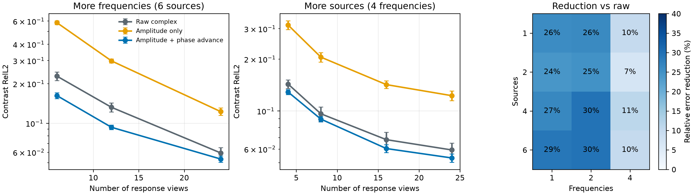
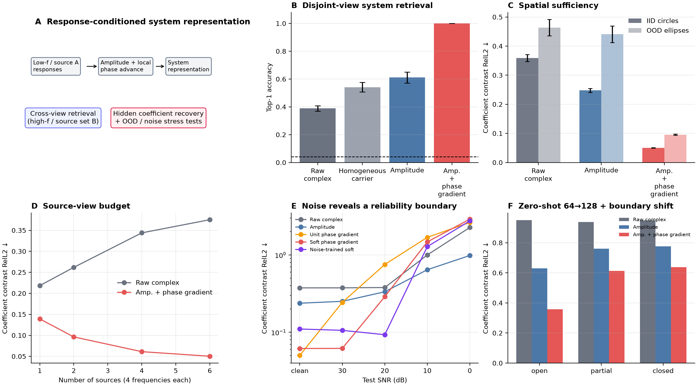
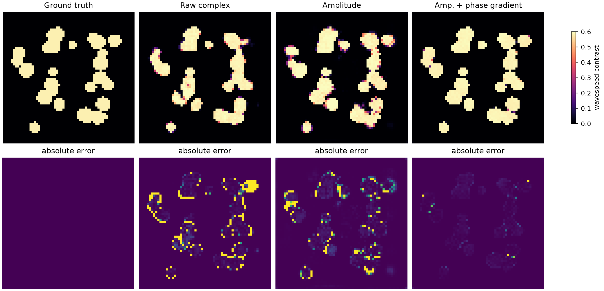

# 从复波动响应中学习可查询的 Wave-System Representation

> 仓库名 `spectral-continuation-operator` 是历史名称。当前研究主线已经从“直接做远频率延拓”推进到一个
> 更基础的问题：**能否从少量复波动 response views 中识别可复用、可查询的隐藏波动系统表示？**

我们的核心发现很简单：完整复场不适合直接当作普通图片处理。绝对相位会随 source、frequency 和
全局相位基准快速变化，但**归一化幅值与局部复相位增量**可以把“局部能量”和“局部传播”分开表示，
从而更稳定地识别产生这些响应的物理系统。

## 当前主线：Wave as Prompt

### 2026-09-26 最新结果：PBNO M4 压缩与第四物理域

M4 把 M3 的 posterior memory 改写为 spectral operator dictionary：保留全部 training-system identities，
但将每个完整 response table 压成共享 basis 上的 16 个复系数。OpenFWI/Ocean 的 value-bank 存储降到原始
bank 的 **0.65%/0.93%**，各预算 test error 退化不超过 **1.48%/1.19%**；计入 shared basis 后总 operator
storage 仍减少约 79%/66%。实际延迟基本不变，因此这里只宣称 storage 成功。

同时新增独立的 heterogeneous structural lattice frequency-domain solver。strict Q3 的 K=1/2 相对 global
Bayesian strong baseline 改善 **10.31%/8.18%**，bootstrap 下界为 9.64%/7.51%。四域 K=2 主结果如下：

| 数据域 | strong baseline | PBNO | 相对改善 |
|---|---:|---:|---:|
| OpenFWI | 0.17015 | **0.14707** | **13.56%** |
| Deepwave | 0.09744 | **0.09077** | **6.85%** |
| Ocean | 0.60843 | **0.48723** | **19.92%** |
| Structural lattice | 0.48300 | **0.44348** | **8.18%** |

统一 prompt-only router 没有通过：shared risk head 修复 Ocean 后，Deepwave K=2 仍比最佳分支差约
2.1%--2.4%。当前方法仍是 validation-selected adapter family，不包装成 universal router。完整方法、噪声、
OOD、失败归因和复现入口见 [PBNO M4 正式报告](reports/PBNO_M4_RISK_RESOLUTION_ZH.md)。



### 2026-09-25 上一结果：PBNO 后验核算子通过主 gate

严格 Q3 把少量复响应当作 prompts，要求回答 source 与 frequency 都未出现过的新 query。最新 M3 使用稳定
Bayesian posterior 作为 in-context system tokenizer，并在其上选择 neural latent transport 或
posterior-kernel attention。线性 PCA--MAP 是 identity transport、零 kernel blend 时的严格特例。

三组 prompt-order seeds、system-held-out test 的主预算 $K=2$：

| 数据域 | validation-selected 强基线 | PBNO | 相对降低 | 系统胜率 |
|---|---:|---:|---:|---:|
| OpenFWI | 0.17015 | **0.14707** | **13.56%** | 93.6% |
| Deepwave | 0.09744 | **0.09077** | **6.85%** | 99.2% |
| Ocean | 0.60843 | **0.48723** | **19.92%** | 77.3% |

OpenFWI 与 Ocean 的 paired bootstrap 下界均为正且改善超过 10%，因此 strict-Q3 主 gate 已通过。Deepwave
belief transport 在 geometry/contrast OOD 的 $K=8$ 从 0.09664 降到 **0.09079**，改善 **6.05%**；Ocean
gated kernel branch 不退化，OOD gate 也通过。参数匹配 CNP 长训练后的 OpenFWI $K=2$ 仍为 0.23247。

后验核分支的 vectorized A100 latency 为 11.9--25.5 ms/完整 test population，约为线性 posterior 的
3.1--4.0 倍；Ocean continuous receiver 通过冻结 functional head 路由精确保留 0.007414。完整公式、消融、
边界和复现入口见 [PBNO M3 正式报告](reports/PBNO_M3_POSTERIOR_KERNEL_OPERATOR_ZH.md)。



### 2026-09-25 上一结果：严格 joint query 与 PBNO M1

严格 Q3 要求目标 source 和目标 frequency 都不出现在 prompts 中。global complex Bayesian operator 已在
OpenFWI、Deepwave、Ocean 三域形成随 K 单调下降的可用结果；在其上加入 whitened nonlinear latent
transport 后，三 seed PBNO 在 OpenFWI K=1/2 相对 validation 选择的最强基线改善 11.7%/9.9%，Deepwave
K=1/2 改善 7.1%/7.0%。高预算收益缩小，OpenFWI K=8 退化 3.0%，Ocean neural residual 无增益，因此尚未
通过最终顶会 promotion gate。

M2 已把 receiver residual 改为 train-only coordinate-RMS 单位，消除了 Deepwave 的数值不稳定；但偏向
稀疏预算训练后 K=1 仍为 0.11665，未过 0.1138 gate，故停止该分支。Q2 则通过效率替代 gate：OpenFWI
rank 96 在误差略降时减少 25% storage，Deepwave rank 112 只退化 1.03%，rank-cubic posterior solve
减少 33%。详见 [PBNO M2 效率与边界报告](reports/PBNO_M2_EFFICIENCY_AND_BOUNDARIES_ZH.md)。

首先阅读 [PBNO M1 正式报告](reports/PBNO_JOINT_QUERY_M1_ZH.md)与
[PBNO 长程计划](docs/PBNO_LONG_TERM_PLAN_ZH.md)。



### 2026-09-25 上一结果：Q2 latent-spectrum prior

新的最小方法把训练 response manifold 的 latent spectrum 作为复高斯先验，在 sparse prompts 下对未知
系统做闭式 posterior/MAP identification。相对重新搜索到 rank 128 的 scalar-ridge 强基线，三 seed
half-budget raw complex RelL2 为：

| 数据域 | scalar ridge | latent spectrum prior | 相对改善 |
|---|---:|---:|---:|
| OpenFWI，K=2/4 | 0.1745 | **0.1292** | **25.9%** |
| Deepwave，K=8/15 | 0.05313 | **0.04349** | **18.2%** |
| Ocean，K=4/8 | 0.001678 | **0.001018** | **39.3%** |

OpenFWI 与 Ocean 均达到 25% equivalent probe saving；Deepwave/Ocean half-budget OOD 相对 strong
baseline 改善 16.1%/14.6%。但 Ocean OOD 绝对误差仍高，且极低/极高预算存在 prior 失配，当前不宣称
universal OOD。functional-rank 审计还表明低秩主要存在于跨系统 response manifold，而不是 source/receiver
空间轴。

首先阅读 [M0 正式报告](reports/WAVE_AS_PROMPT_LATENT_PRIOR_M0_ZH.md)与
[当前状态](docs/CURRENT_STATUS_ZH.md)。下一步只推进 prompt-adaptive calibration 与 continuous receiver
query；flow 需要先通过条件多模态 existence gate。



### 当前方法：PBNO

上述解析结果现已升级为 **Prompted Bayesian Neural Operator**：从任意 source--frequency prompts 识别
共享 system latent，再用 query-conditioned complex response functions 回答新的 source、frequency 与
receiver query。严格论文主任务 Q3、线性特例、分阶段 gates 见
[PBNO 长程计划](docs/PBNO_LONG_TERM_PLAN_ZH.md)；执行后的正式结论以
[M3 报告](reports/PBNO_M3_POSTERIOR_KERNEL_OPERATOR_ZH.md)为准。

## 上一阶段：Cross-Domain Wave Response Query

### 2026-09-24 最新结果

统一 held-out-source query 已在三个多系统域通过预注册 gate。模型不读取隐藏介质，只接收同一未知系统的
少量 source responses，在 inference time 识别 response operator，再回答未测 source。

| 数据域 | half-budget K | 最强局部 baseline | response subspace | 相对改善 |
|---|---:|---:|---:|---:|
| OpenFWI CurveFault-A | 2 / 4 | 0.547 | **0.176** | **68.5%** |
| Deepwave ring ultrasound | 8 / 15 | 0.195 | **0.059** | **69.6%** |
| Ocean Pekeris multistatic | 4 / 8 | 0.886 | **0.0043** | **99.5%** |

主指标均为逐 physical system 等权的 raw complex RelL2；OpenFWI、Deepwave、Ocean 分别使用
500、256、128 个 test systems。Deepwave geometry/contrast OOD 的 K=8 仍为 0.094；Ocean 参数 OOD 的
K=4 为 0.325。结果支持的机制是：**互易性只提供少量准确 anchors，跨系统学习到的复响应子空间负责全局
干涉 completion。**



最小 receiver-preserving residual operator 的三 seed 结果在 OpenFWI 上进一步降低 2.4%--8.7%，但在
Deepwave K=8/15 只增加 0.44%/0.04%；因此不把更大网络包装成核心贡献。The Well HDF5 缺失 source coordinate metadata，当前只保留
public semantic audit，不伪造第四个成功域。

当前首先阅读[跨域 POC 阶段报告](reports/CROSS_DOMAIN_RESPONSE_QUERY_POC_ZH.md)与
[数据 provenance](docs/CROSS_DOMAIN_DATA_PROVENANCE_ZH.md)。冻结 gate 和执行顺序见
[24 小时协议](docs/CROSS_DOMAIN_RESPONSE_QUERY_24H_PLAN_ZH.md)；下一阶段的强基线和跨域 promotion 标准见
[跨数据集指标提案](docs/CROSS_DOMAIN_QUERY_METRICS_NEXT_ZH.md)。面向论文的方法升级、分阶段 gates 与
NO-GO 条件见 [Wave as Prompt 顶会计划](docs/WAVE_AS_PROMPT_TOPCONFERENCE_PLAN_ZH.md)。

## 上一阶段：In-Context Wave Response Query RQ-1

### 2026-09-24 RQ-1 正结果

首个通过 gate 的 setting 是 co-located 9-transducer multistatic array 上的 held-out source query。方法由
gain-calibrated reciprocity routing 和一个 121,938 参数的 2-layer masked residual Transformer 组成。

- IID system-held-out test，K=8：**0.498 ± 0.014** vs strong physics baseline **0.624**，相对提升
  **20.1%**；
- ellipse geometry OOD：**0.427 ± 0.002** vs **0.558**，相对提升 **23.5%**；
- 三 seed、24 test systems、raw complex RelL2；Q3 joint source-frequency query 仍未解决。

完整方法、负结果、图表和 claim boundary 见
[RQ-1 正式报告](reports/IN_CONTEXT_RESPONSE_QUERY_RQ1_ZH.md)。

当前不再把 frequency 只当作网络的 condition channel，也不以重建某一张 field 为最终目标。基本任务是：

> 给定一个未见波动系统的少量 source--frequency probe responses，在不更新模型权重的条件下，回答新的
> source--frequency response query。

首轮固定 receiver array，将一个 probe 写成 $q=(s,\omega)$，response 是该 receiver array 上的复数向量。
主实验严格区分 frequency-held-out、source-held-out 和二者同时未见的 joint query；使用现有
160-system × 9-source × 8-frequency dense archive 生成可复现 episodes。先做 identifiability、强
interpolation/low-rank/retrieval baselines 与 active-oracle audit，再训练最小 DeepSets/CNP query model。

执行后，Q2 source query 已建立上述正结果；Q3 继续作为困难下一阶段，而不把 Q2 写成 joint-query 成功。

Generative belief、flow matching、active policy、RL、可变 receiver、3D 与 multibranch router 都有明确前置
gate，不进入第一阶段。完整 formulation、24 小时执行顺序与 stop rules 见
[In-Context Wave Response Query 计划](docs/IN_CONTEXT_WAVE_RESPONSE_QUERY_PLAN_ZH.md)。

```text
Wave as Query → Wave as Prompt → Wave as Belief → Wave as Action
```

## 上一阶段：多分支相空间 POC

新的 oracle 审计证明：复杂波场局部确实存在单个 phase advance 无法表达的多分支信息，但尺度必须按
波长定义。约 1.5-wavelength 的局部窗口中，K=4 相对 K=1 在 partial/closed boundary 上将 held-out
complex error 降低 26.3%/25.7%；固定 33-pixel 窗口却只有约 6%，说明“局部”的物理单位是波长而非
像素。

由此设计的 two-scale complex packet Gram quotient 一个共同 global phase，同时保留分支之间的相对相位。
在三 seed synthetic 任务中，它在单频观测预算下相对现有五通道 token 改善 12%--18%；在 64→128
boundary shift 上，open/partial/closed 的逐系统改善为 5.1%/11.1%/11.7%，30/30 个系统同向。由于困难
条件仍未达到预注册 15% gate，当前结论是**oracle 机制成立、fixed 69-channel 实现只关闭部分 gap**，不把
它提升为论文主方法。

完整公式、尺度诊断、三 seed 表格、负结果与 stop decision 见
[多分支相空间 MPS-1 报告](reports/MULTIBRANCH_PHASE_SPACE_MPS1_ZH.md)。



## 独立复现：公开 WaveBench

频率感知表示已在第二个、独立的公开数据集 WaveBench 上完成三随机种子 matched comparison。同一个
shared set operator 接收任意 1--4 个频率响应并恢复产生它们的 wavespeed field；所有表示使用相同网络、
split 和训练预算。

| 观测频率数 | Raw complex | Amplitude only | Amplitude + phase advance | 相对 raw 改善 |
|---:|---:|---:|---:|---:|
| 1 | 0.3024 | 0.3807 | **0.2794** | **7.6%** |
| 2 | 0.2422 | 0.2891 | **0.2140** | **11.6%** |
| 3 | 0.2077 | 0.2398 | **0.1814** | **12.7%** |
| 4 | 0.1811 | 0.2088 | **0.1584** | **12.5%** |

完整四频的逐系统 paired bootstrap 改善为 12.52%，95% 区间为 12.10%--12.93%；普通 physical RelL2
从 2.98% 降到 2.61%。结果跨全部 seed 和 budget 同向，但没有通过预注册的 sparse-budget 15% 强效应
gate。因此它建立的是**可复现的跨数据集 measurement-efficiency prior**，不是已经完成的通用新架构。
完整归因见 [WaveBench M1 报告](reports/WAVEBENCH_REPRESENTATION_M1_ZH.md)。



## 上一阶段：可变观测 Wave Set Operator

固定通道 POC 已升级为 shared 4-slot set operator：同一 checkpoint 接收任意顺序和数量的
source-frequency views，参数量不随预算增长。三 seed 结果显示，full-context 下 phase token 与 strong raw
接近（0.0533 vs 0.0593）；真正稳定的优势出现在每源只有 1--2 个频率时，相对 raw 降低 24--30%。在
clean-trained 20 dB 测试上为 0.112，raw 为 0.529。

这个结果同时收缩了 claim：phase token 不是 universal OOD winner。clean ellipse 和 128-grid boundary
上 raw 更强，10 dB 仍失败；instance-contrastive pretraining 也没有提高 full-label 最优精度。完整结果见
[Wave Set Operator M0 报告](reports/WAVE_SET_OPERATOR_M0_ZH.md)。





## 当前最强结果

主实验在 160 个二维变速声学系统上进行，按介质严格划分 train / validation / test。检索任务的两组
response views 在 source 和 frequency 上都不重叠；OOD 测试使用训练中未见过的 ellipse geometry。

| 表示 | 跨视图系统检索 Top-1 | IID 介质恢复 RelL2 | OOD ellipse RelL2 |
|---|---:|---:|---:|
| Raw complex | 38.9% ± 2.0% | 0.3588 ± 0.0120 | 0.4637 ± 0.0279 |
| Amplitude only | 61.1% ± 3.9% | 0.2478 ± 0.0071 | 0.4407 ± 0.0283 |
| Amplitude + local phase advance | **100.0% ± 0.0%** | **0.0504 ± 0.0008** | **0.0955 ± 0.0020** |

相对 raw complex，结构化 token 将 IID 和 OOD 恢复误差分别降低 **86.0%** 和 **79.4%**。这支持的
不是“相位不可迁移”，而是更精确的判断：

> **绝对相位难迁移；经过 gauge-invariant 局部化后，相位 advance 是很强的可迁移传播表征，并与
> amplitude 互补。**



## 表示是什么

对每个复场 `u`，当前最小表示只有 5 个实通道：

```text
log-normalized amplitude,
real/imag horizontal phase advance,
real/imag vertical phase advance
```

相位增量直接由相邻位置的复共轭乘积计算，不做 phase unwrapping，不需要已知 source location、解析
travel time 或 eikonal solver。低幅值区域使用 amplitude gate 抑制不可信相位；跨分辨率时，增量的
offset 按固定物理距离而不是固定像素数定义。

## 当前结论边界

这是一项有力的 representation POC，**还不是完整的通用波动生成器**。

- 已成立：在当前二维 acoustic 数据上，该表示能跨 source、frequency 和未见 geometry 识别系统并恢复
  隐藏空间结构；中高 SNR 下局部 phase 明显补充 amplitude。
- 关键负结果：RBF 坐标插值、简单 eikonal demodulation 和少源 Nyström completion 的 complex error
  接近或超过 1；直接预测未见 source-frequency 的完整复场仍约为 0.93--0.97。
- 尚未通过：10 dB 噪声、partial / closed 强反射边界、真实部分观测、第二 PDE 数据域，以及可用精度的
  unseen-query field generation。
- 因而当前不主张“通用波动基础模型”或“任意远频率恢复”。

## 已检验的新问题：从单分支 phase advance 到多分支相空间 token

现有 token 可以看成局部传播关系的一阶、单尺度、单分支近似。同一位置存在直达、反射和绕射分量时，
一个相邻复共轭乘积会把多个传播方向压成单个统计量。MPS-0/1 已验证：多分支信息的 oracle headroom
存在，但 fixed packet Gram 的三 seed downstream 增益仍低于 promotion gate。后续不再无条件增加固定
filter、半径或手工 phase channels。

完整科学命题、传统理论与本项目新增证据的边界、相关论文以及 24 小时最小 POC 见
[多分支相空间波表征](docs/MULTIBRANCH_PHASE_SPACE_REPRESENTATION_ZH.md)，执行结果见
[MPS-1 报告](reports/MULTIBRANCH_PHASE_SPACE_MPS1_ZH.md)。

## 后续研究边界

1. **RQ-1 已冻结，继续 response query**：先在第二个独立 multistatic 数据域验证 Q2，再以 reciprocity
   routing + per-link spectral state 推进 Q3；不重跑普通 CNP。
2. **停止 fixed front-end enumeration**：当前 69-channel Gram 是机制 POC，不再扫更多半径、方向和 edge；
   多分支只在 Q3/Q4 multipath failure 明确后以 compact learnable tokens 重启。
3. **Belief 和 Active 均后置**：只有条件多模态与 active oracle headroom 得到证据后，才进入 flow 或 policy。

稀疏系数/场重构继续作为历史参考，不切换为当前主任务。

## 推荐阅读顺序

1. [当前状态：一页式结论与决策](docs/CURRENT_STATUS_ZH.md) — 五分钟了解现在做到哪里、相信什么、
   下一步为何这样做；
2. [In-Context Wave Response Query 计划](docs/IN_CONTEXT_WAVE_RESPONSE_QUERY_PLAN_ZH.md) — 当前 active
   formulation、Q1/Q2/Q3、oracle audits、模型顺序和 gates；
3. [RQ-1 正式报告](reports/IN_CONTEXT_RESPONSE_QUERY_RQ1_ZH.md) — reciprocity routing、轻量 query model、
   三 seed test、geometry OOD 与负结果；
4. [多分支相空间 MPS-1 报告](reports/MULTIBRANCH_PHASE_SPACE_MPS1_ZH.md) — 最新已完成 oracle、方法、
   三 seed 正负结果与 gate；
5. [多分支相空间波表征](docs/MULTIBRANCH_PHASE_SPACE_REPRESENTATION_ZH.md) — 冻结科学命题、相关工作与
   原始 POC 协议；
6. [WaveBench M1 报告](reports/WAVEBENCH_REPRESENTATION_M1_ZH.md) — 第二数据集正式结果、HarmoCore
   归因与 2D/3D/时空表示路线；
7. [实验账本](docs/EXPERIMENT_LEDGER_ZH.md) — 逐条路线的正负证据、不要重复的实验、重启条件，以及
   仍未充分开发的正信号；
8. [波动场表征学习 POC 完整报告](reports/WAVEFIELD_REPRESENTATION_POC_ZH.md) — 方法、协议、全部消融、
   stress tests 与声明边界；
9. [旧表征阶段冻结协议](docs/WAVEFIELD_REPRESENTATION_NEXT_STAGE_ZH.md) — M0--M4 与旧 gates；
10. [科学备忘录](docs/SPECTRAL_PREDICTABILITY_IDENTIFIABILITY_CALIBRATION_ZH.md) — 波动方程、信号处理、
   可预测性和可辨识性的通俗解释；
11. [历史探索归档索引](docs/archive/INDEX_ZH.md) — 旧的谱延拓、校准、horizon 和局部 token 路线，仅保留
   关键正负结论与原始证据入口。

具体命令、数据 hash 和旧实验参数统一放在[复现档案](docs/REPRODUCIBILITY_ZH.md)，不再占据主页。
按目录浏览时可使用 [docs 导航](docs/README.md) 和 [reports 导航](reports/README.md)。

## 当前代码入口

```text
src/spectral_continuation/wave_operator_data.py
src/spectral_continuation/response_query.py
src/spectral_continuation/audit_response_query.py
src/spectral_continuation/train_response_query.py
src/spectral_continuation/evaluate_response_query_checkpoint.py
src/spectral_continuation/summarize_response_query.py
src/spectral_continuation/audit_wave_operator_representation.py
src/spectral_continuation/train_wave_operator_identifier.py
src/spectral_continuation/train_wave_operator_contrastive.py
src/spectral_continuation/train_wave_medium_probe.py
src/spectral_continuation/evaluate_wave_medium_ood.py
src/spectral_continuation/summarize_wave_representation_poc.py
src/spectral_continuation/train_wavebench_identifier.py
src/spectral_continuation/summarize_wavebench_representation.py
src/spectral_continuation/plot_wavebench_examples.py
src/spectral_continuation/audit_multibranch_phase_space.py
src/spectral_continuation/audit_wavelength_scaled_phase_space.py
src/spectral_continuation/summarize_multibranch_phase_space.py
```

代码按 `active / supporting / archived` 的完整分类见
[源码索引](src/spectral_continuation/README.md)，配置分类见 [configs/README.md](configs/README.md)，artifact
分类见 [artifacts/README.md](artifacts/README.md)。历史文件暂不物理移动，以免破坏 checkpoint、manifest
和旧报告中的复现路径；它们已从当前接口中明确冻结。

后续研究 Agent 应先遵守根目录 [`AGENTS.md`](AGENTS.md) 中的证据语言、禁重复清单和实验归档流程。

## 最小复核

```bash
python -m venv .venv
.venv/bin/pip install -e '.[dev]'
PYTHONPATH=src .venv/bin/python -m pytest -q
.venv/bin/ruff check src tests
```

本仓库独立于 `APEX_repro_fsk`。旧仓库只作为原始论文、历史代码和数据来源；新方向的协议、实验与
结论均以本仓库为准。
