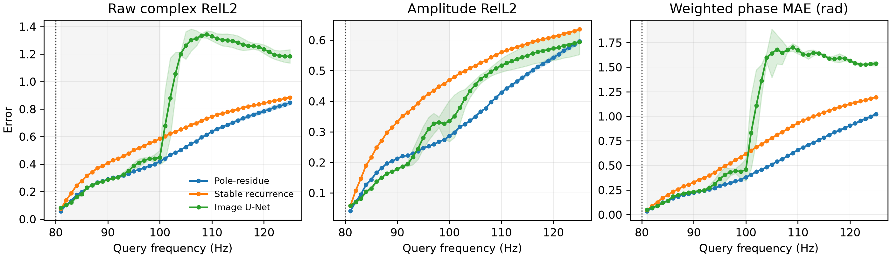
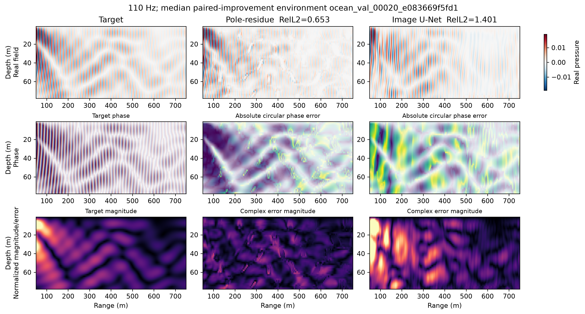
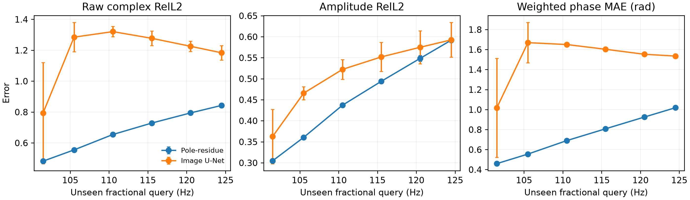

# 连续复谱状态：carrier-gauged pole–residue operator

更新时间：2026-09-15。本文记录当前长程目标中的问题设定、最小方法、已确认结果和实验边界。

## 1. 一句话问题

给定同一物理环境在一段低频带上的复波场，学习一个与查询频率无关的传播状态，使模型可以
直接查询更高的任意频率，而不依赖逐频率递推。

这里的重点不是固定的 `20 Hz → 40 Hz` 配对，也不是把频率当成普通条件输入。我们要检验的是：
低频复场是否包含一个可辨识的局部谱生成元，以及合适的表示能否把它迁移到训练频带之外。

## 2. 为什么要从递推改成连续谱状态

上一阶段的稳定递推模型已经证明，全局相位等变且不降采样的复谱状态明显优于 matched image
U-Net。但它仍有两个结构缺陷：

1. 只能在训练时定义的频率格点上查询；
2. 到达远频必须反复应用同一个一步算子，误差会累计。

局部多路径响应在短频带内可近似写成：

$$
u(x,f) ≈ e^{i s(x)(f-f_0)} Σ_{k=1}^{K} a_k(x)e^{λ_k(x)(f-f_0)}.
$$

其中 $s(x)$ 是主载波的相位斜率，$a_k(x)$ 是复 residue，$λ_k(x)$ 是复 pole。pole 的实部控制
幅值随频率的缓变，虚部控制去除主载波后的残余相位旋转。这个状态可以在任意实数 $f$ 上直接
求值，因此既不绑定整数频率，也没有递推 rollout。

## 3. 最小方法

### 3.1 解析 carrier 与相位 gauge

令最高可见频率为 $f_0$。首先从相邻可见场的归一化复相关估计局部相位增量：

$$
r_j(x)=\frac{u(x,f_j)u(x,f_{j-1})^*}
{|u(x,f_j)u(x,f_{j-1})^*|}.
$$

当前实现保留两种零参数估计器：

- `band_ols`：累计所有主值相位增量后做全带线性回归；
- `endpoint_increment`：只用 continuation 边界处最后一个相位增量，作为边界导数的一侧估计。

Ocean 的 training-free 诊断表明，谱相位存在曲率：只使用解析 carrier 时，
`endpoint_increment` 在 90 Hz 的 raw complex RelL2 为 0.656，而 `band_ols` 为 0.750；在
125 Hz 分别为 1.192 和 1.265。因此端点估计是有物理依据的局部生成元估计，不是额外网络。

用估计的 carrier 将所有可见场转到相对坐标：

$$
v(x,f_j)=u(x,f_j)e^{-i[s(x)(f_j-f_0)+\phi_0(x)]}.
$$

共同全局相位旋转在这一步被消去。

### 3.2 相位不变、全分辨率 encoder

网络输入只包含：

- gauged 可见场 $v$ 的实部和虚部；
- 每个可见场的幅值；
- 相邻场归一化复相关的实部和虚部；
- 介质参数和空间坐标。

这些量对 $u → e^{iγ}u$ 不变。encoder 使用不含 pooling 的 dilated residual blocks，输出每个
空间位置的一组 poles 和 residues。绝对相位始终由输入场的 carrier 携带，而不是由实值网络
重新生成。

### 3.3 稳定 poles 与精确 anchor

对朝高频方向的外推，pole 实部参数化为非正值：

$$
\mathrm{Re}(λ_k)=-g_{max}\,\sigma(z_k) ≤ 0.
$$

这直接排除了随查询距离指数爆炸的模态。residues 被投影到满足：

$$
Σ_k a_k(x)=|u(x,f_0)|.
$$

因此在 $f=f_0$ 时，decoder 精确返回最后一个可见复场。这两项都是结构参数化，不是额外
regularization loss。

### 3.4 一次编码、连续直接查询

最终 decoder 为：

$$
\hat u(x,f)=e^{i[s(x)(f-f_0)+\phi_0(x)]}
Σ_k a_k(x)e^{λ_k(x)(f-f_0)}.
$$

同一环境只编码一次，任意多个频率共享同一个 state。模型对任意实数频率有定义，并且从
$f_0$ 直接到目标频率，不经过中间预测场。

### 3.5 训练目标

主目标始终是原始复场的逐环境 relative L2。没有额外的 amplitude loss、phase loss 或
PDE residual。可选的 visible-history 项也使用完全相同的复场重建目标，其作用只是让同一个
state 同时解释可见频带。

当前代码同时保留平方与非平方 relative error 作为可审计消融；正式 Ocean 配置使用与报告
指标一致的非平方 relative error，并在打开稠密 archive 前冻结。

## 4. 已确认的受控证据

合成数据由三个带空间慢变包络的传播分量组成。输入为 1–14 Hz，训练和选择查询为
15/16/17/18 Hz，外推到 19–24 Hz，并包含从未用于训练的 19.5 Hz 查询。

| 模型 | 15–18 Hz macro | 19–24 Hz 整数 macro | 连续查询 |
|---|---:|---:|---|
| Image U-Net | 0.754 ± 0.200 | 1.119 ± 0.081 | 可输入 19.5 Hz，但误差高 |
| Stable recurrence | 0.344 ± 0.002 | 0.853 ± 0.001 | 不支持 19.5 Hz |
| Continuous pole–residue | **0.169 ± 0.003** | **0.600 ± 0.014** | 19.5 Hz = **0.452 ± 0.005** |

在共同整数外推点上，连续谱状态比递推下降 29.7%，比 image U-Net 下降 46.4%。它在 64×128
网格上的带外 macro 为 `0.591 ± 0.016`，与训练分辨率接近，说明 decoder 不绑定像素尺寸。
U-Net 的 seed 方差很大，其中一个 seed 没有进入有效优化盆地；pole 和 recurrence 则都稳定。

这个合成结果证明表示方向成立，但也暴露限制：误差仍随查询距离明显上升。连续可查询不等于
无限距离可预测。

## 5. Ocean 稀疏监督结果与归因

输入 74–80 Hz，只用 90/100 Hz 监督时，最初的全带 OLS carrier 配置把两点 macro 从稳定递推
的约 0.572 降到约 0.36，但 105–125 Hz macro 约为 0.79，未优于递推的 0.776。换成边界局部
carrier 并删除与它冲突的 visible-history 项后，单 seed 开发结果进一步变为：

| 模型 | 90/100 Hz macro | 105–125 Hz macro |
|---|---:|---:|
| Stable recurrence | 0.572 | 0.775 |
| Pole, band OLS carrier, history | 0.364 | 0.789 |
| Pole, endpoint carrier, history | 0.335 | 0.798 |
| Pole, endpoint carrier, no history | **0.335** | **0.691** |

最后一行相对稳定递推在两个频带分别下降约 41.4% 和 10.9%；105–120 Hz 逐点更低，125 Hz
略高于递推。它仍是开发性单 seed 结果，必须经过三 seed 和稠密协议确认。

冻结配置的三 seed 复验得到 90/100 Hz macro `0.327 ± 0.004`，105–125 Hz macro
`0.695 ± 0.013`。对应稳定递推为 0.571 和 0.776，即分别下降 42.7% 和 10.5%。逐频率看，
105/110/115/120 Hz 分别下降 29.1%/17.8%/8.9%/2.4%，125 Hz 则高 2.0%。因此当前最准确的
结论是“显著延长近端有效 continuation horizon”，不是“任意距离均优于递推”。

早期 OLS 版本的主要归因不是模型容量不足，而是两点监督下的状态不可辨识：许多不同 pole mixtures 都能拟合
距离 10 和 20 Hz 的两个值，却在更远频率产生不同轨迹。放宽 pole 衰减上限从 0.4 到 0.8 后，
外推只从 0.789 变为 0.791，继续搜索这个超参数没有价值。

已经否定的分支包括：

- 自由 learned carrier correction：近频可改善，远频明显恶化；
- 每像素解析 least-squares residues：小矩阵病态，训练不稳定；
- 更重的 U-Net state backbone：没有超过简单全分辨率 residual encoder；
- 单纯增加 pole 数：选择频带可改善，但远频更容易出现不可辨识模态。

端点 carrier 的改进还说明，物理先验必须与任务方向一致：continuation 需要边界处的局部生成元，
而不是可见带内部的平均生成元。visible-history 对 OLS carrier 有正则作用，却会强迫端点状态向后
拟合一段有曲率的频谱，因此应删除。这个版本最终只保留主 query reconstruction loss。

## 6. Ocean 稠密协议与主结果

数据使用相同 Pekeris solver、相同 128/32 development environments 和相同 48×384 网格。
模型只看 74–80 Hz：

- 81–100 Hz：训练，并在独立 validation environments 上选择 checkpoint；
- 101–125 Hz：完全不参与选择的 development extrapolation curve；
- strict environments：现在只注册参数，不生成或打开 field bytes。

这个实验没有增加物理环境数量，而是增加同一环境沿频率轴的观测密度，直接检验
“谱状态可辨识性”这一归因。matched stable recurrence 与 image U-Net 使用相同数据、训练轮数
和近似参数量。

三 seed 主结果如下：

| 模型 | 参数量 | 81–100 Hz | 101–125 Hz |
|---|---:|---:|---:|
| Image U-Net | 1.230M | 0.289 ± 0.003 | 1.217 ± 0.044 |
| Stable recurrence | 1.210M | 0.391 ± 0.001 | 0.765 ± 0.001 |
| Continuous pole–residue | 1.228M | **0.2760 ± 0.0005** | **0.669 ± 0.007** |

在训练/选择频带内，U-Net 已经是很强的 0.289，pole 只低 4.6%；但冻结后跨过 100 Hz，U-Net
立即发生相位崩溃，101–125 Hz macro 变为 1.217。pole 相对它下降 **45.1%**，相对稳定递推
下降 **12.6%**。这比选择一个弱 direct baseline 更有说服力：三者都能拟合训练频带，区别在于
latent 是否支持频带外 continuation。

逐物理环境 paired bootstrap 先平均三个 seed 和全部查询，再以 32 个环境为独立单位。相对
U-Net，带外 32/32 环境改善，平均 absolute improvement 0.549，95% CI `[0.515, 0.583]`；
相对 recurrence，30/32 环境改善，平均 absolute improvement 0.096，95% CI
`[0.067, 0.118]`。相反，训练带内 pole 对 U-Net 的 absolute improvement CI 跨过零，说明
两者的拟合能力接近，带外差距不是由一个明显训练失败的 baseline 造成。

下图环境不是手工挑选：先将三个 seed 和全部 101–125 Hz 查询平均，再按 pole 相对 U-Net 的
paired improvement 取 32 个 validation environments 的中位数。固定 seed 42 在 110 Hz 上，
pole RelL2 为 0.653，U-Net 为 1.401；相位误差和复误差的空间分布与汇总指标一致。

机制指标与最初发现一致。在 101–125 Hz：

- pole 与 U-Net 的 amplitude RelL2 为 0.457 对 0.518，差距为 11.7%；
- weighted phase MAE 为 0.725 对 1.547，差距为 53.1%；
- phase coherence 为 0.625 对 0.018。

因此主要收益确实来自“幅值相对可迁移，但必须结构化表示高频相位”，不是换一个幅值指标放大
数字。

整数 gate 通过并冻结三个 checkpoint 后，才独立生成
101.5/105.5/110.5/115.5/120.5/124.5 Hz 标签。pole 可直接查询这些实数频率，不经过重训或
相邻整数 rollout：

| 模型 | Fractional raw RelL2 | Amplitude RelL2 | Phase MAE | Coherence |
|---|---:|---:|---:|---:|
| Image U-Net | 1.181 ± 0.065 | 0.512 ± 0.035 | 1.505 ± 0.052 | 0.050 ± 0.038 |
| Continuous pole–residue | **0.676 ± 0.008** | **0.456 ± 0.003** | **0.743 ± 0.001** | **0.611 ± 0.001** |

半整数 raw error 下降 42.7%，曲线与相邻整数查询一致。U-Net 同样可以接收实数 query，因此
这个对照检验的是连续频率表示，而不是接口是否接受浮点数。

完整冻结协议见
[`ocean_continuous_poles_stage_20260915.json`](../configs/ocean_continuous_poles_stage_20260915.json)。

## 7. 当前可主张与不可主张

可以主张：

1. carrier-gauged pole state 提供相位等变、分辨率灵活、连续且无 rollout 的 query operator；
2. 受控合成实验中，它比 matched recurrence 和 image representation 更有效；
3. 在参数匹配、训练带拟合接近的 Ocean 对照中，它把 101–125 Hz raw error 相对 U-Net 降低
   45.1%，相对 recurrence 降低 12.6%；
4. 冻结后的半整数查询保持相同结论，且主要收益来自相位而非幅值。

目前不能主张：

1. 已经把真实 Ocean 长程误差降低到可直接部署的精度；
2. 任意远频都能从有限低频唯一恢复；
3. learned poles 等同于唯一真实传播路径；
4. 单一 Pekeris 数据分布可以代表所有波动系统；
5. development 调参结果等同于 untouched strict test 结果。

本阶段结论为 representation-level GO：结构优势已经稳定且与最初 amplitude/phase 发现一致。
下一阶段最重要的不是继续在这个 development split 上调数字，而是冻结方法后生成 strict
environments，并转向第二个真实物理分布检验；绝对 raw error 仍约 0.67，也说明更长程的状态
仍不完全可辨识。
