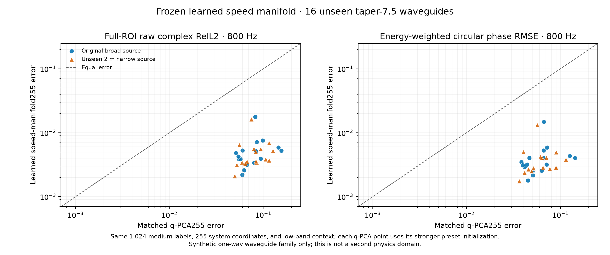
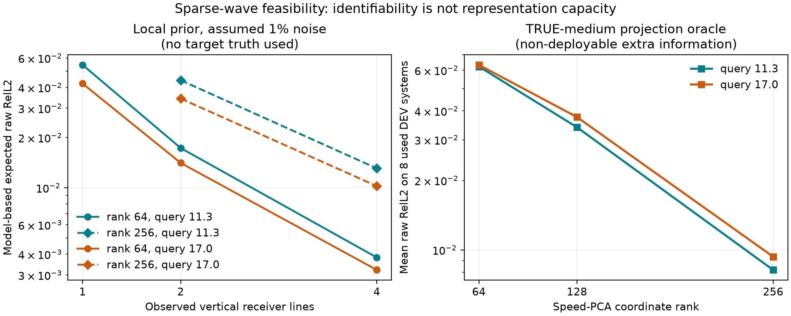

# 从仓库证据走向海洋相位重建与 Wave as Prompt

> 2026-10-05。给下一位研究者的「证据—判断—问题」地图，不是新的实验报告，也不把过去不同输入条件下的误差放进同一排行榜。先读本页，再按链接追溯原始协议、数值与图。本文的「建议」是待检验的研究假设，不是已实现的结果。

## 一页结论

如果目标是**在海洋或真实场景中，仅凭少量水听器复响应，准确预测未测位置、频率或声源的相位**，我们现在既不缺一套能拟合波场的网络，也不能简单说「低频没有高频信息」。真正尚未打通的是以下链条：

```text
稀疏、带噪、可能失去绝对相位参考的观测
    → 辨识环境中影响传播相位的自由度
    → 构成同一个可查询的传播算子
    → 对新接收点／频率／声源给出可信复响应及可靠范围
```

过去最扎实的正信号是：在**已知方程、已知声源、密集干净低频场的合成单向波导**中，学得合适的声速坐标、保留 `c → 1/c²` 的非线性，再交给物理传播器，能在新环境上精确生成高频及新声源的相位。但它**没有**证明真实海洋的稀疏相位重建已解决，也**没有**证明 PCA＋求解器就是最终 AI 方法。最扎实的负信号是：同一坐标在介质统计改变、传感器有噪声、观测变稀或二维散射增强时，可能因容量、辨识和数值精度的不同瓶颈而失败。

因此我建议先做 **被动的、相位可校准的 Wave as Prompt**：给定新环境少量已发生的复观测，预测没有测过的响应；暂不加入主动选频、RL 或 flow。海洋是旗舰需求，另一个不同传播机制的仿真域检验方法没有只记住海洋模态。**首个可交付价值**是未布点位置或未测频率的相位可信预测；完整场真值用于仿真机制研究，真实数据则首先以留出水听器／留出频率检验。

## 1. 先把「相位」和「泛化」说清楚

单频复压强可写作 `u(x,f) = A(x,f) exp(iφ(x,f))`。多路径传播下，各路径到达时间稍有偏差，较高频率的干涉条纹就可能明显移动。这是传统波动物理直觉；**总场幅值并不保证比相位平滑**，在相消、模态截止和共振附近它也会剧变。我们经验上看到的「幅值较易迁移、相位较难迁移」，不能推广为所有场景的定律。[早期跨频证据](EXPERIMENT_LEDGER_ZH.md)与[科学备忘录](SPECTRAL_PREDICTABILITY_IDENTIFIABILITY_CALIBRATION_ZH.md)应按各自条件阅读。

在真实水听器上还存在一个比建模更前置的问题：观测通常不一定是理想的 `u`，而更接近 `y_i(f) = g_i(f) exp(iα_event(f)) u(r_i,f) + noise`。其中 `g_i` 是传感器复增益，`α_event` 可包含发射相位／时钟偏移。若每次发射的共同相位未知，**绝对相位不可由该次观测单独确定**；若各水听器的复增益也未知，连阵元间相对相位也可能不可靠。这是测量模型下的可辨识性限制，不是某个神经网络训练得不够好。跨频预测若要求绝对相位，就必须说明相干时钟、发射参考和标定；否则应明确改为「相对相位／复响应比值预测」，同时承认目标变了。

所以所有后续实验必须标记两个独立轴：

| 轴 | 首轮可操作条件 | 更真实的压力测试 |
|---|---|---|
| 物理信息 | 已知源位置／波形、背景声速、边界类型；未知局部环境 | 声速剖面部分已知，海底参数／几何不确定，最后才考虑源也未知 |
| 相位参考 | 统一时钟、已标定复增益，允许评价未经配准的复压强 | 仅共同事件相位未知；再到阵元增益漂移，采用可辨识的相对相位目标 |

不要把右列的额外困难偷偷加进左列，随后把模型性能下降解释成「波本身不可预测」。

## 2. 仓库证据账：正反馈、负反馈与真正留下的 insight

表里的数值仅帮助记忆数量级，**不是跨任务公平排名**。`新确认`、`已用开发`、`oracle`、`模型内预测`均明确注明。早期实验的时间线与完整数值仍以[实验账本](EXPERIMENT_LEDGER_ZH.md)为准。

| 线索 | 正反馈 | 负反馈／边界 | 留给真实问题的判断 |
|---|---|---|---|
| **从波场图像转向传播表示** | 相位坐标＋复包络的局部连续表示能达到约 1% 级；海洋模态谱查询优于直接插值。[阶段报告](../reports/COHERENT_CONTINUOUS_REPRESENTATION_PROGRESS_ZH.md) | 同核族现场优化约 0.72%，强经典模态／物理读出常更准；空间 chart 准不等于新频率准。 | 编码一张图与识别能回答新 query 的系统是两种能力；学习要争取跨环境摊销、未知物理修正或更少观测，而非替代已知精确求解器。 |
| **Ocean 模态及模式诞生** | 距离相关合成波导中，局部模态参考比简单谱插值更合理；错位集中于模态出现／截止及分量耦合。[波导数据与界限](RANGE_DEPENDENT_WAVEGUIDE_DATA_ZH.md) | 简单截止锚点不稳定；给完整介质的经典传播器可到约 0.00282／0.00065，不能拿缺介质的方法与之宣称胜出。 | 频率连续模型需要处理传播分支随频率的出现、消失和相互作用；但「显式追踪每个模态」也未必是最可扩展的 3D 表示。 |
| **环境坐标选对变量** | 新 16 个同合成族插值环境：相同 1,024 训练介质标签、255 维代码、低频观测和物理反演，声速表示 800 Hz 双源 raw **0.00538／0.00505**，相同维度 `1/c²` 线性表示 **0.08068／0.08197**；相位约 0.004 rad。[确认](LEARNED_SPEED_MANIFOLD_CONFIRM_ZH.md) | 仍是单向、已知 PDE／声源、60/100/140 Hz × 65条干净完整剖面；代码接近合成器自由度，并非真实海洋／现代神经算子。旧 Gaussian 族仅改善 **5.7%／2.6%**。[反例](GAUSSIAN_SPEED_VARIABLE_DEV_ZH.md) | 「学习哪一个物理变量」可能比再加网络层关键，但最佳坐标依赖介质族，不能宣布声速表示普适最优。 |
| **容量 ≠ 方差解释率 ≠ 响应保真** | 余弦族把旧 128 维升到 256 维后，新 32 环境 800 Hz raw 从约 0.51 降到 **0.0148／0.0153**。[独立确认](SPECTRAL_MEDIUM_STRESS_POC_ZH.md) | 128 维已解释 99.86% 介质方差；`q` 的 255 维真介质投影即使保留约 99.997% 系数方差仍留下约 0.078 响应误差。高维 `q` 真介质 oracle 可降到约 0.0031，却不自动能从低频辨识。[归因](VARIABLE_PROJECTION_ATTRIBUTION_ZH.md) · [容量审计](Q_CAPACITY_ORACLE_AUDIT_ZH.md) | 表示压缩应以**目标复响应的误差**而不是介质 MSE／PCA 方差率来判断；需要同时画「真介质投影可达性」和「仅凭实际观测的部署误差」。 |
| **信息不足和先验错误不是一回事** | 改变介质相关尺度后，旧先验 raw 约 **0.42／0.44**；额外知道真实合成函数族的经典非线性逆解，仅用相同低频响应可到 **0.00388／0.00413**。[分布外反证](SPECTRAL_TAPER_EXACT_FAMILY_ZH.md) | 精确函数族是**额外信息**，不是同信息公平算法对照；固定先验并未适应新分布。[OOD 失败](SPECTRAL_TAPER_SHIFT_POC_ZH.md) | 在此理想条件下低频并非原则上不含高频相位；学习问题是如何在**不知道真生成族**时获得可适应且可从观测识别的传播表示。 |
| **稀疏带噪输入和源知识** | 旧开发组从 65 降到 17 条干净剖面 raw 仍约 0.018；1% 合成复噪声下，正确利用已知声源初态可将已用 32 环境约 0.15／0.16 降至 **0.086／0.088**。[噪声记录](SPECTRAL_MEDIUM_STRESS_POC_ZH.md) | 仍约为无噪误差的 6 倍；不是实测水听器噪声，也不是未知源与阵元相位漂移。 | 真实应用应把源与仪器标定显式放进 likelihood／观测模型；不能让编码器暗中从第一条带噪剖面「猜初态」。 |
| **跨域 Wave as Prompt 的系统表示** | OpenFWI、Deepwave、Ocean 的新环境 held-out source response query，少量 prompt 的系统级复响应子空间明显优于局部插值；更严格 source＋frequency 均未见的 Q3，posterior kernel 在 K=2 的 OpenFWI／Ocean raw **0.147／0.487**，比验证集选出的强对照改善约 **13.6%／19.9%**。[E16–E20](EXPERIMENT_LEDGER_ZH.md) | Ocean 的**绝对误差仍高**；OOD 可严重失效。独立 source–receiver CP、简单频率因子化和 neural residual 在多域无稳定增量；K／任务类型不同，单一 global head 不总适用。 | 「少量测量识别系统，再问新问题」已有跨域价值，但不能把相对提升包装成高精度海洋相位已解决。Q2 同频新源与 Q3 新源新频必须分开。 |
| **非线性 decoder 的陷阱** | 完整响应表给足信息时，非线性场生成器有容量；posterior-conditioned 解析表示可稳定保留小预算信号。[E21–E23](EXPERIMENT_LEDGER_ZH.md) | 10% receiver、K=2 严格 Q3 时，Ocean nonlinear latent 稀疏优化约 **1.09–1.27**；learned correction 在小 calibration selection 看似改善，未见系统反而退化。 | 能表示不等于能由少量提示辨识。更大的 Transformer、flow 或深 decoder 不能自行补足缺失观测；优先控制潜变量可观测性、物理约束与新系统验证。 |
| **二维散射中的经典上限与数值底噪** | 多尺度二维 Helmholtz 数据通过 257→513 数值审计；四线公开输入已准备。[M0](HELMHOLTZ_MULTISCALE_M0_PILOT_ZH.md) | **完整** 65×65 低频复场＋已知 PDE／源时，修正物理范围后的经典逆解新频 raw 已约 `10⁻⁴`；四线尚无正式方法成绩。四线局部高斯预期 0.003–0.013，被真实介质一阶切线约 **0.238／0.251** 反证；129 网格 17 Hz 真介质误差已约 0.0285。[审计](HELMHOLTZ_SPARSE_INFO_AUDIT_ZH.md) | 真实稀疏任务必须用非线性、数值收敛、**同样观测信息**的经典逆解对照；局部 Fisher/Jacobian 乐观曲线只是诊断，不能当方法成绩。 |

### 把表收束成四条因果链

1. **相位保真首先是表示问题**：细小介质误差在传播中相干累积，介质平均 MSE 很低也可能错掉整张复场。仓库的增量是**在特定受控介质族中量化了表示变量、容量与复场误差间的巨大落差**；传播时间影响相位本身属于既有物理。
2. **其次是可辨识问题**：高容量坐标能装下答案，稀疏阵列却未必能从数据推出来。Oracle 读取真介质、完整场输入和四线输入必须分表。仓库的新增经验信号是该容量—辨识权衡在两类仿真里非常尖锐；不是一般可辨识性定理。
3. **然后才是生成问题**：新源、新频、新位置应由同一环境算子生成，不能对每个请求拟合一张互不一致的图片。传统 Green／resolvent 算子给出线性源响应结构；我们的开放问题是**只见少量复响应时如何学习可辨识的环境依赖部分**。
4. **最后是可靠性问题**：分布移动、带噪、相位失配和数值离散可比模型结构更早主导误差。合格模型不只给平均 raw，还应知道何时频率跨度、几何或相干度超出了可靠范围；这目前是研究目标，不是已证明能力。





## 3. 最值得做的三个问题设定（按当前优先级）

### A．旗舰：海洋稀疏阵列的相干场补全与查询

一句大白话：**同一片海域，在若干已知声源／频率上只测到少量水听器复压强，预测另一位置或另一频率的复压强，尤其保证相位不漂。** 仿真时可附加「整张场」评价；真实采集首先留出若干水听器与频段。不要把真实不可测的全场当作实测 ground truth。

第一版设定固定标定好的同步阵列和已知源，公开粗声速剖面／水深范围，隐藏局部 SSP、海底与距离相关变化；记录每次发射的源级参考相位。任务先按难度拆开：`R` 未见接收点（空间补全），`F` 未见带内频率（连续谱），`S` 未见声源位置（算子迁移），最后 `SF` 联合未见。首轮重点可以是 `R+F`，但**不能只在原观测点周围插值**；必须有预先固定的距离／深度外推带和频率间隙。以观测预算（阵元数×频率数×发射次数）画复场误差曲线。

应用价值不是「生成一张好看的相位图」，而是用有限布放维持可查询的声场数字孪生，服务未布点传播预测、阵列设计、源定位／匹配场处理的前向响应估计。这里仍需证明下游任务真正受益；目前只有合理的应用假设。

数据上，现有 [Ocean 整数频率数据](COHERENT_DATA_PROVENANCE_ZH.md)是 Pekeris 式受控开发材料，不能假装真实距离相关海洋；[距离相关一向波导](RANGE_DEPENDENT_WAVEGUIDE_DATA_ZH.md)不含反向散射与可穿透海底。应逐级增加海底参数、距离相关 SSP、有限孔径与真实仪器 nuisance，并用独立高精度 solver 审计数值误差。真实观测若来源不一致，先核查时间约定、时钟、源强与阵元复增益；不具备相干参考的数据只能评估幅值或相对相位，不能报绝对 phase RMSE。

### B．通用：少量复响应作为 prompt，回答新实验

一句大白话：**模型到了一处新环境，先看几条「谁发、什么频率、哪里测、测到什么」的例子，就能回答下一条从未测过的实验。** 把 `D_K = {(f_i, s_i, r_i, y_i)}` 当 prompt，查询为 `(f*, s*, r*)`；同一模型权重不针对新环境微调。重点不是把 Transformer 套在点云上，而是让 prompt 表达一个**可作用于新声源的环境传播规律**。这与通用 [ICON 的 in-context operator learning](https://pmc.ncbi.nlm.nih.gov/articles/PMC10523630/)有概念交集；我们不能把「in-context operator」本身称为独创。特定增量要靠复相位、稀疏可观测性、跨源/频率的组合查询及物理一致性证明。[Neural Green's Functions](https://arxiv.org/abs/2511.01924)说明把 Green 型算子当对象有先例；我们的差别若能成立，在于**环境不直接给定，而是由少量响应识别**。

该任务的通用域可用现有 OpenFWI、Deepwave、Ocean 的 `system × source × frequency × receiver` 表，但要按数据真实语义选择 query：[The Well 缺源坐标](EXPERIMENT_LEDGER_ZH.md)，不能凭 trajectory index 伪造多源算子；Deepwave 的某些离散圆环 receiver 设定有重合采样／空间 aliasing，不能把插值下限误称网络失败。现有跨域 K=2 的 Q3 正结果可作为**起点和强 baseline**，不是重启弱 U-Net 排行榜的理由。

### C．跟进：可靠频率视野与少量校准

一句大白话：**模型不仅预测新频率，还明确告诉我们离已测频段多远仍可信；必要时给它一两条新频测量后重新校准。** 这适合海洋窄带测量扩展到较宽频段、频率逐段获取的流程。任务应同时报告预测误差、相位误差与「声明可靠的频率区间里究竟有多少错误」，不能靠缩短区间虚报安全。先做带内间隙和近邻带外，不承诺任意远高频。旧 [可靠视野 POC](RELIABLE_HORIZON_MAP_POC_ZH.md)可提供失败模式，但不能直接证明新相干场表征下的可靠区间。

这一项是 A/B 的**能力扩展**，不是第一阶段必须一起上的第三个大模型。主动选择下一次测量更后置；[Reinforced Inverse Scattering](https://epubs.siam.org/doi/full/10.1137/22M153207X)已做频率／传感器自适应选择，单纯「用 RL 选频率」既不新，也会掩盖当前还没有解决的被动预测精度。

## 4. 从证据推导的最小方法假设，而非组件清单

我认为值得检验的基本对象是：**环境相关的复传播算子**，而不是一张固定分辨率的复图。给定 prompt，先估计环境状态 `z_env = Encoder(D_K, known geometry, optional coarse environment)`；对于频率、声源与接收位置的请求，算子读出 `û(r; f,s) = Decoder(z_env, f, s, r)`。当线性声学近似成立，同环境、同频率下对声源振幅应满足线性叠加；这给出比盲图像损失更具体的结构检验。声源未知或强非线性场景不强加该性质。

**第一项最小可证伪创新**：学一个从响应可识别的**非线性环境先验／传播校正**，但保留显式复相位传播读出。它要和三种同信息强基线比较：①标定后的经典模态／全波或 PE 逆解；②正则化的声速及 `q=1/c²` 高维先验＋非线性物理反演；③当前 Wave as Prompt posterior／retrieval operator。若已知完整环境的物理求解器接近数值底噪，那是 oracle/upper bound，不能作为少观测方法的公平分母。学习模块不能只是把 PCA＋GN 换名；必须在**有限观测、新环境或跨统计族**中证明它提供了可观测且稳定的增量。

表示可以沿两条互不捆绑的路线做小 POC：

1. **介质坐标路线**：从训练的粗 SSP／几何标签学非线性先验，明确保持 `c → 1/c²` 等正确物理变换；新环境用少量响应作后验更新，已知物理读出保证相位组合。适合海洋有粗环境地图时，必须和强 PDE-MAP 及已知真生成族上限区分。
2. **响应算子路线**：不要求给出完整真实 SSP，而学习局部／层级的 Green 型相互作用或传播修正；prompt 仅识别**相位敏感、可观测**的系统自由度，decoder 支持任意查询坐标及新源。适合环境标签不足、欲跨波动机制时；先在海洋与二维回散射各做一个受控小版，不从一开始堆多分支 token、flow、若干物理 loss。

关键比较不是谁的参数更多，而是：**同样的 prompt 能否让新系统的复相位更准？在新源／频率下，是否仍是一个自洽的算子？观测减少／环境改变时，是否知道自己不可靠？** 只有发现相近 prompt 对应明显不同目标、单一预测产生系统性平均化的实证后，再考虑生成式 belief／flow；过去的 best-of-K 审计还不足以支持先上 flow。[相关负结果](EXPERIMENT_LEDGER_ZH.md)

## 5. 怎样评价，才不会再把不同问题混在一起

| 项目 | 必须报告 | 原因 |
|---|---|---|
| 主复数误差 | 系统宏平均 raw complex RelL2；仿真完整 ROI／真实留出阵元，**不做预测后全局相位旋转** | 同时约束幅值与相位；避免用 gauge 对齐掩盖真实漂移。若绝对相位在真实数据不可识别，则明确另报可识别目标，不与原 raw 同表。 |
| 相位与幅值 | 按真值能量加权的圆相位误差、幅值误差；低信号点单独分层 | 干涉零点处相位可不稳定；但不能为了好看从主 ROI 删除难点。 |
| 查询维度 | R、F、S、SF 分开；带内／带外、新几何／新介质统计分别报告 | 同频补全不等于新频率生成，新源不等于新接收点。 |
| 观测条件 | K、接收点布局、SNR、相位／时钟标定等级、已知 SSP／海底信息表 | 防止多给环境标签或少给物理基线而误称 learning 胜利。 |
| 可靠性与成本 | 最差系统、bootstrap 配对区间、误差—预算曲线、校准／编码／全部 query 的端到端时延与内存 | 真实部署更关心坏海域、少量观测和每次建模成本。 |
| 数值真值 | 网格／模态／传播步收敛、相位约定与 receiver 去重 | 误差低到 1% 时，数值底噪可主导结论；仓库已有错误物理界限和 aliasing 的教训。 |

切分单位是**物理环境**，不是像素或同一环境里随机拆频率。开发集只用于选方法；跨介质统计／跨海域和另一 PDE 应用冻结测试。真测试环境不能通过文件名、随机种子、`spec` 中隐藏介质系数泄漏进 encoder；[四线公开输入](HELMHOLTZ_SPARSE_CONTEXT_ZH.md)就是特意为此分离。若真实海洋每个系统观测极少，至少用多航次／多海域留出，并公开可重复的采集校准元数据；一个海域多次抽样不能算多个独立系统。

## 6. 现在最该做、最不该做的事

**第一步，先把题目变成真实可测的合同。** 选定一种同步水听器与已知发射源情景，写清阵列几何、复相位参考、粗环境先验、测量预算，以及真实可留出的目标。先用现有 Ocean 仿真重放这个合同，确认数值真值和传感器模型；真实数据只在元数据足够时接入。若相干相位无法标定，改成阵元间相对相位任务，并清楚声明与绝对复场预测不是一回事。

**第二步，找出具体的信息缺口。** 在同一 prompt 上做非线性经典逆解、当前 posterior operator、真介质投影 oracle（仅机制诊断）及更密观测曲线。若强经典已到数值底噪，就缩减该设置中的学习 claim；若 oracle 准但部署不准，问题是辨识；若 oracle 也差，是表示；若真介质全解也差，先修数值或物理模型。不要用局部线性 Fisher 曲线代替真实非线性部署结果。

**第三步，才测试一个 learning 模块。** 优先比较「非线性环境先验＋相干读出」与「响应算子校正＋相干读出」哪一条能在新环境减少相位误差；先做已校准、小预算、同信息的海洋仿真，然后移到有回散射的二维域。只有这一步跨两个机制显示稳定增量，才值得扩到不确定性、在线校准或更复杂 AI backbone。

**明确暂缓**：已知完整介质时拿神经方法去追赶精确求解器；再用均匀水层制造 learning 优势；用单一低秩 CP 压 source×receiver；只扫网络宽度／attention／损失权重；把 Gaussian 小族的低误差当复杂海洋证据；不验证相干参考就承诺实测绝对相位；在被动 Q3 仍误差高时直接上主动 RL。这些停止条件来自本仓库的反例，不是说这些方向原则上永远没价值。

## 7. 给后续 agent 的最短路线

- 先核实本页每个数字对应的**观测输入、开发／确认身份、是否 oracle**；不可合并跨协议数字。主索引是[实验账本](EXPERIMENT_LEDGER_ZH.md)，最新报告是[连续复场进度](../reports/COHERENT_CONTINUOUS_REPRESENTATION_PROGRESS_ZH.md)。
- 海洋现有材料先读[数据来源](COHERENT_DATA_PROVENANCE_ZH.md)、[距离相关波导限制](RANGE_DEPENDENT_WAVEGUIDE_DATA_ZH.md)；Wave as Prompt 先读账本 E16–E23 与[跨域 POC](../reports/CROSS_DOMAIN_RESPONSE_QUERY_POC_ZH.md)。
- 下一个正式 POC 的先验判定：**是否有可标定、可留出真实测量的复响应任务；强同信息经典法是否留有误差空间；学习模块是否能在新系统和另一物理机制上稳定缩小这个空间。** 任何一项为否，都先修问题设定，而非换模型名字。

最终值得追求的不是「一张图更锐」，而是一个能以少量相干观测**认识未知传播环境、回答新实验、并诚实标记可靠边界**的波动算子。现有结果为这条路线提供了实验依据与反例，但尚未完成它。
