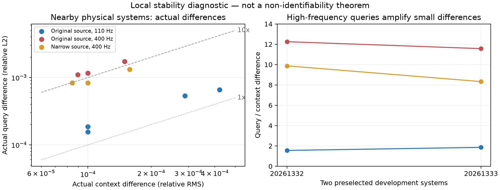

# 小的观测误差会被新query放大多少？

> 2026-10-03；两已有开发系统上的oracle诊断，不是新的学习任务，不触碰64冻结审计环境。

此前经典2000步改善了新源查询，说明优化不足是一个原因。但这没有回答另一个科学问题：即使算法
足够好，观测本身很小的变化，会不会对应更大的高频响应变化？这涉及稳定性，不等于证明解不唯一。

## 不构造任意“作弊扰动”

只改变原数据生成器的三个Gaussian声速体：每个有幅值、两个中心坐标、两个宽度，共15个实参数。
背景、源、边界全部不变。不会在1024维latent里随意加入训练物理族根本没有的高频噪声方向。
构造的两个环境均保持原参数取值范围，每个端点的归一化参数变化上限0.02。

先用中心差分计算“参数变化如何改变观测”的Jacobian（可理解为各参数对响应的灵敏度表）。固定
两种差分步长1e-4与5e-5，二者相对差须≤1%，否则停止解释，不能拿不可靠导数讲物理故事。
观测是原宽源60/100/140Hz、65距离剖面；查询为原源110Hz/400Hz与2m窄源400Hz。

计算一个局部方向，使query响应变化相对于context变化尽量大；只用很小的固定矩阵正则避免数值
奇异。随后真的生成这两个扰动介质的响应，检验**非线性的实际差异**，而不只报告Jacobian预言。
预定context扰动尺度1e-4/1e-3/1e-2，若触及参数边界就缩小，并明确报告实际幅度。

## 结果能说明什么

- 若观测差1e-3而新query差1e-2，可说明该例存在约10倍的局部放大；要求高频相位精度时必须提供
  更准确的信息或合适先验，不能只扩大输出图片。
- 若没有明显放大，也同样重要：不能继续把当前算法误差归因于“本质上无法预测”。
- 有限、带噪观测的稳定性，不等于无噪观测的非唯一性；两个context非常接近，不等于完全相同。
- 两例oracle构造不是数据集平均性能、不是泛化结果、不是新的信息论定理，也不证明神经先验有效。

本诊断使用模态Parseval范数对应连续深度L2；context用三个频率相对差的RMS，方便灵敏度计算。
它**不是**主榜的系统等权raw平均误差，不替换原指标。保留全部三个query与三个扰动尺度，不搜索
别的环境以挑出更戏剧化的例子。512传播单元/64模态的单向模型限制仍然适用。

该CPU诊断与独立评估共用机器，因此新评估的一次计时只作pilot，不用于精密加速结论。正式速度
认证需要之后在受控负载下复测；当下独立审计的主要对象是精度与泛化。

## 两例实际结果

| 查询 | 系统20261332局部放大倍数 | 系统20261333局部放大倍数 |
|---|---:|---:|
| 原宽源110Hz | 1.56 | 1.86 |
| 原宽源400Hz | 12.25 | 11.57 |
| 新窄源400Hz | 9.88 | 8.33 |

导数两种步长最大相对差3.59e-7，通过预定1%门槛；实际非线性成对扰动与局部预测一致。
但为保持原物理参数范围，大多请求的1e-3/1e-2观测差被缩小；400Hz案例实际context差仅约
8.4e-5–1.58e-4，query差约8.3e-4–1.81e-3。**不能把没有实现的1%扰动对应10%误差写成实测结论。**
窄源也不总比宽源更不稳定。这个结果支持高频query更敏感的局部诊断，不证明全局非唯一性，
不解释所有当前学习误差，也不证明特定网络必要。

第一次执行在写入numpy布尔值时失败；保留失败目录，修复为Python标量后完整重跑。
有效结果在`artifacts/coherent_waveguide_local_stability_retry_20261003/`，原失败目录不作完整证据。

每个点来自真正重新传播的两种介质，不是只用导数画出的假想误差；触及边界后重复的同一扰动对
只画一次。右图用每方向最小的预定扰动，不按更大幅度挑选放大率。单位仍不是主榜平均误差。
