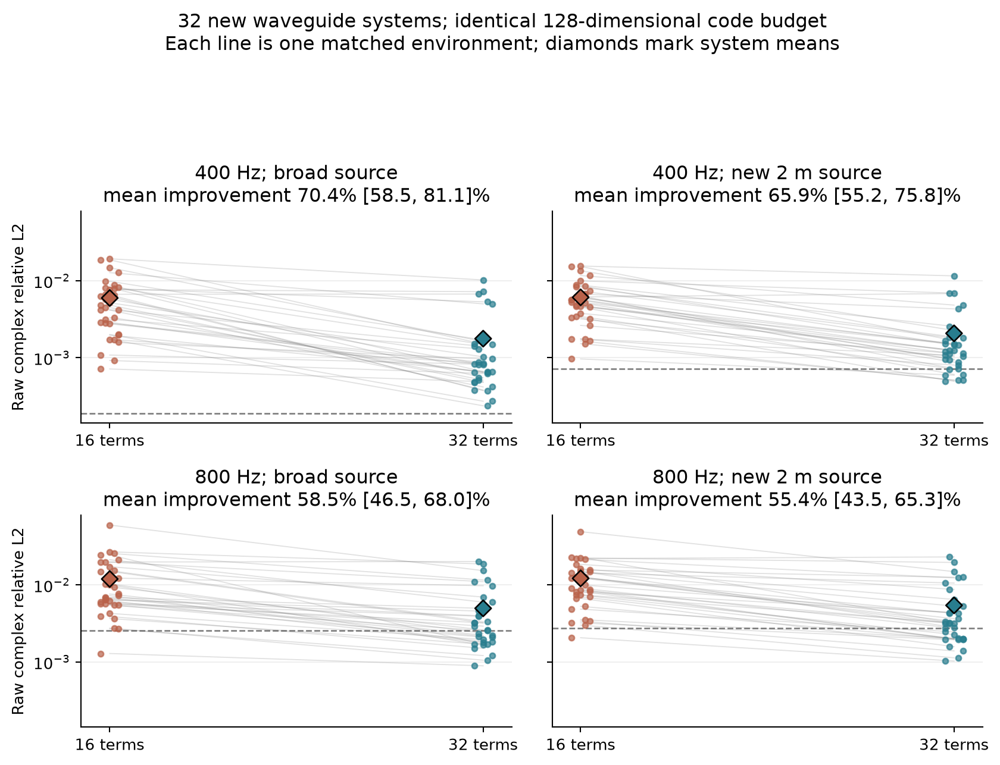
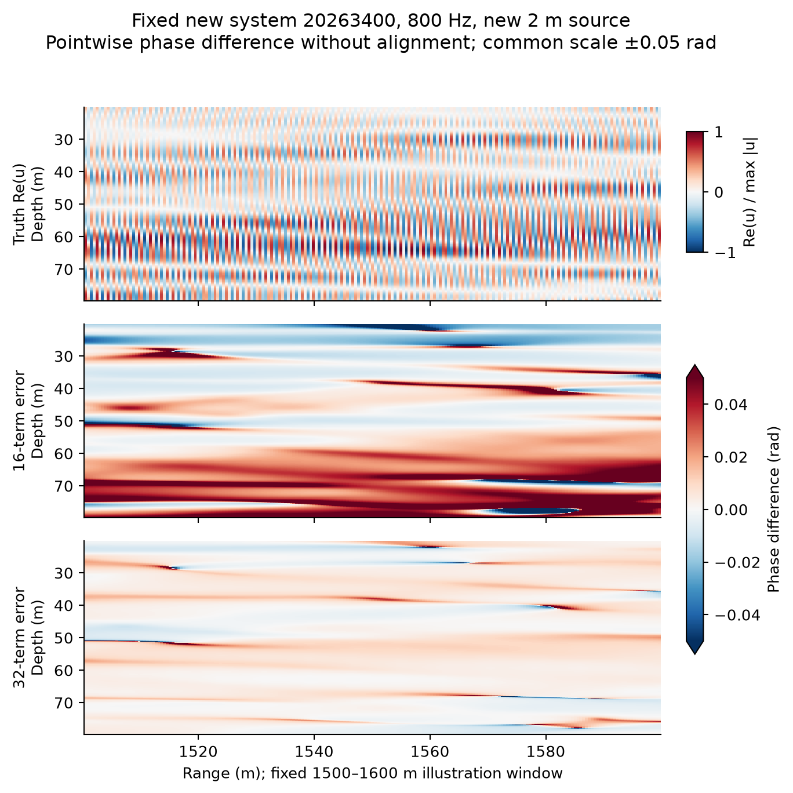

# 高频相干查询：新系统冻结复核协议

> 2026-10-04，生成新系统前登记。以下结果在32系统全部完成后填写；原方法/config/source SHA见冻结manifest。

## 问题和数据身份

前8个开发环境显示：只用60/100/140Hz观测识别128维实生成器，同一代码改用128传播模态，
新2m声源800Hz的raw complex相对L2约0.00356；32模态约0.371。该结果需要独立环境复核。

新系统固定seed20263400–20263431，共32个；不与训练512、原开发8、此前冻结64及数值审计重叠。
不按环境难易筛选。背景、边界、源参数属于公开模型设定；真实扰动介质仅供teacher及注明的oracle。
观测为原宽源60/100/140Hz、65完整深度剖面；新声源没有观测，目标400/800Hz均零目标观测。
真值在4097个偏移距离和513个深度坐标直接求解。保留>=50m完整ROI、raw complex L2主指标、
幅值与能量加权圆相位辅指标，无相位配准。

## 生成前固定的方法

从原512个训练介质得到两个线性统计先验：128坐标、64距离中心×16或×32深度项。旧16项先验
从观测物理统计量取得初值，再做5次全轨迹Gauss–Newton；两候选均从这个代码出发，连续读出
至256段，再各做5次同观测Gauss–Newton。查询时都用128传播模态及同样384点深度积分。
新32项候选的额外自由度只来自训练期更细的介质标签与更大的共享basis；每环境代码仍128，
不隐瞒离线存储/读出成本。算法、rank、校正步数和源/频率/距离范围均由旧开发实验固定。

强控制：16项同成本相同校正；真实介质32/64项投影oracle及完整介质已知oracle额外使用
测试介质，绝不参与推断。完整先验与后补GN并非原冻结64审计的预注册候选；本新集合单独
登记，不能混称为那次64环境的结果。

## 数值门槛与记录

新系统teacher为1024距离段、160模态、384点积分；独立seed20263500/1/2在400/800Hz检查
2048段、192模态、512点积分。预设复模态raw差<0.001才解释结果。额外检查GPU双精度批量
特征分解与独立SciPy逐单元实现的数值一致性。

生成前保存配置/方法源码/训练先验与数据清单的SHA256；任何代码修复要在结果里注明并重新审计，
不因看到测试误差改变超参数。保存全部32系统和各频率数据的hash、每环境每方法raw/相位/时间，
按物理系统做配对区间。该实验验证已有表示机制的独立稳健性，不构成深神经方法胜出。

## 结果

32个系统与64份目标NPZ均已生成并评价，640行逐系统/方法/频率/声源结果完整。3个独立数值系统×两频率的1024段/160模态对2048段/192模态比较，最大未配准复模态raw误差为**2.50e-5**，通过预设0.001门槛；GPU双精度特征分解与SciPy逐段参考差约1.8e-13。来源本实验artifact的freeze_manifest.json和数据目录convergence.json，其中候选源码/训练先验hash在新真值生成前已保存。

| 查询 | 16项raw | 32项raw | 相对改善与95%系统配对bootstrap区间 | 32项相位RMSE(rad) | 32项最大系统raw |
|---|---:|---:|---:|---:|---:|
| 400Hz宽源 | 0.005966 | **0.001767** | 70.4% [58.5%, 81.1%] | 0.001267 | 0.01024 |
| 400Hz新2m窄源 | 0.006084 | **0.002072** | 65.9% [55.2%, 75.8%] | 0.001509 | 0.01157 |
| 800Hz宽源 | 0.011958 | **0.004967** | 58.5% [46.5%, 68.0%] | 0.003987 | 0.02018 |
| 800Hz新2m窄源 | 0.012180 | **0.005429** | 55.4% [43.5%, 65.3%] | 0.004254 | 0.02314 |

均值对32个物理系统等权；10,000次bootstrap按系统成对重采样，不把每个频率/声源当独立样本。每组均31/32系统获益，**同一系统20263421四组均轻微退化**：800Hz窄源由0.02204变0.02314。真实介质32项的额外信息oracle在800Hz宽/窄源为0.002540/0.002735，真实64项约0.000314/0.000341；这些不是同信息可部署对手。原32项代码在800Hz的31/32获益表明增加垂向物理带宽有稳健效果，仍有低阶环境识别与更高阶带宽空间。

第二图预先固定首个系统20263400、1500–1600m、深度20–80m；两张误差图同色标±0.05rad。仅展示时遮罩真值幅值低于此局部最大值0.1%的像素；**主数值无幅值遮罩、无全局相位对齐**。上述显著改善是16→32项的统计先验+物理读出，不是相对最强已知生成族反演或跨物理域神经方法的胜利。该合成环境恰由15个隐藏Gaussian参数生成，故另补做[已知生成族的额外结构上限](GENERATOR_KNOWN_FAMILY_BASELINE_ZH.md)；不能把本结果推广成复杂海洋或多向散射场普遍有效。
