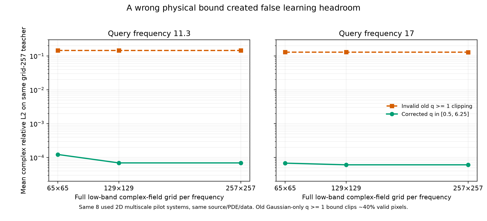

# 真正二维回散射的多尺度介质：只做M0数据与数值门槛

> 2026-10-04，运行前协议。代码与配置先提交、再生成真值。此处**不是**学得声速方法的第二域成绩，也不是独立论文测试集；目的是验证下一轮更合理的二维数据源能否快速建立且数值上可用。

旧二维Helmholtz只有4个轴对齐Gaussian扰动，加上完整65×65低频复场、已知源和边界，经典正弦谱识别再求新频率已到约1e-4；拿一个神经模型对弱四阶差分0.018比较没有意义。下一域应更接近“未知复杂环境＋有限响应”的需求。[完整下一阶段POC设计](NEXT_CROSS_PHYSICS_POC_ZH.md)要求512/64/64训练验证封存系统、有限接收线和强PDE-MAP对照，这次M0 pilot**没有**实现这些条件。

本试验保留原二维含回散射Helmholtz、公开源/海绵边界/频率定义，改为每环境16×16随机多尺度余弦纹理＋3个局部小包体；纹理系数并不交给未来的模型，训练仅有独立512环境的65×65**声速标签**。另生成8个开发环境的257网格直接复场，观测频率6/10/14，未来查询11.3/17（Hz仅作无量纲频率记号，不能照搬海洋单位）。再用2个不同seed、257→513嵌套网格，在14/17检验数值误差。预设：完整主ROI[0.18,0.82]的复场raw最大<0.005，257网格最差每波长采样≥8、线性求解残差<1e-8。8个系统是**开发pilot**，不在上面调神经网络后称独立测试；若数值门槛失败，先调整solver/频带，再冻结后续正式数据协议。

所有生成中间产物和系统split写入artifact manifest，实际大NPZ留本机数据目录；训练标签与目标真值绝不混同。这个域与波导的一向传播方程不同，有真实二维多向传播/回散射；但这次仍是合成平滑介质、理想已知源/边界，绝非真实Ocean泛化。更重要的M1判断是：有限接收线输入时，与**同信息同预算的PDE约束反演、高维q-MAP**对照，是否存在学得非线性物理变量坐标对相位精度和泛化的可靠提升。

## M0结果：数值合格，尚无学习方法成绩

代码/数据协议提交`518ff59`后生成：训练介质网格标签512份（seed20269000–9511）、开发pilot复场8系统（20269600–607；每系统6/10/14/11.3/17五个直接求解频率）、独立数值审计2系统（20269700–701；14与17）。pilot257网格最差每波长采样**12.17点**，线性求解残差最大约**3.20e-13**。两个审计系统在257→513嵌套网格、完整ROI的4个复场raw为0.001177、0.001984、0.000990、0.001498，最坏**0.001984<预设0.005**；M0三项数据/数值门槛全过。注意下面的约1e-4经典误差是**相同257离散teacher**之间的误差，不代表连续物理场本身已达1e-4。

本机大数据路径：`/mnt/data/xuangu-fang/physics-informed-tensor-learning/datasets/coherent_helmholtz_multiscale_pilot_20261004/`，包含512×65×65实速度标签NPZ以及8个每份5×257×257复场NPZ。artifact[`manifest.json`](../artifacts/coherent_helmholtz_multiscale_pilot_20261004/manifest.json)列出全部种子、源码和9个数据文件SHA；[数值summary](../artifacts/coherent_helmholtz_multiscale_pilot_20261004/summary.json)与逐频审计JSON在同目录。没有生成64验证/64封存系统，也没有任何新网络或跨方程方法结果。

补充一个不借助新模型的**完整场强经典对照**：对上述已生成8个pilot系统，取三个频率的完整65×65复场，隐藏纹理系数和所有Gaussian幅值/位置，仍公开源、边界损耗和方程，用正弦谱导数逐点识别实慢度，再由同PDE查询11.3/17。配置/源码在运行前提交见[`configs/coherent_helmholtz_multiscale_fullfield_classic_20261004.json`](../configs/coherent_helmholtz_multiscale_fullfield_classic_20261004.json)。这不是主任务的有限接收线设置；若误差已接近数值底噪，不能为了找学习优势只换一个更复杂介质而保留完整场信息。

旧系统65×65完整场经典方法接近数值底噪，而新pilot同信息条件初步误差很大。为了避免把空间欠采样/求导失真包装成神经表示机会，再固定**同8旧pilot**完整复场观察网格65/129/257的正弦谱识别对照；方程、三个低频、两个查询和目标真值都不变，隐藏介质系数，65结果需严格复现。配置见[`configs/coherent_helmholtz_multiscale_sampling_audit_20261004.json`](../configs/coherent_helmholtz_multiscale_sampling_audit_20261004.json)。更高网格给更多观测信息，不是和65模型的同信息排行榜；只定位机制。

**重要运行中纠错：** 原旧Gaussian数据只允许声速低于背景，故继承的经典代码硬裁`q≥1`；新纹理有局部声速高于背景，初版完整场基线约40%像素被错误裁掉。这使初版0.13–0.15 raw**不构成强基线失败或learning机会**；即使增到257完整观测也不变，是先验物理范围错，而非必然分辨率错。初版脚本/配置/结果留档，不覆写。修正版只改统一的慢度平方允许范围为`[0.5,6.25]`，三个观测网格均重新评估，公开源/边界/方程、目标与split不变；配置/源码见[`configs/coherent_helmholtz_multiscale_sampling_corrected_20261004.json`](../configs/coherent_helmholtz_multiscale_sampling_corrected_20261004.json)。修正结果出来前暂停任何新域方法结论。

## 纠错后完整场强基线：同信息下几乎没有学习余量

修正版在8个**已用开发**系统上的raw/相位系统宏均值（查询11.3 / 17）：

| 3频完整复场观测网格 | raw 11.3 / 17 | 相位RMSE 11.3 / 17 | 平均裁剪率 |
|---|---:|---:|---:|
| 65×65 | **0.000123 / 0.0000684** | 0.000101 / 0.0000608rad | 0 |
| 129×129 | 0.0000695 / 0.0000610 | 0.0000689 / 0.0000555rad | 0 |
| 257×257 | 0.0000695 / 0.0000610 | 0.0000688 / 0.0000555rad | 0 |

初版`q≥1`错误裁剪的65×65 raw曾是0.145/0.129，裁剪约40%–45%；该结果仅作错误审计，**不能作为论文强对照**。修正后65→129在11.3略改善、17几乎不变；完整低频复场加已知源/方程使经典正弦谱识别几乎重现同网格teacher。结论比“新介质更复杂所以有learning headroom”相反：**即使改成多尺度二维回散射介质，完整场这个信息设置仍太容易。** 下一阶段必须先固定有限接收线/噪声与同信息强PDE-MAP、正则化q对照，再谈学习必要性；不要仅因为把输入变稀疏后弱插值基线变差就宣称AI创新。[纠错后48行](../artifacts/coherent_helmholtz_multiscale_sampling_corrected_20261004/results.json)与[SHA manifest](../artifacts/coherent_helmholtz_multiscale_sampling_corrected_20261004/manifest.json)；初版[错误审计](../artifacts/coherent_helmholtz_multiscale_sampling_audit_20261004/summary.json)保留可追踪。

纠错运行时的`public_spec` helper版本见提交`68bc0f2`；本地后续又将它加固为**显式删除全部隐藏介质纹理与包体位置/宽度/幅值**。因经典估计器仅使用从公开source/loss/BC算出的两项，单元测试验证删前删后这两项逐元素完全相等；这是一项防未来误用的代码卫生改动，不是对已报告结果的重调。

为避免“经典完整场能解”被误读成“介质变化对波场影响很小”，再做一个**描述性难度诊断**：相同已知源/边界/PDE，完全不利用低频观测，只用均匀背景预测目标查询场；它衡量异质性实际造成多大复场变化，**不是同信息强基线**。固定两个查询频率和已用8开发系统，配置见[`configs/coherent_helmholtz_multiscale_background_diagnostic_20261004.json`](../configs/coherent_helmholtz_multiscale_background_diagnostic_20261004.json)。
