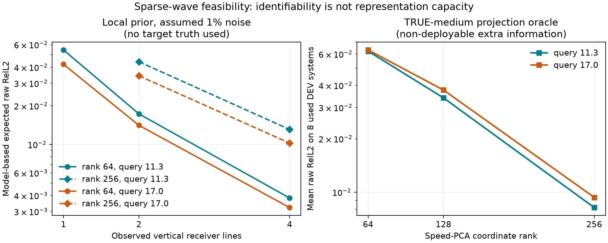

# 四线观测的局部信息量与声速表征容量：两件不能混为一谈的事

> 2026-10-04，已用8个二维Helmholtz开发系统上的**事后机制审计**；没有新独立测试、没有四线非线性反演或神经方法分数。先读[四线任务与公开输入](HELMHOLTZ_SPARSE_CONTEXT_ZH.md)。本页是下一阶段可行性判断，不是论文主结果。

## 为什么同时做两项检查

少量传感器能否回答新频率复场，至少有两个独立瓶颈：**表示容量**——环境代码能否装下造成相位差的介质变化；**辨识**——给定四线低频响应，能否可靠推断这个代码。低维代码通常更容易辨识，却也更容易遗漏相位敏感的介质方向。仅看传感器Jacobian或仅看PCA方差都会错过这个权衡。

## 检查A：局部线性化下的观测信息（不读目标/真介质）

用512份训练声速标签学习64或256维标准化PCA先验，在**训练介质平均场**和第一个开发系统的**公开声源**处，对已知二维Helmholtz方程精确线性化。设标准化坐标`z`的先验协方差是单位阵；低频四线响应的切线矩阵为`J_L`，目标查询场的切线矩阵为`J_H`。在每个频率各自按响应RMS加入假定1%复高斯噪声时，线性高斯后验协方差为`(I + J_L^T Σ^-1 J_L)^-1`，再由`J_H`传播到完整ROI的raw和相位**预期标准差**。导数用对声速的隐式PDE求导，已由有限差分单元测试校验。配置/代码在`fd8a459`先于64维结果运行、256维追加协议在`686b09b`先于追加结果运行；[64维完整噪声/线数表](../artifacts/coherent_helmholtz_sparse_linear_info_20261004/results.json)、[256维完整表](../artifacts/coherent_helmholtz_sparse_linear_info_rank256_20261004/results.json)与各自manifest保留SHA。

| 假定1%复噪声；模型内预期raw | 2线11.3 / 17 | 4线11.3 / 17 |
|---|---:|---:|
| 64维声速先验 | 0.0173 / 0.0141 | **0.00382 / 0.00322** |
| 256维声速先验 | 0.0441 / 0.0343 | **0.0131 / 0.0102** |

这里的1%只是统计假设，**没有给已保存的公开NPZ实际加噪**。结果是局部平均环境、线性PDE切线和准确高斯先验下的*模型内不确定度*，不是对任何开发环境的测得重建误差。129网格切线亦不能作为257教师精度证书。256维更多真实介质方向导致同样四线下后验余量更大，是容量—辨识权衡的方向性证据；不能用这张表说四线方法已经达到0.01。

## 检查B：真实介质投影容量（额外信息、不可部署）

在**同8个已用开发系统**，额外读取真实测试声速，把65网格介质欧氏投影到从同512训练标签学得的64/128/256维PCA子空间，再插值到257网格并用真实已知方程直接查询。结果完全绕过四线编码器，**是带真介质信息的oracle，不是有限观测算法**；欧氏投影也不是该子空间最优响应误差下界。[逐系统64行、配置和SHA](../artifacts/coherent_helmholtz_sparse_capacity_oracle_20261004/summary.json)，代码`e0cdbe6`预提交；长计算分批恢复的实现提交`0b17a92`，不改变投影/求解公式。

| 读取真实介质的投影 | 11.3 raw / 相位rad | 17 raw / 相位rad |
|---|---:|---:|
| 64维 | **0.0623 / 0.0480** | **0.0633 / 0.0468** |
| 128维 | 0.0340 / 0.0225 | 0.0376 / 0.0236 |
| 256维 | **0.00819 / 0.00546** | **0.00935 / 0.00598** |
| 直接读取真实65网格声速并插值 | 0.0000112 / 0.00000790 | 0.0000116 / 0.00000794 |

64维在局部四线高斯模型内看似只有约0.003–0.004不确定度，但该坐标连**读取真实介质**的8环境平均复场都留下约0.06误差；这直接否定“低维信息量小，所以四线实际重建必然容易”的推理。256维真介质投影则约0.008–0.009，给后续高容量方法留出精度空间；但它接近合成器的256个随机谱自由度，谈不上强压缩，并且四线低频推断并未验证。

## 本轮较稳的科学判断与下一步停止条件

传统逆问题的线性代数已告诉我们：观测Jacobian弱方向会留下不确定性，截断表示会留下不可消除的偏差。这是**已有理论**。本轮新增的、严格限于该数据与协议的量化事实是：从64到256维，真介质投影的目标复场误差约降7倍，而四线1%噪声下的局部辨识误差同时约增3倍；二者的理想化数值不能直接相加或当实测误差。该图让后续目标更具体：寻找一种**容量足够、四线可稳定识别**的环境坐标，并同正确物理范围的PDE-MAP、正则化高维`q`、声速PCA及非线性学得先验比较。

下一步必须先在这8个开发系统做实际的四线**非线性**反演，在无噪声和预先固定的小噪声下报告完整ROI、两查询频率、所有系统与成本。若强同信息经典方法达到教师数值底噪，不要为了学习优势继续堆模型；若经典方法与有监督学习之间有真实且稳定的余量，才生成新64验证/64封存系统并训练最小learning模块。本页所有结果都不能算作跨物理域学得方法gate通过。
