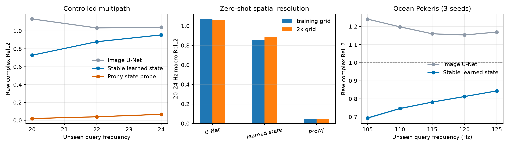

# 震荡复数场表征学习 POC

> 状态：历史阶段记录。连续生成元、稠密 Ocean 和半整数查询已经完成；当前结论请以
> [连续复谱状态](CONTINUOUS_SPECTRAL_STATE_ZH.md) 为准。本文保留用于追踪离散递推 POC 与失败归因。

更新时间：2026-09-15。本文同时记录预先问题、失败分支、最终 POC 和下一步判断。

## 1. 结论先行

这一阶段回答的问题是：

> 对高频震荡复数场，显式保存复相位对称性和频率传播状态的表示，是否比把实部/虚部当作
> 普通图片压进 U-Net bottleneck 更适合跨频率预测？

当前答案是 **GO，但需要重新定义 latent**：

1. 自由的 learned delay dictionary 虽能拟合训练查询，却不能外推；仅把 decoder 写成
   指数形式，不会自动产生正确传播表示。
2. 在受控三路径震荡场上，一个解析有限阶谱状态探针把 20–24 Hz 未见查询的 raw complex
   RelL2 做到 0.043，并在两倍空间分辨率上保持 0.043。这证明紧凑、resolution-independent
   的传播状态确实存在。
3. 由网络学习局部稳定谱状态后，matched 参数量下，合成场 raw error 从 U-Net 的 1.069
   降到 0.854；Ocean 105–125 Hz 三 seed 平均从 1.184 降到 0.776，下降 **34.5%**。
4. 学习模型在 Ocean 每个频率的 32/32 validation environments 上都优于 matched U-Net。
5. 新模型对共同复相位旋转近似严格等变；Ocean 等变误差约为 `6.5e-5`，普通 U-Net 约为
   `2.5e-1`。

因此最值得继续的对象不是“wavelet 版 U-Net”，而是：**由可见频带自监督辨识的稳定复谱
状态，以及从该状态出发的 query operator。** 当前递推 decoder 只支持频率 lattice，是
POC 而不是最终连续算子。

## 2. 第一性原理

局部多路径波场可表示为：

$$
u(x,f) ≈ Σ_k a_k(x,f)e^{i2πfτ_k(x)}.
$$

若包络在短频带内缓变，并令 $u_n=u(x,f_0+nΔf)$，有限个指数模态满足有限阶线性递推：

$$
u_n(x)=Σ_{r=1}^{R}c_r(x)u_{n-r}(x).
$$

递推系数的特征根编码衰减和单位频率步上的相位旋转。它们比某个频率上的 Re/Im pixels 更
接近跨频率稳定的传播状态。

这个表示还应满足共同相位等变性。如果所有可见场同时旋转：

$$
u(x,f_j) → e^{iγ}u(x,f_j),
$$

那么输出也必须旋转相同角度。用于估计传播状态的量应是不变量，例如模长和相邻频率复相关：

$$
R_j(x)=u(x,f_j)u(x,f_{j-1})^*/|u(x,f_j)u(x,f_{j-1})^*|.
$$

普通 Re/Im U-Net 不保证这种结构，四次空间下采样还会直接丢失高频相位条纹。

## 3. 最小学习模型

### 3.1 Invariant full-resolution encoder

Encoder 的输入包括：

- 每个可见频率的场幅值；
- 相邻频率归一化复相关的实部和虚部；
- 物理介质与空间坐标。

这些输入对共同相位旋转不变。网络只使用全分辨率 dilated residual convolutions，不对原始
波场做 pooling。它输出每个空间位置的 $R$ 个复递推系数 $c_r(x)$。

### 3.2 Stable complex state

为避免长程递推数值爆炸，对系数施加结构化投影：

$$
Σ_r|c_r(x)| ≤ 1.
$$

这是模型参数化，不是额外 loss。它给出了一个简单的充分稳定条件。实际复波场状态始终由原始
复场承载，因此 encoder 只估计相位不变的传播规则，不负责重新生成绝对相位。

### 3.3 Query decoder

从最高可见频率开始，使用同一组系数逐个频率步推进，直到查询频率。训练损失包含两部分，
但二者都是完全相同的 raw complex reconstruction：

1. 90/100 Hz 查询重建；
2. 在 74–80 Hz 可见带内用同一递推状态做一步重建。

第二项不是 amplitude/phase loss stacking，而是辨识“一步生成元”所必需的自监督约束。若只
监督 90/100 Hz，相对 80 Hz 分别为 10 和 20 个步长，模型无法区分某些相位分支。

当前 decoder 只能查询 $Δf$ 的整数格点。下一阶段应将稳定 companion state 分解为复根，
再通过连续指数作用支持任意实数频率；POC 不提前实现这一层。

### 3.4 Matched image baseline

Baseline 接收完全相同的频率集合、介质、坐标、查询、样本和训练轮数，把 Re/Im 拼接后输入
现有四尺度 U-Net。Ocean 中两者参数量分别为 310,282 和 309,210。

## 4. 受控合成实验

每个场由三个带 Gaussian 慢变包络的传播分量叠加，delay 含随机截距、方向、slowness 和弱
曲率。使用 1–14 Hz 作为可见频带，16/18 Hz 选择 checkpoint，冻结后评估 20/22/24 Hz。
训练网格为 32×64，并在同一连续数据分布的 64×128 网格直接评估。

| 表示 | 原网格 20–24 macro | 两倍分辨率 macro | 共同相位等变误差 |
|---|---:|---:|---:|
| Image U-Net | 1.069 | 1.059 | 3.99e-1 |
| Learned stable state | **0.854** | **0.888** | 4.56e-5 |
| 解析 Prony state probe | **0.043** | **0.043** | 2.36e-6 |

解析探针不是最终方法，而是 representation existence proof：当数据确实由少量 damped complex
exponentials 组成时，有限阶复谱状态几乎完整保留了外推信息，而且不绑定像素分辨率。learned
state 与探针之间仍有很大差距，说明瓶颈在状态辨识，不在 decoder 表达能力。

## 5. Ocean Pekeris 三随机种子

输入为 74–80 Hz 七个连续频率，90/100 Hz 用于训练和选择，105–125 Hz 是开发性外推窗口。

| 未见查询 | Image U-Net | Learned stable state | 相对下降 |
|---:|---:|---:|---:|
| 105 Hz | 1.241 ± 0.001 | **0.694 ± 0.003** | **44.0%** |
| 110 Hz | 1.198 ± 0.001 | **0.747 ± 0.002** | **37.7%** |
| 115 Hz | 1.160 ± 0.001 | **0.782 ± 0.001** | **32.6%** |
| 120 Hz | 1.153 ± 0.001 | **0.813 ± 0.001** | **29.5%** |
| 125 Hz | 1.169 ± 0.001 | **0.844 ± 0.000** | **27.8%** |
| 五点平均 | 1.184 | **0.776** | **34.5%** |

三个 seed 的 state model 五点 macro 分别为 0.7754、0.7749、0.7781，方向稳定。逐环境比较
时，每个查询频率均为 32/32 environments 改善。

这不是对原 M1 的完全替代：它使用七个低频场，而 M1 使用 79/80 Hz 两个场；M1 在最近的
105/110 Hz 仍更低。新结果证明的是“结构化复谱状态优于 matched image representation”，
不是当前模型已经胜过所有旧模型。

## 6. 关键失败与归因

### 6.1 自由 delay dictionary 不会自动学出生成元

第一版模型将输入投影到 48 个可学习 delay channels，再用指数 decoder 查询。它在合成场
16/18 Hz 的 error 达到约 0.30，但 20–24 Hz 又回到约 1.03。原因是有限训练查询允许许多错误
delay mixtures 插值相同点。物理形式的 decoder 只是必要条件，不提供可辨识性。

### 6.2 只监督偶数步会产生谱 alias

不使用可见带一步重建时，Ocean 模型在 105/110/115/120/125 Hz 得到
1.575/0.742/1.484/0.814/1.416，呈现明显奇偶振荡。90/100 Hz 只约束传播算子的第 10 和
第 20 次幂，无法唯一确定一步相位分支。加入可见带自监督后，曲线变为连续的
0.693/0.745/0.781/0.813/0.845。

### 6.3 逐像素 Prony 在真实场上数值不稳定

直接在 Ocean 每个像素拟合低阶 Prony 递推会爆炸。真实多路径数、谱零点、包络变化和噪声使
局部小矩阵严重病态。这说明学习的空间正则化是必要的，也说明不能把 learned state 过度解释
成唯一真实路径。

## 7. 与相关工作的关系

- [Wavelet Neural Operator](https://arxiv.org/abs/2205.02191) 用通用离散小波参数化积分核，
  重点是空间局部多尺度表示；它没有按物理频率辨识复谱状态。
- [MscaleFNO](https://arxiv.org/abs/2412.20183) 用并行尺度化 FNO 缓解震荡函数的 spectral
  bias，是后续必须加入的高频 baseline；其 latent 仍是多尺度空间 Fourier features。
- [Physics-informed neural wavefields with Gabor basis functions](https://arxiv.org/abs/2310.10602)
  证明 Gabor 输出基底能帮助高频 Helmholtz PINN，但对象是单实例 PDE solution，不是多频
  条件到连续查询的 learned operator。
- [High-frequency wavefield extrapolation using FNO](https://academic.oup.com/jge/article/19/2/269/6576250)
  已经研究有限低频分量到高频波场，因此“低频到高频”本身不是新颖性；区分点必须是采样
  可辨识性、复相位等变和结构化谱状态。
- [Koopman Neural Operator](https://arxiv.org/abs/2301.10022) 在 latent 中学习简单演化，支持
  spectral state 的总体思路，但针对时间动力系统，并未处理复波场的频率相位结构。
- [Wave Interpolation Neural Operator](https://openreview.net/pdf/da67acab5d6d31d6d81c585fd513e9051a8a781d.pdf)
  对未训练波长的电磁场做区间内插值，是 query-conditioned wave operator 的直接相关工作；
  我们关注训练频带以外 continuation。

当前检索没有发现与“由跨频率不变量估计全分辨率稳定 complex spectral state，再查询频带外
复场”完全相同的架构。但这只是阶段性 novelty audit；继续投入前还需系统覆盖阵列信号处理、
无线信道估计、matrix pencil 和 system identification 文献。

## 8. 下一步判断

下一步不应立刻增加方向、wavelet、implicit decoder 和生成模型。最小顺序是：

1. 将离散稳定递推改成连续稳定谱生成元，支持任意实数查询频率；
2. 在同一 Ocean development protocol 下比较 discrete state、continuous generator、M1 和
   MscaleFNO；
3. 只在连续生成元仍明显受限于空间混叠时，增加频率归一化的局部 slowness/direction 维；
4. 方法冻结后，再生成新的 dense-frequency domain 和 strict environments。

因此这一 POC 的核心贡献不是当前 34.5% 数字本身，而是把下一阶段的研究对象从模糊的
“更好的波场 backbone”收敛为一个具体问题：**如何从有限复频谱中学习可辨识、稳定且连续的
传播生成元。**
