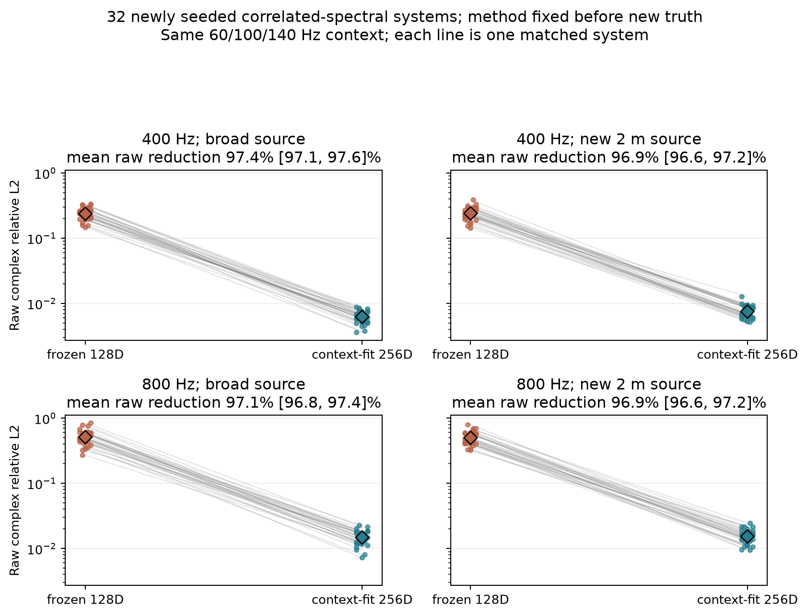
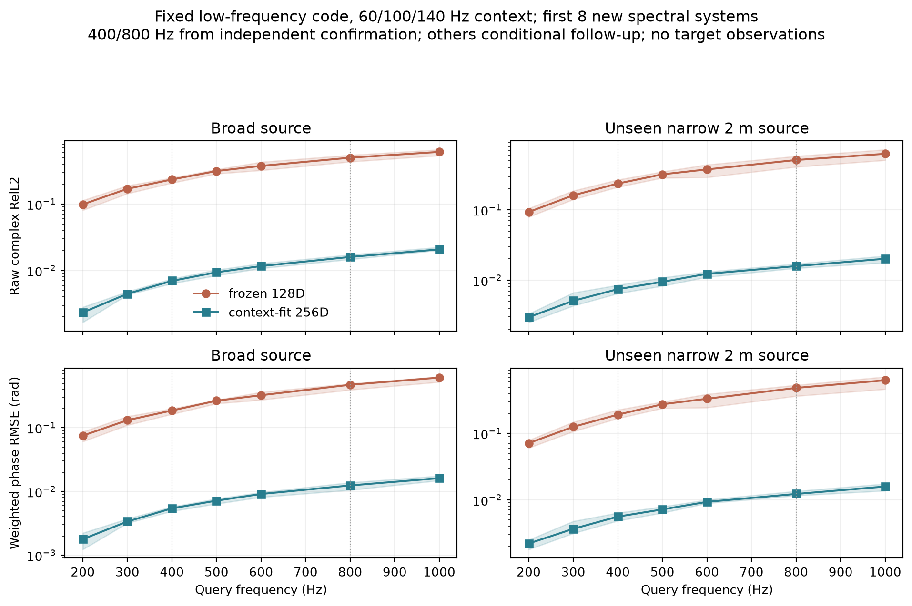
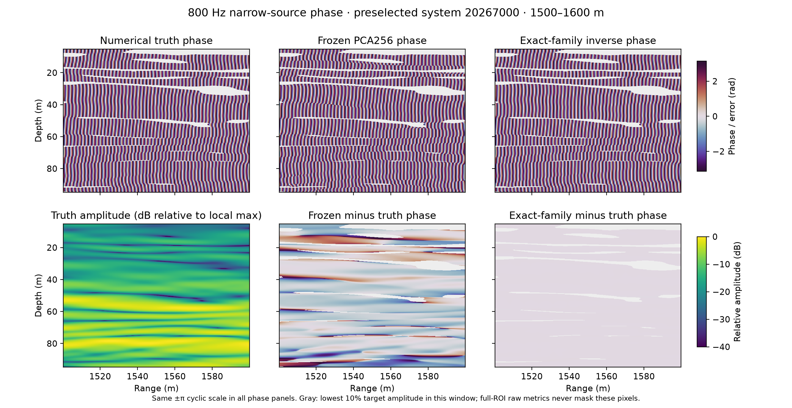
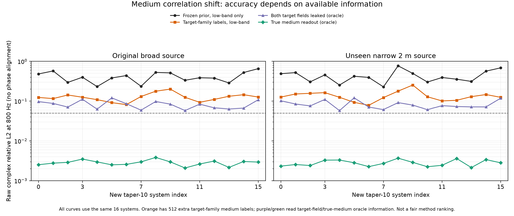

# 高精度复波场表示：截至2026-10-04的阶段判断

> 先读本页，再决定是否深入[完整进度报告](../reports/COHERENT_CONTINUOUS_REPRESENTATION_PROGRESS_ZH.md)。这里概括科学结论与下一阶段取舍，不把尚未成立的AI方法写成论文贡献。

## 一句话结论

**低频复场确实可能包含足够的信息，支持未观测高频、未见声源和连续坐标下的高精度相位查询；在当前合成族内，把学习放在“声速”而非“慢度平方”变量上，再接正确非线性物理映射，出现了强且经新环境确认的相位收益。** 但该表征仍靠近完整介质自由度与已知传播方程，并非已证实必要的新神经表征。知道合成介质精确函数族时，经典非线性反演仍更准。值得继续深入，但不该把同一物理域的成功直接包装成跨场景AI顶会主方法。

## 我们到底在表示什么

原愿景是表示任意查询下的复波场，而不是把每个频率的实部/虚部当作两张图。当前最强的实施路径实际上是**表示一个物理系统**：从同一环境在60/100/140Hz的宽源完整复场中识别一组介质/传播坐标，再用已知的一向波导方程回答400–1000Hz或新声源。它天然保持复数叠加和相位，但**物理解码器并非学得的算子**；因此“系统辨识＋物理查询”与“学习到通用波场隐空间”必须分开。

| 问题层次 | 当前证据 | 可以说什么 / 不能说什么 |
|---|---|---|
| 表示容量 | 16×16相关谱介质中，128维介质PCA解释99.8637%方差，但读取真测试介质的128维欧氏投影在800Hz仍有约0.39 raw；256维投影约0.008 | 介质MSE/方差不是相干相位证书；不能证明任意128维非线性表征不可能 |
| 低频可识别性 | 训练512介质的rank256先验＋相同低频观测和5+5次经典GN，在**新32系统**800Hz宽/窄源raw0.01475/0.01532、相位0.01123/0.01170rad，32/32系统胜过原128维 | 当前理想化统计族里信息充分；不能推成真实海洋、未知背景或稀疏带噪传感器可辨识 |
| 连续查询 | 固定同一代码，在新32固定前8系统200–1000Hz查询，1000Hz宽/窄raw0.02081/0.02016、phase约0.016rad | 不是只在400/800两点命中；但误差随频率增加，前8不是第二个独立集合 |
| 观测鲁棒性 | 旧8开发中17条干净剖面仍约0.018/0.019；1%复噪声原方案约0.172/0.178，改用已知源初态后约0.0845/0.0889；同改动在已用32环境复核为0.0862/0.0880 | 已用32的噪声条件预设门槛全过、宽/窄32/32与31/32改善，但最差仍0.127/0.149；并非现实水听器验证 |
| 学习必要性 | 若额外知道合成器真实16×16余弦**速度**函数族，经典精确非线性255参数反演在已用32系统800Hz raw0.00942/0.01033 | “训练PCA不可替代”不成立；但这个结构法有额外函数族知识，不是同信息公平榜 |
| 介质统计变化 | 固定训练谱尺度5的PCA256与5+5GN，在新16个RMS相同、谱尺度10的系统800Hz宽/窄raw0.416/0.435、相位0.374/0.404rad；0/16系统raw≤0.10 | 原固定方法的分布外gate**失败**；同一PDE而非第二域。真介质欧氏PCA投影仍约0.29，真实32项物理oracle约0.003，但投影不是最优响应代码 |
| 事后归因控制 | 为taper10另提供512个介质训练标签再拟合PCA256，低频部署raw0.127/0.137，仍不过0.05；直接泄漏800Hz双源目标共同适配旧PCA256，raw0.083/0.083 | 目标统计重训与目标场监督均明显改善，但都没有恢复高精度；后者完全不可部署、5步未收敛，不是容量下界 |
| 正确生成机制的物理上限 | **额外知道**真16×16余弦速度族及taper10，但不知测试系数/高频目标，也不用训练介质标签：同16系统低频反演800Hz宽/窄raw0.00388/0.00413，相位约0.003rad | 在这个密集无噪声、已知PDE/源的理想任务里，低频**可包含**高频所需信息；PCA失败不是信息论不可能。额外真函数族使其不构成同信息学习算法排行榜 |
| 最小学习变量机制＋新环境确认 | 同1024份介质网格标签、同255环境代码与低频5+5GN：学得声速基经正确`c^{-2}`映射，在**新16个taper7.5系统**800Hz宽/窄raw**0.00538/0.00505**、phase**0.00420/0.00391rad**；学得q-PCA为0.08068/0.08197，16/16系统raw≤0.05，所有预设门槛通过 | 证实该已知合成函数族的**统计插值**中选择学习变量很重要；不是第二PDE、非强压缩/深神经方法。精确已知合成族的经典逆解有额外信息，仍须保留；本结果不支撑通用方法论文 |
| 第二介质**统计族**边界 | 旧Gaussian局部扰动族，已用8开发系统、同512训练标签/rank128/低频5+5GN，声速法800Hz双源raw0.00322/0.00343，q-PCA0.00341/0.00353 | 只有5.7%/2.6%改善，逐环境各4/8胜，预设≥20%门槛失败；不能说换成声速在不同介质族均有显著增益，更不是第二物理域确认 |
| 固定代码到更高频 | 新确认前8个**已用**系统不再拟合，1200Hz原256段×128模态读出双源raw0.00674/0.00654、相位约0.005rad；512×192只降低raw3.2%/0.15% | 绝对相位依然准确，但“此频段主要缺输出分辨率”的事前≥20%门槛失败；不是新独立测试，也没有1200Hz q同频方法排名 |

另一个边界是原Gaussian族仅有15个隐藏参数；知道精确Gaussian生成族的多初值经典反演在旧8开发800Hz可到约0.00026。相关谱族增加到255随机系数，解决了“只有15参数所以太简单”的部分质疑，却也让256维几乎等于真实随机自由度，**不再是强压缩表示**。两者还是同一个一向波导PDE，不构成两个物理域。Ocean均匀层和异质Helmholtz上的早期空间/谱表示审计也显示强经典基或物理求解可以明显胜过神经候选；详见完整报告第2–4与第8–15节。

## 从第一性原理看，哪些结论稳，哪些不稳

传统波动物理告诉我们：传播相位会累积；在单一路径的粗略估计里，相速微小偏差造成的相位误差随频率和传播距离增长。因此“介质方差保留99%”本来就不足以保证高频复响应。这是**传统理论解释**，不是我们的新定理。我们新增的经验事实是：在一个明确的相关谱合成族和严格数值审计下，99.86%的介质方差仍对应约0.39高频相干误差，而近完整维度加低频物理反演可把独立系统误差降到约0.015；局部Jacobian重排128维也未解决全局问题。具体阈值、跨源和连续频率曲线来自我们的任务与数据，不能由那条传统量纲估计直接推出。

当前仍有三个不同的困难，不能互相借成绩：

1. **容量**：某种隐坐标是否能保存目标查询需要的信息？读取真实测试介质的投影只能回答这一层，而且欧氏投影不是最佳响应误差下界。
2. **辨识与稳定性**：只给有限、带噪低频观测，能否估准隐坐标？17条干净与1%噪声的反差说明信息数量与噪声/初态处理不是同一件事。已知源初态修正可把已用32系统raw均值从约0.15/0.16降到0.086/0.088，仍远不及无噪声的0.015。
3. **学习增量与可迁移性**：当真实函数族未知、方程不完美或系统发生分布转移时，学习模块能否超越同信息同预算的强经典反演？**目前没有通过。**

新完成的匹配RMS相关尺度5→10测试尤其重要：在训练统计以外，高频raw从同分布约0.015升到新系统约0.42，尽管方程、源和16×16余弦形式未变。它表明“同分布高精度”不能直接外推成“通用波场表征”。真介质的欧氏PCA投影也不保真，但这**不是**任意256维代码的严格失败证明：事后直接读取目标800Hz宽源、从该投影出发在同一子空间内适配5步，可把宽源raw从0.293降到0.075，未拟合的窄源仍0.223；再把窄源目标也泄漏给同一代码共同优化，两源都约0.083。后一数字不是部署、5步也未收敛，不能被称作子空间容量下界。它说明“拟合某一目标响应”和“形成可低频辨识、跨源查询的环境表示”必须分开。更值得警惕的是：即使用512份**新统计族标签**重训同维先验，低频部署还只有0.127/0.137；该新族训练介质PCA256解释99.99675%方差，真介质欧氏投影仍有约0.067/0.065高频raw。高方差保留仍不是相位证书，问题不只是忘了重新拟合旧PCA。

最强的归因控制又给出相反的正信号：若把这个合成器真正的余弦**速度**函数族及谱尺度告诉经典非线性反演，**不提供测试环境系数或高频目标**，同样低频输入可把新taper10族800Hz raw降到0.00388/0.00413。这使“低频信息完全不够，所以任何表示都失败”的解释站不住；但它不告诉我们在真实海洋、未知介质生成机制、噪声或不同PDE下也可识别。新的科学问题应是：**如何从跨环境数据学习一个能随介质统计变化而适配、同时保留波相位作用的生成机制坐标，而非把训练介质的欧氏方差主成分当作普适环境代码？** 这才需要学习；可学习性与优于强同信息物理基线仍待检验。

我们据此只更换了**一个学习变量**：从同1024份介质标签学习声速而非慢度平方的255维PCA，再精确映射`c^{-2}`，其他低频观测、5+5步物理反演和代码维数不变。已用16环境开发后，协议`5fe88a5`在任何新真值前冻结；**新16个**taper7.5环境800Hz宽/窄raw0.00538/0.00505，相位0.00420/0.00391rad，相比同信息q-PCA raw降低93.34%/93.84%，所有预设门槛通过。这是一个可信的**表征变量机制正结果**，但新taper位于训练5与10之间、仍是相同余弦合成族。即使共享声速基后续可借助数据学得的16深度方向函数张量分解无损压缩到q基约一半存储，255维环境代码仍近乎合成自由度；在线计算暂未因此变快，不能把PCA＋已知方程重新命名为通用现代神经算子。完整协议、成本和两张图见[新环境确认](LEARNED_SPEED_MANIFOLD_CONFIRM_ZH.md)、[报告第22节](../reports/COHERENT_CONTINUOUS_REPRESENTATION_PROGRESS_ZH.md)。

更重要的**反证边界**也已按独立协议做出：把训练/测试换成局部Gaussian介质家族，不改同信息rank128和5+5低频反演，声速法虽绝对raw约0.003，却只比强q-PCA改善5.7%/2.6%，未过20%增量门槛；逐系统各只有一半获益。该族也仍是一向PDE、使用旧8开发环境，所以不是另一个成功或失败的独立物理域验证；但它使“声速变量天然普遍更好”的表述**不成立**。见[Gaussian负结果](GAUSSIAN_SPEED_VARIABLE_DEV_ZH.md)。下一阶段应先明确何种介质复杂度/非线性变换造成q空间秩膨胀，再设计真正跨介质族和跨物理域的可学习生成机制，而非直接推出泛化性。

这里较深的解释可以用一行传统代数看懂：若`c = c_bg + delta_c`，那么`c^{-2}`包含`delta_c`的一次、二次、三次等交互项；一个在声速变量里近线性的环境族，在慢度平方里未必还是同维线性族。我们的**增量实验证据**是：混合余弦训练的q-PCA255仍保留99.99745%介质投影方差，高频raw却约0.081；Gaussian家族q-PCA128保留约99.999984%方差，raw已约0.0035，速度变量再改进很小。小方差残差是否造成大相位误差要由传播长度、频率和响应敏感性决定，不能只看介质PCA保留率。它解释当前现象的方向，但不是关于任意复杂介质/波方程的定理。

新做的**额外真介质信息oracle**把这一解释进一步钉实：余弦新16系统把真实介质欧氏投到冻结速度/q空间，800Hz双源raw分别约**0.0024 vs 0.076–0.078**；Gaussian旧8则两种投影都约**0.002–0.003**。余弦q介质系数相对投影残差仅0.00664，仍导致强相干相位误差；Gaussian q残差0.000469，响应较稳。四项预设机制检查通过，[逐系统图](../reports/figures/spectral_variable_projection_attribution.png)展示两族差别。**但欧氏投影不是响应最优容量下界**，且都直接读取真实测试介质，不能混入可部署结果；其价值是定位“表示变量”而非证明所有q参数化都失败。详见[归因协议](VARIABLE_PROJECTION_ATTRIBUTION_ZH.md)。

为避免把匹配255维的胜出误写成“q变量永远不能表示”，又在**同一批已用16系统**作[容量—辨识事后审计](Q_CAPACITY_ORACLE_AUDIT_ZH.md)：q-PCA真介质投影从rank255的约0.077变为rank768的约0.0031，但同低频反演无持续先验时反而约0.123；加入显式代码MAP后约0.032/0.034，仍未达到声速255的约0.005。rank768需3倍环境代码与q共享基。强MAP改善是实证，不能只引用无先验失败；后8复核仍是已用环境，不是新确认。最稳妥的解释是**学得的非线性物理变量坐标在这个合成族里同时给出较紧凑的表示与较稳定的低频识别**，不是一个普适的q不可辨识定理。未来跨域实验必须把高维、正则化q作为强对照。

新建的[二维多尺度Helmholtz M0 pilot](HELMHOLTZ_MULTISCALE_M0_PILOT_ZH.md)完成数值检查和可复用数据，但**没有第二域方法成绩**。完整65×65低频复场给经典谱反演的查询raw仍约0.000123/0.0000684；最初0.145/0.129是错用旧`q≥1`裁剪范围导致，不能作为学习优势。故下一轮必须改变有真实需求的观测条件（如有限接收线），不是对完整场再加一个网络；同时比较正确物理范围下的PDE-MAP与正则化高维q。

四线×65点×三个低频的[模型侧公开输入](HELMHOLTZ_SPARSE_CONTEXT_ZH.md)已从同8开发环境生成且剔除隐藏介质/随机种子。进一步的[局部信息—容量审计](HELMHOLTZ_SPARSE_INFO_AUDIT_ZH.md)显示：64维先验的四线1%假定噪声模型内查询raw预期虽仅约0.003–0.004，但**读取真实介质**的64维投影oracle竟约0.06；256维投影约0.008–0.009，四线局部后验预期约0.010–0.013。前者仅局部线性模型、后者不可部署；二者不等于实际重建。它收紧了下一步：要证明高容量环境坐标在有限观测下真实可辨识且优于强同信息物理逆解，而不是再单独夸低维压缩或理想化Jacobian。

后补的真实介质差值**一阶展开反证**表明，这个局部模型确实不能直接外推：8开发环境的11.3/17 raw仍0.238/0.251；129网格真实介质直接预测相对257教师的17误差也0.0285。下一轮四线方法和强经典对照应是**非线性的、数值收敛的257网格或等效精度**；不能再用129网格Born/Jacobian预期或完整场经典法的成绩替代实际有限观测比较。

固定确认集首8环境代码的1000/1200Hz附加测试又显示另一边界：在1200Hz，原256段×128模态读出raw仍约0.0066、相位约0.005rad；扩大至512段×192模态仅有3.2%/0.15% raw收益，预设≥20%分辨率收益门槛失败。这说明**至少到1200Hz、在这些系统和声源上**相位残差不主要由输出网格/模态数造成；它不否认更高频、更多散射或3D场需要适配分辨率。该实验不重新拟合代码、无q-PCA同频对照，详见[频率读出审计](SPEED_RESOLUTION_SCALING_ZH.md)。

这张**局部可视化**只为看相位条纹怎样漂移，不能代替完整ROI的raw。所有相位图和相位差统一使用±π循环色标；白/灰色是该视窗目标幅值最低10%的像素，仅在展示中遮罩，相应像素没有从完整ROI的主指标里删除。所选系统是新16环境里按seed排第一个，不是按效果挑的最好案例。

图中灰色虚线是0.05研究门槛，**不是**把五种信息条件放进一张公平方法排行榜。横轴16个系统相同，帮助看每个系统的方向与异常值；橙色额外用了新介质族512标签，蓝色知道真实合成函数族，紫/绿色直接读取目标场或真实介质。

## 下一阶段的最小可行方向，而不是再堆组件

我建议将下一个研究问题收成：**给定少量、可能有噪声的低频复响应和已知源，学习一个能够回答新频率/新源/连续坐标的相干传播表示；不预先告诉模型真实介质生成函数族，并明确检验介质统计发生变化时是否还能适配。** 海洋水声作为旗舰，再用异质2D Helmholtz（包含散射/反向传播）检验能否跨越一向波导假设。先把观测条件、源/介质/PDE哪些已知写死，避免把额外信息优势误算成学习优势。下一阶段核心不应只是让网络更像一张高分辨率图，而要让环境代码支持多个源的**同一传播算子作用**；单源响应oracle与双源共同oracle之间的差异给出了这个需求的直接实验动机，但不是方法创新证据。

方法从一个可消融的核心开始：让学习负责**环境相关的传播算子先验或局部生成元**，而已知物理负责复相位的组合与查询。可把距离或空间上的小块相干传输看成可组合的矩阵作用；共享网络从多频响应推断这些局部作用的分布或修正项，查询时按目标频率和空间分辨率组合。这样学习的对象不再是“某张场的像素”，且有机会适配3D/4D场；但它还只是下一阶段假设，不能把现有PCA+GN改名当成已经实现。不要第一轮就上flow、Transformer、多个loss；先与下列对照在一个域里测最小增量，过门槛再移到第二域。

**不可省的对照**：同信息PCA+已知源GN；公开函数族时的精确经典逆解；已知完整介质时的直接数值求解；合适的FNO/INR或函数张量；相同在线延迟/内存轴。主指标仍是完整ROI、不做全局相位配准的raw complex RelL2，分报幅值与能量加权圆相位RMSE，并在独立细坐标、频率和新源上检查数值收敛。一个有潜力的下一阶段gate是：在至少两个真正不同的物理域、未见环境，复杂介质且源已知的低频条件下，raw≤0.05（困难域可先≤0.10）、相位≤0.15rad，并相对最强同信息同预算基线稳定改善≥20%；1%噪声至少不比正确利用已知源的物理基线差。**这些是准入标准，不是现有成绩。**

## 复现和证据边界

主结果、所有失败与运行前协议见[相关谱介质记录](SPECTRAL_MEDIUM_STRESS_POC_ZH.md)、[谱统计分布外测试](SPECTRAL_TAPER_SHIFT_POC_ZH.md)、[学习声速确认](LEARNED_SPEED_MANIFOLD_CONFIRM_ZH.md)和[完整报告第21–24节](../reports/COHERENT_CONTINUOUS_REPRESENTATION_PROGRESS_ZH.md)；[第二物理域 POC 计划](NEXT_CROSS_PHYSICS_POC_ZH.md)只完成M0数据pilot与[四线开发输入](HELMHOLTZ_SPARSE_CONTEXT_ZH.md)，方法验证尚未实施。大NPZ在本机`/mnt/data/xuangu-fang/physics-informed-tensor-learning/datasets/`同名目录，训练标签/代码和JSON指标在`artifacts/`对应目录。阶段十一[post-run清单](../artifacts/coherent_stage11_inventory_20261004/inventory.json)覆盖31组数据、1194份本机复场/复观测NPZ（含同8开发系统的四线副本）、额外1份速度训练标签NPZ和218个artifact目录，但它不是运行前冻结证据；新32确认的[预真值manifest](../artifacts/coherent_waveguide_spectral_confirm_protocol_20261004/manifest.json)、学习声速新16的提交`5fe88a5`以及二维M0提交`518ff59`/启动manifest分别承担该职责。既有32环境被精确结构法与噪声条件复核再次使用，不能给它们第二次“全新test”标签；taper10新16与taper7.5新16虽各自独立，仍是同一PDE及合成器家族。
