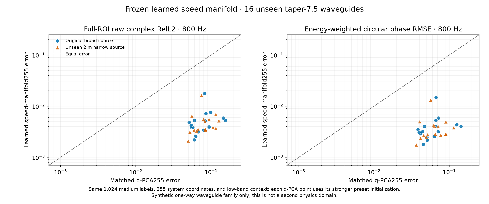
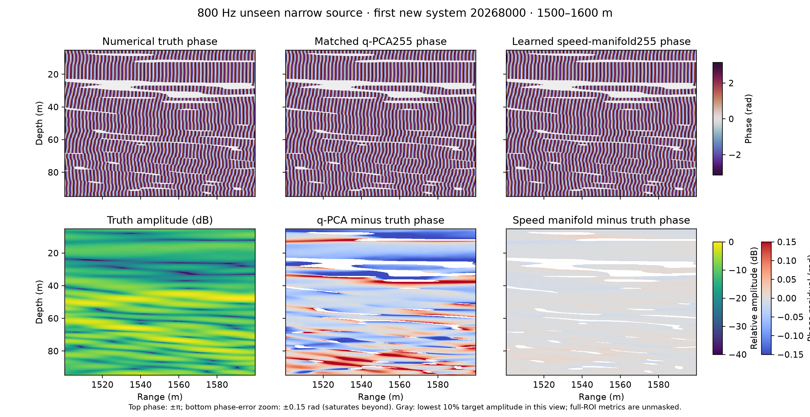

# 这一轮到底发现了什么？给 AI 背景读者的通俗解读

> 2026-10-05。本文重点解释**已经得到的正发现**，同时把实验给了模型什么、哪些数字是额外信息的诊断、哪些结论尚未成立讲清楚。建议先读本文，再按需查[完整阶段决策](PHASE_REPRESENTATION_DECISION_20261004_ZH.md)和[原始确认记录](LEARNED_SPEED_MANIFOLD_CONFIRM_ZH.md)。

## 先说结论

我们最可信的正结果不是“发明了一个能从任意低频猜出任意高频的网络”。它更准确地说是：

> 在一个已知波动方程、声源与背景的受控波导中，若从低频复响应推断的是**同一环境的声速表示**，再让物理方程负责生成新频率和新声源的复波场，高频相位可以非常准；而把同样的数据直接压成传播方程里的“慢度平方”线性坐标，在某种较复杂介质分布上会明显失准。

这个结果在**16个事先未使用的新环境**中复现：800 Hz 完整复场误差，声速表示约 **0.005**，同数据、同255维代码的慢度平方表示约 **0.081**。两个声源各16/16个环境都由声速方法获胜。不过，这16个新环境仍与训练数据来自**同一16×16余弦介质生成族**，只是相关尺度在训练的两个尺度之间；它不是跨波动方程或真实海洋验证，更不是深度神经网络已胜过所有经典方法。



## 1. 为什么“高频相位”特别难？

复数波场可以粗略写成`u = A × exp(iφ)`：`A`表示幅值，`φ`表示相位。幅值告诉我们波有多强，相位告诉我们波的峰谷在什么位置。两张幅值图看起来近似，复波场仍可能相差很大：只要峰谷错开，`u`的实部和虚部都会错。

用**单条传播路径**作直觉：相位约等于`2π × 频率 × 传播时间`。如果环境表示让传播时间差了20微秒，那么到800 Hz就可能产生约0.1弧度的相位偏差。路径越长、频率越高，对“环境模型”的精度要求往往越严。这是传统波动物理给出的直觉，**不是我们的新定理**；真实场还会有多条路径、模态干涉、局部零点与散射，不能把单路径公式当全场严格误差界。

因此，我们不再只问“能否把20 Hz图片变成40 Hz图片”，而是问：**能不能先识别同一个环境怎样让波传播，再用它回答不同频率、声源与位置的查询？** 目标不是把低频总场的幅值直接复制到高频。总场幅值在干涉和共振附近也未必稳定；我们需要同时正确合成幅值与相位。

## 2. 实验到底给了方法什么？

主实验是一个**单向声学波导仿真**。每个环境有不同的声速扰动；这一组较复杂介质由16×16个随机余弦系数生成，而不是旧实验里只有几个局部Gaussian包。训练先验使用1,024份**声速/介质网格标签**，其中两种相关尺度各512份。新确认环境的相关尺度7.5落在训练尺度5和10之间，所以它是**同一合成族内的统计插值**。训练时没有把新环境的真实声速或800 Hz目标场交给推断方法。

测试一个新环境时，方法知道背景、声源和单向传播方程，只看到这个环境在**60、100、140 Hz**由原宽声源激发的复响应：每个频率有65条完整深度剖面。然后问它：这个环境在400或800 Hz的波场如何？如果把声源改成一个**训练输入中没出现过的2米窄声源**，又如何？评价在完整空间ROI进行，不挑好看的位置，也不允许最后把预测场整体旋转一个相位来降低误差。

这里的“误差0.005”指`复场相对L2 = ||预测复场−真实复场||₂ / ||真实复场||₂`。它同时惩罚幅值和相位偏差；另单独报告按真实场能量加权的圆相位RMSE。相位图片中遮住很弱信号的位置仅是为了看图，**没有从完整ROI主指标里删掉**。

## 3. 方法怎么做？“学习”究竟在哪里？

把它想成两段：**先识别环境，再让物理规律回答问题。**

第一段，从1,024份训练声速场中做PCA，学到一个平均声速场和255个变化方向。一个新环境的声速先被写成`平均声速 + 255个方向的加权和`。这里的方向确实是**从训练数据学出来的**，并没有把16×16余弦函数或新环境的真实系数硬塞给方法；但PCA是线性统计学习，**不是深神经编码器**。新环境的255个权重起初未知，要从上面三个低频复响应中推断。

第二段，用已知的、精确的物理关系，把推断出的声速`c`转换成传播方程需要的慢度平方`q = 1/c²`；再计算模态之间怎样耦合、波在距离上怎样累积复相位，最后按要求输出800 Hz、新声源、任意查询距离与深度处的复场。代码先在粗网格、再在细网格各做5步Gauss–Newton物理反演；这一步是**经典优化**，不是网络在测试时偷看高频真值。频率与声源改变时，使用的是同一套推断出的环境坐标，只更换物理查询。

最重要的对照不是一个弱U-Net，而是：用**相同1,024份介质标签、相同255维环境代码、相同低频观测、相近的5+5步物理反演**，直接对`q = 1/c²`做线性PCA。对照还预先设了两个初始化，报告其中较强者。两者都使用已知物理读出；关键变化是**在哪个物理变量里学习统计表示，以及是否保留`c → 1/c²`的非线性**。

用两行把信息流串起来：

```text
离线：1,024份训练声速标签 → 学平均声速与255条共享变化方向
新环境：60/100/140 Hz复响应 → 物理反演255个环境权重 → 声速c → q=1/c² → 已知传播方程 → 新频率／新声源复场
```

第二行没有“新环境真实声速”或“800 Hz真实场”的入口；频率、声源、位置是最后向同一环境表示提出的不同问题。约0.005的相对L2也不能理解成“每个像素都只错0.5%”：它是**完整ROI的总复数能量归一化误差**，局部弱信号处可能有更大相位偏差。

可以用一句更直观的话理解：声速场中的变化在这个合成族里比较像一个相对平直的坐标系；把它先逐点做`1/c²`，这些变化会互相“相乘、弯曲”，再试图用同样255条直线方向压住它，可能漏掉对高频相位很重要的细节。这里“弯曲”只是几何比喻；我们并未证明一般介质的声速空间总比慢度平方空间简单。

更具体一点，设声速是`c₀ + δc`，那么`1/(c₀ + δc)²`除了与`δc`成正比的部分，还含有`δc²`、`δc³`等项。如果`δc`本来是几个空间模式的加权和，平方项就会生出这些模式之间的**交叉组合**。因此，“声速变化能用255条线性方向表示”并不推出“慢度平方变化也能用同样255条线性方向表示”。这是传统代数启发的机制；这种机制在本实验里到底造成多大复场误差，需要下面的投影与容量审计来回答。

还要说明公平比较的一个成本边界：两个方法的**每环境代码都是255维**，训练标签、低频输入和反演步数也相同；但原始声速共享基的深度采样更密，存储约为慢度平方共享基的5倍，在线推断平均约9.04秒而非对照的7.8–7.9秒。利用这个**特定合成器**恰有16条深度模式的事实，可把冻结声速基做几乎无损的函数张量分解，存储降到对照约一半；当前程序仍展开基并运行物理求解，所以**在线时间没有因此降低**，更不能外推说真实三维海洋也只需16条模式。[存储审计](LEARNED_SPEED_BASIS_STORAGE_AUDIT_ZH.md)

## 4. 最硬的正结果：新16环境的双声源确认

事先固定方法、阈值和新环境编号后，才生成这16个环境的目标真值。以下是每个环境等权平均；宽源是原声源，窄源是查询时的新2米声源：

| 新16环境 | 400 Hz复场误差，宽／窄 | 800 Hz复场误差，宽／窄 | 800 Hz相位RMSE，宽／窄 |
|---|---:|---:|---:|
| 从声速学表示，再经物理关系生成 | **0.00205／0.00249** | **0.00538／0.00505** | **0.00420／0.00392 rad** |
| 直接从慢度平方学同维线性表示 | 0.03491／0.03876 | 0.08068／0.08197 | 0.06444／0.06521 rad |

在800 Hz，两个声源的完整复场误差分别降低**93.34%和93.84%**；声速方法的最差单环境误差为宽源0.01769、窄源0.01624，两个声源各16/16环境都在预先设定的0.05研究门槛之内。新环境上的独立数值求解审计，最坏教师差约`9.13×10⁻⁵`，低于主方法的约0.005误差，因此这不是靠两个粗糙数值网格之间的巧合取得的改善。完整协议、逐环境记录及预注册门槛在[新环境确认](LEARNED_SPEED_MANIFOLD_CONFIRM_ZH.md)。



另一个相关的正信号是：在**不同的一批32个新环境**里，把较早方法的128维环境表示提高到接近合成自由度的256维后，仅用同样的低频观测，800 Hz宽／窄源复场误差从约0.51／0.50降到**0.01475／0.01532**。固定其中预选前8个环境的代码、查询更多未参与选型的频率，到了1,000 Hz，双源仍约**0.0208／0.0202**。这说明当前受控系统并非只在某个整倍频点碰巧预测成功；但误差确实随频率升高，也没有证明任意远频率都可靠。[相关谱介质确认及连续频率图](SPECTRAL_MEDIUM_STRESS_POC_ZH.md)

## 5. 我们为什么相信“表示变量”是重要原因？

做了一个明确标为**不可部署**的诊断：不再让方法从低频猜介质，而是直接读取测试环境的**真实声速**，分别投影到已经训练好的声速PCA空间和慢度平方PCA空间，再经相同物理传播器生成800 Hz波场。这相当于暂时排除“低频没推断准”的影响，只问两个表示空间各自保存了什么。

在新16个余弦环境，声速空间的真实介质投影带来的800 Hz宽／窄源复场误差约**0.00239／0.00240**，同255维慢度平方空间却约**0.07779／0.07575**。后者看似矛盾：它在训练介质上已保留约**99.997%**的慢度平方方差，为什么波场仍错这么多？因为**平均平方意义下很小的介质遗漏，不一定是高频相干响应里很小的遗漏**。0.6%左右的慢度平方系数相对投影残差，在该传播条件下就对应约0.08的复场误差。具体数字是我们的实验事实；“小环境误差可被相位放大”这个方向则有传统波动理论基础。[两族投影归因与逐例图](VARIABLE_PROJECTION_ATTRIBUTION_ZH.md)

这也不等于宣布“慢度平方不能表示波”。把它的线性PCA代码从255增至768，再**直接读取真实介质投影**，800 Hz误差可降至约**0.0031**。但代价是每环境代码增加到约3倍；只从低频反演时，高维代码还要妥善正则化。我们追加了持续高斯先验的强一些的慢度平方MAP基线，它在已用16环境约为**0.0319／0.0335**，明显好于不加持续先验的版本，却仍没追上原来冻结的255维声速方法。这个追加属于**事后开发分析**，不是第二个新测试；其他先验和求解器仍可能继续改进。[容量与辨识审计](Q_CAPACITY_ORACLE_AUDIT_ZH.md)

所以较稳的解释是：在**这个介质族**里，声速坐标不仅以较低维数保留了目标相位所需的信息，而且在当前低频条件与物理优化下较容易推断；不是“`q`在数学上做不到”。

## 6. 另一个重要正发现：低频并非原则上不含高频信息

我们还故意把介质统计形状换得更细：固定旧统计先验直接从低频预测800 Hz时，复场误差一下升到约**0.42／0.44**。乍看似乎说明“低频预测高频物理上不可能”。但一个**额外知道合成器真实16×16余弦声速函数族和新统计尺度**的经典非线性反演，只使用相同低频复响应、不读取真实测试系数或高频目标，能在这批已用环境做到约**0.00388／0.00413**。[已知精确生成族控制](SPECTRAL_TAPER_EXACT_FAMILY_ZH.md)

这两种方法**信息不等价**：经典法被告知了真实合成函数族，PCA法只从介质样本中学习统计空间，不能拿0.004对0.42当公平算法排行榜。但它回答了一个基础科学问题：在此已知方程、声源、密集无噪声观测的理想任务里，低频响应**可以**包含高频相位所需的信息；固定PCA失效不能简单归咎为物理世界没给信息。真正困难的是，在不知道精确生成族时，怎样从数据学到可适配的环境坐标。

## 7. 哪些是新增经验事实，哪些不是？

| 层次 | 我们现在能说什么 |
|---|---|
| 已有物理／信号处理直觉 | 传播相位随频率、时间延迟和距离累积；多变量非线性变换可以让线性子空间变得不再紧凑；高维逆问题通常需要先验。我们不能把这些当成新发现。 |
| 本轮较强的新增经验事实 | 在明确的16×16相关谱介质与预先冻结的新16环境中，同标签、同255维代码、同低频观测的**声速表示＋非线性物理组合**将800 Hz双源误差从约0.08降到约0.005；真实介质投影、高维慢度平方控制和数值审计共同缩窄了原因解释。 |
| 更广的科学信号 | 低频确可识别某些环境的高频相位生成规律；“表示能装下目标信息”与“观测能推断该表示”必须分开。新二维双向波动域的检查进一步说明，观测条件和经典物理基线会决定学习是否有真实空间。 |
| 还未证实 | 一个现代神经表征／算子在真实海洋、不同介质统计和第二波动方程上稳定胜过最强同信息基线；稀疏带噪观测与三维、四维场中的同样精度。 |

有两个负结果尤其不能藏起来。其一，换成只有少数局部Gaussian扰动的旧介质族，声速表示虽也达到约0.0032／0.0034，却只比同维慢度平方改善**5.7%／2.6%**，预先设定的相对提升门槛失败；变量优势不是普适定理。[Gaussian族负结果](GAUSSIAN_SPEED_VARIABLE_DEV_ZH.md) 其二，二维含回散射的多尺度Helmholtz数据虽然造出来并通过了数值审计，但在给出**完整低频复场**时，正确的经典物理逆解已把新频率误差做到约`10⁻⁴`。这不是值得靠更复杂网络“击败”的问题。有限接收线输入已准备好，不过其同信息非线性强基线和学习方法尚未完成；局部线性信息分析也被真实介质的大扰动反证，不能充当实际模型成绩。[第二域审计](HELMHOLTZ_MULTISCALE_M0_PILOT_ZH.md) · [四线信息与容量的边界](HELMHOLTZ_SPARSE_INFO_AUDIT_ZH.md)

## 8. 如果只记住三句话

1. **正发现是真的，但范围很窄：** 同一已知合成波导族内，学声速而不是直接线性压缩慢度平方，可以把新环境的800 Hz相位与复场误差降一个数量级以上。
2. **原因不是“网络足够大”：** 当前成功核心是从数据选对物理变量、保留`c → 1/c²`的非线性，再用已知方程相干地生成查询；目前仍是PCA＋经典物理反演，不是已成熟的现代AI算子。
3. **下一篇论文的关键缺口仍在：** 让这种高容量、相位保真的环境表示在有限且可能带噪的观测下可识别，并在另一波动场族中稳定超越同信息、数值收敛的物理强基线。
