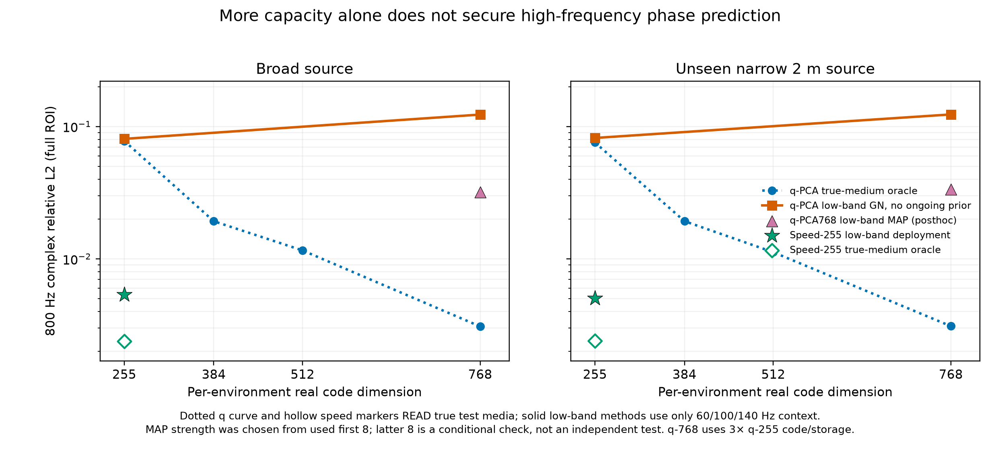

# 慢度平方PCA的容量追问：255维不够，增加代码维数呢？

> 历史证据 / 技术参考（2026-10-05 归档标记）：保留原实验、数值和复现路径。
> 文内“当前/下一步/待完成”描述属于当时阶段，不是现行任务；请先读[三条 Wave as Prompt 路线](wave_as_prompt/README.md)。

> 2026-10-04，**事前审计协议**。只用已经公开看过的余弦taper7.5新16环境；这批数据不再算新的独立测试。代码和本文件在运行前提交。配置见[`configs/coherent_waveguide_q_capacity_oracle_20261004.json`](../configs/coherent_waveguide_q_capacity_oracle_20261004.json)。

先前同255维对比中，学得的声速坐标经非线性`c^{-2}`物理组合，800Hz宽/窄源raw约0.005；慢度平方`q=c^{-2}`的线性PCA只有约0.081。这不是“线性q再多给一点维数也一定不行”的证据。这里问更窄的问题：同1024份训练q标签，冻结PCA后把rank从255扩大为384、512、768，直接读**真实测试介质**作欧氏投影，再由同一物理传播器预测800Hz宽/窄源；同时量化介质残差、训练方差率、每环境代码数和共享基存储。255维须复现前一份真介质投影归因的q结果，作为实现一致性检查。

这是一项**带额外真介质信息的oracle容量诊断**，并非低频观测的部署对照，更非该q子空间最优复响应误差下界。扩大rank也改变容量、计算和存储，不能拿768维q和255维声速当同预算排行榜。若高rank q显著追上声速，结论是非线性声速表示提供更紧凑的坐标；若仍追不上，只能说当前训练标签和欧氏PCA投影下仍有缺口，不能声称所有q表示失败。主指标仍为完整ROI未相位对齐的raw complex RelL2，辅以能量加权圆相位RMSE；双源分别报告，不挑单个最好源。

运行后填写结论、清楚标记是否复现255维检查；没有预设胜负gate，不把此旧测试集再次用作方法确认。

追加固定的部署诊断见[`configs/coherent_waveguide_q768_deploy_dev_20261004.json`](../configs/coherent_waveguide_q768_deploy_dev_20261004.json)：仅取768维q-PCA，同1024训练介质、保存的低频观测和原5+5步Gauss–Newton，用原先两种初始先验强度在同16个**已用**系统上推断，然后查询800Hz宽/窄源。它不读取真测试介质作推断，却仍是受上方oracle启发的**事后开发分析**；只与原255维声速/q结果一起讨论容量和在线时间，不把它改写成独立确认。若它追上声速，优点应表述为“较低维/共享存储效率”；若不追上，需分辨是低频条件、优化还是先验形状，不能立刻得出表示不可能。

由于5+5步的初步结果比q255更差，另外固定一个**事后、更窄**的迭代步数诊断：首8已用环境、768维、初值精度1e-7，检查(0,0)/(1,1)/(3,3)/(5,5)粗细Gauss–Newton步。配置见[`configs/coherent_waveguide_q768_horizon_dev_20261004.json`](../configs/coherent_waveguide_q768_horizon_dev_20261004.json)。若少步明显更好，则“低频代码不可辨识”也要限定为当前目标/优化轨迹；选最佳步数属于用开发目标反馈的事后调参，不可当无泄漏部署协议。

最后做一个对强基线公平性重要的**有界正则化检查**：原q768的5+5步只有数值阻尼而没有持续的高斯代码先验，不能把它当最终强MAP基线。首8已用环境固定先验强度0、1e-6、1e-4、1e-2，零强度需严格复现原q768；两阶段更新都用相同的`mean(code²)`惩罚。配置见[`configs/coherent_waveguide_q768_map_dev_20261004.json`](../configs/coherent_waveguide_q768_map_dev_20261004.json)。不把从这批旧目标中挑出的最佳强度称为独立测试；本次仅检查“不加正则导致的高维不稳”是否可被简单强MAP修复。

看到前几例`1e-6`明显优于无先验后，在运行该MAP方案的**后8个系统**前，固定仅此一个强度做条件性复核。后8虽然尚未用于MAP超参反馈，已经在先前声速/q768无先验实验中使用，所以**不是全新的方法测试集**；不再在后8上追加强度搜索。设置见[`configs/coherent_waveguide_q768_map_check_20261004.json`](../configs/coherent_waveguide_q768_map_check_20261004.json)。

## 完成结果：更多线性维数修复oracle容量，但低频部署还需正确约束

所有数字是**已经被多次使用过的同16个余弦波导环境**。oracle直接读取真实测试介质；部署只读保存的60/100/140Hz复响应。800Hz完整ROI的系统宏均值，宽源/新2m窄源分别如下：

| 表示与信息条件 | 代码维数 | raw宽/窄 | 相位RMSE宽/窄 | 说明 |
|---|---:|---:|---:|---|
| q-PCA真介质欧氏投影oracle | 255 | 0.07779/0.07575 | 0.07212/0.07018 | 与既有投影归因相差<1e-12，复现通过 |
| 同上 | 384 | 0.01926/0.01928 | 0.01421/0.01434 | 额外真介质信息 |
| 同上 | 512 | 0.01159/0.01124 | 0.00853/0.00827 | 额外真介质信息 |
| 同上 | 768 | **0.00309/0.00311** | 0.00249/0.00252 | 额外真介质信息，接近声速255投影0.00239/0.00240 |
| q-PCA低频部署，原5+5步，不持续惩罚代码 | 255 | 0.08068/0.08197 | 见[原确认](LEARNED_SPEED_MANIFOLD_CONFIRM_ZH.md) | 同1024训练标签、原先两初值中较好者 |
| 同上 | 768 | **0.12308/0.12337** | 0.09286/0.09423 | 同低频信息，更多维反而更差 |
| q-PCA768低频MAP，代码高斯惩罚1e-6 | 768 | **0.03185/0.03353** | 0.02425/0.02570 | 前8开发、后8仅固定强度条件性复核；不是新test |
| 非线性声速表示低频部署 | 255 | **0.00538/0.00505** | 0.00420/0.00391 | 原先冻结的确认结果，不因本轮事后调参而改变其身份 |

**容量：** rank255 q的训练介质方差保留率已达99.997452%，但介质欧氏投影残差0.006644放大为约0.077的800Hz复场误差。增至rank768，方差保留率99.999999979%、介质投影残差0.000404，真介质投影响应约0.0031，说明“q线性空间绝不可能表达高频相位”是错误的；代价是每环境代码255→768、q共享基约0.524M→1.575M个float64。声速255未压缩共享基约2.621M个float64，而本合成器可精确做深度rank16分解压至0.265M；只谈某一种存储形式会误导。

**辨识与正则：** 原q768低频5+5步在16系统上约0.123，虽拟合低频很小（首例末步context平方误差约2.9e-7），高频明显不对。首8的0+0、1+1、3+3、5+5步宽源分别1.219、0.147、0.130、0.126；因此至少在这段轨迹里，失败**不是简单的后期迭代过拟合**。更公平的高斯代码MAP扫描（惩罚`mean(code²)`）首8：无惩罚0.126/0.131，1e-6为**0.0313/0.0350**，1e-4为0.171/0.164，1e-2为0.916/0.871；零惩罚严格复现前一脚本。预先固定1e-6后，后8条件性复核为**0.0324/0.0321**，与前8近似。它说明前述q768无先验结果不能作为最终强基线；MAP确实大幅修复，但仍高于同环境的声速255。它**没有**排除其他强度、非高斯先验、不同求解器或神经q模型进一步改善。

同16系统逐例配对，原冻结声速255在宽/窄源均为**16/16**低于此事后q768-MAP，逐例相对降幅最小分别52.9%/54.4%；这只描述**同一批已用样本**，不是新的统计确认，也不抵消未来需要更强q先验和第二方程的要求。

**最小科学结论：** 当前余弦家族里，物理生成变量选得合适能同时减小表示所需维数和低频反演的有效歧义；仅增大线性q-PCA代码可以修复真介质投影误差，却不能自动保证从低频观测找到合适代码。传统信号处理/反问题理论会预期“高维逆问题需要正则化”；新增经验事实是这里的**具体rank–相位–低频部署曲线**以及非线性声速变量在同训练标签/信息下的优势。它不是跨介质族或跨PDE的理论，也不足以独立撑起一篇普适AI方法论文。下一个真正有分量的实验仍应是[非余弦的二维回散射与Ocean场](NEXT_CROSS_PHYSICS_POC_ZH.md)，并把高维q-MAP作为强对照。

复现材料：oracle [`summary.json`](../artifacts/coherent_waveguide_q_capacity_oracle_20261004/summary.json)（128条逐系统双源结果）；q768原低频[`summary.json`](../artifacts/coherent_waveguide_q768_deploy_dev_20261004/summary.json)（64条）；步数诊断[`summary.json`](../artifacts/coherent_waveguide_q768_horizon_dev_20261004/summary.json)（64条）；前8 MAP[`summary.json`](../artifacts/coherent_waveguide_q768_map_dev_20261004/summary.json)（64条）；后8固定强度[`summary.json`](../artifacts/coherent_waveguide_q768_map_check_20261004/summary.json)（16条）。各artifact内还保留配置、SHA manifest、逐系统结果和必要的优化历史；图的数字及源SHA见[`spectral_q_capacity_audit.json`](../reports/figures/spectral_q_capacity_audit.json)。
