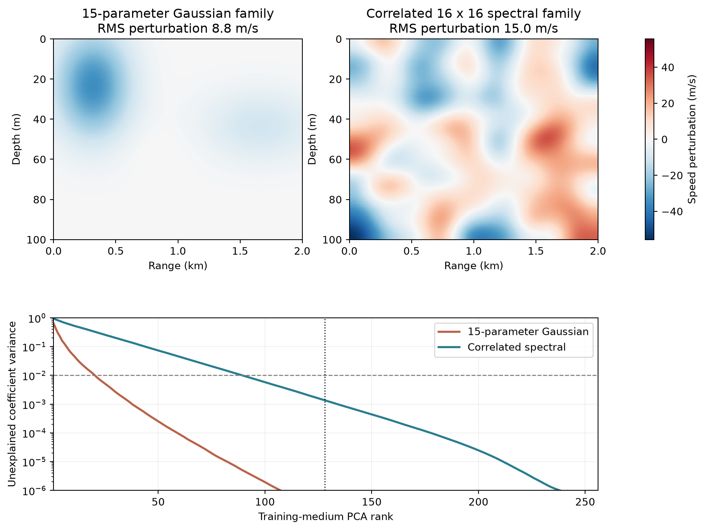
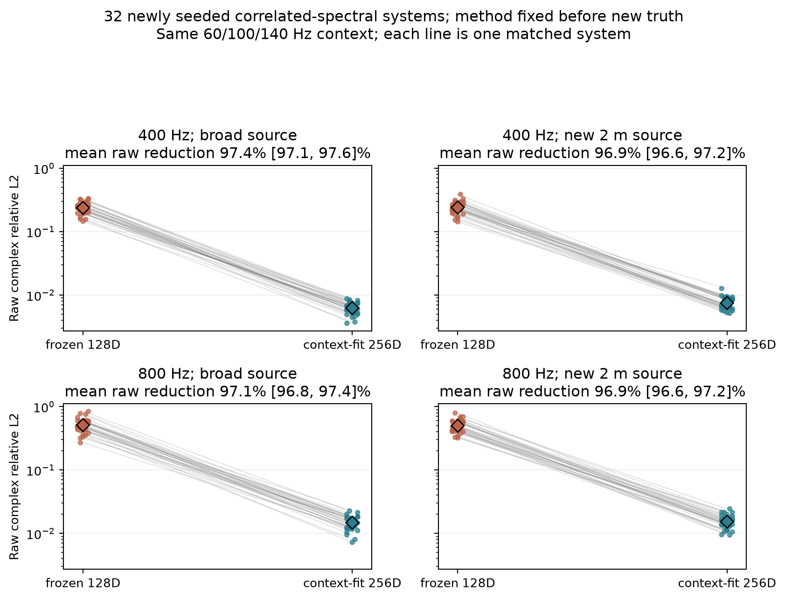
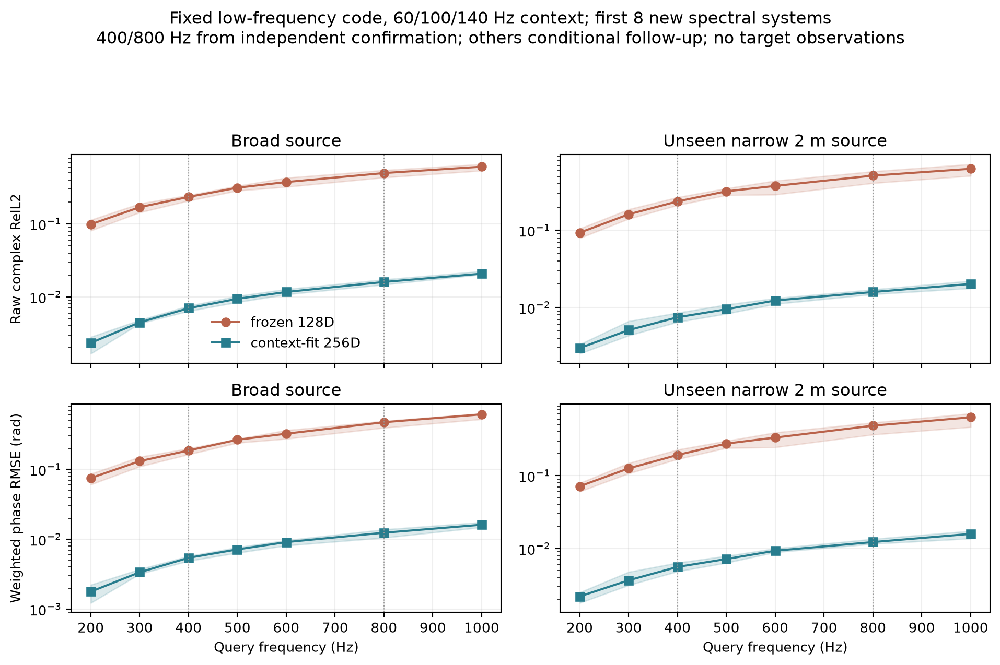

# 更丰富介质的相干表示压力测试：运行前协议

> 2026-10-04约05:35 UTC，首次生成该族目标真值前登记。它是原单向声学波导方程下的新**介质统计族**，不是第二种波动方程，也不代替已有2D Helmholtz物理域。

## 科学问题

原族的隐藏介质恰是3个二维Gaussian、15个连续参数。即使查询800Hz较准，也可能只证明这个低维光滑族容易识别。新族在已知背景温跃层上加入16×16个相关随机余弦系数；随机变量并非三个局部包，虽然谱锥衰减使有效维数可能低于256。训练、编码、源和目标频率协议不变，才能直接问：先前固定128实坐标与可变相干读出机制，在更丰富的未知介质里还保真吗？

训练系统seed20264000–20264511（512个），验证系统20264600–20264631（32个），数值审计20264700–20264702。随机谱项RMS标定15m/s，16×16系数按频谱指数锥衰减，背景温跃层/边界/源公开，隐藏谱系数只在训练标签、真值及明示oracle中出现。每个新验证系统只给原宽源60/100/140Hz×65完整深度剖面；400/800Hz原源和新2m窄源目标没有观测。目标4097偏移距离×513深度的直接复模态真值使用1024距离段/160模态/384点积分，独立审计2048/192/512，预定最坏raw差<0.001。主指标完整>=50m ROI的系统等权未配准raw complex相对L2；幅值和能量加权圆相位分报。

## 固定方法、对照与判定

训练512个**介质标签**上的64距离中心×16/32深度项PCA先验，各截128实坐标。两个候选使用同原方案：16项正常统计初始化和5次全程GN，再共同映射到256距离段的16/32项候选并各固定5次GN；查询用128传播模态、相同384点积分。比较16与32项、真实介质32/64项以及完整介质oracle。不存在深网络新模型，不额外查询目标场，不按新族结果选择迭代次数/先验强度/ROI。报告PCA方差覆盖率与全局基存储；固定每系统代码维数不等于固定所有成本。

压力测试成功门槛仅用于研究决策：32项在800Hz宽/窄源均raw≤0.05、能量加权相位RMSE≤0.05rad，并相对同128码16项在两源均改善≥20%，系统胜出率≥24/32。400Hz四项数字同样完整报告。达不到时按数值真值、容量oracle、context推断及频率/源复杂度归因，不移动门槛。即使通过，它也只说明同单向PDE下第二个介质统计族的机制稳健性，不能等同真实复杂海洋或跨物理域AI论文结论。

训练标签已经生成且未查看新系统完整汇总时的复杂度审计：相同64×32介质投影的PCA到99%方差，
原15参数Gaussian族约21维，本相关谱族约90维；到99.9%分别约38与134维。前128维在新族
仍覆盖99.86%，因此它比原族丰富不少，却不是有效256维满难度。下图预先选各族第一个固定系统，
不是按模型误差挑案例：

新族固定扰动RMS15m/s，上图所选旧Gaussian例的RMS约8.8m/s；两族既改变结构也改变强度。
跨族误差差距**不能单独归因为维数/空间纹理**。若新族失败，应先报告这个混杂因素，
再单独设计幅度匹配控制，不在原新32结果里事后换RMS或改主指标。

## 结果

原32系统和6次数值审计均已完成，最坏数值raw差5.75e-5，远低于0.001门槛。固定128实坐标、5+5次GN的16/32项部署候选在400Hz宽/窄源raw约0.242/0.236，在800Hz约0.518/0.503；32项对16项四组的相对收益都低于0.1%。相位RMSE在400Hz约0.20/0.19rad，800Hz约0.50/0.48rad，**全部未通过预设门槛**。相反给真实测试介质的32项oracle在400Hz约0.00056、800Hz约0.0011；它额外读取测试介质，不能当部署方法。最终低频context相对L2约0.0126，仍与800Hz有巨大放大差距。必须进一步区分：训练PCA的128维容量不足、低频反演误差、以及二者共同作用；不能直接说“物理上不可辨识”或“只需多加深度项”。

**事后机制诊断，2026-10-04 06:09 UTC登记：** 保持所有32系统、频率、源、ROI和物理读出不变，使用真实测试介质的64距离中心×16/32深度项投影，再取其在**训练512系统拟合的128维PCA子空间**的欧氏最小二乘投影，三次样条延拓到256段，查询相同400/800Hz独立真值。这是读取真实测试介质的额外信息容量oracle，绝不重新命名为可部署编码器；不按目标频率误差选rank、步数或系统。比较其raw/相位和已完成的完整真实介质32项oracle，判断有限128码是否已经致命。此投影oracle也不是全体128维代码中最小响应误差的严格下界；若它表现差，只能说明欧氏PCA投影不适配响应，不能证明不存在更好的同维表示。固定后的结果会写到本页。

所有中间训练标签、先验、环境seed、目标NPZ和哈希分别归档；生成前冻结manifest与事后数据inventory明确分开。

## 128维容量诊断与后续固定秩扫描

已登记的真介质PCA投影oracle现已跑完原32系统。虽然训练介质前128方向解释约99.86%系数方差，真实测试介质投影后的介质系数相对L2平均仅0.0511，800Hz宽/窄源复场raw仍达0.3906/0.3859；400Hz为0.1829/0.1763。它们大幅低于部署候选约0.52/0.50，却远高于真实32项介质约0.0011。这证明**当前欧氏PCA 128维投影会丢失大量高频响应信息**；不能由99.86%介质方差覆盖率推断相位精度，也不能把全部失败归因于GN优化。但投影不最小化复场误差，因此它不证明所有128维非线性/响应感知表示都失败。16/32项投影oracle几乎相同，当前首先该检查保留哪些距离方向，而不是继续堆垂向项。

2026-10-04约06:18 UTC的**事后、运行前秩扫描协议**：训练512个标签重新计算32项全PCA；在相同原32系统上读取真测试介质，按系数欧氏投影分别截128/256/384/511维；256段/128模态物理读出、400/800Hz宽/窄两源、同ROI，报modal Parseval raw与系数误差。rank不基于测试结果选取；所有行均为读取真介质的额外信息oracle，不能作为部署方法或严格最佳响应误差下界。该补充会揭示随着rank增加是否接近真介质oracle；若511维仍差，则训练分布外残差和欧氏目标的重要性尤须区分。配置、源码、训练数据SHA在运行前提交，不能倒填为原冻结候选。

2026-10-04约06:23 UTC的**事后、运行前响应感知表征POC协议**：只用512训练介质、其中固定两个背景seed和已知单向物理算子，求800Hz原宽/新2m窄源对介质PCA代码的局部Jacobian；两源、两个训练背景的归一化Jacobian Gram相加，前128特征向量旋转完整511维训练先验。这相当于线性化意义上优先保留最能改变查询响应的方向，而不是最能解释介质像素方差的方向。测试时在原冻结32系统读取真介质分别投影到该128维子空间与欧氏PCA128，统一256段/128模态读出，400/800Hz两源，同ROI、modal Parseval raw；低频context**完全没有**参与这个oracle，不能宣称是已部署编码器。预设gate：800Hz两源响应感知投影raw均≤0.15，且各比PCA128降低≥30%；过gate才尝试从同低频context估计该代码，未过则暂停这一路。所有背景、模式数、步长、rank和gate在运行前固定；相同32系统已用于发现PCA失败，因此这是post-hoc机制探索而非新的独立确认。

2026-10-04约06:27 UTC的**事后、运行前256维context推断开发协议**：秩扫描前13个系统的临时输出显示，欧氏PCA从128增到256维时，800Hz真介质投影oracle从约0.44降到约0.008；该观察仅用于决定开启开发实验，正式统计仍须等待全32完成。现在固定原32中按seed最先的8系统为已看过的**开发**样本，使用相同低频60/100/140Hz×65剖面，不读取任何测试介质，分别直接以训练512介质的rank128/256、32深度项先验做64段5步GN，再连续化到256段5步GN；相同400/800Hz宽/窄查询，完整ROI未配准raw和相位。原冻结rank128是16→32分支初始化，仍作为外部已知强对照；这里直接rank128为算法内部matched对照。开发gate预设为rank256在800Hz两源raw≤0.10、相位RMSE≤0.15rad，且相对原冻结rank128两源raw均至少降低50%。只有过此门槛才新生成此前未用的独立seed做确认；开发8绝不重新命名为独立测试。rank256的每环境代码与GN求解成本都翻倍，不能称固定128维收益。过程允许得到负结果，尤其低频观测可能无法唯一约束新增方向。

### 容量曲线、响应感知方向和开发门槛的结果

全32系统、额外读取真介质的32项欧氏PCA投影oracle，在800Hz原宽/新窄源的modal Parseval raw：rank128为0.3906/0.3859，rank256为0.00809/0.00797，rank384为0.00207/0.00210，rank511为0.00132/0.00137；相应训练方差保留率为99.8637%、99.999956%、99.9999995%、100%。即使99.86%的介质方差很高，剩余方向仍足以造成约0.39的相干响应误差。rank256的投影系数误差平均0.00139，rank128为0.0511。以上oracle不是低频可推断结果，也不是最佳同维响应误差下界。

按固定训练背景和800Hz局部Jacobian旋转出的响应感知128维基，800Hz两源raw仅到0.3796/0.3846，较欧氏PCA128的0.3906/0.3859几乎不变；400Hz由0.1829/0.1763退化到0.1964/0.2000。预设两源≤0.15且各改善≥30%的gate失败，**不继续训练这条响应基的低频编码器**。这仅否定当前两背景、单点线性化与高频Gram构造，不能否定所有任务感知子空间。

一个值得保留的细节：按这两个训练背景处的局部Jacobian Gram计算，前128方向已经解释约99.995%的**局部线性化响应灵敏度能量**，却没有带来相应的真实有限幅度响应保真。这与“介质方差99.86%但相位很差”是两种不同的错位：前者可能提示单点/少点局部线性化不能概括跨介质分布的非线性相位，不足以证明全局最优响应子空间也不存在。

作为实现检查，另用800Hz、64传播模态、相关谱背景和独立有限差分测试轨迹Jacobian的随机方向，测试通过；这排除了明显的一阶导数实现错误，但不改变只在线性化点附近有效的数学边界。

增加容量后，开发首8系统的rank256**仅用相同低频context**、固定5+5次GN，400Hz宽/窄源raw为0.00737/0.00826、相位0.00560/0.00616rad；800Hz为0.01489/0.01638、相位0.01154/0.01276rad，最差系统0.01960/0.02395。直接rank128 matched分支在800Hz为0.53366/0.54360，与原冻结16→32初始化的rank128数值近乎一致；rank256低频context平方误差平均4.94e-8，rank128为1.73e-4。开发门槛全部通过，但它是**看过原32全体结果之后选择的8个开发系统**，绝不作为独立确认。

### 新32系统确认：真值生成前冻结

**强度混杂因素的配对控制，2026-10-04约07:00 UTC、运行前固定：** 原Gaussian训练512环境（seed20261300–331与20261500–979）的64×64声速扰动网格RMS平均为8.168874841m/s、中位数7.9617、范围0.9438–20.8927。新相关谱介质固定RMS15m/s，与旧族不匹配。为隔离其中的**平均扰动幅度**，在已看过的首8谱介质系统相同seed和同空间谱形状上，把RMS统一降到8.168874841m/s；相同512训练seed重新拟合128维PCA，完全相同60/100/140Hz context、5+5步GN、400/800Hz宽/窄源、数值teacher与主指标。新审计seed20265400–402，门槛仍<0.001。两强度版本的同seed系统可成对比较；这是post-hoc开发机制诊断，不是新独立确认，也不能消除旧Gaussian族**幅度分布**及形状/维数之间的全部混杂。若低RMS的rank128在800Hz两源仍raw>0.10，说明大误差并不只由“15m/s更强”造成；若降至≤0.05，则当前rank128失败的主要强度因素值得重估。保留连续数值，不能只报二元判断。

**已知精确谱生成族的额外结构对照，2026-10-04约06:57 UTC、运行前登记：** 原8已看过的开发系统，不读取任何真实测试谱系数；但比训练PCA多知道未知声速扰动恰由16×16余弦系数生成、DC固定零、频谱锥和RMS15m/s。将这些已知速度基通过已知背景声速的一阶慢度平方导数投影到同64×32生成器空间，得到255维解析先验；使用**同60/100/140Hz×65剖面、同5+5次GN、同256段/128模态、同400/800Hz宽/窄目标**。没有训练介质标签输入；因准确知道合成器，此对照比通用PCA有更强的函数族信息，不能放在同信息方法排行榜。开发判断门槛：800Hz两源raw均≤0.05且各不超过训练PCA256对应raw的2倍。通过只说明这组随机谱合成族可能同样容易被精确解析参数化解释；失败则可帮助判断PCA学到非线性/跨尺度相关性是否关键。无论结果如何，不能据此调整已冻结的新32确认方法。

该**一阶近似解析基**已经失败：旧8系统800Hz宽/窄源raw0.2058/0.2276，400Hz0.0706/0.1219，均明显高于训练PCA256+相同5+5步的0.0149/0.0164与0.00737/0.00826。低频context平方误差平均1.45e-5，高于PCA256的4.94e-8。不能由此说训练数据学习是不可替代的，因为本解析对照只对速度到慢度平方做一阶线性化、没有使用**精确非线性**速度参数生成器，也没有按测试介质真实响应误差优化基。为了把“解析基容量不足”和“同一基的低频反演失败”分开，2026-10-04约07:05 UTC事后登记一个仅在同旧8上的真测试介质解析基欧氏投影oracle：用真实介质计算64×32生成器系数并投到固定255维一阶解析基，再同256段/128模态读出400/800Hz双源，报系数误差、raw与相位。它额外读真介质，不可部署，也不是同维最优响应误差下界；如果800Hz oracle仍≥0.10，当前**线性化基的容量**就是主要限制之一；如果≤0.03，优先怀疑反演/优化。保留全部结果，不对新32改方法。

投影诊断也完成：一阶解析基对真实生成器的系数相对L2仅0.01488，看似接近，却在800Hz宽/窄源产生raw0.5635/0.5661（400Hz为0.2869/0.2949），甚至比同基的低频context拟合raw0.2058/0.2276更差。按先前启发式，**这种欧氏投影不是高保真容量证据**；它只说明当前一阶基在介质MSE目标下截断的方向会大幅影响高频响应。反而同一基的context拟合可用某些系数误差抵消这些输出误差，故不能把真实介质欧氏投影当成响应误差的严格下界，也不能排除该基存在另一个更好的响应优化代码。要真正挑战“学习必要性”，仍需实现精确非线性声速255参数反演；本轮没有这个对照，不宣称解析物理法被普遍击败。

**在线优化预算诊断，2026-10-04约06:49 UTC、运行前固定：** 仅在原8已看过的开发系统上，将rank256的64段+256段GN步数由5+5降为1+1和2+2；训练先验、context、读出、频率、源、主指标均不变。它不改变已冻结的新32确认候选。若1+1步已在800Hz两源raw/相位均≤0.05，就不以“需要复杂神经网络加速”作为动机；若明显不够，再考虑一个有强同监督线性基线的摊销逆解POC。事后选择的任何成本点不能重命名为新32预冻结方法。

两条预算曲线在旧8开发系统完成：800Hz宽/窄源，1+1步raw0.02702/0.02771、相位RMSE0.02122/0.02159rad，最差系统raw0.04427/0.04893；2+2步raw0.01694/0.01817、相位0.01336/0.01416rad；原确认候选5+5步raw0.01489/0.01638。1+1已经通过预设的双源raw/相位≤0.05。因此**此密集无噪声协议下，不应仅为了给网络找位置而开发摊销warm-start**；目前更优先完成新32系统确认和频率曲线。1+1/2+2是事后开发成本检查，不改新32的5+5冻结候选；尚无可比较的完整墙钟延迟和GPU独占测量。

**有条件的频率连续性补充，2026-10-04约06:48 UTC、额外频率真值生成前登记：** 仅在下述全新32系统确认gate通过后，从中按seed固定前8系统，保持已确定的低频rank128/256代码、256段/128模态读出和宽/窄源，增加此前未用于代码选择的200/300/500/600/1000Hz五个目标频率；400/800Hz直接引用同8系统的确认数据，形成200–1000Hz多点曲线。目标4097×513同ROI、未配准raw及相位指标不变；数值审计在独立seed20265100–102的200/1000Hz做1024/160与2048/192比较，gate<0.001。预期门槛为1000Hz两源rank256系统平均raw与相位各≤0.05、最差系统raw各≤0.10。此补充不是全新系统，也不声称任意频率无限外推或第二域；如果确认gate失败则不运行它。新频率不用于重新选择代码、rank或迭代次数。

2026-10-04约06:33 UTC预先固定新IID系统20265000–20265031、独立数值审计20265100–20265102，与训练512、原32及旧Gaussian新32均不重叠。完全沿用16×16相关谱介质RMS15m/s、60/100/140Hz宽源×65剖面、400/800Hz宽/新窄源、4097×513目标网格、同>=50m ROI、教师1024段160模态与审计2048段192模态。将**原128维冻结候选**和**开发后固定的rank128/256直接32项先验+5+5次GN**在新系统上原样执行；后两者的训练标签仍为原512介质，不在新32上调迭代、先验强度、rank或源。数值审计上限0.001。确认门槛预先定为rank256在800Hz两源系统等权raw与相位RMSE均≤0.05，两源相对原128维冻结候选raw均改善≥70%，各至少28/32系统获益，两源最差系统raw均≤0.10。报告400Hz和所有失败例、系统配对bootstrap区间、计算/存储代价，不只报通过项。即使确认成功，它也仅是**同单向PDE、同相关谱统计族的独立系统**；rank256不是深神经或第二域。新数据与代码/配置的冻结manifest必须在任何目标真值生成前落盘。

## 2026-10-04 独立32环境的最终确认

协议manifest于06:33:55 UTC写入，真值生成于约06:34:33 UTC启动；方法源码、配置和训练标签SHA在确认过程中未改动。32个新系统20265000–20265031的目标真值与候选全部完成；6组数值审计最坏raw差5.93e-5，低于预定0.001。每个环境仍只给原宽源60/100/140Hz×65完整深度剖面，目标宽/新2m窄源无观测。没有在中途查看完整rank256性能或改任何阈值。

| 全新32系统，系统等权均值 | 400Hz宽源 | 400Hz新窄源 | 800Hz宽源 | 800Hz新窄源 |
|---|---:|---:|---:|---:|
| 原冻结128维raw | 0.23703 | 0.24059 | 0.51131 | 0.49965 |
| 直接128维matched raw | 0.23703 | 0.24059 | 0.51131 | 0.49965 |
| context-fit 256维raw | **0.00623** | **0.00749** | **0.01475** | **0.01532** |
| context-fit 256维相位RMSE，rad | 0.00467 | 0.00557 | 0.01123 | 0.01170 |

800Hz宽/窄源raw平均降低97.11%/96.93%；以**物理系统**为bootstrap单位的配对95%区间分别为[96.82%,97.39%]和[96.62%,97.22%]。两源均32/32系统获益，最差单环境raw0.02263/0.02439，预定的均值、相位、≥70%改善、≥28/32胜出和最差≤0.10门槛**全部通过**。400Hz宽/窄源也均32/32获益，降幅97.37%/96.89%。原冻结128维与直接128维matched结果几乎完全相同，因此大差距不是两种rank128初始化流程造成的。完整逐系统图、区间和预定首系统的局部相位图在[确认图](../reports/figures/spectral_rank256_confirm.png)和[相位图](../reports/figures/spectral_rank256_confirm_phase.png)；相位图的两幅误差色标分别为±0.75与±0.05rad，**不能按相同色阶视觉比较**，主指标仍在完整ROI计算、无相位配准。

这支持一个清晰但受限的科学结论：对该相关谱介质，低频复响应含有足够信息，可在近完整的统计介质坐标和精确已知的单向传播读出下恢复未观测800Hz及未见窄源的相位；原128维虽解释99.86%训练介质方差，却严重丢失高频相干响应。256维**已接近合成介质的255个随机谱自由系数**，每环境隐坐标、全局基和GN解线性系统成本均比128维增加；这不是高度压缩的表征、不是跨统计族或跨PDE验证，更不是深度网络相对最强同信息基线的胜利。该实验使用密集、无噪声、已知背景/源的低频观测；精确非线性谱族的经典255参数逆解尚未测试。通过确认gate只允许执行**事先登记**的固定代码五频点补充，不允许回头调rank或步数。

### 相同谱形状的扰动强度配对控制

已看过的原谱族首8开发种子，用相同随机谱形状把RMS从15m/s统一降到原Gaussian训练族平均8.168874841m/s；128维训练先验按相同512训练种子重新拟合，其他协议不变。800Hz宽/窄源的原128维raw从高RMS的0.53366/0.54360降到低RMS的**0.30562/0.30982**，相位RMSE从宽源0.515降到0.26063rad；400Hz宽/窄raw从0.26494/0.24705降到0.14018/0.12746。低RMS数值审计最坏3.65e-5。由于低RMS两源800Hz仍远高于预定0.10判别阈值，**更强扰动不是原128维失败的唯一原因**；但误差下降约43%，因此也不能说强度不重要。本对照仍是旧8开发系统，不消除两族谱形状、随机幅度分布和隐藏维数的其他差异，更不证明信息论不可压缩。低RMS的训练标签、原始目标和结果保存在`artifacts/coherent_waveguide_spectral_amplitude_matched_dev_20261004/`及同名本地数据目录。

### 已通过确认门槛后才执行的固定代码频率曲线

按06:48 UTC预先登记的条件，从确认集合取**固定前8系统**，不重估其rank128/256代码；直接复用400/800Hz独立确认结果，只为200/300/500/600/1000Hz新生成直接数值真值。200/1000Hz独立网格—模态审计最大raw差7.22e-5。完整4097×513网格、同宽/新窄源、同>=50m ROI，无目标观测与相位配准。1000Hz时rank256宽/窄源系统平均raw为**0.02081/0.02016**，相位RMSE**0.01615/0.01588rad**，最差单系统raw0.02407/0.02395；预定双源均值raw/phase≤0.05、最差raw≤0.10门槛全部通过。原冻结128维相同固定8系统的1000Hz宽/窄raw为0.60844/0.62912。rank256窄源raw在200/300/400/500/600/800/1000Hz依次为0.00297/0.00508/0.00744/0.00946/0.01229/0.01584/0.02016；是连续可查询的平滑增长，而非只在400/800两个点“碰巧工作”。

这不是无限外推定理；1000Hz仍在相同单向方程、相同介质分布、相同已知源/背景和已选前8新系统上，且误差随频率持续增加。图的阴影是系统间四分位区间，不是95%置信区间；完整每系统数值与图表SHA在`reports/figures/spectral_frequency_curve_confirm.json`。新增40份复模态目标NPZ在本地同名数据目录，结果与配置在`artifacts/coherent_waveguide_spectral_frequency_curve_20261004/`，不可将这个子集再算作独立8系统。

### 下一项开发诊断：观测数量与复数噪声（运行前协议）

独立确认使用每个环境3个低频×65条**完整深度剖面且无噪声**，这是很强的信息条件。为避免把这种精度直接解释为真实海洋可用，固定旧8个**已经看过的谱介质开发系统**、训练512介质rank256先验、同5+5次GN及相同400/800Hz双源完整ROI，不重训、不改rank/步数/评价。只从原65条低频modal观测等距抽取33或17条；另保留65条但对每个低频的整个复模态观测矩阵加独立复Gaussian噪声，使加入噪声的矩阵二范数与原信号之比**精确等于**0.001或0.01。随机种子固定为20261004+系统seed，两噪声强度使用同一标准噪声实现；新频率和新窄源不参与拟合。低频剖面是在既有65条中抽取，未重新数值生成或改变teacher。

开发判断门槛：800Hz双源均值，33条干净与65条0.001噪声各raw和phase≤0.05；17条干净与65条0.01噪声各raw和phase≤0.10。所有四条件、两频率与双源连续数字照报，失败不调GN或改噪声定义。这里的噪声是**模态复系数层**的理想化扰动，并非传感器位置误差、海洋环境误差或真实水听器噪声；低剖面失败也可能来自当前三次样条/局部反演对稀疏采样的数值失稳，不能立刻宣称波场信息论上不可辨识。配置`configs/coherent_waveguide_spectral_context_robustness_dev_20261004.json`和实现源码在运行前冻结；本项仅找部署边界/下一任务切入点，旧8不能再当独立测试。

**实现事故与修正，任何性能结果前记录：** 首次启动的`artifacts/coherent_waveguide_spectral_context_robustness_dev_20261004/`只写了config与manifest，就在33条条件的首次GN因旧推断函数默认65个观测边界而维度不匹配退出，**没有写出可用评估行**。修正版仅在64段和256段GN调用中明确传入与17/33/65条观测对应的边界索引；rank、初始化、5+5步、噪声/系统/查询/gate全不变。后续结果必须来自新输出目录`..._v2_20261004/`；原失败目录保留，不把失败运行当负性能结果。

**修正版旧8开发结果。** 同800Hz宽/新窄源的系统等权均值如下；相位是能量加权圆RMSE，原65条干净参考raw0.01489/0.01638仅作对照，不重跑。

| 输入条件 | 宽源raw / 相位rad | 窄源raw / 相位rad | 预定双源门槛 |
|---|---:|---:|---|
| 33条干净 | 0.01487 / 0.01154 | 0.01654 / 0.01292 | ≤0.05，通过 |
| 17条干净 | 0.01809 / 0.01403 | 0.01877 / 0.01457 | ≤0.10，通过 |
| 65条、0.1%复噪声 | 0.02427 / 0.01888 | 0.02487 / 0.01976 | ≤0.05，通过 |
| 65条、1%复噪声 | 0.17235 / 0.13745 | 0.17822 / 0.14693 | ≤0.10，**失败** |

1%噪声条件的最差系统raw0.264/0.252；其他条件最差不超过0.037。注入噪声在每个低频复模态观测矩阵上严格归一化至所列相对二范数，而非仅在图像上后加噪声。**不能只展示前三项**：当前方法确实对1%复噪声敏感。相反17条干净仍很好，说明先前65条的密集性并非唯一使成功成立的原因。这仍是旧8开发诊断，无法证明真实水听器条件；1%失效也不能直接解读为物理不可辨识，因为当前初始化先对带噪稀疏复场做三次样条二阶求导，容易放大噪声，在线GN又没有按已知噪声的明确先验正则。下一轮若要修复，应一次只改变初始化或噪声统计处理，并保留本失败作为强对照。

**1%噪声机制的最小2×2开发对照（运行前协议）：** 固定刚才失败的旧8系统、同一复噪声实现、训练rank256先验、5+5次GN、400/800Hz双源与主指标；原方案是“对观测场求导的normal-statistics介质初始化 + 带噪声的首剖面作为源初态”。只考察其余三个组合：介质从训练平均值开始但源初态仍用带噪首剖面；保留normal-statistics但源初态改为**由公开源形状解析算出的无噪初态**；两者同时改。源初态公式是已知宽源在32个模态上的投影，与干净模拟首剖面相差约1e-7，不读取隐藏介质或目标场。它比“仅有带噪观测而不知道源”多利用协议原本已公开的源信息，必须显式标明。GN步数、阻尼、rank和先验强度都不调，保留原失败行。判断门槛是**至少一个同一组合**在800Hz宽/窄源均值raw与phase各≤0.10；若通过，只说明这个开发族可通过初始化修复部分噪声脆弱性，仍需全新系统验证；若失败，再考虑明确噪声似然/概率先验，而非宣称物理不可辨识。配置`configs/coherent_waveguide_spectral_noise_initialization_dev_20261004.json`及源码在结果前提交。

**2×2开发结果（800Hz，旧8系统）。** 原“normal-statistics介质初始化＋带噪初态”宽/窄源raw0.17235/0.17822、相位0.13745/0.14693rad；其余三组合如下。

| 介质初始化 / 源初态 | 宽源raw / 相位rad | 窄源raw / 相位rad | 双源≤0.10 |
|---|---:|---:|---|
| 训练均值 / 带噪 | 0.48861 / 0.54268 | 0.48242 / 0.52316 | 失败 |
| normal-statistics / **已知源** | **0.08455 / 0.06749** | **0.08887 / 0.07238** | 通过 |
| 训练均值 / 已知源 | 0.44989 / 0.51471 | 0.43404 / 0.48388 | 失败 |

这说明在当前旧8合成环境和1%复观测噪声下，**利用原协议本已公开的源形状**，避免从噪声样本取传播初态，就能消除大约一半高频误差；训练均值不是一个可靠的零成本GN初始化，求导得到的统计初值仍有必要。已知源组合的最差单系统raw为0.17971/0.16770，不能夸大为“所有环境都达到0.10”；0.084/0.089均值也仍显著高于干净的0.015/0.016。通过的是事后旧8开发gate，尚无新环境或真实水听器噪声确认，更不能据此断言隐代码本身统计最优。若将来进一步降低1%噪声误差，下一**独立**问题才是概率先验/噪声似然能否在强已知源基线之上增益，而不是继续把源初态噪声误当介质不确定性。

### 最后一个必要的额外结构基线：精确非线性谱族反演（运行前协议）

旧一阶解析余弦先验失败，**不能**得出训练PCA必要的结论，因为它只把速度到慢度平方线性化。现在在同一旧8已看过的谱介质开发环境上，额外告诉算法未知介质恰由16×16余弦速度系数构成、DC固定零、各系数具有公开的频谱锥和RMS尺度；但**不给任何测试环境的真实255系数，也不给训练512介质标签**。算法把255个标准化速度坐标经精确`c^{-2}`映射投影成64/256传播单元的32垂向项，用解析链式导数计算完整低频传播轨迹的GN，固定各5步；同60/100/140Hz宽源×65完整剖面、400/800Hz宽/窄目标、全ROI未配准raw/phase。线性物理统计初始化的固定岭精度1e-7，这个值是在旧8第一个系统的**初始化坐标范数**探查后选择，非先验独立超参数；因此整个基线只可作post-hoc强结构上限，不能再声明预独立。其余步数、阻尼、线搜索与PCA256相同，但已知精确生成族本身是重要额外信息，且整体算力/初始化成本不完全匹配。

判断门槛：800Hz宽/窄源系统平均raw均≤0.03、最差单系统raw均≤0.10；若通过，说明在这个合成族里无需训练介质标签也可能靠精确家族+低频观测做高精度查询，削弱“PCA学习不可替代”的论文主张；若失败，只否定当前初始化/10步优化实例，不证明精确生成族无法反演。真介质投影与解析Jacobian的单元测试通过，且在固定外部坐标时任意改测试spec里的隐藏谱系数不会改变预测；本旧8控制绝不影响已完成的新32独立确认数字。配置、源码、门槛在此次**结果产生前**提交，完整输出保留所有8个系统，不筛失败例。
