# 复杂波动场的谱可预测性、可辨识性与校准

> **定位说明（2026-10-05 更新）：** 本文是长期科学背景与证据解释，不是逐次实验日志。
> 本次将 9 月的校准／可靠性实验与 10 月的共享传播生成器、介质先验、容量／可辨识性诊断纳入同一框架。
> 先读 [§0 的判断修订](#0-核心判断)、[§21 的新事实表](#21-近期观察如何修正早期判断2026-10-05-更新)，
> 再按需阅读理论。最新状态见[当前状态](CURRENT_STATUS_ZH.md)；AI 论文方向见
> [凝练后的科学 insight](EVIDENCE_TO_OCEAN_WAVE_PROMPT_ZH.md)。
> 当前实验范围已收敛为[补全、新实验、校准三条路线](wave_as_prompt/README.md)；
> 本文中的长期愿景和旧阶段后续建议不代表正在启动的任务。

初版：2026-09-17；本次科学与排版修订：2026-10-05。

**公式显示说明：** 块公式已预渲染为本地 SVG 矢量图，行内符号使用普通 Unicode／代码字样，
不依赖网页的 LaTeX 宏或数学插件。图片带中文替代文字；需要复制／修改公式时，见
[公式源码](assets/spectral_science_math/equations.json)和[重新生成说明](assets/spectral_science_math/README.md)。

状态：科学 formulation 备忘录。本文不提出已经验证的新模型，也不把尚未实验的判断写成结论。
它试图用一套统一语言解释本项目迄今最重要的正结果和负结果，并定义未来真正值得研究的对象。

## 阅读说明：四类证据不要混在一起

本文面向有机器学习背景、但不一定学过信号处理或系统辨识的读者。为了避免把经典知识误写成
“我们的发现”，后文使用四种标签：

- **[经典理论]**：波动方程、信号处理或系统辨识已经给出的结论；
- **[项目事实]**：在当前数据、协议和对照实验中已经重复观察到的结果；
- **[交叉增量]**：不是新的数学定理，而是把经典理论转化为 AI 任务、表征原则或可检验指标后，
  由本项目实验支持的新认识；
- **[研究假说]**：由理论和现象共同提示、但尚未被充分验证的判断。

这里的“增量”是相对于本项目已经建立的证据链而言，不主张历史上首次发现。是否构成论文贡献，
还需要更广泛的文献检索和跨数据验证。

### 三分钟直觉版

可以把一个复杂波场想成许多传播路径的叠加。频率稍微改变，每条路径都会按自己的传播时延转动
相位。相邻频率足够近时，我们能看出它们“转得多快”；频带足够宽时，我们才可能把时延相近的
路径分开。困难来自三处：观测频率太稀会把相位圈数看错，频带太窄会把不同路径混在一起，而新的
共振或模态可能在查询频率变得显著，却在旧频带里很难从噪声中识别。

因此，低频到高频不是永远可预测或永远不可预测。更合理的问题是：现有观测还能稳定预测多远，
什么表示保留了真正与未来频率有关的信息，以及何时应停止外推并请求少量新观测做校准。

### 常用英文术语速查

| 术语 | 本文中的通俗含义 |
|---|---|
| complex field | 同时保存振幅和相位的复数波场，不是普通 RGB 图像 |
| frequency response | 系统对不同激励频率的稳态响应 |
| impulse response | 系统对瞬时激励的时域响应；它的傅里叶变换就是 frequency response |
| delay spread | 最早和最晚显著到达之间的时延跨度 |
| phase wrapping | 相位每转一圈就回到同一角度，因此相差整数圈看起来相同 |
| phase unwrapping | 利用连续性猜回相位转过的整数圈数 |
| group delay | 相位随频率变化的斜率所对应的有效传播时延 |
| coherence bandwidth | 在多大频率间隔内，两个响应仍高度相关；通常与 delay spread 成反比 |
| resolvent | 给定频率时，把激励映射到响应的“系统逆算子” |
| pole / residue | 共振所在的复频率位置 / 该共振如何贡献到观测场 |
| observability | 现有观测能否区分内部状态 |
| system identification | 从输入输出数据辨识系统状态或动力学参数 |
| analytic continuation | 从已知区间延伸解析函数到区间外；数学上可能唯一，数值上仍可能极不稳定 |
| spectral innovation | 查询频率出现、但可见频带没有充分暴露的新模态或新干涉结构 |
| predictive state | 只保留预测未来所需信息的状态，而不要求完整重建过去 |
| shared propagation generator | 同一套描述环境如何传播波的规则；这里不特指生成式神经网络 |
| query-sensitive direction | 环境中变化很小、却会显著改变所查询复场的方向 |
| MAP / posterior | 结合观测与先验求最可信状态 / 给出仍然可能的状态及其概率 |
| oracle diagnostic | 为诊断而额外读取真值的理想化检查，不是实际部署算法成绩 |
| readout | 把系统代码变成指定频率、源与位置上的复响应 |

## 0. 核心判断

复杂波动场的频率延拓不是普通图像到图像回归，也不应被简化为“幅值可迁移、相位不可迁移”。
更准确的判断是：

> 有限频带能预测多远，取决于观测、噪声、允许的物理系统族和推断方法，而不是由“低频／高频”
> 单独决定。一个局部拟合器失败，可能是状态选错、容量不足、先验失配、优化未收敛，也可能确实
> 是信息不足。只有在仍与观测相容的物理系统对查询给出不同答案时，才需要额外观测或更强且正确的先验。

这里有三个必须分开的概念：

1. **解析唯一性**：理想的连续、无噪频率数据在数学上是否唯一决定其他频率；
2. **稳定可辨识性**：有限、离散、有噪观测是否能以有界条件数确定查询场；
3. **分布可预测性**：跨实例训练得到的先验，能否把原本不可稳定辨识的问题限制到较小的可行集合。

**本次最重要的纠偏：早期的有限 horizon 主要是“当时模型的有效范围”，不是已经证明的物理极限。**
近期在已知 PDE／源、稠密无噪低频观测的合成系统中，识别共享传播生成器后，60/100/140 Hz
可以支撑 800 Hz 的高精度查询。这不等于真实海洋也能做到，却足以否定“远频失败必然因为没有信息”。

现在的主线更明确：**找到既能精确生成查询响应、又能从实际观测中推断出来的系统表示。**
风险图和 calibration 仍有价值，但不能替代首先把复场／相位预测做准。

## 1. 从波动方程到频率响应算子 [经典理论]

考虑离散化后的线性波动系统：

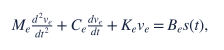

其中 `e` 表示介质、几何和边界，激励由源作用位置／分布 `Bₑ` 和信号 `s` 描述。对单频激励
`s(t)=Re[s₀ exp(−iωt)]`，稳态复场满足：

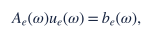

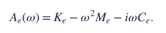

因此：

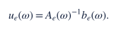

`Aₑ(ω)⁻¹` 是频率参数化的 resolvent。直观地说，它是在某个频率上把外部激励转换成
系统响应的逆算子。对开放域 Helmholtz 或 scattering 问题，定义会加入
radiation boundary condition，但核心仍然是一个随复频率变化的 resolvent。远离 eigenfrequency、
resonance 和 cutoff 时，响应对频率通常是光滑或解析的；在适当延拓下，resolvent 是 meromorphic，
其 poles 对应共振，residues 对应 resonant states。散射 resolvent 的这一结构有严格数学基础，参见
[Zworski, 2017](https://doi.org/10.1007/s13373-017-0099-4)。

这带来第一个重要事实：

> 波场在频率轴上不是任意函数，它具有由 wave operator 决定的解析和极点结构。

但这并不意味着从有限低频样本到高频的数值延拓一定稳定。

**符号约定：** 本文统一采用时间因子 `exp(−iωt)`，所以传播时延对应 `exp(+iωτ)`，
阻尼项带负号。采用相反时间约定也完全合法，但整套公式必须同时换号；不同数据集还需核对
FFT、源和相位参考。这里修正的是本文约定，不是在给已有实验做事后相位对齐。

## 2. 解析唯一性不等于稳定预测 [经典理论]

对满足适当稳定性／衰减条件的 causal linear response，按本文约定，频率响应在复频率上半平面
具有解析性，并在相应条件下满足 Kramers--Kronig 类型的全局约束。若函数可解析穿过该实轴区间，
精确连续取值可由解析函数唯一性定理确定延拓；若实轴只是解析域边界，还需相应函数类的边界唯一性条件。
不能把这句话无条件套到任意带噪频率数据上。

然而有限区间上的解析延拓是经典 ill-posed problem：极小的观测扰动可以在区间外被放大为巨大误差。
Dienstfrey 与 Greengard 对有限实轴区间上的 upper-half-plane analytic continuation 明确指出了这种
不适定性，并用 singular-value expansion 暴露可恢复与不可恢复方向，参见
[NIST / Inverse Problems, 2001](https://www.nist.gov/publications/analytic-continuation-singular-value-expansions-and-kramers-kronig-analysis)。

因此应区分：

这里的 AI 类比是：训练分布像一个强先验，它能缩小答案范围，却不能凭空补回观测中不存在、
且在训练分布内部仍有多种可能性的实例信息。神经网络也不能取消这个区别。跨样本训练可以提供先验，从而排除许多数学上可行但在数据分布中
不常见的延拓；它不能从观测中恢复在训练分布内仍然存在的不可区分分支。

一个很实用的形式化是定义与观测相容的可行集合。给定观测 `Oₑ` 和容差 `ε`：

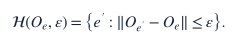

在查询频率 `ω_q`，条件解集合的直径为：

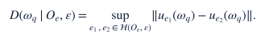

如果 `D` 很大，那么对于接收同一份观测、且无法排除集合中两端候选的 deterministic predictor，
worst-case 绝对范数误差不能普遍小于 `D/2`；相对误差还需考虑各目标的归一化。
这是三角不等式给出的界；新增有效观测或更强且正确的先验
可以缩小集合。**我们尚未在真实海洋上构造出这个集合及其严格直径下界；模型误差高不是该下界的实证证明。**

## 3. 时域到达结构给出的第二种视角 [经典理论]

对固定 source 和 receiver，频率响应也可以写成 causal impulse response 的傅里叶变换：

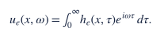

若局部响应近似由 `P` 条路径组成：

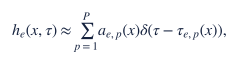

则：

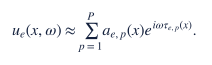

这正是 harmonic carrier、Prony、matrix pencil 和有限指数和模型背后的信号结构。Prony 和
matrix pencil 可以粗略理解为：从一串复数频率样本中，反推出有多少个旋转指数分量，以及每个
分量的旋转速度和权重。有限指数和在理想
条件下可以由有限样本恢复；finite-rate-of-innovation sampling 给出了比普通 bandlimited sampling
更一般的可恢复性框架，参见
[Vetterli, Marziliano and Blu, 2002](https://www.ee.cuhk.edu.hk/~tblu/monsite/pdfs/vetterli0201.pdf)。
Matrix pencil 则是估计 damped/undamped exponentials 的经典方法，参见
[Hua and Sarkar, 1990](https://escholarship.org/uc/item/2n45r2z5)。

但复杂波动场与理想 `P`-path 模型之间有三个差异：

- 有效路径数随位置、频率和分辨率变化；
- continuous reverberation 或 scattering tail 不一定具有有限 `P`；
- 不同分量可在频率上出现 cutoff、resonance 和强烈 amplitude modulation。

因此，有限指数和更适合作为局部模型和 identifiability probe，而不是全频真理。

## 4. 频率采样有两个互补限制 [经典理论]

### 4.1 频率间隔控制无歧义时延范围

单路径的相邻频率相位增量为：

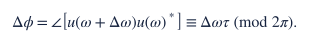

对于单一路径，若仅把主值相位直接除以频率间隔、不额外推断整数圈数，一个充分的无折返条件是：

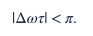

使用 Hz 表示，并以最大绝对残余时延界表示：

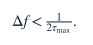

均匀频率采样间隔 `Δf` 会使时延出现 `1/Δf` 周期的混叠。因此间隔决定时延混叠周期，
而不是总带宽。**上式不是所有辨识方法的必要条件**：已知时延所在区间、非均匀采样或先去掉已知
参考传播相位，都可能解除主值分支歧义。去参考后，应看残余时延，不一定是整条传播路径的绝对时延。
多路径的合成相位斜率也不等于某一条固定路径的时延。

**[项目事实]** 本项目中 79/80 Hz 优于 74/77/80 Hz；“增加更多但相隔较远的频率”也没有帮助。
经典理论提供了与现象一致的解释，但这些模型对比没有单独排除训练、输入编码和优化的影响。
额外观测在信息论上不会让最优预测变差；“拼接后模型没有收益”不等于“新增样本没有信息”。

### 4.2 总带宽控制时延分辨率

设可见频带宽度为 `B`。普通傅里叶分辨率约为 `1/B`，不是对所有强先验方法都成立的不可突破下界。
稀疏超分辨在额外分离度和噪声条件下可能更好。两条到达时间差远小于
`1/B` 的路径，在当前带宽中可能表现为几乎同一个有效 carrier，却在更远频率逐渐分离。

对于不依赖很强路径先验的常规估计，这提示我们兼顾：

- 足够小的 `Δf`，避免长时延 aliasing；
- 足够大的 `B`，分辨相近到达或相近 poles。

样本数大致为 `m≈B/Δf`。这意味着有效自由度会随 bandwidth--delay product 增加，
与 Slepian/Landau--Pollak 的 time--bandwidth concentration 理论一致。该理论说明有限时间与有限频带
中显著自由度的数量由 time--bandwidth product 控制，而不是由中心频率单独控制。一个现代综述入口见
[Simons and Wang, 2011](https://geoweb.princeton.edu/people/simons/PDF/reprints/GEM-2011.pdf)。

信号处理里常用 **coherence bandwidth（相干带宽）** 描述响应仍保持强相关的典型频率范围。
它通常与 delay spread 反向变化，但具体常数取决于相关阈值和系统定义。本文的 predictable horizon
与它有亲缘关系，却不完全相同：后者还包含 population prior、空间观测、模型偏差和校准信息。

由此得到一个比“高频更难”更精确的判断：

> 带宽与时延跨度决定一类信号的有效自由度；中心频率还直接影响相位对参数误差的放大。
> 即使只有一条路径、自由度没有增加，同样的时延误差在更高频率也会变成更大的相位误差。
> 模态密度、截止、衰减和空间分辨率又会带来额外变化，不能只用一个乘积概括全部难度。

## 5. 为什么干涉零点是困难区域 [经典理论 + 项目事实]

当 `u(ω)≠0` 时，可以定义 complex logarithmic derivative：

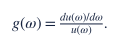

其实部和虚部分别对应：

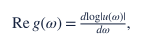

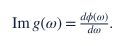

第二项是局部 group-delay-like phase velocity。但当多路径 destructive interference 使
`|u(ω)|` 接近零时，`g(ω)` 的条件数急剧恶化；相位本身也变得没有稳定物理意义。
通俗地说，两个很强的波若刚好互相抵消，合成结果会接近零；这时极小噪声就能让合成向量的角度
发生巨大跳变，所以该处的“相位标签”本身不可靠。

这有三个直接推论：

1. phase loss 不应在低幅值位置与高能量位置等权；
2. 单一 per-pixel slope 在干涉节点附近必然不稳定；
3. amplitude、局部谱曲率和多模型分歧是可靠性预测的合理候选特征，但不是所有方法必需的输入。

这不授权删掉低幅值区域来美化结果。主指标仍是完整规定区域上的 raw complex relative L2；
能量加权圆周相位误差、幅值误差和节点诊断用于解释主指标，而不替换它。

**[项目事实]** 我们观察到误差随传播距离、谱曲率和干涉节点增加。该结果支持上述经典条件数
解释，但当前证据还不足以声称三者构成完整的因果模型。

## 6. Modal/resolvent 视角下的有限 horizon [经典理论 + 项目事实]

在局部频带，频率响应可以写成近似 modal expansion：

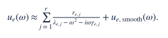

这解释了为什么 rational interpolation、Loewner realization 和 rational Krylov methods 适合频率响应。
Loewner framework 可以直接从 frequency-response measurements 构造 reduced state-space realization，
其阶数与 Loewner matrix 的有效秩相关，参见
[Ionita and Antoulas, 2014](https://doi.org/10.1137/130914619)。针对 Helmholtz frequency response 的
自适应 rational model reduction 也利用了同样结构，参见
[Bonizzoni, Pradovera and Ruggeri, 2021](https://doi.org/10.48550/arXiv.2112.04302)。

但一个在可见频带内准确的低阶 realization 不一定在带外继续有效：

- 查询频率接近未见 pole 时，导数和条件数快速增大；
- mode cutoff 会改变有效状态维度；
- residues 的空间混合可能随频率旋转；
- 在开放或复杂散射系统中，有限窗口内看似低阶的响应可能只是高阶系统的局部投影。

**[项目事实]** 增加固定 pole 数、使用单一 Neural ODE、或假设全局共享 AR coefficients，都没有
稳定解决远频预测。理论上，频率是 PDE 参数，不是物理时间；仅以一张观测场为完整状态，
一般不能保证存在对未知环境通用的频率平移映射，使得：

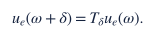

也不能预设这样的映射满足半群合成律：

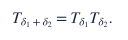

把频率轴直接当时间轴做 autonomous rollout，是一个需要验证的局部近似，而不是物理定律。
Neural ODE 在这里失败，不一定说明它拟合能力弱；也可能是它推进了不完整的状态。
反过来，若状态包含足够的环境／生成器信息，完全可以在新频率重新求响应，包括此前不显著的模态。
所以“旧低阶状态不够”与“原始观测不够”是两个不同结论。近期共享生成器结果正是这一差别的实例。

## 7. 四个层次的可辨识性 [经典理论 + 交叉 formulation]

### 7.1 Structural identifiability

在一个指定模型族中，连续无噪观测是否唯一决定未知参数或查询响应。这是 uniqueness 问题。
直观问题是：“如果测量无限精确，答案是否只有一个？”这是经典系统辨识概念。

### 7.2 Stable identifiability

有限离散观测和小噪声是否只导致有界查询误差。这由 observation map 的最小奇异值、参数相关性和
query sensitivity 决定。
直观问题是：“测量只有一点误差时，答案会不会差很多？”这是经典逆问题概念。

若 `zₑ` 是局部 latent physical state，线性化后：

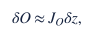

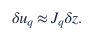

将复观测的实部／虚部堆成实向量，设噪声协方差为 `Σ`、局部高斯先验协方差为 `C₀`。
在线性化有效时，观测信息与后验协方差可写成：

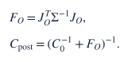

查询的局部协方差近似为：

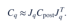

通俗地说，要同时看“观测能看清哪些状态方向”与“查询会把哪些方向放大”。无先验且信息矩阵
可逆时才退化为常见的逆信息矩阵表达。低秩先验、强非线性、误设噪声和数值误差都可能使这个局部
预测过于乐观。近期四线 Helmholtz 诊断已经发现明显的线性化余项，见 §21；不能把这一公式的估计当实测精度。

### 7.3 Distributional identifiability

训练分布提供 population prior `p(z)`，把可行状态限制到经验流形。神经网络的主要价值在这里：
它不是改变 PDE 的 uniqueness，而是减少在真实数据分布中需要区分的状态集合。
先验失配也会排除正确答案，因此“分布内很好”必须与“换介质统计规律后仍然可靠”分开验证。
**[交叉增量]** 我们把这一层单独列出，是为了区分“物理上能否辨识”和“借助学习分布后能否预测”。
这是面向当前 AI 任务的概念拆分，不是新的辨识定理。

### 7.4 Calibration identifiability

测试时 observation `Cₑ` 更新实例状态：

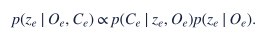

Calibration 的价值应定义为它对 query uncertainty 的减少，而不是 support reconstruction error：

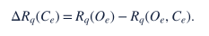

这里的差值对某一个实例／某一种算法不保证为正。正确概率模型下，额外信息可降低平均最优 Bayes risk，
不意味着每次有限预算校准都会降低实测误差；错误噪声模型、先验或更新方式都可能造成负收益。

若不同环境的 calibration 可以互换而不影响结果，说明模型没有使用实例信息；本项目的
shuffled-instance control 明显恶化，支持 calibration 确实在辨识实例状态。
**[项目事实]** 正确实例的稀疏校准有稳定收益，而打乱实例配对会显著恶化；这排除了“校准输入只
提供一个通用频率偏置”的简单解释。

## 8. Horizon 是有用的条件量，不是自动成立的物理极限 [交叉 formulation]

对误差阈值 `η`，定义实例条件的稳定预测 horizon：

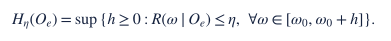

`R` 的定义必须写清楚：固定算法的经验误差、校准过的风险估计和最优 conditional Bayes risk
不是同一个量。前两者得到的是**模型相关 horizon**，不能宣称是任何方法都无法超过的极限。
还应说明风险是否只是点估计，或具有经过检验的统计覆盖率。

这个定义有几个优点：

- 不把 110 Hz 或二倍频当成特殊物理对象；
- 把近程成功和远程失败放入同一条曲线；
- 允许不同环境有不同 horizon；
- 可以直接与 acquisition cost 和 uncertainty calibration 结合；
- 能定义 calibration 的作用为 horizon reset 或 horizon extension。

更进一步，可定义单位成本的 horizon gain：

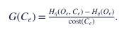

这比“使用了多少百分比传感器”更接近真正部署价值。

这里的 horizon 不是传统信号处理中唯一固定的物理常数，而是一个任务条件量：它同时取决于观测、
环境、训练先验、允许误差和模型。**[项目事实]** 我们的多个方法都表现出近程改善、随后与强基线
交叉的曲线，因此只报告某个单频点会掩盖最关键的科学现象。

定义要求整段区间都满足阈值，不是假设误差随频率单调。离散测试只能报告“在已测试网格上”的
horizon，可能漏掉狭窄共振；不能据此认证连续区间。后来的共享物理生成器可以大幅移动这条边界。
若起始频率本身已超过误差阈值，本报告按约定把 horizon 记为0，而不报告空集合的上确界。

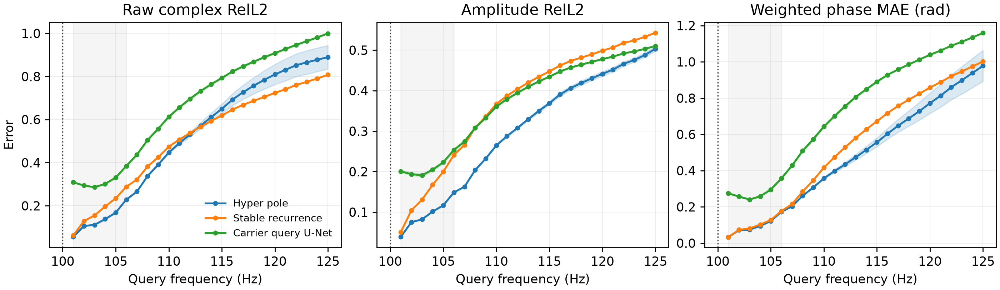

**图 1｜项目实证，不是理论示意。** 灰色区域为 calibration 频带，右侧是完全未见的查询频率。
三个面板分别给出复场误差、幅值误差和加权相位误差。Hyper-pole 在近程有优势，但随后与稳定
recurrence 交叉；所有方法都随频率距离恶化。这正是“有限且模型相关的预测 horizon”，而不是
“某模型拥有全局外推能力”。

## 9. 不应急于压成单个标量的控制变量 [研究假说]

目前至少有五个相互作用的无量纲或归一化量：

1. **phase-alias number**：`a=2Δf·τ_max`；
2. **delay-resolution number**：`b=BΔτ`；
3. **normalized query offset**：`q=(f_q−f₀)τ_eff`；
4. **local curvature number**：`c=(f_q−f₀)²·|d²φ/df²|`；
5. **modal innovation count**：可见边界与 query 之间新增的有效 poles、cutoffs 或 modes 数。

可检验的初始假说是：

- `a<1` 是单路径、已指定残余时延界下，主值增量不折返的充分条件，不是一般必要条件；
- `b` 太小会使相近路径不可分，导致远频分支歧义；
- `q` 决定局部 slope error 的累积；
- `c` 和 modal innovation 决定一阶 state 何时失效；
- error curve 更可能在这些归一化变量上跨几何 collapse，而不是在 raw Hz 上 collapse。

这组假说比预设一个“普适 6 Hz horizon”更科学，也更容易被跨域证伪。

## 10. 对 amplitude--phase 发现的更严格表述 [经典机制 + 项目归纳]

“幅值可迁移、相位不可迁移”是有启发性的第一版，但容易被反例攻击。更精确的三层结构是：

### 10.1 Shared envelope prior

路径包络、几何衰减和低空间频率结构通常比 complex interference pattern 更平滑，适合由
population model 提供先验。但观测幅值 `|u|` 本身包含相干叠加，因此在干涉节点和 mode transition
附近并不稳定。

### 10.2 Locally identifiable phase transport

当频率采样足够密、局部 amplitude 不接近零时，相邻复场比值能够稳定估计局部 phase velocity。
因此 phase 不是“不能迁移”，而是需要正确 gauge 和 sampling density。

### 10.3 Spectral innovation

新模态、共振、cutoff 和多路径重新干涉不能总由旧 slope 唯一确定。它们构成需要 calibration 或
更强先验的 innovation。

前两层与多路径和相位采样理论一致；第三层是我们为解释 AI 外推失败而提出的工作性归纳，仍需用
显式 modal-event 数据验证。所以更稳健的项目主张是：

> Learning 可以提供跨实例的结构先验；观测用来辨识实例的相位敏感状态；物理读出把同一状态
> 变成不同频率／源下的响应。Calibration 在现有信息不足或模型失配时补充实例约束，而不是每次跨频必需。

近期结果还提示：学习对象不一定是幅值包络或“相位图片”，也可以是共享传播生成器。
这是对最初幅相直觉的深化，而不是证明幅值总能迁移、相位总不能迁移。

## 11. 为什么“表示能力”与“预测能力”必须分开 [项目事实 + 交叉增量]

设 decoder family 为 `u≈D(z,f)`。很低的 reconstruction oracle 只说明对每个目标存在某个
`z_q`：

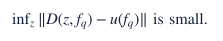

真正任务要求的是从历史观测确定该坐标：

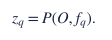

**[项目事实]** Local patch-span oracle 为 0.052，而 learned local-span 为 0.619。前者回答“目标能否被
这套字典压缩”，后者回答“仅凭可见频带能否推断正确坐标”。这个巨大差距说明：压缩得好并不等于
当前模型能从过去预测未来。**它不证明这些坐标无法被任何方法推断**；推断网络、训练数据、优化、
先验和观测信息都可能造成差距，需要逐一排查。

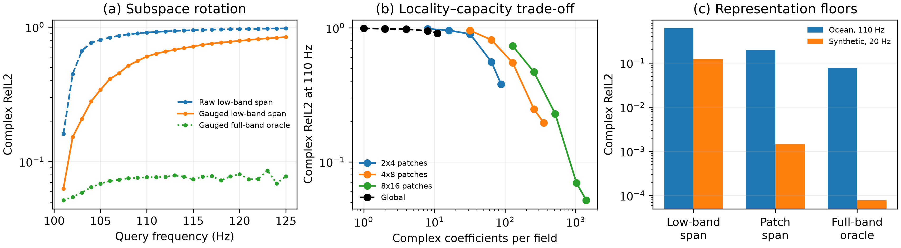

**图 2｜项目实证。** 左图显示低频子空间随查询频率快速失配；中图显示把表示局部化、增加每个场的
复系数可以显著降低 oracle error；右图则显示 full-band oracle 还能更低。关键不是“低秩不存在”，
而是存在一个很大的 **oracle--learned gap**：目标位于某个低维空间，不代表其坐标能由过去频带预测。

理想 representation 应当是 future-predictive sufficient statistic：

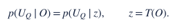

同时它应尽量丢弃只帮助重建过去、却不帮助预测未来的信息。Past--future information bottleneck
正是选择性保留 past 中对 future 有用信息的理论框架，参见
[Creutzig, Globerson and Tishby, 2009](https://doi.org/10.1103/PhysRevE.79.041925)。
Predictive-state representation 则直接用未来可观测测试的预测来定义 state，参见
[Littman, Sutton and Singh, 2001](https://proceedings.neurips.cc/paper/2001/file/1e4d36177d71bbb3558e43af9577d70e-Paper.pdf)。

**[交叉增量]** 这对 AI 表征学习的启示是：

- autoencoding loss 不是充分目标；
- in-band masked reconstruction 也不是 out-of-band predictability 的充分代理；
- latent dimension 应由可预测 future tests 决定，而不是只由当前场重建误差决定；
- 可用独立风险估计器诊断 spectral state 的有效范围，但不必从第一版就强行加入 horizon 输出头。

Koopman 方法试图寻找线性推进的 observables，但有限维 invariant subspace 并非普遍存在；即使存在
近似低维表示，也必须检验它是否适合 future prediction，而不只是重建。相关限制见
[Brunton et al., 2016](https://doi.org/10.1371/journal.pone.0150171)。

## 12. Calibration 的三个不同角色 [交叉 formulation]

### 12.1 Gauge calibration

确定共同相位、局部 phase branch 或 carrier slope。它通常只需要很少观测，但作用 horizon 有限。

### 12.2 State calibration

估计已有 reduced model 的 poles、residues、modal coefficients 或 latent state。其有效性依赖 support
是否对这些状态方向可观测。

### 12.3 Innovation calibration

当旧 reduced state 无法描述新频带时，calibration 可能需要触发新状态、扩大 latent rank 或重新
初始化局部 realization。但若已识别的生成器本身支持这些模态，也可能只需更完整的读出，不必再测量。

**[项目事实]** 现有 sparse AR calibrator 主要做前两类；fixed-8-mode paired-fidelity 中缺失高阶 modes，更接近第三类。
这些机制与前者约 12% 的历史正收益、后者 dense AR(1) 仅短暂改善一步的现象相容，尚非唯一因果解释。

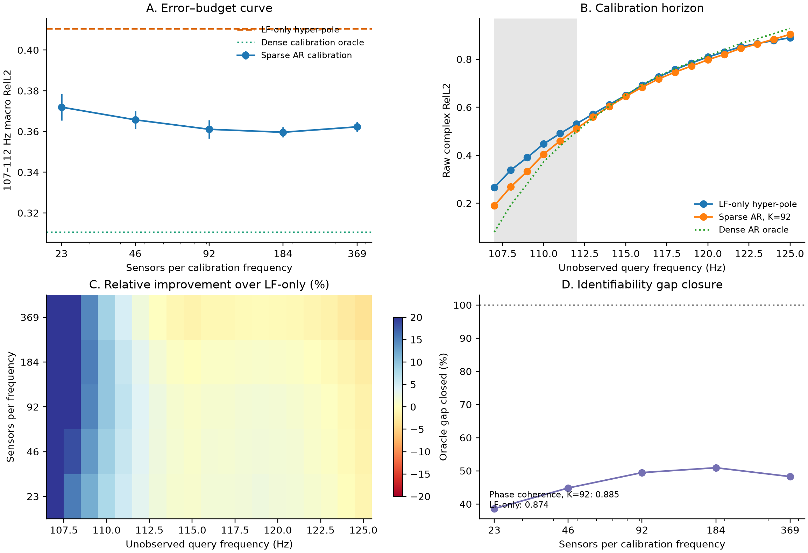

**图 3｜项目实证。** 左上显示增加传感器后收益很快饱和，说明瓶颈不只是空间采样数量；右上和左下
显示校准收益集中在紧邻 support 的频率，并随查询距离衰减；右下显示稀疏校准只能关闭约一半 dense
oracle gap。它支持“校准可更新局部实例状态”，同时反驳“一次校准即可恢复任意远频率”。

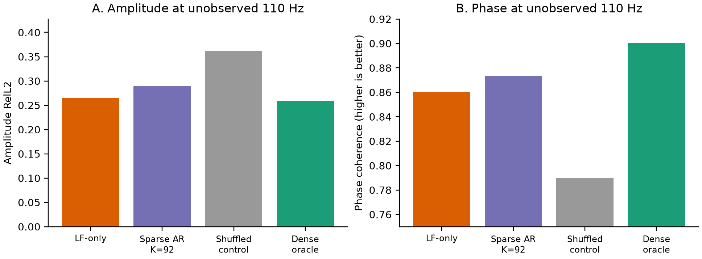

**图 4｜项目实证。** 正确 sparse calibration 对幅值误差改善有限，却提高了 phase coherence；把其他
实例的校准观测错配进来后，幅值和相位都显著恶化。这是当前最直接的证据：有效信息不是一个通用
频率偏置，而是实例特定的 phase-sensitive state。

## 13. Multi-fidelity 的关键不是 LF error，而是 correctability [交叉假说]

设 low/high discrepancy 为：

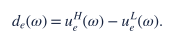

通常只比较 `‖dₑ‖` 和 solver cost。但 calibration task 真正关心的是：

1. `dₑ` 是否位于低维、跨频稳定的 discrepancy subspace；
2. calibration support 是否能观测这个 subspace；
3. query 处是否出现 support 中不存在的新 discrepancy modes。

因此两个 LF solver 即使 raw RelL2 相同，也可能具有完全不同的 calibratability。更合理的 fidelity
设计目标是：

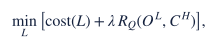

而不是单独最小化 LF-to-HF error。**[项目事实]** 固定 `nmodes=8` 在浅水实例中几乎没有节省，在
深水实例中又产生难以校正的缺失模态。**[研究假说]** 因而 fidelity knob 更可能需要按有效模态数
或能量比例归一化，而不能跨环境固定绝对截断数；这仍需多种 matched-cost LF 构造验证。

## 14. 对早期实验的解释：保留事实，降低过强归因

以下是 9 月阶段的历史结果，不是最新方法的性能。右列区分合理解释与已经证明的结论。

| 实验事实 | 能支持的解释及边界 |
|---|---|
| 粗频带直接拼接不改善 | 与相位圈数歧义相容，也可能是编码／训练问题；不能断言新增观测无信息 |
| 79/80 Hz carrier 强于 74/77/80 Hz | 支持较小 terminal spacing 对当前局部 carrier 有帮助，不是通用采样最优性证明 |
| Carrier M1 在 105/110 Hz 大幅胜过 direct | 正确 gauge 将高频振荡变成较平滑 residual，延长近程 horizon |
| M1 在训练频带内弱于 direct | 结构化 bias 牺牲带内自由拟合，换取带外稳定性 |
| Hyper-pole 只在 107--112 优于 recurrence | 更强 state 改善局部曲率，但其额外参数未稳定扩大远程 horizon |
| Local-span oracle 极低、learned model 很差 | 该表示能容纳目标，而当前推断链失败；尚不能归因为非唯一性 |
| Masked-frequency pretraining 不帮助外推 | 带内 interpolation tests 不是带外 future-sufficient state |
| Correct calibration 有效、shuffled 失败 | support 在更新实例特定 phase state，而不是提供通用 bias |
| Paired-fidelity oracle 107 Hz 强、随后衰减 | 局部误差修正不能自动保证远频正确；缺失模态是待分离机制之一 |
| Fixed n8 浅水无成本、深水难校正 | fidelity gap 随真实 modal count 改变，absolute truncation 不具跨实例一致性 |

## 15. 传统理论与本项目增量的明确边界

传统理论已经很好地解释了“为什么这个问题可能困难”，但没有自动回答“在跨实例学习、空间场输出和
稀疏测试时校准同时存在时，什么任务最合理、什么表示真的有效”。两者的边界如下。

| 传统理论能够给出的结论 | 传统理论本身没有直接给出、本项目正在建立的增量 |
|---|---|
| 频率响应有解析、极点与模态结构 | 如何把这些结构转化成可学习、可跨实例的高维空间场表示 |
| 有限区间解析延拓通常数值不稳定 | 对一个已训练模型和具体实例，稳定预测 horizon 在哪里、如何估计 |
| 频率间隔约束无歧义时延范围，总带宽约束时延分辨率 | 细 terminal band 与 carrier representation 在神经算子外推中如何共同改善近程泛化 |
| 有限指数和与低阶 realization 在给定模型族内可辨识 | learned latent 是否真由可见频带确定，而不只是事后能重建目标 |
| observability 描述观测能否区分内部状态 | disjoint-frequency sparse calibration 是否更新实例状态，以及 shuffled-instance control 如何检验它 |
| 多保真模型存在成本—误差权衡 | 哪种低保真误差可被少量高保真观测校正，即 fidelity correctability |
| 干涉零点附近相位估计病态 | 面向全空间神经算子的幅相指标、风险预测和停止外推规则应如何设计 |

**最重要的边界声明：** “解析延拓不适定”“相位会 wrapping”“Prony 能估计有限指数和”都不是本项目
贡献。当前真正有增量的部分，是把这些分散理论组织成一个可证伪的 AI 任务，并通过正负实验发现：

1. **固定模型有实例相关的有效 horizon，而不是一个全局二元能力。** 早期模型多只在近程改善，
   后来的结构生成器在理想协议下可显著延长范围；应评价完整误差曲线，不能宣称已测出物理极限。
2. **能表示未来场，不等于当前算法能推断其坐标。** 0.052 的 local oracle 与 0.619 的 learned result
   要求分开考察表示容量和推断能力，但不证明物理非唯一。
3. **历史异频校准确实携带实例信息，却未产生大幅、持续的远频修复。** 正确配对／打乱配对和
   频率距离对照支持局部 phase-state 解释，不足以证明一定是新模态不可观测。
4. **低保真是否有用取决于 correctability，而不只是 raw error。** 固定八模态的实验表明，成本低、
   表面误差相近的先验，可能因缺失 query-sensitive modes 而难以校正。
5. **AI 表征应同时对查询充分、对实际观测可推断。** 近期先验坐标、容量与反演实验让这个原则
   更具体：不能用介质方差、oracle 重建或局部信息矩阵中的任何一个单独代替可部署查询精度。

下面再按证据强度列出当前结论。

### 15.1 理论上成立

- wave frequency response 具有 resolvent/meromorphic structure；
- causal frequency response 的有限带解析延拓一般不适定；
- uniform frequency spacing 限制无歧义 delay aperture；
- total bandwidth 约束普通傅里叶时延分辨率；更强先验的超分辨需另外讨论稳定性；
- 干涉零点使 phase derivative 和 local carrier 估计病态；
- 低阶 realization 的存在不保证带外稳定性。

### 15.2 早期指定协议内的观察，不应推广到所有波场

- 细频率 spacing 比粗 multi-frequency input 更有价值；
- carrier-relative representation 显著提高近程 extrapolation；
- predictability 随 query distance、传播距离和谱曲率下降；
- calibration 的主要收益来自实例特定 phase correction；
- reconstruction-friendly local latent 不一定是 prediction-friendly latent；
- 真实 LF/HF gap 中，一步 calibration 有强信号，但六步 open-loop 不成立。

### 15.3 尚待验证的研究假说

- 不同 wave domains 的 error--horizon curve 能否对 normalized delay variables 发生 collapse；
- learned uncertainty 能否在真实 error 爆发之前识别 modal innovation；
- sequential sparse calibration 能否以一半以下 HF acquisition cost 保持给定误差（旧协议未达标，见 §21）；
- predictive bottleneck 是否能学到比 reconstruction latent 更小、更稳定的 spectral state；
- fidelity correctability 是否比 LF raw error 更能预测最终 calibrated performance。

## 16. 更深的任务 formulation

本节保留不同任务的数学定义，**不是要求下一阶段同时开展**。当前优先级是被动观测下的高精度
复场／相位查询；主动选频必须先有强重建模型和可用的行动收益空间。

### 16.1 Open-loop spectral prediction

给定过去频带 `Oₑ`，预测 disjoint future queries，并同时输出可靠性：

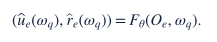

`r̂` 不只是 variance，而应估计 raw field error 超过阈值的概率或上界。

### 16.2 Sequential spectral calibration

在第 `t` 步，模型拥有 history `Hₜ`，选择下一次 calibration action：

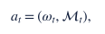

其中 `Mₜ` 是固定或可选 sensor set。获得观测后：

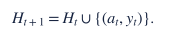

目标是在成本预算内最小化整个 query band 的误差：

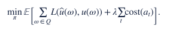

这把 calibration 从静态附加输入提升为 experimental design 或 active sensing 问题。

### 16.3 Spectral event prediction

除了预测场，还预测下一次 modal birth、cutoff、resonance proximity 或 horizon failure。这可能比要求
模型在不可辨识区域继续输出看似确定的场更科学。

### 16.4 Multi-fidelity extension

Cheap solver prior 是可选信息源，不是主任务定义：

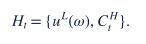

评价重点应是它减少了多少 HF calibration cost，而不是是否在某个频率提高几个百分点。

## 17. 对未来 representation 的约束

不再预设五种 latent 或同时堆入多个 loss。最小的结构问题是：

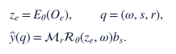

大白话：**观测先告诉我们“这是一个什么系统”，再用同一个系统回答不同频率、源和接收位置的问题。**
编码器可以是神经网络、带学习先验的物理反演，也可以先用经典方法做强对照；上式不是已完成模型。

这里真正需要的是三条性质：

1. **查询充分性**：系统代码保留相位敏感细节，而不是只保留介质或图片中的大方差方向。
2. **观测可推断性**：代码必须从允许的 context 得到，不能靠目标真值拟合后宣称完成预测。
3. **共享生成规则**：频率／源改变时使用同一系统代码；读出可按波长提高数值分辨率，但不能重读目标真值。

复线性、源的叠加、相位参考和物理算子的平滑性可以直接体现在读出结构中，不必全部写成惩罚项。
共同相位旋转只在源和测量参考也相应变换时才是约定变换，不能把任意目标相位对齐当成模型能力。
高精度读出可能仍昂贵；若每次调用完整 PDE solver，就不能直接称为廉价 neural operator。

**[交叉增量]** 一个紧凑生成器可以生成高秩的源—响应算子，不能把“系统代码低维”误写成
“所有场图或所有源响应一定在一个很低秩的固定空间里”。这给 operator learning 和 functional tensor
的启发是：压缩共享结构／因子，允许查询时组合出复杂响应；不是无条件把输出矩阵的 rank 压低。
对应的多源受控诊断见[共同生成器机制备忘](GENERATOR_REPRESENTATION_MECHANISM_ZH.md)；
固定矩阵秩的误差界不能推广成所有神经算子或张量方法的下界。

## 18. 对 flow 或生成模型的判断

原版把“发现多个分离分支”放得过于像生成模型的必要前提，本次修正：**单峰状态不确定性也能
导致高频条件均值失去相干幅值。** 一个最简单的经典例子是：观测后的时延是高斯变量、幅值固定，

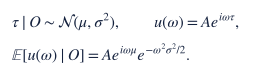

每个候选波都有幅值 `A`，但高频相位不确定时，平均后互相抵消。这里不需要多峰，也不需要新模态。
不过条件均值仍是标准平方误差下的最优点预测；不能据此声称采样必然降低 raw relative L2，
更不能拿“最好的一次采样”与确定性预测不公平比较。

更合理的生成对象是**同一个系统状态的后验**：抽一个状态，用它生成整组频率／源响应，而不是每张
相位图独立加噪。其科学价值是提供跨查询一致的候选物理系统、可信区间或下游风险。
这首先应与线性／非线性高斯后验和简单 ensemble 比较；只有后验校准、proper score、联合响应统计
或下游决策确实改善，才有理由引入 flow。**这是经典概率机制启发的新任务假说，不是本项目已验证的 flow 正结果。**

## 19. 哪些诊断已经做过，哪些才值得下一步做

原版的 horizon atlas 和 sequential POC 后来已经执行，结果是**能识别风险，不等于能有效修复风险**。
不要再把它们列成完全未做的新计划，也不要直接升级 RL。具体事实见 §21.1。

当前更有决定性的顺序是：

1. **真正稀疏、同信息的非线性识别**：四线 Helmholtz 的公开输入已准备，但尚未有可部署方法结果。
   先做收敛的物理 MAP 强对照，再检验学习先验；不是把局部高斯误差当成绩。
2. **检验一个学习机制**：学习“哪些介质方向对响应重要、又能从观测中辨识”，与相同标签／代码预算的
   PCA、正则化高秩先验和物理反演比较。不能只赢明显缺容量的 rank255 对照。
3. **真实误差链核对**：区分表示截断、推断、噪声／相位参考和数值读出误差；保留 raw complex L2
   主指标、圆周相位诊断与完整成本。分别报告同频稀疏重建和无目标频率观测的预测。

这些是研究优先级，不是本次文档更新启动的新实验。连续谱、真实海洋适用性和生成后验都应建立在
前两项的真实精度／泛化证据上。

## 20. 可能形成的长期研究定位

现在最值得保留的一句话是：

> **如何从有限复波观测中，学到一个对相位敏感查询足够精确、能被观测识别、并能跨频率和源复用的系统表示？**

这比“保证任意远频延拓”更可检验，也不把路线锁死在 horizon 或主动校准上。
对于海洋，它可以落到高精度相位稀疏重建与连续谱响应；对于 AI，它落到 observation-conditioned
operator learning（由观测确定的算子学习）、query-sufficient representation（对查询充分的表征）
和共享系统后验。科学对象是同一个，协议要分别写清楚。

传统理论提供可辨识性、条件数和传播结构；本项目目前的增量主要是**用对照实验排除错误归因，
并发现“表示坐标—观测约束—查询响应”不能割裂设计**。这仍不是已经完成的一篇新神经方法论文。
具体候选 AI 方法、一句话论文主张及可证伪门槛见[科学机制与候选论文方向](EVIDENCE_TO_OCEAN_WAVE_PROMPT_ZH.md)的第4节。

## 21. 近期观察如何修正早期判断（2026-10-05 更新）

本节只汇总已有结果，没有新训练。除特别注明，raw 指完整规定区域、按系统平均的复数相对 L2，
不做目标相位对齐；“broad / narrow”是两种查询源，不是两个数据集。不同表行的信息、系统族和
query 不同，**不应直接横向排名**。Oracle 指用了部署时拿不到的真值作诊断。
下文“5+5反演”指粗／细距离网格各做5次 Gauss–Newton 更新，即用当前物理模型的局部导数反复修正环境代码。

### 21.1 校准：知道哪里会错，不等于知道怎样把它修好

| 已完成的事实 | 应该得出的判断 |
|---|---|
| 固定频率、环境分组验证下，Ocean 风险 AUROC 从 disagreement 的 0.906 到物理特征组合的 0.934；synthetic 为 0.960 / 0.957 | 风险有可预测信号，但物理特征并非每个域都增加收益。Ocean 当时风险阈值 raw=0.5，不是高精度 0.05 |
| Ocean 无校准 raw 0.63138，最好固定一次 0.59197，风险触发一次 0.57202；每次 552 个复观测 | 比无校准改善约 9.4%，但比最好固定只好 3.37%，未过 10% gate；两／三次也未继续稳定改善 |
| 后续 32 DEV 系统、45 个等成本动作里，理想知道哪个动作最好的 oracle 为 0.5540，开发集最好固定为 0.5920 | 在该动作池里理论可选的经验余量只有约 6.42%；不能靠更复杂策略凭空制造 50% 收益。这个 oracle 也不是所有可想象实验的上界 |
| 可学习的行动价值排序有信号，但 value policy 为 0.5846，差于风险规则 0.5720 | “能学到排序”与“提高最终场精度”必须分别检验 |

出处：[可靠 horizon 最终报告](../reports/RELIABLE_HORIZON_MAP_FINAL_ZH.md)、
[行动价值 POC](../reports/ACTIONABLE_HORIZON_POC_ZH.md)。这些是开发／分组验证证据，不是封存正式测试。

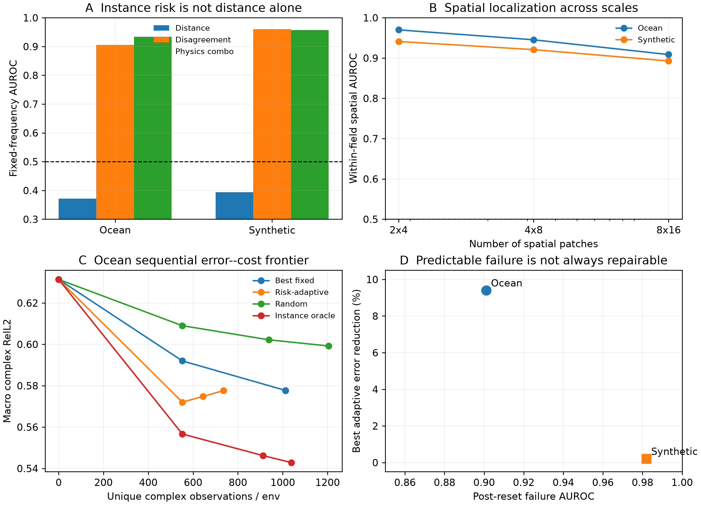

**图 5｜已完成的风险／校准实验。** 阅读重点是风险分类、实际 raw error、校准预算三者要分别看；
不能用高 AUROC 替代高精度场重建。该图保留历史协议，不与下方 800 Hz 新合成任务直接比数值。

### 21.2 远频失败：究竟是没有信息，还是没有表示／推断对？

| 指定协议内的事实 | 它排除什么，又没有证明什么 |
|---|---|
| 新 32 个相关谱介质，60/100/140 Hz ×65 条完整深度剖面、已知源／PDE，固定 q-PCA128→256 加相同物理反演：800 Hz raw 0.51131/0.49965→0.01475/0.01532 | 原128维先验不足，不能把失败直接归因于低频无信息。256维接近真实255自由度，不是强压缩或深网络创新 |
| 旧先验在新 taper10 介质 raw 0.4155/0.4350；知道真实16×16速度函数族、但不读测试系数的经典非线性反演，在同一低频观测上为0.003880/0.004129 | 强额外结构能消除大部分失败；这不是同信息公平排名，更不证明原学习先验具备 OOD 泛化 |
| 早期 FNO 在512系统训练后 dev最好0.1753，而同输入的共享物理生成器识别约0.01136 | 编码对象和推断方式是实质变量；增加网络／数据不是唯一出路。不能把学习算法失败写成物理不可辨识 |

出处：[谱介质容量确认](SPECTRAL_MEDIUM_STRESS_POC_ZH.md)、
[介质统计偏移](SPECTRAL_TAPER_SHIFT_POC_ZH.md)、[已知函数族强对照](SPECTRAL_TAPER_EXACT_FAMILY_ZH.md)、
[共享生成器 POC](SHARED_PROPAGATION_GENERATOR_POC_ZH.md)。后两行含已反复使用的开发／诊断系统，不能算新的独立确认。

### 21.3 表示坐标：可逆变量变换不增加信息，却会改变有限模型的能力

近期最强的正结果来自一个很简单的变化：先表示速度 `c`，再精确计算 `c⁻²`，而不是直接对 `c⁻²`
做相同维数的线性 PCA。两个变量对正速度是一一对应的，**并没有创造新观测信息**；区别在于
“先压缩哪个变量”，以及有限维先验如何约束非线性反演。

下表的 q 指慢度平方（代码可使用其背景归一化版本），不要与前文代表一次实验请求的 query 符号混淆。

为什么可能差很多？少数平滑模式组成的 `c`，经过倒数平方后会产生高阶乘积和更多频率成分。
如果忽略参考尺度，`c=c₀(1+δ)` 时：

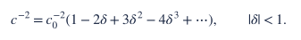

**[经典机制]** 这是非线性变量变换带来的秩／频谱扩展，不是新的理论。
**[项目事实]** 它在有限代码的相位敏感远频查询中确实可以产生大影响，但依赖介质族：

| 验证范围 | 800 Hz raw：速度先验 vs 同维 q 先验 | 结论边界 |
|---|---|---|
| 预先冻结、全新16系统，taper5和10训练，7.5测试；同1024介质标签、255代码、低频观测、5+5反演 | 0.005375 / 0.005052 vs 0.080678 / 0.081965；对应相位 RMSE 0.004197 / 0.003915 rad | 相对误差降约93%；全部16系统两源均 raw≤0.05。但这是同函数族／同单向 PDE 的统计插值，不是真实海洋或新物理域 |
| 三个高斯扰动介质，旧8 DEV；同512标签、128代码和反演 | 0.003219 / 0.003435 vs 0.003415 / 0.003528 | 仅5.74% / 2.64%，未过20% gate；两源各只有4/8胜，否定普适大增益 |

出处：[速度先验独立确认](LEARNED_SPEED_MANIFOLD_CONFIRM_ZH.md)、
[第二介质族负结果](GAUSSIAN_SPEED_VARIABLE_DEV_ZH.md)、[真介质投影归因](VARIABLE_PROJECTION_ATTRIBUTION_ZH.md)。
这些 learning 主要是数据驱动的 PCA 先验，不能包装成已经验证的深度 neural operator。
相同代码维数也不等于相同全部成本：该确认中速度法在线平均约9.04秒，q对照约7.83–7.93秒，
均未计离线介质标签生成与先验学习；共享基的存储还要单独核算。

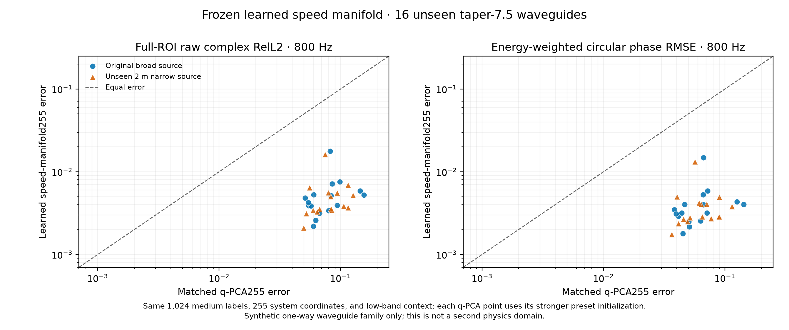

**图 6｜同观测、同代码预算的正结果。** 这是预先冻结方法后生成的16个新系统；不是把旧开发集多次调参
后的最好结果当独立测试。图中的大改善必须与表中 Gaussian 介质的负结果一起读。

### 21.4 能表示、能辨识、能稳定求解：是三道不同的门

在上述已使用的16个余弦介质上，把 q-PCA 从255升到768维，给它**真实测试介质做投影**时，800 Hz
raw 可到0.00309/0.00311。这说明高秩线性 q 并非完全不能表示，而不是部署方法已经达到该数值。
仅给低频观测、相同5+5反演，无持续先验时却为约0.123/0.123；加高斯 MAP 后为0.03185/0.03353，
仍高于速度255维的0.00538/0.00505。MAP 强度是在前8例选择，后8仅为条件固定强度检查，不是新测试。

**[交叉增量]** 增加容量会放入更多需要由有限观测估计的方向。好的表示要同时做到“容得下正确答案”
和“容易从 context 定位答案”。这里的真介质欧氏投影不是严格最小响应误差下界，当前优化失败也不
排除更好的 q 先验／优化器。出处：[容量与可辨识性审计](Q_CAPACITY_ORACLE_AUDIT_ZH.md)。

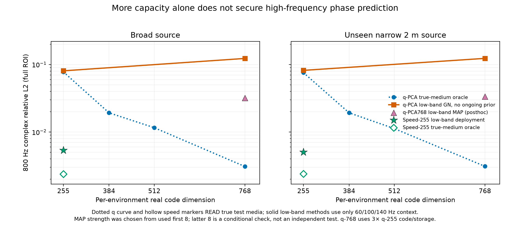

**图 7｜不要把 oracle 当方法成绩。** 增加 rank 可以降低真值辅助的表示误差，但从同一低频输入出发，
必须有合适先验与推断才能兑现容量；横向比较也要计算增加的代码、共享基和反演成本。

### 21.5 第二物理域、噪声和分辨率：哪些事实还在约束我们

| 诊断 | 实测／计算事实 | 不允许推导的结论 |
|---|---|---|
| 双向2D Helmholtz，三张完整65×65低频场、已知源／PDE | 修正错误的允许介质范围后，经典反演11.3/17查询 raw仅0.000123/0.0000684 | 原先0.145/0.129是错误裁剪产生的无效弱基线，不能算学习余量；同离散teacher精度不等于连续PDE绝对精度 |
| 同8 DEV，四线×65点×3频=780个复观测 | 数据已去除隐藏介质／seed。局部高斯分析估计rank64误差约0.00382/0.00322；但给一阶模型真实参数变化仍有0.238/0.251误差 | 局部线性小方差不是实际方法成绩；非线性四线预测尚未验证，不能说跨域已成功 |
| 已使用32个谱介质，1%复模态噪声 | 用已知源初值替代带噪测量初值，raw0.15054/0.16094→0.08619/0.08805 | 是有价值的经典纠正，但仍明显差于无噪结果；不是现实水听器噪声、同步误差和边界未知的验证 |
| 同16确认集的前8例，冻结速度代码到1200 Hz | 原读出raw0.006741/0.006537；加倍空间网格并增模态只好3.19%/0.15% | 这段范围已不是分辨率主瓶颈；既不证明任意高频无需自适应，也不证明更多网格必然改善 |

出处：[Helmholtz 数据／强基线](HELMHOLTZ_MULTISCALE_M0_PILOT_ZH.md)、
[四线公开输入](HELMHOLTZ_SPARSE_CONTEXT_ZH.md)、[信息与非线性余项审计](HELMHOLTZ_SPARSE_INFO_AUDIT_ZH.md)、
[谱噪声确认原始汇总](../artifacts/coherent_waveguide_spectral_noise_confirm_20261004/summary.json)、
[固定代码读出分辨率](SPEED_RESOLUTION_SCALING_ZH.md)。

### 21.6 现在可以凝练的科学判断

1. **表示误差应该在响应上审计。** 介质方差保留99.86%仍可能丢掉相位敏感方向；介质重建不是查询精度的充分代理。
2. **低维状态与低秩响应是不同对象。** 一个紧凑传播规则可以通过多次相干作用生成复杂响应；先压缩系统，再生成场，值得作为学习主线。
3. **“没有预测好”要拆开归因。** 物理信息、先验支撑、容量、优化、噪声和读出精度都可能是瓶颈；我们已经看到其中多项真实反转早期结论。
4. **校准应针对剩余的、与 query 有关的不确定性。** 高风险识别不保证校准可修复；更强模型可能比更多测量更先解决当下瓶颈。
5. **真正开放的是学习问题。** 能否不用知道合成介质的真实函数族，就学到跨介质／物理域仍然相位准确、由稀疏观测可推断的系统表示？目前尚无充分正证据。

前四条中的数学机制大多来自经典理论；本项目增量是具体的正负对照、适用边界和它们对 AI 任务设计的约束。
第五条是据此提出的研究方向，不是已经兑现的论文贡献。

## 参考理论入口

- [Zworski, Mathematical study of scattering resonances, 2017](https://doi.org/10.1007/s13373-017-0099-4)
- [Dienstfrey and Greengard, Analytic Continuation, Singular Value Expansions, and Kramers--Kronig Analysis, 2001](https://www.nist.gov/publications/analytic-continuation-singular-value-expansions-and-kramers-kronig-analysis)
- [Vetterli, Marziliano and Blu, Sampling Signals With Finite Rate of Innovation, 2002](https://www.ee.cuhk.edu.hk/~tblu/monsite/pdfs/vetterli0201.pdf)
- [Hua and Sarkar, Matrix Pencil Method, 1990](https://escholarship.org/uc/item/2n45r2z5)
- [Ionita and Antoulas, Data-Driven Parametrized Model Reduction in the Loewner Framework, 2014](https://doi.org/10.1137/130914619)
- [Bonizzoni, Pradovera and Ruggeri, Rational Model Reduction of Helmholtz Frequency Responses, 2021](https://doi.org/10.48550/arXiv.2112.04302)
- [Littman, Sutton and Singh, Predictive Representations of State, 2001](https://proceedings.neurips.cc/paper/2001/file/1e4d36177d71bbb3558e43af9577d70e-Paper.pdf)
- [Creutzig, Globerson and Tishby, Past--Future Information Bottleneck, 2009](https://doi.org/10.1103/PhysRevE.79.041925)
- [Brunton et al., Koopman Invariant Subspaces and Finite Linear Representations, 2016](https://doi.org/10.1371/journal.pone.0150171)

## 项目内部证据

- [谱连续算子第一阶段报告](../reports/STAGE1_REPORT_ZH.md)
- [连续谱生成器 Gate 报告](../reports/SPECTRAL_GENERATOR_GATE_REPORT_ZH.md)
- [稀疏谱校准 POC](../reports/SPARSE_SPECTRAL_CALIBRATION_POC_ZH.md)
- [全局隐空间与局部 token 诊断](../reports/GLOBAL_LATENT_DIAGNOSTIC_ZH.md)
- [局部复谱 Token POC](../reports/LOCAL_SPECTRAL_TOKEN_POC_ZH.md)
- [独立多保真 Calibration Gate](../reports/PAIRED_FIDELITY_CALIBRATION_GATE_ZH.md)
