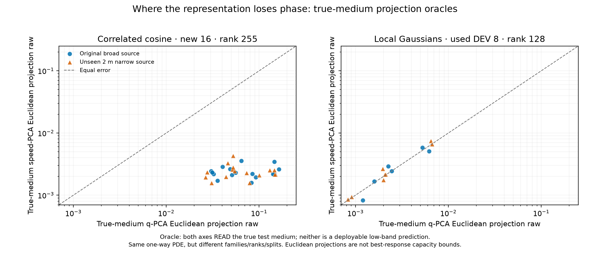

# 两种介质统计族的表示误差归因：读取真介质的不可部署oracle

> 2026-10-04约12:05 UTC，在所有部署/高频结果完成后、**本诊断oracle计算前**登记。只对已有余弦族新16与Gaussian族旧8的800Hz真值做解释，不生成新系统或频率目标；结果不得放进可部署方法排名。

## 要区分的两个解释

余弦族速度表示比q表示强93%，Gaussian族却只强约3%–6%。一个可能原因是：声速里的有限线性组合经`c^{-2}`以后产生高次交互，q的同维**线性**PCA漏掉的微小介质方向被长距离相位放大；另一个可能原因只是q低频初始化/GN优化没有找到好代码。前者需要表征容量证据，后者需要推断证据，不能混为一谈。

## 固定诊断

每个已存在的测试系统额外读取**真实测试介质**，分别欧氏投影到该家族训练得到的固定声速PCA和q-PCA子空间，再经相同256段、128模态的已知一向物理解码器查询800Hz宽/新窄源。余弦族rank255，训练标签为taper5和10各512份，新16个taper7.5系统；Gaussian族rank128，训练标签512份，旧8开发系统。每族内部训练标签/测试介质不交叉，但Gaussian旧8已在历史工作中反复使用。对应训练介质q方差解释率由完整训练标签和冻结基算出，不能因其靠近100%就宣称相位足够。

**这是直接读取真测试介质的额外信息oracle**，与只看低频响应的部署不等信息。欧氏投影也**不是该子空间800Hz响应误差的严格最小值**；若其误差高，只能说明常用介质欧氏投影不保真，不能证明任何代码/非线性表示都无解。两族代码rank、介质复杂度不同，不能把两族绝对数字并列作为公平方法排行榜；只看各族内部的速度/q相对模式。

事前设定的机制检查（800Hz双源系统宏均值均要满足）：余弦族q投影raw≥0.02而速度投影≤0.01，Gaussian族两种投影raw都≤0.005。若失败，不能再说部署差距主要来自这一欧氏投影机制；需保留优化/数据条件解释。无论通过与否，存全量逐系统值、真介质额外信息标签、训练方差率和源码/先验/目标SHA。配置：[JSON](../configs/coherent_waveguide_variable_projection_attribution_20261004.json)。

## 完整结果：预设机制模式成立，但仍非容量下界

协议/代码提交`f5e29b5`后运行，既有真值未更改。24个已存在系统×2表示×2声源共96条直接读取真介质的**额外信息oracle**结果；逐系统介质投影残差、训练标签/先验/目标SHA与完整配置在`artifacts/coherent_waveguide_variable_projection_attribution_20261004/`。

| 同一族内部，800Hz系统宏均值raw | 声速空间读取真介质投影（宽/窄） | q空间读取真介质投影（宽/窄） | 原先只用低频的部署（声速 vs q） |
|---|---:|---:|---:|
| **余弦taper7.5新16**，rank255 | **0.002391 / 0.002404** | **0.077785 / 0.075747** | 0.005375/0.005052 vs 0.080678/0.081965 |
| **局部Gaussian旧8开发**，rank128 | 0.002448 / 0.003065 | 0.002484 / 0.002884 | 0.003219/0.003435 vs 0.003415/0.003528 |

四个预设机制检查全通过。对应800Hz相位RMSE：余弦声速投影0.00203/0.00204rad、q投影0.07212/0.07018rad；Gaussian声速投影0.00198/0.00247rad、q投影0.00196/0.00226rad。真介质在训练**声速网格**PCA中的平均相对残差：余弦6.26e-15，Gaussian5.11e-4；在q系数PCA中的平均相对残差：余弦**0.00664**，Gaussian**0.000469**。训练方差覆盖率仍分别是余弦速度约100%、q99.997452%，Gaussian速度99.9999816%、q99.9999842%。一个看起来很小的余弦q系数残差在800Hz传播后确实对应约0.076–0.078的全复数场误差，而Gaussian两种空间的真介质投影响应都接近0.003。

这让归因更具体：余弦族q的**欧氏投影响应**已经与其低频部署误差0.081–0.082相近，所以不能简单说“只是低频优化没调好”；Gaussian族两个欧氏投影响应也几乎相同，符合部署收益不显著。相反，余弦速度空间真介质投影约0.0024，低频部署约0.005，说明声速代码的低频辨识仍贡献额外误差。

**必须保留的逻辑边界：** 欧氏介质投影不是以800Hz响应为目标优化过的代码，不是任意rank255 q空间的数学误差下界；之前目标泄漏的响应优化控制已经表明“在子空间里换代码”可能改善欧氏投影。这里也不比较两族绝对难度或物理域泛化：一个新16/255代码，一个已用8/128代码，介质族不同但方程相同。传统Taylor展开解释非线性变换可能导致秩膨胀；**这两组具体幅度、相位和已训练表示的对照是我们的新增经验事实**。下一步真正有意义的是在非余弦且更复杂的介质/不同波方程上预测何时这种结构会出现，而不是再刷本已用队列。
