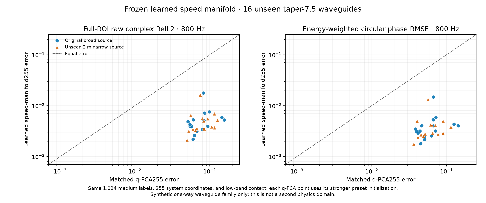
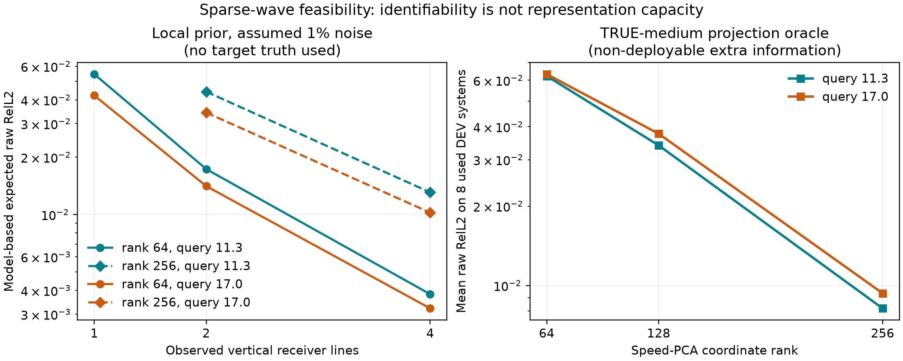

> 历史快照：2026-10-05 重整前版本；保留原结论与复现记录，不是当前计划。
> 当前入口：[三条 Wave as Prompt 路线](../../wave_as_prompt/README.md)。正文相对链接已重定位。

# 从波动场证据到 AI 研究问题：表征几何、可辨识性、算子复杂度与相干生成

> 2026-10-05 第二版。根据仓库正负结果重新推导科学问题及 AI 论文方向。本文明确区分经典结论、项目实证与未来假说；新增的是分析和研究设计，没有新增实验成绩。公式用普通文本书写，避免网页渲染问题。

## 先给出研究判断

**我最看好的 AI 主线是：学习一种由有限观测可推断、又保留未见查询所需相位信息的环境表示。** 它把海洋稀疏相位重建和 Wave as Prompt 放进同一个学习问题：哪些信息需要保留、如何由测量获得、怎样通过物理结构生成新的响应。

```text
跨环境训练数据 → 学习相位敏感的环境／算子先验
                          ↓
新环境的稀疏复观测 → 推断可观测状态及其不确定性
                          ↓
                同一个物理结构化 decoder
                          ↓
             新接收点、新频率、新声源的复响应
```

已有结果给了这条路线两类支持：一类证明在受控波导中，合适的环境坐标确实可以支持高精度高频相位与新源查询；另一类反复暴露出**压缩准、观测拟合准、未见查询准之间的断裂**。我认为后者更接近有普遍性的 AI 问题。现有证据尚未证明一个现代学习方法在真实海洋及另一物理域稳定胜出，故下文给出的是具有发表潜力的假说与判定实验。

建议先读第 1 节的科学推导和第 4 节的三张论文方向卡；第 3 节保留证据账，第 5–8 节说明任务与探索顺序。三个方向是有先后关系的候选，第一轮只推进方向 A 的一个学习机制。

| 一句话 insight formulation | 对应的 AI 问题 | 证据成熟度 |
|---|---|---|
| **表示距离应反映查询响应的变化，而不只反映介质像素的变化。** | 任务感知表征学习、非线性降维 | 有受控机制证据；跨族优势尚未成立 |
| **一个 latent 的价值，取决于它保存了多少能由 prompt 推断的未来查询信息。** | 条件充分表示、meta-learning、稀疏逆问题 | 多次容量／辨识分离的经验支持；学习方案未完成 |
| **波响应可以高秩，生成这些响应的共享规律仍可紧凑。** | 结构化 neural operator、局部／条件低秩、functional tensor | 有多源 rank 审计；现代方法增量待做 |
| **物理先验最有用时，会让同一环境的不同查询共享一个生成机制。** | 结构化 decoder、算子一致性、组合泛化 | 共同生成器的强正对照；不是新物理定理 |
| **不确定相位的平均会削弱相干性，概率模型应生成同一环境下自洽的整组响应。** | 条件生成、函数／算子后验、跨查询校准 | 理论动机明确；本项目尚无合格概率模型实证 |

## 1. 五条更底层的 insight，怎样变成学习问题

### 1.1 先用一个统一 formulation 定位误差

设隐藏环境为 `θ`，它包括声速、几何、边界、损耗等。已知声源输入为 `b_s`；线性波动模型的响应为 `u_θ(f,s) = R_θ(f)b_s`。`R` 是传播／Green 算子，表示这套环境怎样把激励变成响应。观测集合为 `C = {(f_i,s_i,r_i,y_i)}`，待回答的查询为 `q=(f,s,r)`，其干净目标记为 `U_q`。学习模型为 `Z=E(C)`、`Û_q=D(Z,q)`。这里必须公开源、背景和标定信息哪些属于输入。

在平方复数误差下，令 `μ(C,q)=E[U_q | C,q]`、`ν(Z,q)=E[U_q | Z,q]`，有一个标准条件期望分解：

```text
E ||U_q − D(Z,q)||²
  = E ||U_q − μ(C,q)||²       当前观测仍未消除的不确定性
  + E ||μ(C,q) − ν(Z,q)||²    编码压缩丢掉的可预测信息
  + E ||ν(Z,q) − D(Z,q)||²    有限 decoder／训练／推断造成的误差
```

这是条件期望正交性的经典结果，适用于确定性编码 `Z=E(C)`、有限二阶矩和同一数据分布，复数可按实部虚部理解。它针对**未按随机目标范数归一化的平方误差**；当前逐系统 relative L2 并不直接服从这条数值分解。它也没有把「测试真介质投影」「部署误差」自动变成三个可测项，现有 oracle 只能帮助诊断。

这条式子给出具体研究逻辑：增加观测或改善标定可能减小第一项；学习更合适的 latent 针对第二项；更好的算子读出与优化主要针对第三项。某个网络训练失败，不能直接推断第一项很大。已用低频可做到 0.004 的精确函数族对照，正是对这种误判的反例。

### 1.2 Insight 1：任务定义了表示几何；换坐标不会凭空增加信息

**一句话：A useful wave representation preserves response geometry, not just medium variance.**

大白话：两张声速图在像素上差不多，并不意味着它们让波走得一样；长距离传播会把很小的走时偏差累积成明显的相位错位。因此表示的「相似」应通过它能回答的查询来衡量。可用一组训练查询定义 `d_Q²(θ₁,θ₂)=E_q ||W_q[H_θ₁(q)−H_θ₂(q)]||²`，其中 `W_q` 是事先固定的单位／查询权重。只有足够丰富的查询才可能区分所有环境；一般而言，这只是针对该查询族的距离。

这可以直接连到波动方程。固定源，若 `L_θ(f)u=b` 且逆算子 R 存在，小扰动满足 `δu≈−R(δL)u`。介质误差先作用在已有波场上，再经整个环境传播到观测位置，所以相同大小的介质误差，位置、方向和频率不同，后果可能截然不同；接近共振时逆算子还可能很敏感。该扰动公式属于经典分析，说明「物理上重要的压缩方向」应依赖传播作用，不能仅从介质纹理大小判断。

在一个局部小扰动内，该距离近似 `δθᵀG_Qδθ`，`G_Q=E_q J_qᵀW_qᵀW_qJ_q`。`J_q` 表示「环境某个方向变一点，目标响应变多少」，所有复数在这里堆成实向量。这解释了为什么 PCA 方差小的方向仍可能对高频关键。**我们已有的全局均值处 Jacobian 基和一阶展开失败，说明不能把这条局部公式当全局充分方法。** 可研究的是跨多环境、有限扰动的非线性表征学习，必须以实际未见查询误差检验。

当前最强例子是：同样 255 维坐标下，余弦介质族中声速表示的 800 Hz raw 约 0.005，慢度平方表示约 0.081；Gaussian 族却几乎没有这项相对优势。这里有一个重要纠正：对正声速，`c ↔ 1/c²` 是可逆关系。若保留完整函数、正确变换同一先验分布并做精确推断，两者对物理查询的后验预测应一致。**信息内容和内在维数不会因可逆改名而改变；线性近似所需秩、先验形式和数值优化性质会改变。** 我们实际比较的是两种不同的有限维统计模型，并非证明声速坐标创造了新信息。

这里的等价针对后验分布及其查询预测；坐标概率密度的最大点（MAP）本身未必在非线性换坐标后保持对应，因为密度会带 Jacobian 因子。不能仅凭两个坐标中的 MAP 结果不同就宣布信息量不同。

为什么可逆变换仍影响有限维模型？`c=c₀+δc` 经 `1/c²` 变换会产生 `δc²、δc³` 等交叉项。一个在声速空间很直的低维集合，在 `q` 空间会弯曲；用同样数量的线性基近似，可能丢掉相位敏感细节。这个代数机制是经典的，仓库的增量是对两个介质族给出了可复核的响应后果。[变量归因](../../VARIABLE_PROJECTION_ATTRIBUTION_ZH.md)

**AI 出口：** 学习由目标响应定义的非线性坐标或先验，比较它与介质重建 autoencoder、响应加权线性降维、声速 PCA、正则化高秩 q-PCA 的差别。关键消融必须包含「同一先验仅换坐标、做正确概率变换」的控制；否则容易把改变先验产生的收益错误归因为坐标本身。任务相关降维已有[goal-oriented Bayesian inverse problems](https://arxiv.org/abs/1607.01881)基础，因此新贡献要落实在强非线性相干响应、有限观测推断和可泛化的学习机制上。

### 1.3 Insight 2：可表达的 latent，还必须是 prompt 可识别的 latent

**一句话：Learn a representation that is sufficient for unseen queries and inferable from the available observations.**

大白话：把答案放得进抽屉，与能凭手上的线索找到正确抽屉，是两回事。q 的 768 维真介质投影约 0.003，但只凭低频观测的强一些 MAP 约 0.032；Ocean 非线性 decoder 用完整响应拟合 latent 约 0.368，K=2 稀疏推断约 1.09–1.27。这些结果提示，单独把 autoencoder 重建做得更好，可能并不改善稀疏预测。[容量审计](../../Q_CAPACITY_ORACLE_AUDIT_ZH.md) · [functional operator 负结果](../../../reports/HETEROGENEOUS_FUNCTIONAL_OPERATOR_M0_ZH.md)

可同时看两个局部量：观测敏感性 `G_C=J_CᵀΣ⁻¹J_C`，以及上节查询敏感性 `G_Q`。前者问「这点变化能不能从带噪测量看出来」，后者问「它会不会改变我们关心的答案」。一个方向对观测弱、对目标强，会形成风险；对两者都弱的方向则可优先压缩。但这要在明确的先验尺度下比较，矩阵特征值会受参数单位影响；先验、噪声和查询共同决定有效难度。相关思想已有[likelihood-informed dimension reduction](https://arxiv.org/abs/1403.4680)，两矩阵本身不是新贡献。

更深的一步是：**我们未必需要恢复完整环境，只需要恢复足以预测规定查询族的状态。** 如果两个环境对全部目标查询几乎相同，模型可以让它们共用一个代码；如果它们对 prompt 相同、对目标不同，模型就应保留不确定性。所谓「query-sufficient」在平方误差下可理解为 `E[U_q|Z,q]≈E[U_q|C,q]`；概率预测则要求尽量保留整个条件分布。这是研究目标，不能靠给 latent 起名来保证。

充分性也依赖查询范围：一个足以回答某个孔径／频带的紧凑状态，未必足以回答所有声源与任意高频。仓库当前 255/256 维代码已接近合成器自由度，没有证明全面查询同时允许很强压缩。应把「可回答的 query 范围—latent 容量—观测预算」一起报告。

**AI 出口：** 把训练 episode 写成「同一环境抽稀疏 context → 从 context 推断 z → 在不重叠 query 上训练」，让表示与可推断性一起学习。物理已知时，先使用同一个可靠非线性逆解器，只学习环境先验／坐标；这样能看清学习到底改好了什么。之后再考虑摊销 encoder。网络可接收可变坐标、频率与 mask，但输出应携带观测强弱，不能假设所有 latent 方向都已知。

有限观测下的局部高斯协方差可以诊断弱方向，却无法覆盖多解、强散射和模态转换；已有二维反证要求我们用实际非线性、多环境实验验证。**接近的 prompt、不同的 query**可作为压力测试对，但有限数据中的近邻碰撞也不构成严格的信息论下界。

### 1.4 Insight 3：低维生成规律，与低秩输出矩阵是不同的复杂度

**一句话：A compact wave generator can produce a high-rank response operator.**

考虑一个简单例子：`T_d(f)=diag(exp(i2πf d/v₁), …, exp(i2πf d/v_N))`，`v_j` 全部已知，环境只有一个未知数 `d`。这个算子只需存一个环境参数，但它有 N 个非零、模长为 1 的奇异值。若强行用一个 rank-r 输出矩阵替代，最佳相对 Frobenius 误差仍是 `sqrt((N−r)/N)`。这是初等线性代数反例，说明**低参数维数不推出低输出秩**，不构成新的数学定理。

这也是波相对许多扩散过程的一项重要特点：理想传播可以主要旋转不同分量的相位，而不迅速压低它们的能量，因此细尺度分量和相干干涉会持续存在；扩散则常随时间强烈衰减高空间频率。真实波动中的损耗、有限孔径、窄频带又可能形成有效低秩，所以应实测谱随任务变化，不能说「所有波算子都不低秩」。

仓库的 40 个正交声源审计出现了近似平坦的响应奇异值：固定输出 span 的 rank 8/16/32 下误差约 0.894/0.775/0.447，而共享物理生成器的 40 源平均 raw 约 0.0017。[机制备忘](../../GENERATOR_REPRESENTATION_MECHANISM_ZH.md) 这不是对所有 FNO、DeepONet 或函数张量的下界；它只反对在这个任务上强制所有源共用一个过小的**固定输出子空间**。早期 source–receiver CP 失败也支持重新选择因子化对象，不能据此宣布所有 tensor 方法无效。

值得区分四种量：①每环境 latent 维数；②跨环境变化的秩；③固定环境的 source→receiver 算子秩；④随频率、孔径增加的传播分量与数值分辨率。现有功能张量可以继续用来压缩**环境系数函数、去除载波后的局部作用或分层交互块**，并允许因子依赖频率／环境；每一种 rank 都应单独命名和测量。

固定 latent 也不意味着高频免费。单路径 `φ=2πfτ` 中，保持相位误差 ε 需要走时误差约小于 `ε/(2πf)`。同一个走时标量在更高频必须估得更准；在固定走时范围内用均匀量化保证此精度，所需编码位数随 `log₂ f` 增长。这是局部无歧义相位误差的量级说明，不是多路径场的压缩定理或采样界。新模态出现还可能增加实际参与传播的自由度。

**AI 出口：** 学习可组合的传播／散射作用或频率共享的算子系数，把高秩振荡交给结构化 decoder 合成；local low-rank 或 functional tensor 只压缩有证据可压缩的部分。相位分离和蝶形分解已有[phase-preconditioned RKS](https://arxiv.org/abs/1711.00942)及[WideBNet](https://arxiv.org/abs/2011.12413)先例。潜在新增是从不完整响应推断环境依赖的算子结构，并在源、频率、网格变化中保留相干精度。

### 1.5 Insight 4：物理结构把不同 query 绑定起来，降低了学习的自由度

**一句话：Share the physical mechanism across queries, and learn the environment-dependent part.**

对同一环境，响应满足 `u=R_θ(f)b_s`。源位置／形状改变的是激励，频率改变算子取值，接收点改变读取位置。一个 unconstrained decoder 可以分别给这些请求输出看似合理却相互矛盾的答案。共享算子则在架构层保留源线性；对适用的二阶线性系统，还可用共同的 `K_θ−ω²M_θ+iωC_θ` 描述跨频关系，而不为每个频率独立产生一套系数。边界辐射、色散介质可能需要更一般的频率依赖，不能把这个简式强加到所有波动场。

复数特性还给出一个很具体的编码要求：同一发射的源激励及观测**一起改变共同相位参考**时，环境本身应不变，输出随源旋转；仅旋转响应而固定已知源，并不是同一个一致的测量问题。不同路径／分支的相对相位决定干涉，不能逐分支全部消去。仓库的多分支 Gram 与逐 packet 去相位控制提供了有限正信号，也显示固定大通道前端的增益不足。[多分支记录](../../EXPERIMENT_LEDGER_ZH.md) 可以学习局部分析基或相位关系，但应携带需要的源参考，不必首先引入复杂群论包装。

**AI 出口：** 用共享生成器、源线性读出、连续坐标和适用的边界条件限制 hypothesis class，让 learning 集中估计未知环境作用。其增量需体现为更少样本、更少测量或更好的组合泛化。单纯「加物理」已有大量先例；当前精确 PDE 读出的优势主要属于物理结构，不能全部算成网络创新。实际只有部分物理准确时，应学习明确的一项模型差异，并检查它是否能迁移到新频率／新源。

### 1.6 Insight 5：生成模型的合理对象是相干系统后验

**一句话：Generate coherent response families from a shared uncertain system state.**

先看单路径反例：条件于观测，传播时间 `τ` 仍服从均值 μ、标准差 σ 的高斯分布，振幅固定为 A。每个可能场 `u(f)=A exp(i2πfτ)` 的幅值都是 A，但条件均值为：

```text
E[u(f)|C] = A exp(i2πfμ) exp(−(2πf)²σ²/2)
```

高频时均值幅值被压低，即使真实候选场都没有衰减。这来自高斯特征函数，是经典概率结论；本项目尚未量化它解释了多少真实模型误差。它提示我们：「预测像被抹平了」可能部分来自不可消除的条件相位不确定性，但也可能只是表示／优化失败，必须用控制实验区分。

这修正了上一版过窄的说法：**后验生成的动机不要求先出现多个 mode；单峰的环境不确定性经相位非线性映射，也足以影响相干性。** 不过，如果高斯后验经物理解码已经足够，复杂 flow 仍无必要。标准平方误差下条件均值最优，随机抽一个自洽样本不能一般性地降低其 Bayes MSE；用 best-of-K 偷看目标选样也不是部署能力。

有研究价值的条件生成应是先采 `z^(k) ~ p(z|C)`，再让**同一个** `z^(k)` 回答整组频率、接收点和声源；独立生成每张频率图会丢失跨查询的相关性。是否需要 flow／diffusion，取决于真实条件分布能否由简单高斯／混合模型描述。潜变量后验采样已有[相关生成模型工作](https://proceedings.mlr.press/v267/venkatraman25a.html)，我们的候选增量是相干响应族的结构、概率校准和实际用途。

**AI 出口：** 预测连续频谱的联合分布和可靠范围，评估完整 query 向量的 proper score（鼓励正确概率分布的评分，如 energy score）、覆盖率与区间宽度、跨频相关性和物理一致性。后验均值的 raw 仍保留；仅有覆盖率可以靠无限宽区间取得，不能单独算成功。更多校准观测应在正确统计模型下**平均而言**缩小条件风险，单个环境、单个 query 不保证每次都改善。

## 2. 海洋相位任务需要明确的测量条件

单频复压强可写作 `u(x,f) = A(x,f) exp(iφ(x,f))`。多路径传播下，各路径到达时间稍有偏差，较高频率的干涉条纹就可能明显移动。这是传统波动物理直觉；**总场幅值并不保证比相位平滑**，在相消、模态截止和共振附近它也会剧变。我们经验上看到的「幅值较易迁移、相位较难迁移」，不能推广为所有场景的定律。[早期跨频证据](../../EXPERIMENT_LEDGER_ZH.md)与[科学备忘录](../../SPECTRAL_PREDICTABILITY_IDENTIFIABILITY_CALIBRATION_ZH.md)应按各自条件阅读。

在真实水听器上还存在一个比建模更前置的问题：观测通常不一定是理想的 `u`，而更接近 `y_i(f) = g_i(f) exp(iα_event(f)) u(r_i,f) + noise`。其中 `g_i` 是传感器复增益，`α_event` 可包含发射相位／时钟偏移。若每次发射的共同相位未知，**绝对相位不可由该次观测单独确定**；若各水听器的复增益也未知，连阵元间相对相位也可能不可靠。这是测量模型下的可辨识性限制，不是某个神经网络训练得不够好。跨频预测若要求绝对相位，就必须说明相干时钟、发射参考和标定；否则应明确改为「相对相位／复响应比值预测」，同时承认目标变了。

所以所有后续实验必须标记两个独立轴：

| 轴 | 首轮可操作条件 | 更真实的压力测试 |
|---|---|---|
| 物理信息 | 已知源位置／波形、背景声速、边界类型；未知局部环境 | 声速剖面部分已知，海底参数／几何不确定，最后才考虑源也未知 |
| 相位参考 | 统一时钟、已标定复增益，允许评价未经配准的复压强 | 仅共同事件相位未知；再到阵元增益漂移，采用可辨识的相对相位目标 |

不要把右列的额外困难偷偷加进左列，随后把模型性能下降解释成「波本身不可预测」。

## 3. 仓库证据账：正反馈、负反馈与真正留下的 insight

表里的数值仅帮助记忆数量级，**不是跨任务公平排名**。`新确认`、`已用开发`、`oracle`、`模型内预测`均明确注明。早期实验的时间线与完整数值仍以[实验账本](../../EXPERIMENT_LEDGER_ZH.md)为准。

| 线索 | 正反馈 | 负反馈／边界 | 留给真实问题的判断 |
|---|---|---|---|
| **从波场图像转向传播表示** | 相位坐标＋复包络的局部连续表示能达到约 1% 级；海洋模态谱查询优于直接插值。[阶段报告](../../../reports/COHERENT_CONTINUOUS_REPRESENTATION_PROGRESS_ZH.md) | 同核族现场优化约 0.72%，强经典模态／物理读出常更准；空间 chart 准不等于新频率准。 | 编码一张图与识别能回答新 query 的系统是两种能力；学习要争取跨环境摊销、未知物理修正或更少观测，而非替代已知精确求解器。 |
| **Ocean 模态及模式诞生** | Pekeris Ocean 的误差归因指向模态出现／截止；另一距离相关单向波导的局部模态参考比简单谱插值好，但幅值和相位仍都贡献误差。[阶段报告](../../../reports/COHERENT_CONTINUOUS_REPRESENTATION_PROGRESS_ZH.md) | 前者简单截止锚点不稳定；后者给完整介质的经典传播器可到约 0.00282／0.00065。这是两组不同模型与信息条件。[波导界限](../../RANGE_DEPENDENT_WAVEGUIDE_DATA_ZH.md) | 频率连续模型需要处理分支变化与相互作用；显式模态不是唯一表示，也尚未验证对 3D 的可扩展性。 |
| **环境坐标选对变量** | 新 16 个同合成族插值环境：相同 1,024 训练介质标签、255 维代码、低频观测和物理反演，声速表示 800 Hz 双源 raw **0.00538／0.00505**，相同维度 `1/c²` 线性表示 **0.08068／0.08197**；相位约 0.004 rad。[确认](../../LEARNED_SPEED_MANIFOLD_CONFIRM_ZH.md) | 仍是单向、已知 PDE／声源、60/100/140 Hz × 65条干净完整剖面；代码接近合成器自由度，并非真实海洋／现代神经算子。旧 Gaussian 族仅改善 **5.7%／2.6%**。[反例](../../GAUSSIAN_SPEED_VARIABLE_DEV_ZH.md) | 「学习哪一个物理变量」可能比再加网络层关键，但最佳坐标依赖介质族，不能宣布声速表示普适最优。 |
| **容量 ≠ 方差解释率 ≠ 响应保真** | 余弦族把旧 128 维升到 256 维后，新 32 环境 800 Hz raw 从约 0.51 降到 **0.0148／0.0153**。[独立确认](../../SPECTRAL_MEDIUM_STRESS_POC_ZH.md) | 128 维已解释 99.86% 介质方差；`q` 的 255 维真介质投影即使保留约 99.997% 系数方差仍留下约 0.078 响应误差。高维 `q` 真介质 oracle 可降到约 0.0031，却不自动能从低频辨识。[归因](../../VARIABLE_PROJECTION_ATTRIBUTION_ZH.md) · [容量审计](../../Q_CAPACITY_ORACLE_AUDIT_ZH.md) | 表示压缩应以**目标复响应的误差**而不是介质 MSE／PCA 方差率来判断；需要同时画「真介质投影可达性」和「仅凭实际观测的部署误差」。 |
| **信息不足和先验错误不是一回事** | 改变介质相关尺度后，旧先验 raw 约 **0.42／0.44**；额外知道真实合成函数族的经典非线性逆解，仅用相同低频响应可到 **0.00388／0.00413**。[分布外反证](../../SPECTRAL_TAPER_EXACT_FAMILY_ZH.md) | 精确函数族是**额外信息**，不是同信息公平算法对照；固定先验并未适应新分布。[OOD 失败](../../SPECTRAL_TAPER_SHIFT_POC_ZH.md) | 在此理想条件下低频并非原则上不含高频相位；学习问题是如何在**不知道真生成族**时获得可适应且可从观测识别的传播表示。 |
| **稀疏带噪输入和源知识** | 旧开发组从 65 降到 17 条干净剖面 raw 仍约 0.018；1% 合成复噪声下，正确利用已知声源初态可将已用 32 环境约 0.15／0.16 降至 **0.086／0.088**。[噪声记录](../../SPECTRAL_MEDIUM_STRESS_POC_ZH.md) | 仍约为无噪误差的 6 倍；不是实测水听器噪声，也不是未知源与阵元相位漂移。 | 真实应用应把源与仪器标定显式放进 likelihood／观测模型；不能让编码器暗中从第一条带噪剖面「猜初态」。 |
| **跨域 Wave as Prompt 的系统表示** | OpenFWI、Deepwave、Ocean 的新环境 held-out source response query，少量 prompt 的系统级复响应子空间明显优于局部插值；更严格 source＋frequency 均未见的 Q3，posterior kernel 在 K=2 的 OpenFWI／Ocean raw **0.147／0.487**，比验证集选出的强对照改善约 **13.6%／19.9%**。[E16–E20](../../EXPERIMENT_LEDGER_ZH.md) | Ocean 的**绝对误差仍高**；OOD 可严重失效。独立 source–receiver CP、简单频率因子化和 neural residual 在多域无稳定增量；K／任务类型不同，单一 global head 不总适用。 | 「少量测量识别系统，再问新问题」已有跨域价值，但不能把相对提升包装成高精度海洋相位已解决。Q2 同频新源与 Q3 新源新频必须分开。 |
| **非线性 decoder 的陷阱** | 完整响应表拟合显示非线性表示信号，但新系统 raw 仍约 0.368；posterior-conditioned 解析表示更稳定地保留小预算信号。[E21–E23](../../EXPERIMENT_LEDGER_ZH.md) | K=2 严格 Q3 时，Ocean nonlinear latent 稀疏优化约 **1.09–1.27**；learned correction 在小 calibration selection 看似改善，未见系统反而退化。 | 完整信息拟合较好不保证稀疏推断较好，也不证明差距完全属于物理不可辨识；需要区分信息、先验和优化。 |
| **二维散射中的经典上限与数值底噪** | 多尺度二维 Helmholtz 数据通过 257→513 数值审计；四线公开输入已准备。[M0](../../HELMHOLTZ_MULTISCALE_M0_PILOT_ZH.md) | **完整** 65×65 低频复场＋已知 PDE／源时，修正物理范围后的经典逆解新频 raw 已约 `10⁻⁴`；四线尚无正式方法成绩。局部高斯模型预期 0.003–0.013，但给真实介质差值的一阶预测仍约 **0.238／0.251**，否定直接将局部预期外推为全分布精度；129 网格 f=17 真介质误差已约 0.0285。[审计](../../HELMHOLTZ_SPARSE_INFO_AUDIT_ZH.md) | 真实稀疏任务必须用非线性、数值收敛、**同样观测信息**的经典逆解对照；局部 Fisher/Jacobian 乐观曲线只是诊断，不能当方法成绩。 |

### 把表收束成四条因果链

1. **相位保真首先是表示问题**：细小介质误差在传播中相干累积，介质平均 MSE 很低也可能错掉整张复场。仓库的增量是**在特定受控介质族中量化了表示变量、容量与复场误差间的巨大落差**；传播时间影响相位本身属于既有物理。
2. **其次是可辨识问题**：高容量坐标能装下答案，稀疏阵列却未必能从数据推出来。Oracle 读取真介质、完整场输入和四线输入必须分表。仓库的新增经验信号是该容量—辨识权衡在两类仿真里非常尖锐；不是一般可辨识性定理。
3. **然后才是生成问题**：新源、新频、新位置应由同一环境算子生成，不能对每个请求拟合一张互不一致的图片。传统 Green／resolvent 算子给出线性源响应结构；我们的开放问题是**只见少量复响应时如何学习可辨识的环境依赖部分**。
4. **最后是可靠性问题**：分布移动、带噪、相位失配和数值离散可比模型结构更早主导误差。合格模型不只给平均 raw，还应知道何时频率跨度、几何或相干度超出了可靠范围；这目前是研究目标，不是已证明能力。





## 4. 三个可能发表的方向：主张、方法与决定性证据

下面的英文句式是**候选论文主张**；只有对应关键实验通过后才能写成已完成贡献。

### 方向 A：面向未见查询、可由观测推断的波动表示（优先）

**一句话论文 formulation：We learn wave-system representations that preserve phase-sensitive unseen-query information under sparse observations.** 中文：从稀疏波响应学习环境表示，使它保留未见查询所需的相位信息。

**科学问题。** 介质重建、完整场压缩与稀疏 query 预测对应不同的最优表示；前两者的成功不足以保证第三者。我们要检验「让表示在实际观测协议下学会被推断」是否优于先学一个 autoencoder，再要求 encoder 把稀疏输入塞进去。

**一个最小的 learning 方法。** 用可训练的连续介质／生成器 decoder `m_η(z,x)` 定义共享非线性先验；z 是每个环境的状态，η 在训练环境间共享。先保持一个经过验证的物理传播器 P 和相同在线推断算法。每个训练 episode 把同一系统的响应拆成 C 与 Q：

```text
内层：z* = argmin_z 观测噪声加权的 ||P(m_η(z), C的查询) − y_C||² + λ||z||²
外层：更新 η，使 P(m_η(z*), Q的查询) 与训练系统的 y_Q 接近
部署：新系统只给 C，推断 z*，回答未见 Q；不读取测试 y_Q
```

大白话：外层学习「怎样的一套环境坐标，能让内层用几条测量就找到有预测力的位置」。一项 query 复数重建目标即可启动；内层的噪声似然和先验有明确统计含义。可以从现有声速 PCA 加一个小的非线性坐标映射开始，同时检查物理可行的声速范围。**双层训练、学习先验和可微物理各自都不是新概念**；需要证明这里的相位敏感表示与观测协议耦合确实解决了一个旧方法遗漏的困难。

第一步先让经典逆解承担 z 的推断，使 learning 增量能归因于共享先验。若证明表示改进，再训练 variable-set encoder 摊销它。这样不必一开始同时学习 encoder、decoder、后验和物理残差。若内层容易多解或梯度不稳，先在可控小模型检验训练目标；不能用不收敛的内层给新方法制造优势。

**决定性实验。** 同训练环境、同监督、同 latent 维度和同输入预算，对比：介质 MSE 学到的先验；完整 query 场重建学到、但不经历稀疏推断的先验；上述稀疏 context→held-out query 训练的先验。保留强声速/q-MAP、非线性物理逆解、posterior response operator，以及至少一个适配非规则输入的神经算子。报告表示 oracle 与实际推断两条曲线，并用逐环境结果判断收益是否跨介质族。若比较者使用相同高频训练监督，应全部公开，避免把监督增量写成架构增量。

**频率泛化的写法。** 首篇可以主张「新环境上回答未观测频率」，即该频率在其他训练环境中可见。若进一步声称「超出整个训练频带」，则该频带的目标场不能参与 query loss、checkpoint 选择或超参反馈。训练时用了 800 Hz 的损失后，不能把新系统 800 Hz 称为全局未见频率外推。这两层泛化分开报告。

**发表价值。** 对 AI 会议，主贡献是一个明确的表征学习原则和最小算法，在两类波动机制中改善稀疏新 query 的精度／样本效率，海洋相位作为高要求应用。若未来有跨海域实测与多物理解释，可扩展为偏 AI 的期刊工作。任务可视为经典逆问题与 in-context learning 的交叉，论文不依赖宣称发明全新任务。[NIO](https://arxiv.org/abs/2301.11167)已研究从算子观测识别环境，因此应比较具体输入、输出和泛化能力。

**否证／停止条件。** 如果非线性 prior 的优势只来自更大容量、额外介质标签或更长优化；如果只改善真介质 oracle、实际稀疏推断不改善；或者强同信息逆解已达数值精度，而 learning 无成本／数据收益，就不能继续把它作为独立 AI 主贡献。当前证据支持启动该机制检验，尚不支持宣称它成功。

### 方向 B：紧凑生成机制支撑高秩、连续的波动算子（中长期）

**一句话论文 formulation：Learn compact wave generators that synthesize high-rank responses across sources, frequencies, and resolutions.** 中文：学习紧凑的波传播生成规律，合成跨声源、频率与分辨率的高秩响应。

**科学问题。** 高频多源场的存储与预测难度究竟来自环境规律，还是来自输出振荡？固定输出 low-rank 的失败是否可通过重新选择因子化对象来缓解？这是一个表示／算子学习问题，即使先给完整环境或充分观测，也可以独立成立。

**具体方法切入点。** 让网络预测局部传播／散射作用的连续参数，用共享组合规则获得长程响应；把 functional tensor 放在系数函数或局部去相位作用上，允许输出算子保持高秩。一向波导可先用已知传输形式；有反射的第二域需要能组合入射与返回分量的结构，不能直接照搬一向矩阵乘积。第一版只验证一种结构和一种可学习参数化，选择的依据是局部压缩审计。`Low-rank` 是需验证的局部性质，不能对任意介质全局宣告成立。

**决定性实验。** 在环境代码固定时扩大声源子空间、频率上限和查询网格，画误差—全局存储—在线成本曲线；比较输出 Tucker/CP、共享响应基、标准 neural operator、结构化算子及经典降阶方法。用多源算子作用误差检验，避免只在一个 Gaussian 声源上证明低秩。结构化组合和相位载波的收益要分别消融；现成物理解码带来的提升单独归因。

**发表价值与风险。** 若学得结构在复杂源空间和频率变化中比强 neural operator 更高效地保持相位，这是比特定水声场景更广的算子贡献；3D 是后续扩展证据。已有 phase-preconditioned MOR、butterfly neural networks 和 Green operator learning，故「把波按相位分解」不足以构成新颖性。若全部优势只来自调用已知精确 solver，学习模块没有改善精度—成本或适应能力，这条线保留为机制结论。

它与方向 A 可以共享数据和 decoder，但分别要解决**可推断性**与**高秩算子合成的复杂度**。若最终依赖同一个方法、同一组实验才能站住，应写成一篇完整论文，而非换标题拆成两篇。

### 方向 C：共享环境后验驱动的相干生成与谱可靠性（满足条件后）

**一句话论文 formulation：Represent wave uncertainty over shared system states to generate physically coherent response families.** 中文：在共同环境状态上表示不确定性，生成物理自洽的整组波响应。

**科学问题。** 在实际稀疏观测仍留下查询相关不确定性时，如何既保持每个样本的相干性，又正确描述联合分布与可靠频带？这与单张场的生成精度不同，最直接用途是海洋频率响应的可靠预测、校准和下游风险评估。

**方法顺序。** 先给现有先验加入经校验的高斯／Laplace 后验，通过同一个物理 decoder 采样；对照独立频率预测的高斯模型，检验共享环境能否改善联合分布与校准。只有真实 posterior 的非线性／非高斯性造成明确剩余误差，再引入 conditional flow 或 diffusion 在环境／算子代码空间建模。每个 sample 固定一份环境代码，回答所有 query；源参考与相位 nuisance 明确建模。

**决定性实验。** 用可精确积分的小模型先验证概率评分和相位平均衰减机制；在复杂波场上比较 posterior mean raw、联合 energy score、区间覆盖与宽度、跨频相关性，以及新增校准观测后的变化。把采样成本算进去。只有 best-of-K 好看、单张图更锐或低频拟合更小，均不足以证明这条路线成立。

**发表价值与风险。** 条件生成用于逆问题已很成熟；潜在贡献在共享环境诱导的跨查询相干分布及可验证用途。它不应承诺无信息新增就降低 Bayes 极限，也不必要求条件后验多峰。当前仓库没有这组决定性证据，故排在确定性精度路线之后。

### 当前选题排序

| 方向 | 最有希望的核心贡献 | 当前最缺的一块 | 建议 |
|---|---|---|---|
| A：可推断的 query 表示 | 观测协议与目标响应共同塑造非线性先验 | 实际有限观测下，跨族／跨机制的最小学习增量 | **主攻；先一次只改 prior 的学习方式** |
| B：紧凑生成器、高秩响应 | 新的结构化算子／因子化对象与精度—复杂度规律 | 超过经典物理和现成结构网络的新增能力 | 平行保留理论与小容量审计；不马上开完整大模型 |
| C：相干系统后验 | 连续响应族的联合条件生成与概率校准 | 查询相关不确定性实证及强简单后验对照 | 后置；一旦确定性残差被归因为不确定性，再启动 |

## 5. 这些 AI 问题落到哪些重要应用任务

### A．旗舰：海洋稀疏阵列的相干场补全与查询

一句大白话：**同一片海域，在若干已知声源／频率上只测到少量水听器复压强，预测另一位置或另一频率的复压强，尤其保证相位不漂。** 仿真时可附加「整张场」评价；真实采集首先留出若干水听器与频段。不要把真实不可测的全场当作实测 ground truth。

第一版设定固定标定好的同步阵列和已知源，公开粗声速剖面／水深范围，隐藏局部 SSP、海底与距离相关变化；记录每次发射的源级参考相位。任务先按难度拆开：`R` 未见接收点（空间补全），`F` 未见带内频率（连续谱），`S` 未见声源位置（算子迁移），最后 `SF` 联合未见。首轮重点可以是 `R+F`，但**不能只在原观测点周围插值**；必须有预先固定的距离／深度外推带和频率间隙。以观测预算（阵元数×频率数×发射次数）画复场误差曲线。

应用价值不是「生成一张好看的相位图」，而是用有限布放维持可查询的声场数字孪生，服务未布点传播预测、阵列设计、源定位／匹配场处理的前向响应估计。这里仍需证明下游任务真正受益；目前只有合理的应用假设。

数据上，现有 [Ocean 整数频率数据](../../COHERENT_DATA_PROVENANCE_ZH.md)是 Pekeris 式受控开发材料，不能假装真实距离相关海洋；[距离相关一向波导](../../RANGE_DEPENDENT_WAVEGUIDE_DATA_ZH.md)不含反向散射与可穿透海底。应逐级增加海底参数、距离相关 SSP、有限孔径与真实仪器 nuisance，并用独立高精度 solver 审计数值误差。真实观测若来源不一致，先核查时间约定、时钟、源强与阵元复增益；不具备相干参考的数据只能评估幅值或相对相位，不能报绝对 phase RMSE。

### B．通用：少量复响应作为 prompt，回答新实验

一句大白话：**模型到了一处新环境，先看几条「谁发、什么频率、哪里测、测到什么」的例子，就能回答下一条从未测过的实验。** 把 `D_K = {(f_i, s_i, r_i, y_i)}` 当 prompt，查询为 `(f*, s*, r*)`；同一模型权重不针对新环境微调。重点不是把 Transformer 套在点云上，而是让 prompt 表达一个**可作用于新声源的环境传播规律**。这与通用 [ICON 的 in-context operator learning](https://pmc.ncbi.nlm.nih.gov/articles/PMC10523630/)有概念交集；我们不能把「in-context operator」本身称为独创。特定增量要靠复相位、稀疏可观测性、跨源/频率的组合查询及物理一致性证明。[Neural Green's Functions](https://arxiv.org/abs/2511.01924)说明把 Green 型算子当对象有先例；我们的差别若能成立，在于**环境不直接给定，而是由少量响应识别**。

该任务的通用域可用现有 OpenFWI、Deepwave、Ocean 的 `system × source × frequency × receiver` 表，但要按数据真实语义选择 query：[The Well 缺源坐标](../../EXPERIMENT_LEDGER_ZH.md)，不能凭 trajectory index 伪造多源算子；Deepwave 的某些离散圆环 receiver 设定有重合采样／空间 aliasing，不能把插值下限误称网络失败。现有跨域 K=2 的 Q3 正结果可作为**起点和强 baseline**，不是重启弱 U-Net 排行榜的理由。

### C．跟进：可靠频率视野与少量校准

一句大白话：**模型不仅预测新频率，还明确告诉我们离已测频段多远仍可信；必要时给它一两条新频测量后重新校准。** 这适合海洋窄带测量扩展到较宽频段、频率逐段获取的流程。任务应同时报告预测误差、相位误差与「声明可靠的频率区间里究竟有多少错误」，不能靠缩短区间虚报安全。先做带内间隙和近邻带外，不承诺任意远高频。旧 [可靠视野 POC](../../RELIABLE_HORIZON_MAP_POC_ZH.md)可提供失败模式，但不能直接证明新相干场表征下的可靠区间。

这一项是 A/B 的**能力扩展**，不是第一阶段必须一起上的第三个大模型。主动选择下一次测量更后置；[Reinforced Inverse Scattering](https://epubs.siam.org/doi/full/10.1137/22M153207X)已做频率／传感器自适应选择，单纯「用 RL 选频率」既不新，也会掩盖当前还没有解决的被动预测精度。

## 6. 物理先验具体放在哪里，哪些约束有条件

我认为值得检验的基本对象是**环境相关的复传播算子**。给定 prompt，先估计环境状态 `z_env = Encoder(D_K, known geometry, optional coarse environment)`；对于频率、声源与接收位置的请求，算子读出 `û(r; f,s) = Decoder(z_env, f, s, r)`。当线性声学近似成立，同环境、同频率下对声源激励应满足线性叠加。源未知时，该物理性质仍可成立，但须先把源的未知量纳入观测模型；强非线性传播则不适用这个线性约束。

**第一项最小可证伪创新**：学一个从响应可识别的**非线性环境先验／传播校正**，但保留显式复相位传播读出。它要和三种同信息强基线比较：①标定后的经典模态／全波或 PE 逆解；②正则化的声速及 `q=1/c²` 高维先验＋非线性物理反演；③当前 Wave as Prompt posterior／retrieval operator。若已知完整环境的物理求解器接近数值底噪，那是 oracle/upper bound，不能作为少观测方法的公平分母。学习模块不能只是把 PCA＋GN 换名；必须在**有限观测、新环境或跨统计族**中证明它提供了可观测且稳定的增量。

表示可以沿两条互不捆绑的路线做小 POC：

1. **介质坐标路线**：从训练的粗 SSP／几何标签学非线性先验，明确保持 `c → 1/c²` 等正确物理变换；新环境用少量响应作后验更新，已知物理读出保证相位组合。适合海洋有粗环境地图时，必须和强 PDE-MAP 及已知真生成族上限区分。
2. **响应算子路线**：不要求给出完整真实 SSP，而学习局部／层级的 Green 型相互作用或传播修正；prompt 仅识别**相位敏感、可观测**的系统自由度，decoder 支持任意查询坐标及新源。适合环境标签不足、欲跨波动机制时；先在海洋与二维回散射各做一个受控小版，不从一开始堆多分支 token、flow、若干物理 loss。

关键比较是：**同样的 prompt 能否让新系统的复相位更准？在新源／频率下，是否仍是一个自洽的算子？观测减少／环境改变时，是否知道自己不可靠？** 过去的 best-of-K 审计不足以支持启动 flow；新的重启依据应是第 1.6 节的查询相关不确定性与简单后验模型的不足，并不限于是否多峰。[相关负结果](../../EXPERIMENT_LEDGER_ZH.md)

| 物理特性 | 合理的架构用法 | 不能自动保证的性质 |
|---|---|---|
| 线性声源叠加 | 固定环境／频率下，decoder 对源激励线性 | 环境识别本身仍可非线性；未知源不能与环境任意混合而不建观测模型 |
| 共同源相位参考 | 源及其观测一起换相位参考时，环境状态不变，输出随源旋转 | 对每个分支独立去相位会破坏干涉；只有幅值数据也不会自动恢复绝对相位 |
| 频率共享传播规律 | 同一环境代码生成一族频率算子 | 任意频率 MLP 不自动满足因果性；单向平方根传播不自动覆盖回散射 |
| 互易性 | 在线性、互易介质和正确源／接收定义下共享相关 kernel | 运动介质、非互易边界或不同测量归一化可能改变关系 |
| 无源性／能量约束 | 在正确能量内积或端口归一化下约束作用 | 复压强向量的普通欧氏范数不一定收缩，不能直接强迫所有传输矩阵谱范数≤1 |
| 连续空间表示 | 坐标化系数与适配查询带宽的读出 | 数值分辨率与传播分量数量仍可能随频率、孔径和源变化 |

第一轮只采用任务已明确满足的一两项结构，先保持正确的复数观测似然与源线性读出。其他性质作为机制检验或后续扩展，避免堆叠约束后无法归因。

## 7. 怎样评价，才不会再把不同问题混在一起

| 项目 | 必须报告 | 原因 |
|---|---|---|
| 主复数误差 | 系统宏平均 raw complex RelL2；仿真完整 ROI／真实留出阵元，**不做预测后全局相位旋转** | 同时约束幅值与相位；避免用 gauge 对齐掩盖真实漂移。若绝对相位在真实数据不可识别，则明确另报可识别目标，不与原 raw 同表。 |
| 相位与幅值 | 按真值能量加权的圆相位误差、幅值误差；低信号点单独分层 | 干涉零点处相位可不稳定；但不能为了好看从主 ROI 删除难点。 |
| 查询维度 | R、F、S、SF 分开；带内／带外、新几何／新介质统计分别报告 | 同频补全不等于新频率生成，新源不等于新接收点。 |
| 观测条件 | K、接收点布局、SNR、相位／时钟标定等级、已知 SSP／海底信息表 | 防止多给环境标签或少给物理基线而误称 learning 胜利。 |
| 可靠性与成本 | 最差系统、bootstrap 配对区间、误差—预算曲线、校准／编码／全部 query 的端到端时延与内存 | 真实部署更关心坏海域、少量观测和每次建模成本。 |
| 数值真值 | 网格／模态／传播步收敛、相位约定与 receiver 去重 | 误差低到 1% 时，数值底噪可主导结论；仓库已有错误物理界限和 aliasing 的教训。 |

切分单位是**物理环境**，不是像素或同一环境里随机拆频率。开发集只用于选方法；跨介质统计／跨海域和另一 PDE 应用冻结测试。真测试环境不能通过文件名、随机种子、`spec` 中隐藏介质系数泄漏进 encoder；[四线公开输入](../../HELMHOLTZ_SPARSE_CONTEXT_ZH.md)就是特意为此分离。若真实海洋每个系统观测极少，至少用多航次／多海域留出，并公开可重复的采集校准元数据；一个海域多次抽样不能算多个独立系统。

## 8. 探索节奏与论文是否站得住的判据

**第一步，先把题目变成真实可测的合同。** 选定一种同步水听器与已知发射源情景，写清阵列几何、复相位参考、粗环境先验、测量预算，以及真实可留出的目标。先用现有 Ocean 仿真重放这个合同，确认数值真值和传感器模型；真实数据只在元数据足够时接入。若相干相位无法标定，改成阵元间相对相位任务，并清楚声明与绝对复场预测不是一回事。

**第二步，找出具体的信息缺口。** 在同一 prompt 上做非线性经典逆解、当前 posterior operator、真介质投影 oracle（仅机制诊断）及更密观测曲线。若强经典已到数值底噪，就缩减该设置中的学习 claim；若 oracle 准但部署不准，重点检查观测辨识、先验和优化；若投影 oracle 也差，重点检查表示与投影准则，不能据此宣称该子空间最优误差必然高；若真介质全解也差，先修数值或物理模型。不要用局部线性 Fisher 曲线代替真实非线性部署结果。

**第三步，测试方向 A 的一个 learning 模块。** 先固定物理解码器和内层推断，只改变先验／坐标的训练目标，比较介质 MSE 与实际 sparse-context→held-out-query 学习。新的科学变量是「表示是否经过部署推断条件的训练」，不是对旧 8/16 个系统继续扫 rank、损失权重或网络宽度。先在开发环境判断机制，再冻结新系统测试；对海洋与有回散射的二维域给出同信息结果。

**第四步，再决定是否需要更大表征与生成。** 若学习先验确有优势，但读出随源／频率成本失控，进入方向 B；若表示和推断都通过检查，剩余误差表现为条件不确定性，先做方向 C 的简单后验。当前更新仅形成研究设计，不自动启动任何新训练或长期目标。

一篇 AI 会议论文最少需要串起四件事：一个容易说明的失败机制；一个可消融的学习方法；两个不同传播机制中的未见系统结果；一项直接由方法结构带来的新能力或精度—数据／成本优势。可以预先把相对强同信息基线约 20% 改善作为开发参考，同时要求绝对相位／复场误差达到应用需要、配对区间稳定、没有关键预算退化；这不是录用门槛，也不能为达到比例而选弱分母或事后换指标。若只能得到「某一变量在一个合成器上优于另一变量」，当前更适合作为科学机制结果。

偏 AI 的期刊方向需要更长证据链：真实测量或跨海域验证、对不同介质机制的可解释适用条件、相干预测对下游任务的价值，以及方法在更大维度／规模上的可靠行为。增加案例数或给模型换一个更宏大的名称不能代替这些证据。

**明确暂缓**：已知完整介质时拿神经方法去追赶精确求解器；再用均匀水层制造 learning 优势；用单一低秩 CP 压 source×receiver；只扫网络宽度／attention／损失权重；把 Gaussian 小族的低误差当复杂海洋证据；不验证相干参考就承诺实测绝对相位；在被动 Q3 仍误差高时直接上主动 RL。这些停止条件来自本仓库的反例，不是说这些方向原则上永远没价值。

## 9. 与已有研究的距离：哪些概念不能作为新颖性

以下为本次针对性检索核查的原始论文／作者摘要，不是完整领域综述。引用支持的是既有概念边界；对本文具体方法是否首创，仍需在候选结构明确后做更细致比对。

| 既有工作 | 已有的关键思想 | 我们若要增量，必须多证明什么 |
|---|---|---|
| [Goal-oriented Bayesian inverse problems，2017](https://arxiv.org/abs/1607.01881) | 先验、观测、噪声和目标共同决定低维近似 | 强非线性波相位下的可学习表示，而非只重写线性广义特征值问题 |
| [Likelihood-informed subspace，2014](https://arxiv.org/abs/1403.4680) | 数据真正约束的后验方向可与其余方向分离 | 随 prompt 几何／频率变化的预测能力，以及实际非线性辨识 |
| [Phase-preconditioned RKS，2017](https://arxiv.org/abs/1711.00942) | 分离快速相位以压缩波传播模型 | 从不完整测量学习环境依赖结构及其跨 query 泛化 |
| [WideBNet，2020/2021](https://arxiv.org/abs/2011.12413) | 用蝶形与多尺度结构构造宽频逆散射网络 | 共享系统表示、连续查询与新的结构化算子能力 |
| [NIO，2023](https://arxiv.org/abs/2301.11167) | 神经网络从算子观测反演环境函数 | query-sufficient 表示的具体学习机制与相位敏感泛化 |
| [ICON，2023](https://pmc.ncbi.nlm.nih.gov/articles/PMC10523630/) | 用数据 prompt 在推断时回答新算子问题 | 复杂复响应的可观测性、物理结构及未见查询精度 |
| [Neural Green's Functions，2025](https://arxiv.org/abs/2511.01924) | 学习 Green 型解算子，支持源／边界函数变化 | 未知环境仅由稀疏响应暴露时的识别与相干预测 |
| [Outsourced Diffusion Sampling，ICML 2025](https://proceedings.mlr.press/v267/venkatraman25a.html) | 在生成模型潜空间做后验推断 | 跨频率／源共享环境的不确定性、联合校准及波动任务收益 |

因此，我愿意押注的是**方向 A 的可推断表示原则，配合方向 B 的结构化读出**。这个组合的科学问题清楚，已有正负证据能约束方法设计，而且可以用最小实验否证。方向 C 是有独立意义的下一步，是否启动由不确定性证据决定。

## 10. 给后续 agent 的最短路线

- 先核实本页每个数字对应的**观测输入、开发／确认身份、是否 oracle**；不可合并跨协议数字。主索引是[实验账本](../../EXPERIMENT_LEDGER_ZH.md)，最新报告是[连续复场进度](../../../reports/COHERENT_CONTINUOUS_REPRESENTATION_PROGRESS_ZH.md)。
- 海洋现有材料先读[数据来源](../../COHERENT_DATA_PROVENANCE_ZH.md)、[距离相关波导限制](../../RANGE_DEPENDENT_WAVEGUIDE_DATA_ZH.md)；Wave as Prompt 先读账本 E16–E23 与[跨域 POC](../../../reports/CROSS_DOMAIN_RESPONSE_QUERY_POC_ZH.md)。
- 下一个正式 POC 的先验判定：**是否有可标定、可留出真实测量的复响应任务；强同信息经典法是否留有误差空间；学习模块是否能在新系统和另一物理机制上稳定缩小这个空间。** 任何一项为否，都先修问题设定，而非换模型名字。

最终值得追求的不是「一张图更锐」，而是一个能以少量相干观测**认识未知传播环境、回答新实验、并诚实标记可靠边界**的波动算子。现有结果为这条路线提供了实验依据与反例，但尚未完成它。
