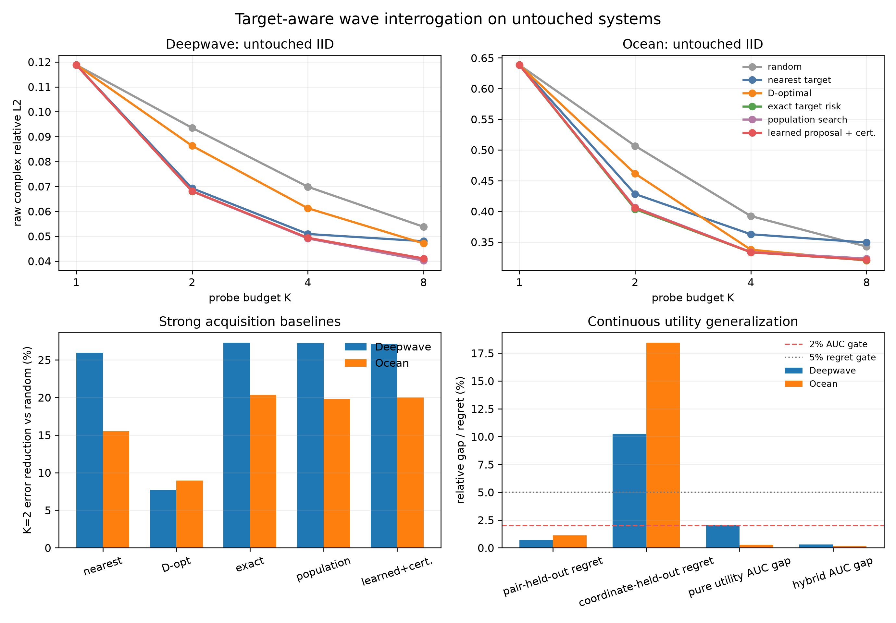

> 历史快照：2026-10-03连续相干表示主线更新前。不是当前执行计划；原文证据保留。

# 当前故事、证据与未来路线图

> **2026-10-03 新决策：** 用户已将主线转向高精度复波场连续表征，优先解决相位重建与空间/频率查询。
> 当前执行协议见 [24 小时表征计划](../COHERENT_CONTINUOUS_REPRESENTATION_24H_ZH.md)。本页以下 active
> interrogation 叙事是上一阶段档案，停止执行；待本轮结果形成后重整本入口。

> 更新日期：2026-10-03
> 文档角色：这是本项目当前**唯一的叙事与研究决策入口**。
> 如果数字与旧计划冲突，以 M1 正式报告和本页为准；旧文档只作实验档案。

## 0. 三分钟版本

这项研究最初从一个直观但重要的观察出发：在复杂波动场中，频率变化时，幅值或能量包络往往比复相位
更平稳；相位却会因为传播距离、干涉、多径和共振快速旋转。因此，“把低频图像直接变成高频图像”既是
病态问题，也没有充分利用一次真实波动实验可以主动改变频率和声源这一事实。

我们现在把问题改写为：

> 给定一个未知波动系统的少量 source--frequency 复响应作为 prompts，模型能否先形成对隐藏 response
> operator 的 belief；当用户指定一个目标响应时，模型再决定下一次最值得测量的 probe，并用有限预算回答
> 目标 query？

这带来一个关键转变：

```text
旧问题：frequency 是要外推的 condition
新问题：frequency 和 source 是可以选择的 experiment query
```

当前最强方法由两个互补部分组成：

```text
少量复杂波场 prompts
        ↓
PBNO：学习隐藏 wave-system operator 的 posterior belief
        ↓
连续 utility network：快速提出有价值的 source--frequency 候选
        ↓
解析 posterior risk：在 top-4 候选中认证并选择
        ↓
用新测量更新 belief，回答目标 response query
```

在冻结方法后生成的 untouched systems 上，相同第一条 probe、相同测量预算和相同 downstream 模型下，
K=2 相对 random probing 的 raw complex RelL2 降低：

| 数据域 | Random | 当前方法 | 相对降低 | 系统胜率 |
|---|---:|---:|---:|---:|
| Deepwave | 0.09353 | **0.06802** | **27.27%** | 100.0% |
| Ocean | 0.50662 | **0.40346** | **20.36%** | 99.6% |

从 K=1/2/4/8 看完整 error--budget AUC，改善为 21.15% 和 12.47%。learned proposal + analytic
certification 相对 exhaustive analytic planner 的 AUC 只退化 0.29% 和 0.16%。



这已经是一个可信的核心 POC，但还不是一篇稳妥的顶会完整论文：外部真实或公开 multistatic 数据缺失；
严格未见 source/frequency 坐标的连续外推失败；Ocean OOD 的系统 belief 失效；当前实验也还不能支持
“response-adaptive agent”这一更强说法。

## 1. 为什么这个问题值得研究

### 1.1 波动场与普通图像不同

复波场同时含幅值和相位。相位不是普通纹理：频率轻微变化就可能带来许多圈相位旋转；多个传播路径叠加时，
某一点的幅值也可能因相消突然接近零，使显式相位变得不稳定。把实部和虚部直接交给 U-Net 可以拟合某个
数据分布，但不会自动得到跨 source、frequency 和 receiver geometry 的物理表征。

更自然的研究对象不是单张场，而是整个系统的 response operator：

$$
y = H_{\theta}(q) + \epsilon, \qquad q=(\omega,s,r).
$$

这里隐藏状态 $\theta$ 包括介质、几何、边界和散射体；$q$ 是一次实验的频率、声源和接收配置；$y$ 是
复响应。少量 $(q,y)$ 对不是几张互不相关的图片，而是同一个隐藏算子的有限次观测。

### 1.2 原始“幅值易迁移、相位难迁移”怎样进入新故事

这个发现仍然是故事起点，但不再被写成“复制低频幅值，再生成高频相位”的硬规则：

1. 幅值较平稳说明跨 query 存在共享系统结构，可以从多个低成本 response prompts 中识别；
2. 相位变化快说明远频率的完整复响应通常不能仅靠确定性插值恢复；
3. 当已有 prompts 不可辨识时，与其继续扩大 decoder，不如主动选择能最大幅度减少目标不确定性的 probe；
4. 因而频率既是模型输入，也是实验动作。这把早期的跨频率经验事实连接到现代的 in-context learning、
   operator learning 和 active experimental design。

新主线没有否定 APEX，而是把 APEX 的现象提升为一个更可检验的问题：**哪些 prompts 足以识别隐藏
operator；信息不足时应该向系统追问什么？**

## 2. 当前任务的严格定义

每个 test system 都是训练时未见过的隐藏环境。模型获得初始数据集：

$$
D_K = \{(q_i,y_i)\}_{i=1}^{K}.
$$

用户再给出目标 query $q^{\star}$。在剩余预算内，模型从候选 action 集合选择下一条 probe $a$，观测响应后
预测 $y^{\star}=H_{\theta}(q^{\star})$。

评价遵循四条约束：

- system-held-out：测试系统从未用于训练或选参；
- strict joint query：目标 source 与 target frequency 都不出现在 prompts 中；
- matched budget：所有方法使用相同的 probe 数量和 receiver 信息；
- raw complex metric：主指标直接衡量复响应误差，不通过只看幅值来掩盖相位失败。

当前 M1 的 action 是 source--frequency pair，receiver layout 固定。它是 **target-aware sequential design**，
但还不是强意义上的 adaptive policy，因为当前线性高斯 belief 下，posterior covariance 主要由“测了哪里”决定，
并不强依赖“具体测到了什么数值”。

## 3. 方法到底创新在哪里

### 3.1 PBNO：可查询的复响应 operator belief

PBNO 不把每个 response 当成独立图片。它在训练系统上学习一个共享的低秩复响应坐标系和 query-conditioned
readout，并把任意数量、任意顺序的 prompts 更新成一个 posterior：

$$
p(z_{\theta}\mid D_K) = \mathcal N(\mu_K,\Sigma_K).
$$

$z_{\theta}$ 是隐藏系统在 response-operator chart 中的坐标。均值表示当前最可能的系统，协方差表示哪些
系统方向仍不可辨识。给定新 query，query basis 把同一 belief 解码成对应响应。

这部分的意义不是“PCA 本身新”，而是把异构复响应 prompts 组织成一个**带不确定性的、可供任意 query
调用的 operator memory**。此前的 M3/M4 已证明它在多个域上优于强 Bayesian/retrieval baseline，并且
rank-16 spectral dictionary 可显著压缩 response bank。

### 3.2 Target-predictive risk：为目标选择测量

对候选 probe $a$，解析 posterior update 给出测量后协方差 $\Sigma_{D_K\cup a}$。目标 query 的预期风险为：

$$
R(a;D_K,q^{\star})
=
\mathrm{Tr}(S_{q^{\star}} B_{q^{\star}}
\Sigma_{D_K\cup a} B_{q^{\star}}^{H} S_{q^{\star}}).
$$

直观上，它选择的不是“离目标最近”或“覆盖空间最均匀”的 probe，而是对当前目标最能消除 operator
ambiguity 的 probe。这是当前强效应的主要来源。

### 3.3 学习 proposal，物理后验负责 certification

遍历全部 actions 可以准确计算风险，但候选变大后不够优雅。M1 增加一个 160,801 参数、对 prompt 顺序
不敏感的 continuous set utility：

$$
U_{\psi}(D_K,q^{\star},a) \longrightarrow \widehat R_a.
$$

它学习“prompt belief、目标和候选 action 的几何关系”，先提出 top-4 actions；解析 risk 只在这四个候选中
认证。这样 learning 和 physics/statistics 的职责清楚：

- learning 负责在大 action space 中形成 proposal；
- analytic posterior 负责 data consistency、不确定性更新与安全 fallback；
- 最终方法不是 loss 堆叠，也不是不可解释的端到端 policy。

这是目前最适合论文的方法表述：

> A learned wave-system belief turns sparse responses into target-aware experiments; a compact query utility learns
> acquisition geometry, while analytic posterior risk certifies its proposals.

## 4. 我们已经知道什么

### 4.1 经 untouched systems 复验的正结果

| 证据 | Deepwave | Ocean | 结论 |
|---|---:|---:|---|
| K=2，random → exact risk | 27.27% | 20.36% | target-aware probing 有强效应 |
| K=1/2/4/8 AUC 改善 | 21.15% | 12.47% | 效应不只来自单一预算 |
| learned utility，pair-held-out regret | 0.71% | 1.12% | 能组合未见 source--frequency 配对 |
| hybrid 相对 exhaustive AUC gap | 0.29% | 0.16% | proposal + certification 几乎保留最优 planner |
| Deepwave OOD，K=2/4/8 改善 | 26.51/27.80/23.41% | — | 一类 geometry/contrast shift 下机制仍有效 |

最强简单 heuristic 不是 random。Deepwave 的 nearest-target 已把 K=2 error 降至 0.06927，Ocean 的最佳
单步 heuristic 也明显好于 random。因此论文必须同时报告 nearest、farthest、D-optimal、population schedule
和 exhaustive target risk；不能只用 random 放大优势。

完整 AUC 上更严格的比较是：

| 数据域 | Random | 最佳简单 heuristic | Exact target risk | 相对最佳 heuristic 的改善 | Population schedule |
|---|---:|---:|---:|---:|---:|
| Deepwave | 0.24968 | 0.20355，nearest | **0.19687** | **3.28%** | 0.19664 |
| Ocean | 1.38928 | 1.27786，D-optimal | **1.21597** | **4.84%** | 1.22059 |

所以需要同时承认两件事：target-aware design 相对无信息 probing 的 measurement-efficiency 效应很强；但
相对调得好的 geometry heuristic，当前净增益只有约 3%--5%，且 population fixed schedule 几乎追平 exact
planner。这正是外部数据与连续大 action space 成为下一阶段硬任务的原因。

### 4.2 重要负结果和声明边界

| 负结果 | 数字或现象 | 科学含义 |
|---|---|---|
| 严格 coordinate holdout 失败 | regret 10.23% / 18.43% | 当前 utility 会插值 action pair，但不会任意外推新坐标 |
| 5 倍速度 gate 未过 | 单步约 4.53× / 2.81×；完整 hybrid 不快 | 当前贡献是结构与精度，不是加速 |
| Ocean OOD belief 失败 | absolute error 达数百至数千 | acquisition 不能补救失真的系统表示 |
| response-adaptive policy 无充分空间 | population schedule 几乎追平 exact planner | 当前应称 target-aware design，不称 autonomous agent |
| learned target correction 多次不泛化 | selection 有增益，unseen systems 回退 | 非线性容量不等于 sparse conditional identifiability |
| flow / multimodal decoder gate 未开 | conditional oracle gap 不稳定或不足 | 现在加入生成模型更像装饰，而非必要组件 |

这些负结果不是附注，而是下一阶段选题的边界：**目前的瓶颈不是再加一个 decoder，而是外部有效性、真正
连续的 query geometry，以及在分布变化下仍可信的 operator belief。**

## 5. 当前结果能否撑起顶会论文

我们的判断是：核心 POC 已经成立，但论文完整度仍不足。

已经具备：

- 一个容易讲清楚的新任务：从 wave prompts 到 target-aware experiment；
- 一个兼顾 modern learning 和物理可解释性的混合方法；
- 两个物理数据域的 untouched strong effect；
- 完整预算曲线、强 acquisition baselines、bootstrap 和明确失败边界。

仍缺少：

- 至少一个社区认可的外部 multistatic / scattering / ultrasound 数据来源；
- 真正密集、连续 source--frequency action space 上的 off-grid 证据；
- 对“为什么必须 learning、为什么不是 classical Bayesian design 即可”的更强实验回答；
- 当前候选集较小时，learned proposal 没有 wall-clock 优势；learning 的实用必要性仍需在连续或大规模
  action space 中建立；
- 若要声称 agent/adaptivity，则需要 response value 真正影响下一步决策的新任务。

因此当前最稳妥的论文标题方向是：

> **Learning to Interrogate Wave Systems from Sparse Response Prompts**

而不是“universal wave foundation model”“autonomous wave agent”或“arbitrary continuous frequency
generalization”。

## 6. 未来方向：分三层推进，不同时开工

### Track A：把当前故事做成完整论文，最高优先级

目标是证明当前效应不是两个内部 synthetic benchmarks 的偶然结果。

1. 加入一个公开或实验 multistatic acquisition 数据域，优先 ultrasound/NDT、inverse scattering 或阵列响应；
2. 冻结当前方法后做 system-held-out evaluation；
3. 与 random、nearest、coverage、D-optimal、population schedule 和 exhaustive risk 同表比较；
4. 报告 raw complex RelL2、error--budget AUC、probe saving、win rate、bootstrap 和成本轴。

**Promotion gate：** 相对最强非 target-aware schedule，K=2 或主预算至少改善 10%；或者达到同一误差时节省
至少 25% probes。若外部域未过，当前工作定位为有价值的内部 POC，不通过改指标掩盖。

### Track B：Continuous Query Operator，方法升级主线

当前 utility 严格坐标外推失败，主要因为 teacher 和训练 action grid 本身太稀。下一步不是继续扫 MLP 宽度，
而是重新生成密集连续 source/frequency 数据，让模型学习真正的 functional action representation：

```text
continuous source/frequency coordinate
        +
operator belief tokens
        ↓
query-conditioned functional basis / neural Green representation
        ↓
continuous utility and response prediction
```

可以借鉴 neural operator、functional tensor factorization 和 Green's-function learning，但只保留一个核心模块，
不能同时叠 FNO、flow、Transformer 和多种辅助 loss。

**Promotion gate：** 完全未见 source locations 和 frequency coordinates 的 regret 小于 5%；两域 hybrid AUC
相对 exhaustive planner 的 gap 小于 2%；并至少展示 off-grid action 或大候选集的实际优势。

### Track C：Belief-space Wave Agent，长期独立课题

要让“根据刚测到的 response 决定下一步”真正成立，任务必须含 system-dependent ambiguity，例如未知噪声、
局部 receiver failure、多模态散射体假设或 action-dependent occlusion。届时模型维护多模态 belief：

```text
提出多个环境假设 → 选择最能区分假设的 probe → 更新 belief → 再规划
```

这条线可以自然连接 generative posterior、flow matching、active learning 和 POMDP，但它不应被硬塞进当前论文。

**启动 gate：** response-conditioned oracle 相对 population schedule 的跨系统增益，在至少两个域上稳定超过
15%，且收益确实来自 observation value 而不是 query geometry。未过 gate 时不启动 RL 或大 policy。

## 7. 推荐的实际节奏

| 阶段 | 只做什么 | 暂时不做什么 | 决策点 |
|---|---|---|---|
| A0 | 找到并审计外部 multistatic 数据 | 重写模型 | 数据是否支持 source/frequency actions |
| A1 | 冻结方法跑外部 system-held-out benchmark | 为结果调指标 | 是否过 10% / 25% gate |
| B0 | 生成密集连续 action teacher | 扩大旧 utility MLP | strict coordinate oracle 是否有空间 |
| B1 | 只实现一种 continuous operator representation | 同时加 flow/RL | regret、AUC、off-grid 三 gate |
| C0 | 构造 value-dependent ambiguity 诊断 | 训练 agent | conditional oracle 是否超过 15% |
| C1 | generative belief + sequential policy | 与当前论文混写 | 两域真实 sequential gain |

推荐顺序是 **A → B → C**。Track A 补齐现有论文的可信度；Track B 是最可能形成下一篇方法论文的方向；
Track C 概念最强，但只有在任务本身存在 response-dependent action value 时才值得投入。

## 8. 不应重复的弯路

- 不再通过只换 utility width/depth、更多 loss 或更长训练尝试解决严格坐标外推；
- 不再把 random 当唯一 acquisition baseline；
- 不因 PCA--MAP 看起来简单，就无 oracle 证据地替换成更大非线性 encoder；
- 不在 Ocean OOD belief 失效时继续调 acquisition policy；先修 representation；
- 不在 conditional oracle gate 未过时启动 flow、RL 或 Transformer policy；
- 不再增加第五个同质 acoustic toy dataset 代替外部有效性；
- 不把 pair holdout 写成 arbitrary continuous source/frequency generalization；
- 不把 fixed target-aware schedule 写成 response-adaptive autonomous agent。

## 9. 阅读顺序

如果只想理解故事：

1. 本文；
2. [大白话方法说明](../PBNO_STORY_PLAIN_LANGUAGE_ZH.md)；
3. [M1 正式报告](../../reports/ACTIVE_WAVE_INTERROGATION_M1_ZH.md)的摘要、主表和限制。

如果要复现实验：

1. [M1 正式报告](../../reports/ACTIVE_WAVE_INTERROGATION_M1_ZH.md)；
2. [实验账本](../EXPERIMENT_LEDGER_ZH.md)；
3. [数据 provenance](../CROSS_DOMAIN_DATA_PROVENANCE_ZH.md)；
4. `artifacts/active_wave_interrogation_m1_summary/summary.json`。

如果要决定下一项研究：

1. 本文第 6--8 节；
2. [M1 原预注册计划](../ACTIVE_WAVE_INTERROGATION_NEXT_PLAN_ZH.md)，仅用于核对哪些 gate 已经执行；
3. [归档索引](../archive/INDEX_ZH.md)，用于避免重复负实验。

## 10. 一句话研究愿景

> 从“预测一张波场”，走向“从少量响应理解一个隐藏波动系统，并知道下一次该如何用波向它提问”。

