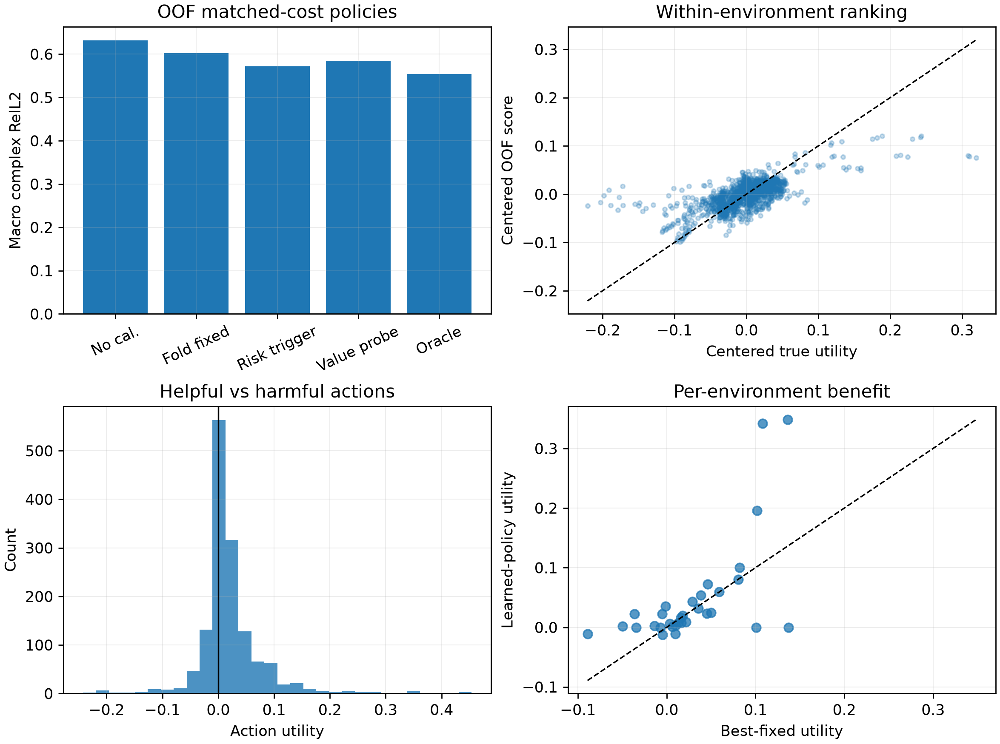

# Actionable Horizon / Value-of-Calibration Map 第一阶段报告

> 历史证据 / 技术参考（2026-10-05 归档标记）：保留原实验、数值和复现路径。
> 文内“当前/下一步/待完成”描述属于当时阶段，不是现行任务；请先读[三条 Wave as Prompt 路线](../docs/wave_as_prompt/README.md)。

更新日期：2026-09-22

## 结论先行

本阶段得到的是一个有科学价值、但不支持立即升级复杂模型的混合结论：

1. calibration action 的价值具有真实的实例异质性。单 mask 既有 action space 中，逐实例 oracle
   相对最佳固定 endpoint 改善 5.97%；加入三个等成本 sensor masks 后，oracle raw complex RelL2
   为 0.5540，而最佳 development fixed action 为 0.5920。
2. target-free value signal 可以学习。严格按环境四折 OOF 的线性 state--action probe，在同一环境的
   45 个 actions 内达到 utility Spearman 0.624；把预测分数随机换到其他环境后，macro error 退化到
   0.6073，显著差于真实配对的 0.5846，单侧 $p=0.00090$。
3. 但是当前 value probe 没有战胜最强简单基线。risk-trigger 的 raw error 为 0.5720，value probe
   为 0.5846；paired difference 的 95% bootstrap 区间为 $[-0.0252,-0.0022]$，方向稳定地不利于
   value probe。
4. expanded oracle 相对最佳 development fixed 只改善 6.42%，没有通过事先冻结的 10% paper-level
   task gate。三个随机 masks 把单-mask oracle 仅从 0.5566 改善到 0.5540，说明新增动作主要增加了
   组合数量，没有显著增加可控子空间。

因此本阶段判定为：**机制级 GO，当前论文级方法路线 NO-GO**。Action value 确实不是 failure risk
的同义词，也能从谱状态中部分预测；但在现有 AR calibrator 和随机 sensor mask action space 下，
更复杂的 selector 没有足够收益上限。下一步若继续，优先改变 action 的物理表达能力，而不是堆叠
Transformer、RL 或更多 risk features。

## 1. 为什么做这个 POC

上一阶段已经发现：

- Ocean 与 synthetic 上的 failure risk 都可以由 seed disagreement 提前预测；
- Ocean 的一次 risk-triggered calibration 有真实收益；
- reset 后 failure 仍然可预测，但重复 calibration 不再降低 raw error；
- synthetic 即使 post-reset AUROC 很高，calibration 的 dense ceiling 仍然很低。

这表明“知道哪里会失败”和“知道采取什么动作能修复”是两个不同问题。前者是 reliability prediction，
后者是 controllability-aware decision。Actionable Horizon 将模型输出从 failure probability 推进为
候选观测的反事实价值：

$$
V_e(a)=L_e^0-L_e^a.
$$

这里的 loss 始终是完整、未复制传感器值的 raw complex RelL2。

## 2. 实验协议

### 2.1 状态、动作与评价

- 32 个 Ocean development environments；
- 可见频带为 90--100 Hz，部署查询固定为 107--125 Hz；
- 候选 sweep endpoint 为 106--120 Hz；
- 三个随机 mask realizations：4201、4301、4401；
- 每个 mask 每频率使用 92 个传感器，连续扫描 6 个频率；
- 每个非空 action 的 gross cost 固定为 552 个复数观测；
- 总 action 数为 $15\times3=45$。

动作在 endpoint 之前不能改变已经输出的预测。主 utility 因而用固定 107--125 Hz 部署轨迹定义，既
衡量校准后的质量，也惩罚过晚触发。局部 6-frequency utility 只作机制诊断。

三个 masks 是不同的随机观测 realization，并不是三个跨环境共享绝对坐标的硬件阵列。每个候选 mask
的具体坐标在动作执行前可知，value feature 可以读取它在 OOF spatial-risk map 上的覆盖统计。

### 2.2 特征与模型

允许的输入只有 action 执行前可获得的信息：

- endpoint 与剩余查询比例；
- 冻结预测的幅值、空间粗糙度、step change 和谱曲率；
- 三 seed 的 complex、amplitude 和 phase disagreement；
- OOF 实例 failure probability；
- OOF 4×8 spatial-risk map，以及候选 sensor mask 在该图上的覆盖。

禁止使用 query target、真实 query error、未购买的 calibration values 和 post-action disagreement。

主 probe 是标准化 ridge regression。用于 action ranking 的 target 在每个训练环境内中心化；是否执行
no action 由另一个预测绝对 utility 的 ridge gate 决定。ridge 系数由外层训练环境内部的三折选择。
所有外层评价按物理环境四折 OOF；一个环境的 45 个 action 永远不会被拆到训练与测试两侧。

### 2.3 两类 gate

M0A 使用已有单-mask replay，是回顾性机制审计。它的 gate 是 oracle 相对 fixed 改善至少 5%、
absolute gap 至少 0.02，并且过半环境的最优 endpoint 不同于 fixed endpoint。

M0B 的三个 masks 中，4201 的结果已经存在，4301 和 4401 是冻结协议后新增。论文级 gate 要求
expanded oracle 相对最佳 development fixed 至少改善 10%。已有开发环境不承担 strict test claim。

M1 要求 learned policy 优于 fold-specific fixed、关闭至少 30% OOF fixed-to-oracle gap、harm rate 不高于
fold fixed，并通过 shuffled-instance control。即使这些机制指标通过，仍必须与已有 risk-trigger 比较。

## 3. 结果

### 3.1 M0A：单 mask action space 足以做机制探针

| 指标 | 结果 | Gate |
|---|---:|---:|
| Best fixed endpoint | 111 Hz | -- |
| Best fixed raw RelL2 | 0.5920 | -- |
| Instance oracle raw RelL2 | 0.5566 | -- |
| Oracle 相对 fixed 改善 | 5.97% | 至少 5%，通过 |
| Absolute gap | 0.0353 | 至少 0.02，通过 |
| Oracle endpoint 不同于 111 Hz | 78.1% environments | 至少 50%，通过 |

这说明 endpoint 价值不是一个完全由全局平均决定的常数，学习 action ranking 是有定义的任务。

### 3.2 M0B：增加随机 masks 没有创造足够的新 headroom

| 策略或上限 | Macro raw complex RelL2 | 相对 no calibration 改善 |
|---|---:|---:|
| No calibration | 0.6314 | 0.00% |
| Best development fixed，111 Hz @ 4201 | 0.5920 | 6.24% |
| Three-mask instance oracle | 0.5540 | 12.26% |

expanded oracle 相对最佳 fixed 改善 6.42%，低于 10% gate。虽然 96.9% 环境的 oracle action 不等于
全局 fixed action，但其中大量差异只是几个近似等价动作之间的切换。最有力的证据是：加入另外两个
masks 后，oracle 仅从 0.5566 降到 0.5540，相对改善约 0.48%。换言之，当前有效决策自由度几乎都
来自“何时校准”，而不是“用哪个随机 mask”。

全部 1440 个 environment--action pairs 中，71.1% 对完整部署轨迹有正 utility；局部 6-frequency
窗口中 85.0% 为正。calibration 在短期经常有效，但收益会随传播距离衰减，并且过晚触发无法挽回
此前误差。

### 3.3 M1：value 可排序，但没有超过 risk-trigger

| Policy | Raw complex RelL2 | Harm rate | Median horizon | Mean horizon extension |
|---|---:|---:|---:|---:|
| No calibration | 0.6314 | 0.0% | 5.0 Hz | 0.00 Hz |
| Random matched cost | 0.6052 | 28.1% | 6.0 Hz | 0.53 Hz |
| Fold-specific best fixed | 0.6025 | 28.1% | 7.0 Hz | 0.81 Hz |
| Risk trigger，primary mask | **0.5720** | **6.25%** | 6.5 Hz | **1.03 Hz** |
| Learned state--action value | 0.5846 | 9.38% | 6.5 Hz | 0.72 Hz |
| Counterfactual oracle | 0.5540 | 0.0% | 7.0 Hz | 1.34 Hz |

这里的 fold-specific fixed 每折只用训练环境选 action，因此比使用全部 development data 得到的
0.5920 更保守。value probe 相对这个 OOF fixed 改善 2.97%，关闭 36.85% 的 OOF fixed-to-oracle gap，
harm rate 也更低；但 paired 95% CI 为 $[-0.0045,0.0427]$，跨过零。

相对更强、且早已冻结的 risk-trigger，value probe 反而退化 2.21%；paired CI 为
$[-0.0252,-0.0022]$。使用 development fixed 作为参考时，value probe 只关闭 19.3% 的 gap，
risk-trigger 已关闭 52.5%。因此不能通过更弱的 fold-fixed baseline 宣称方法成功。

### 3.4 正信号不是纯粹的频率先验

线性 value probe 的平均 within-environment utility Spearman 为 0.624。将一个环境的 OOF value scores
随机配给另一个环境，再执行所选 action，20,000 次 control 的 macro error 为：

shuffled macro error 的均值为 0.6073，95% 区间为 $[0.5929,0.6208]$。

真实实例配对结果 0.5846 优于几乎全部 shuffled controls，单侧 $p=0.00090$。因此 state feature
确实携带“这个环境偏好哪个 action”的信息；失败原因不是 value 完全不可学习，而是剩余 oracle gap
太小、数据量只有 32 个独立环境，并且简单 risk crossing 已经抓住最主要的 endpoint 决策结构。

## 4. 归因

### 4.1 Risk 为什么在这里比 value regression 更强

risk-trigger 使用的是一个与动力学自然对齐的归纳偏置：在预测首次即将越过误差阈值时立刻校准。
主 utility 同时奖励早触发、未来覆盖和校准质量，因此 failure crossing 已经是很强的 endpoint proxy。
通用线性 regressor 还要从 32 个环境中同时学习这三种效应，统计效率反而更差。

### 4.2 Mask 为什么几乎没有贡献

当前 AR calibrator 从随机稀疏点估计一个受限的全局/低分辨率状态。92 个点已经覆盖较广，三个随机 mask
之间的有效观测子空间高度相似。spatial-risk coverage 虽然能描述 mask，却无法让 calibrator 修正其
表示范围之外的 modal mixing。因此“选更好的随机 mask”不是当前主要瓶颈。

### 4.3 Actionable horizon 与 reliable horizon 的关系

可靠性图回答何时开始失败；本实验说明，这个时间本身也是当前最有用的 calibration trigger。动作后
平均 horizon 可以延长约 1 Hz，但 oracle 也只有 1.34 Hz。这进一步表明长期误差不是 selector 可以
单独解决的：需要能改变可修复子空间的 action 或 state update。

## 5. Gate 判定

| Gate | 判定 | 原因 |
|---|---|---|
| M0A mechanism gate | GO | 三项最低 headroom 条件全部通过 |
| M0B paper-level task gate | **NO-GO** | expanded oracle 对最佳 fixed 仅 6.42%，低于 10% |
| M1 weak fixed-baseline gate | 部分通过 | 排序、gap closure、harm 和 shuffle control 有正信号，但 CI 跨零 |
| M1 strong-baseline gate | **NO-GO** | value probe 0.5846，显著差于 risk-trigger 0.5720 |
| 复杂 policy/Transformer/RL | **停止** | 当前主要缺少 action headroom，不是 selector capacity |

## 6. 下一步应改变什么

如果将来重启 Actionable Horizon，最小而有价值的变化不是增加 value head 容量，而是引入物理上真正
不同的 actions，再先做 oracle audit：

1. **风险定向传感器**：让 mask 覆盖 spatial-risk map 的高风险 patch，同时保留几何可观测性；与随机
   mask 做同成本反事实比较。
2. **不同信息类型**：候选 action 不只改变坐标，还可选择频率窗口宽度、复数场/强度观测、不同 source
   或 boundary excitation。只有信息算子发生变化，controllability 才可能显著变化。
3. **可表达的状态更新器**：若 dense/action oracle 证明新观测含有信息，再把单一 AR reset 升级为能修正
   多 modal components 的低秩 state update。
4. **第二数据域与 strict environments**：只有新的 action space 在 oracle 层面先通过 10% gate，才值得
   扩数据、训练 action encoder，并打开严格测试集。

更直接地说，下一阶段值得研究的是 **action design for identifiability**，而不是 value-head design。

## 7. 复现与产物

- 冻结协议：`configs/actionable_horizon_poc_20260922.json`；
- 问题设定：`docs/ACTIONABLE_HORIZON_POC_ZH.md`；
- 代码入口：`spectral_continuation.evaluate_actionable_horizon`；
- 汇总 JSON：`artifacts/actionable_horizon/value_probe_ocean_20260922/actionable_horizon_summary.json`；
- 正文图：`artifacts/actionable_horizon/value_probe_ocean_20260922/actionable_horizon_poc.png`；
- 逐环境、逐 action NPZ 因体积与数据治理规则不提交 Git，可由 replay checkpoint 重建。
