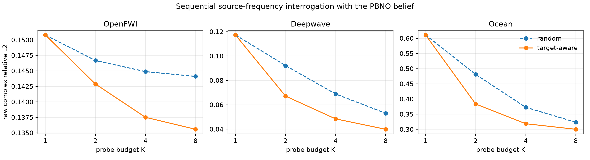

# 从 Wave as Prompt 到 Target-Aware Wave Interrogation

> 日期：2026-09-27
> 状态：论文级 POC 正结果；支持 target-aware experimental design，不支持 response-adaptive policy
> 主指标：逐 physical system 等权的 raw complex relative L2
> 数据：OpenFWI、Deepwave、Ocean；补充 Structural Lattice 机制审计

## 1. 一句话结论

我们没有继续给 field decoder 堆网络，而是改变了问题：当目标 source--frequency response 已知时，模型应先
决定“下一次测哪个 source 和 frequency”，再用新 response 更新对未知 wave system 的认识。

将现有 PBNO 看作一个从少量 wave prompts 形成的 learned operator belief 后，只用其 posterior predictive
variance 贪心选择下一条 probe，在完全相同的测量预算与下游模型下取得：

| 数据域 | K=2 随机 probes | K=2 target-aware probes | 相对降低 | 95% 区间 | 系统胜率 |
|---|---:|---:|---:|---:|---:|
| Deepwave | 0.09220 | **0.06715** | **27.17%** | [26.64%, 27.70%] | 100% |
| Ocean | 0.48116 | **0.38365** | **20.27%** | [18.77%, 21.74%] | 100% |
| OpenFWI | 0.14668 | **0.14289** | 2.58% | [2.21%, 3.01%] | 85.2% |

K=1/2/4/8 的完整顺序曲线中，Deepwave 的 error--budget AUC 降低 21.14%，Ocean 降低 12.35%，OpenFWI
降低 3.52%。因此“probe choice 改变可辨识性”在两个独立声学域上是强效应，在 OpenFWI 上是稳定弱效应。



但一个同样重要的负结论是：只根据训练 population 离线选择固定 schedule，已经几乎追平解析 uncertainty
schedule；让 60k 参数 neural policy 根据第一条 response 做 system-specific reranking，在 Deepwave 回退，
Ocean 只额外改善 0.37%。因此目前应写成：

> **a learned wave-response operator supports target-aware experimental design**，

而不能写成：

> **a response-adaptive wave agent has been solved**。

## 2. 为什么这比继续改 decoder 更接近第一性原理

### 2.1 当前瓶颈是信息，不只是函数逼近

此前几轮已经反复出现同一模式：

- nonlinear neural field 能拟合完整 response manifold，但从两个 sparse prompts 推不回稳定 latent；
- target-truth candidate oracle 很低，target-free reranker 却只能兑现 1%--2%；
- learned operator prior 能保证 prompt consistency，但 unseen query 最多改善 2.93%。

这说明在固定 prompts 下，很多误差属于 conditional identifiability gap。更大的 decoder 看不到新的物理信息，
只能学习训练分布的平均修正。真正直接的干预是改变观测：在预算不变时，询问更有信息的 source--frequency。

### 2.2 frequency 在这里是 action，不再只是 condition

未知环境记为 theta，一个实验 query 为：

$$
q=(s, f, r),
$$

系统返回复响应：

$$
y=H_{\theta}(q).
$$

给定目标 query $q^{\star}$ 和已有 prompts $D_t$，任务不是直接猜 $H_{\theta}(q^{\star})$，而是先从合法
actions 中选择下一次 source--frequency probe，再更新预测：

```text
已有 wave prompts
        ↓
PBNO system posterior
        ↓
比较候选 source-frequency probes 对目标 response 的预测不确定性
        ↓
测量选中的 probe response
        ↓
更新 posterior，并回答目标 query
```

这保留了 Wave as Prompt 的核心，同时把模型从被动 completion 推到 task-aware sensing。

## 3. 问题设定

### 3.1 Strict-Q3 target

目标是未见 source 与未见 frequency 的 joint query $(s^{\star},f^{\star})$。任一 context probe 都满足：

$$
s_i \ne s^{\star},
\qquad
f_i \ne f^{\star}.
$$

因此模型不能通过同频矩阵补全或同 source 谱插值直接回答。

### 3.2 公平预算

- 随机与 target-aware 方法拥有相同的 probe 数 K；
- 每条 probe 都返回同一 receiver array 上的完整复响应；
- 第一条 probe 对两种方法完全相同；
- target-aware 方法只改变后续 probe 的 source 与 frequency；
- 不读取隐藏介质、test target truth 或候选 probe 尚未测得的 response。

### 3.3 顺序协议

第一条 probe 由冻结随机顺序给出。之后每一步从尚未选择的合法 actions 中贪心选一条。K=1/2/4/8 使用
同一嵌套 prefix，不能为每个预算重新挑一套有利的 prompts。

## 4. 方法：Learned Operator, Analytic Planning

### 4.1 PBNO belief

训练系统的完整复 response operator 在共享 basis 中写为：

$$
x=\mu+Bz+\epsilon.
$$

已有 prompts 对应观测行 $B_D$。PBNO 的解析 posterior 为：

$$
\Sigma_D=
\left(B_D^H B_D+\Lambda\right)^{-1},
$$

$$
m_D=\Sigma_D B_D^H(y_D-\mu_D).
$$

这里的表示不是一张 field image，而是整个 source--frequency--receiver response operator 的 system state。
训练 response distribution 决定 basis 与 latent spectrum；posterior-kernel dictionary、neural latent transport
和连续 adapter 构成完整 learned PBNO predictor。

### 4.2 Target-predictive uncertainty

对目标 response rows $B_{q^{\star}}$，并把训练数据估计的 raw-coordinate scale 写成 $S_{q^{\star}}$，候选
probe $a$ 加入后，用下面的量衡量目标预测不确定性：

$$
R(a;D,q^{\star})=
\mathrm{Tr}
\left[
S_{q^{\star}} B_{q^{\star}}
\Sigma_{D \cup a}
B_{q^{\star}}^H S_{q^{\star}}
\right].
$$

实际选择使 $R$ 最小的 action。它类似 classical c-optimal design：优化的不是全部 latent 的平均不确定性，
而是指定目标 response 的预测方差。不同点在于，这里的 observation/query functions 来自跨系统学习到的复
wave-response operator，而 action 同时包含 source 与 frequency。

### 4.3 为什么暂时不用 RL

在线性高斯 posterior 中，covariance 只依赖“测了哪些 query”，不依赖 response 的具体数值。因此当前解析
planner 天然是 target-aware、sequential，但不是 system-response-adaptive。只有 nonlinear/multimodal belief
使不同系统需要不同 actions，RL 或 belief-conditioned policy 才有不可替代性。

这与相关工作的边界不同：AL4PDE 和 multi-resolution active FNO 主要选择用于训练 surrogate 的 PDE
simulations；Reinforced Inverse Scattering 用 RL 选择 sensor/frequency 以改善 inverse imaging。我们的 POC
选择 inference-time probes，用来回答一个指定的 unseen response query。相关入口包括
[AL4PDE](https://arxiv.org/abs/2408.01536)、
[Multi-Resolution Active Learning of FNO](https://proceedings.mlr.press/v238/li24k.html)、
[Active Operator Learning with UQ](https://arxiv.org/abs/2503.03178) 和
[Reinforced Inverse Scattering](https://epubs.siam.org/doi/abs/10.1137/22M153207X)。传统 c-optimal design
的定义与有限 action domain 算法可参考
[Harman and Jurik, 2008](https://www.sciencedirect.com/science/article/pii/S0167947308003320)。

## 5. 正式顺序结果

### 5.1 Raw complex relative L2

| 数据域 | K | 随机 | target-aware | 相对降低 | 系统胜率 |
|---|---:|---:|---:|---:|---:|
| Deepwave | 1 | 0.11733 | 0.11733 | 0% | -- |
| Deepwave | 2 | 0.09220 | **0.06715** | **27.17%** | 100% |
| Deepwave | 4 | 0.06889 | **0.04845** | **29.67%** | 100% |
| Deepwave | 8 | 0.05304 | **0.03990** | **24.77%** | 100% |
| Ocean | 1 | 0.61107 | 0.61107 | 0% | -- |
| Ocean | 2 | 0.48116 | **0.38365** | **20.27%** | 100% |
| Ocean | 4 | 0.37274 | **0.31865** | **14.51%** | 100% |
| Ocean | 8 | 0.32348 | **0.30032** | **7.16%** | 94.5% |
| OpenFWI | 1 | 0.15081 | 0.15081 | 0% | -- |
| OpenFWI | 2 | 0.14668 | **0.14289** | 2.58% | 85.2% |
| OpenFWI | 4 | 0.14489 | **0.13751** | 5.09% | 80.6% |
| OpenFWI | 8 | 0.14411 | **0.13558** | 5.93% | 80.2% |

所有数字先在 target events 与三个 prompt seeds 内聚合，再按 physical system 等权。K=2 的 paired bootstrap
区间在三个域都完全为正。

### 5.2 Error--budget AUC

横轴使用 $\log_2 K$，在 K=1/2/4/8 上做梯形积分：

| 数据域 | 随机 AUC | target-aware AUC | 相对降低 |
|---|---:|---:|---:|
| Deepwave | 0.24627 | **0.19421** | **21.14%** |
| Ocean | 1.32117 | **1.15799** | **12.35%** |
| OpenFWI | 0.43903 | **0.42359** | **3.52%** |

因此旧的“active AUC 至少 15%”gate 只有 Deepwave 通过。Ocean 在稀疏预算强、随 K 增大收益收缩；不能用
K=2 的 20% 代替完整 AUC 结论。

### 5.3 第四物理域机制审计

在独立 damped structural lattice 上，用 posterior-kernel predictor 做 K=2 审计，random 为 0.44305，
target-aware 为 0.40938，改善 7.60%，系统胜率 99.6%。这支持机制可跨 acoustic/structural wave，但没有
达到 15% 强效应，因此没有把它混入三域 PBNO 主图。

## 6. Learning 模块到底贡献了什么

### 6.1 已经成立：learned operator belief 是 planner 的模型

planner 并不知道 wave equation 的隐藏介质，也没有运行 PDE solver。它使用的是训练 responses 学出的：

1. complex response basis 与 latent spectrum；
2. sparse prompts 下的 system posterior；
3. rank-16 empirical operator dictionary；
4. neural latent transport 与跨域连续 prior adapter。

因此规划并不是在一个手写解析 Green function 上做 classical design，而是在一个 learned latent response
operator 上做目标预测方差最小化。完整 PBNO downstream 相对简化 posterior-kernel 的 K=2 结果进一步为：

- Deepwave：0.09220 到 0.06715，改善 27.17%；
- Ocean：0.48116 到 0.38365，改善 20.27%；
- OpenFWI：0.14668 到 0.14289，改善 2.58%。

### 6.2 小正结果：query-conditioned posterior metric

我们实现了 11k--16k 参数的 positive Mahalanobis metric。它用 training systems 的 leave-one-system-out
target error 学习：对当前 target query，posterior 的哪些可观测方向最适合 operator retrieval。它始终保留
analytic posterior 与 rank-16 dictionary，不直接生成 target field。

三 prompt-seed development 结果：

| 数据域 | fixed posterior metric | learned metric | 相对降低 |
|---|---:|---:|---:|
| OpenFWI | 0.14789 | 0.14591 | 1.34% |
| Deepwave | 0.09772 | 0.09760 | 0.12% |
| Ocean | 0.49163 | 0.47907 | 2.55% |

所有方向为正，但都低于 3%。把该 metric 用在 target-aware contexts 上，只额外改善 Deepwave 0.24%、Ocean
0.50%。因此它适合作为“query decomposition 可学习”的消融，不足以成为 headline contribution。

### 6.3 负结果：自由 neural acquisition policy

63k/60k 参数 policy 读取第一条 prompt posterior、target 和全部候选 actions，在解析 risk 上学习有界 residual。
训练使用三个 acquisition schedules，step 0 精确等于 analytic planner。

- Deepwave：任何 learned checkpoint 都不如 step 0，最终严格回退；
- Ocean：0.40350 到 0.40202，只比 analytic planner 额外改善 0.37%；
- 更大 residual 的第一版在两个域都明显破坏 validation。

这不是“网络还不够大”。用 target truth 事后选 action 的 oracle，相对 population schedule 剩余空间约为
Deepwave 9.3%、Ocean 14.1%、OpenFWI 10.7%，均未过 15% conditional-action gate。当前信息条件不足以
支撑 RL、Transformer policy 或更多 policy loss。

## 7. Strong fixed schedule：必须诚实写出的边界

对每个 target 与第一条 probe，使用 training systems 的平均下游误差离线选择第二条 probe。这一
population-optimal schedule 不读取 test system 的第一条 response，却在一个独立 prompt seed 上达到：

| 数据域 | analytic uncertainty | population schedule | 相对差异 |
|---|---:|---:|---:|
| Deepwave | 0.07011 | 0.07007 | population 好 0.06% |
| Ocean | 0.40006 | 0.39911 | population 好 0.24% |
| OpenFWI | 0.14537 | 0.14456 | population 好 0.56% |

这说明当前主要收益来自 target-conditioned schedule，而不是根据未知系统的 response 自适应。好消息是，解析
posterior risk 几乎复现了昂贵的 train-population search，证明 learned representation 的 uncertainty 排序是
有意义的；限制是不能把它包装成 active reasoning agent。

## 8. Learned evidence / likelihood 审计

我们还检查了“学习 observation precision 是否可能成为主方法”。在 20/10 dB noisy prompts 下，对
prior strength 做 validation-only 网格选择后，global operator test error 为：

| 数据域 | 20 dB | 10 dB | 判断 |
|---|---:|---:|---|
| OpenFWI | 0.18064 | 0.19317 | 可校准，但现有 M4 noise branch 已更强 |
| Deepwave | 0.10792 | 0.13181 | 可校准，但不是 clean 主误差瓶颈 |
| Ocean | 0.76128 | 0.99015 | 最优 strength 已到网格上界，接近 mean fallback |

Ocean 的问题不是一个小 likelihood head 可以修好的过置信尺度，而是 noisy sparse prompts 下几乎失去
conditional identifiability。当前不启动 learned evidence network；只有真实重复测量、已知 sensor noise 或
heteroscedastic oracle 明确超过 10% 时重启。

## 9. 对论文故事的判断

### 已经足够作为 POC 核心结论的部分

1. 一个新的、简单的 inference-time 任务：给定目标 wave response 与 probe budget，选择 source--frequency
   measurements 后回答目标；
2. 同一个 PBNO belief 和同一 raw complex metric，在 Deepwave/Ocean 得到 20%--30% 稀疏预算收益；
3. K=1/2/4/8、三 prompt seeds、逐 system bootstrap 与一个弱效应域，结果结构完整；
4. 方法把 representation、uncertainty 与 physical action 接成闭环，而不是添加装饰性 backbone；
5. neural policy、learned metric、fixed schedule 和 noise likelihood 都有明确负边界。

### 还不足以直接投稿的部分

1. 当前 test systems 已在项目多轮开发中被使用，不再是 pristine final test；
2. target-aware schedule 与 population fixed schedule 几乎相同，不能 claim response adaptivity；
3. 两个强域仍是已有 synthetic archives；缺少真实或外部实验 acquisition benchmark；
4. 还缺 uniform/farthest coverage、nearest-frequency、D-optimal、population-optimal 等完整 acquisition
   baseline 表；
5. 解析 risk 目前遍历有限候选集，尚未证明对连续 source/frequency action 的泛化与计算优势。

所以准确评价是：

> 这已经是一篇潜在顶会论文中足够有分量的核心 POC，但不是完成版论文证据。

## 10. 冻结决策

1. 将主线从“再降低固定 prompts 下的 decoder error”推进为 target-aware wave interrogation；
2. 保留 PBNO 作为 learned operator belief，不推倒已有方法；
3. query-conditioned metric 记为小正消融，不继续扫 projection width/depth；
4. system-conditioned policy 为 NO-GO，不启动 RL；
5. learned evidence 为后置现实噪声支线，不与 clean 主任务堆叠；
6. 下一阶段首先补强 acquisition baselines、新 untouched systems 和连续 action，而不是再加 loss。

## 11. 复现入口

正式 sequential evaluation：

```bash
CUDA_VISIBLE_DEVICES=0 .venv/bin/python \
  -m spectral_continuation.evaluate_sequential_active_wave_query \
  --config configs/sequential_active_wave_query_m0_20260927.json \
  --output artifacts/sequential_active_wave_query_m0_summary \
  --device cuda
```

Learning 审计：

```bash
CUDA_VISIBLE_DEVICES=0 .venv/bin/python \
  -m spectral_continuation.train_query_conditioned_posterior_metric \
  --config configs/pbno_query_conditioned_metric_m0_20260927.json \
  --domain Ocean \
  --output artifacts/pbno_query_conditioned_metric_m0_projection_ocean

CUDA_VISIBLE_DEVICES=0 .venv/bin/python \
  -m spectral_continuation.train_active_wave_query_policy \
  --config configs/active_wave_query_policy_m0_20260927.json \
  --domain Ocean \
  --output artifacts/active_wave_query_policy_m0_constrained_ocean
```

机器结果：

- `artifacts/sequential_active_wave_query_m0_summary/summary.json`；
- `artifacts/sequential_active_wave_query_m0_summary/sequential_results.csv`；
- `artifacts/sequential_active_wave_query_m0_summary/sequential_active_query.png`；
- development checkpoints 与逐系统 arrays 保持本地，不进入 Git。
