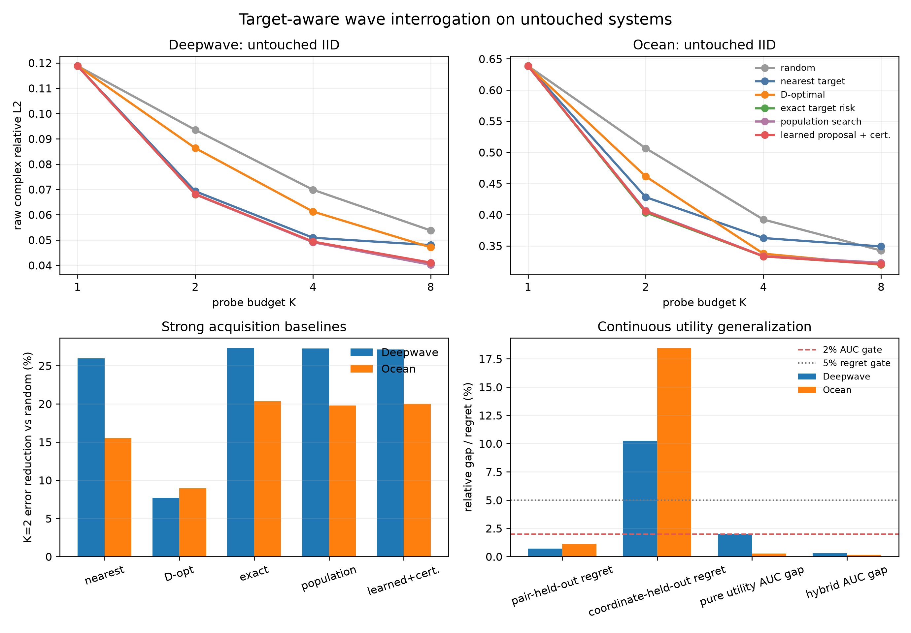

# Target-Aware Wave Interrogation M1：Untouched Systems、强基线与 Learned Query Utility

> 日期：2026-09-28
> 状态：三项阶段任务完成；IID 主效应与 learning-based pair-action utility 通过，严格坐标外推与 Ocean OOD 未通过
> 主指标：逐 physical system 等权的 raw complex relative L2
> 当前叙事、论文边界与后续路线统一见
> [项目故事与路线图](../docs/CURRENT_STORY_AND_ROADMAP_ZH.md)。

## 1. 一句话结论

这一阶段把 M0 的开发信号推进成了更可信的论文级 POC：在从未参与方法选择的 256 个 Deepwave 和 256 个
Ocean IID systems 上，冻结 PBNO belief 与 target-risk acquisition 后一次性复验，K=2 相对相同首 probe 的
random schedule 分别降低 error 27.27% 和 20.36%。K=1/2/4/8 的 error--budget AUC 降低 21.15% 和
12.47%。

同时，一个 160,801 参数的 continuous set utility operator 可以在整块留出的 source--frequency **配对**上
把 action-risk regret 控制在 0.71%/1.12%。用它提出 top-4 actions，再由解析 posterior risk 认证，完整
downstream AUC 相对 exhaustive planner 只退化 0.29%/0.16%。这给出了一个现代且相对统一的方法结构：

```text
sparse wave prompts
        ↓
learned complex operator belief
        ↓
continuous learned query proposal
        ↓
analytic posterior-risk certification
        ↓
new measurement and posterior update
```

但两个更强的声明没有成立：完全留出 source locations 与 frequency coordinates 时 regret 上升到
10.23%/18.43%；Ocean 参数 OOD 的 absolute error 达数百至数千。因此当前支持 interpolation over unseen
query combinations，不支持任意连续坐标外推，也不支持 universal OOD wave agent。



## 2. 三项任务与预注册门槛

### 任务一：untouched systems

- Deepwave：256 IID test + 128 OOD，seed base 20261027；
- Ocean：256 IID test + 128 OOD，seed base 20261027；
- source、frequency、receiver geometry 与旧训练 archive 完全相同；
- PBNO basis、normalization、memory、neural checkpoint、adapter 和 acquisition 全部冻结；
- 新 response 只用冻结 normalization 编码，不在新数据上重拟合任何 component。

预注册 IID gate：K=2 至少一域改善 20%，另一域改善 15%。

### 任务二：完整 acquisition baselines

共享同一首个随机 probe、strict-Q3 合法 actions 和 nested K=1/2/4/8：

1. random；
2. nearest-target geometry；
3. farthest/space-filling；
4. D-optimal latent-volume reduction；
5. exact target-predictive risk；
6. validation-only population-optimal schedule；
7. per-system target-truth oracle，仅作不可部署上限。

同时记录 source activations、unique sources、source/frequency switches、receiver samples 与 planner latency。

### 任务三：learning-based utility operator

目标函数为：

$$
U_{\psi}(D,q^{\star},a)
\longrightarrow
\widehat R(D,q^{\star},a),
$$

其中 $D$ 是已有 query set，$q^{\star}$ 是 target，$a$ 是候选 source--frequency action。门槛为：

- 参数少于 500k；
- held-out action regret 小于 5%；
- 相对 exhaustive planner 的 downstream AUC 退化不超过 2%；
- 5 倍加速或训练 action set 外的坐标泛化至少一项成立。

## 3. Untouched IID 主结果

### 3.1 K=2 raw complex RelL2

| 数据域 | random | exact target risk | 相对降低 | paired 95% 区间 | 系统胜率 |
|---|---:|---:|---:|---:|---:|
| Deepwave | 0.09353 | **0.06802** | **27.27%** | [26.71%, 27.83%] | 100% |
| Ocean | 0.50662 | **0.40346** | **20.36%** | [19.23%, 21.43%] | 99.6% |

这几乎精确复现 M0 旧 test systems 的 27.17%/20.27%，因此不是旧 test reuse 的偶然结果。

### 3.2 完整预算曲线

| 数据域 | K | random | exact target risk | 相对降低 |
|---|---:|---:|---:|---:|
| Deepwave | 1 | 0.11881 | 0.11881 | 0% |
| Deepwave | 2 | 0.09353 | **0.06802** | **27.27%** |
| Deepwave | 4 | 0.06986 | **0.04919** | **29.58%** |
| Deepwave | 8 | 0.05377 | **0.04051** | **24.67%** |
| Ocean | 1 | 0.63860 | 0.63860 | 0% |
| Ocean | 2 | 0.50662 | **0.40346** | **20.36%** |
| Ocean | 4 | 0.39216 | **0.33310** | **15.06%** |
| Ocean | 8 | 0.34239 | **0.32023** | **6.47%** |

log2-budget AUC：

| 数据域 | random | exact target risk | 相对降低 |
|---|---:|---:|---:|
| Deepwave | 0.24968 | **0.19687** | **21.15%** |
| Ocean | 1.38928 | **1.21597** | **12.47%** |

## 4. 强基线到底削弱了多少故事

### 4.1 K=2

| 方法 | Deepwave error / gain | Ocean error / gain |
|---|---:|---:|
| random | 0.09353 / 0% | 0.50662 / 0% |
| nearest target | 0.06927 / 25.95% | 0.42812 / 15.49% |
| farthest | 0.08481 / 9.33% | 0.45747 / 9.70% |
| D-optimal | 0.08632 / 7.71% | 0.46135 / 8.93% |
| exact target risk | **0.06802 / 27.27%** | **0.40346 / 20.36%** |
| population search | 0.06805 / 27.25% | 0.40633 / 19.80% |
| learned proposal + certification | 0.06815 / 27.13% | 0.40527 / 20.00% |

Deepwave 的 nearest heuristic 已很强，exact 只再降低约 1.8%；Ocean 相对 nearest 仍降低约 5.8%。因此论文
不能只与 random 对比，也不能声称所有域都需要复杂 planner。

### 4.2 AUC 与 population baseline

| 数据域 | 最强几何 heuristic | exact | population | learned + cert. |
|---|---:|---:|---:|---:|
| Deepwave | 0.20355 | 0.19687 | **0.19664** | 0.19744 |
| Ocean | 1.27786 | **1.21597** | 1.22059 | 1.21793 |

Exact 相对最强简单 heuristic 的 AUC 改善只有 3.28%/4.84%。Population 与 exact 基本等价，但构造完整
schedule 需要 Deepwave 2196.6 s、Ocean 348.3 s 的 validation truth search；exact planner 不需要为每个
target/action 收集完整 validation response error table，并自然适配 belief 变化。

因此最准确的 claim 是：

> learned operator uncertainty recovers population-optimal target-aware design without downstream truth search.

而不是“提出了比所有 supervised schedule 更低 error 的 planner”。

## 5. Continuous learned query utility

### 5.1 模型

每个 query 用归一化 source coordinates 与 log-frequency 的 Fourier features 编码。已有 prompts 用共享 MLP
后做 masked mean/max pooling，因此对 prompt permutation 不变。target、candidate、relative interaction 与
context token 进入小型 scorer。两个域各 160,801 参数。

网络不看 medium、test response 或 target truth；监督只来自冻结 analytic posterior risk。训练时留出的 actions
不能作为 context、target 或 utility label。

### 5.2 未见 source--frequency 配对

| 数据域 | held-out mean regret | median | P90 | all-action mean regret |
|---|---:|---:|---:|---:|
| Deepwave | **0.71%** | 0% | 2.80% | 1.97% |
| Ocean | **1.12%** | 0% | 2.85% | 0.97% |

纯 learned schedule 的 AUC gap 为 Deepwave 2.006%、Ocean 0.271%。Deepwave 严格地高于 2% gate，不能按
四舍五入写成通过。

### 5.3 Learned proposal + analytic certification

每一步先由 $U_{\psi}$ 提出 top-4 actions，只在短名单内计算 exact target risk。结果为：

| 数据域 | exhaustive AUC | learned + cert. AUC | 相对退化 |
|---|---:|---:|---:|
| Deepwave | 0.19687 | 0.19744 | **0.29%** |
| Ocean | 1.21597 | 1.21793 | **0.16%** |

两域均通过 2% gate。该模块把 learning 和 physics 接在一个清晰接口上：learning 做 query-space proposal，
posterior risk 做 safety certification。

### 5.4 不能夸大的部分

- 完全留出 source locations 和 frequency coordinates 后，Deepwave/Ocean regret 为 **10.23%/18.43%**，
  严格连续坐标外推失败；
- 单步 utility inference 相对 exhaustive ranking 的速度约 4.53×/2.81×，未过 5×；
- top-4 hybrid 整条 schedule 约 27.2/26.0 ms，当前甚至略慢于 batched exact 的 23.7/21.5 ms；
- 因此保留 hybrid 是为了 representation 与 certification，不是为了速度。

## 6. Target-truth oracle 与 adaptive policy

K=2 per-system truth oracle error 为 Deepwave 0.05955、Ocean 0.34499。相对 population schedule 的剩余空间：

| 数据域 | population | truth oracle | gap |
|---|---:|---:|---:|
| Deepwave | 0.06805 | 0.05955 | 12.48% |
| Ocean | 0.40633 | 0.34499 | 15.10% |

Ocean 刚越过 15%，Deepwave 未过，且 M0 neural policy 已失败。因此只产生一个域特异的弱重启信号，不足以
重启跨域 RL/Transformer policy 主线。若未来 Ocean 引入 nonlinear/multimodal belief，可做单独 oracle-first
研究。

## 7. Untouched OOD

### Deepwave OOD：通过

| K | random | exact target risk | 改善 |
|---:|---:|---:|---:|
| 2 | 0.14369 | **0.10559** | **26.51%** |
| 4 | 0.11251 | **0.08123** | **27.80%** |
| 8 | 0.09217 | **0.07059** | **23.41%** |

### Ocean OOD：失败

Ocean OOD absolute error 为数百至数千；K=2 改善 0.28%，bootstrap 区间跨零。K=4 的偶发 20.35%不能
抵消 representation 已经失效的事实。query selection 只能提高已有 belief 的信息效率，不能修复 population
operator 在训练参数区间外的严重失配。

## 8. 阶段决策

### 已通过

1. untouched IID 主效应：两域 K=2 27.27%/20.36%；
2. 完整 acquisition baseline 与物理成本轴；
3. 小于 500k 的 learned utility；
4. 未见 action pairs 的 regret 小于 5%；
5. top-4 hybrid 的两域 AUC gap 小于 2%；
6. Deepwave OOD 稳定。

### 未通过

1. 全新 source/frequency coordinates 泛化；
2. 5× planner speed；
3. Ocean OOD；
4. 跨域 response-adaptive policy oracle gate；
5. 相对 population schedule 的 error 优势。

### 论文主张

当前足以支持一篇论文中的强核心 POC：

> **A learned wave-system belief turns prompts into target-aware experiments; a compact query utility learns the
> acquisition geometry, while analytic posterior risk certifies its proposals.**

但还不是稳妥的完整顶会投稿证据。最主要剩余风险是外部真实 acquisition data，以及严格连续坐标和 Ocean
OOD。下一阶段不再扫 width/depth；要么生成带更密 source/frequency coordinates 的连续 teacher，要么进入
真实/公开 multistatic acquisition 数据。

## 9. 复现入口

```bash
# Untouched data
.venv/bin/python -m spectral_continuation.cross_domain_response_data \
  --config configs/active_wave_interrogation_untouched_20260927.json \
  --domain deepwave \
  --output artifacts/active_wave_interrogation_m1_data/deepwave_untouched_v1.npz

# Utility
.venv/bin/python -m spectral_continuation.train_continuous_acquisition_utility \
  --config configs/continuous_acquisition_utility_m1_20260928.json \
  --output artifacts/continuous_acquisition_utility_m1 \
  --device cuda

# Full baselines
.venv/bin/python -m spectral_continuation.evaluate_acquisition_baselines \
  --config configs/acquisition_baselines_m1_untouched_20260928.json \
  --output artifacts/acquisition_baselines_m1_untouched \
  --device cuda
```

机器汇总：`artifacts/active_wave_interrogation_m1_summary/summary.json`。
