# 连续复波场表征：探索进度与证据边界

> 2026-10-04更新，24 小时目标执行中。本文是滚动开发记录，不是最终论文结果。
> [任务与门槛](../docs/COHERENT_CONTINUOUS_REPRESENTATION_24H_ZH.md) ·
> [数据来源](../docs/COHERENT_DATA_PROVENANCE_ZH.md)

## 先说当前判断

最新候选是：**不直接预测一张张相位图，而是从几个复场识别共同的实传播生成器，再按请求的频率、
声源与精度读出复场。** 这一表示已有机制正信号；学习能快速推断它，但尚未有稳定的两域方法优势。
目前最有判别力的结果集中在**第21–22节**：旧变量表示的相关尺度变化失败、精确已知函数族物理上限、以及不预置真基时学得声速变量的独立新环境确认。第13–15节记录了共同生成器起点；前面探索过程不是同时推进的模型组件。

| 当前最重要事实 | 可以得出什么；不能得出什么 |
|---|---|
| 同观测下，包络FNO0.175；经典共同生成器0.0114 | 共享物理生成规律比独立曲线预测有效；主要收益不是AI |
| 学习生成器三seed均值0.00733，核0.00887 | 有学习增量，但约17.4%，没有稳定过20%门槛 |
| 经典context反演100/500/2000步0.00350/0.00167/0.00163 | 学习不是精度最强；更合理地审计摊销时间/存储 |
| 新强控制：128维训练先验 + 全程Gauss–Newton一次，64独立环境0.000824 | 比旧神经/迭代都更准；不要把弱优化器造成的差距归给神经必要性 |
| 同64环境、新窄源400Hz，GN一次0.00593；神经三seed均值0.04524 | 高精度跨请求查询可行，但新增深神经贡献未成立；该GN为后补强对照 |
| 新开发表示：128维代码/32深度项，窄源400Hz0.00155；40正交源平均0.00170 | 固定每环境代码与更细物理读出可以分开；全局基/计算增加，尚未独立验证这个新版 |
| 新窄源400Hz，固定latent，32→64模态使误差约0.123→0.037 | 表示与查询分辨率能分离；经典decoder也有这个能力 |
| 二维Helmholtz完整观测经典谱反演约1e-4 | 生成器原则不是波导专属；该协议没有第二域神经必要性 |
| 新16个taper7.5合成系统，学得声速变量800Hz双源raw0.00538/0.00505；同标签同代码q-PCA约0.081/0.082 | 预设门槛全部通过，变量选择＋已知非线性物理组合很关键；**仍同一合成族/一向PDE，非神经必要性或跨域主张** |

高精度空间表示、共享编码、完全无目标频率样本的谱查询仍分开评价，不将单场拟合当成共享算子。
历史主要数字来自development；64新IID环境冻结审计已完成，三seed不与旧8开发系统混合。
没有打开旧Ocean封存集。已有8环境的高频窄源不能写为新系统上的正式OOD泛化。
当前还不足以宣布顶会核心方法成立，尤其新强控制进一步削弱了神经优势。

多源作用loss与新增观测复残差输入均已失败并停止。全程物理校正在新query上也很强；当前检查
固定代码的频率/距离误差伸缩，前述少观测和读出带宽检查已完成。经典分支继续承担强对照，
不删掉推翻早期结论的实验。[新审计协议](../docs/GENERATOR_FREQUENCY_SCALING_AUDIT_ZH.md)已写明
不重新拟合代码、不用新query选择模型，正在做数值真值审计，不先宣布高频结果。
已知PDE的次级源神经分支、旧包络FNO扩容及局部多相位核容量扫描均已停止。

## 1. 当前实验究竟在测什么

空间实验给模型某一频率的复数样本，问同频率其他坐标的值；即便该频率未用于训练，也不是凭空生成
这个频率。谱实验只给若干其他频率的完整场，目标频率完全没有样本。这两种表严格分开。

所有误差主指标均为 raw complex relative L2；保留绝对相位，不做预测后相位对齐。
幅值误差和能量加权圆相位误差仅用于解释。汇总先逐系统/频率，系统等权。

## 2. Ocean：低误差成立，但 learning 必要性尚未成立

### 局部与全场

局部编码器从波长归一化坐标与复样本中提取复 Fourier 投影，预测局部平面波方向/波数；复包络系数
由可微的正则最小二乘消元。所有分量相干叠加，重建复场而不是独立拟合缠绕相位图。

开发局部 patch 上，16 分支共享编码器误差为 **0.00335**，调好学习率的全局字典为 **0.00438**，
固定前向角锥基函数约 **0.00583**。但这不是最终最强对照。

独立求解的更密坐标上，经典基函数加入已知圆柱扩散补偿——先拟合 `sqrt(r) * u`，再除回来——
比共享模型更准。95–125 Hz 两个开发环境的误差大约为：

| 方法 | 复数误差范围 | 解释 |
|---|---:|---|
| 共享 learned chart | 0.00032–0.00050 | 很准，但不是最优 |
| learned chart + 扩散补偿 | 0.00021–0.00039 | 物理补偿有用 |
| 固定前向 chart + 扩散补偿 | 0.000061–0.000081 | 当前更强的经典对照 |

200 Hz 若维持旧采样间距，共享模型误差约0.041/0.057；改为随波长增加观测密度后约0.00031/0.00030。
这说明采样尺度影响很大，**不是免费超分辨率**。经典结构化基函数在该环境族仍更强。

结论：均匀水层、距离不变 Ocean 的空间插值，不能据此宣称需要 neural representation；此前只比较
弱固定字典得到的大增益需要收缩。它仍是检验相位精度、物理补偿与频率尺度的重要控制域。

## 3. 异质 Helmholtz：表示容量与共享编码明显不同

独立生成40个系统，32训练、8开发验证，257×257，频率6–14。最高频的257→513内部场差在三个
审计环境中为0.0012–0.0024，其中包括数据里最低声速的困难环境。不是严格误差上界。

### 有足够空间样本时，表示并不缺容量

两个开发系统 × 7/11/14频率，规则stride2拟合、其他坐标留出：

| 逐场拟合表示 | 平均 raw complex error |
|---|---:|
| 固定16分支，半径1.5参考波长 | 0.19798 |
| 学习16分支，半径1.5参考波长 | 0.01610 |
| 学习16分支 + 二次相位，半径1.5参考波长 | 0.00821 |
| 学习16分支，半径0.75参考波长 | 0.00163 |
| 稠密样本上的三次插值 | 0.000274 |

这里的“学习”是对一个场优化局部参数，不是共享模型。小窗口用了更多窗口和参数；需要误差—存储曲线，
不能只看误差说全面领先。三次插值已经很强，这不是一个已经解决的 neural operator 贡献。

### 共享编码器的瓶颈

每个局部窗口64个随机复样本，预测64个其他坐标；测试系统及频率不进入训练。半径从1.5缩到0.75参考
波长，共享16分支误差从 **0.44575** 降到 **0.03259**。这是采样密度与局部模型适用范围共同改变，不能
写成同任务上的14倍算法改进。

在小窗口的完全相同样本上，调参 Gaussian RBF 可到 **0.01769**，因此平面波编码器仍不胜出。

## 4. 最小的学习升级：学习相位坐标与包络度量

有限个平面波组成的字典可能既有截断误差，又有系数病态。因此另测一个更小的假设：让网络预测局部
相位坐标和包络平滑方向，保留复数观测的解析读出。

$$
K_z(x,x')=\exp\{-\|(x-x')L_z\|^2\}\,
\exp\{i[\phi_z(x)-\phi_z(x')]\}.
$$

$$
\widehat u(x)=K_z(x,X)[K_z(X,X)+\lambda I]^{-1}u(X).
$$

`z` 由复样本的共同相位不变特征预测；第一版 `phi(x)=k*x`，随后仅依据上面的容量证据检验二次曲率。
这相当于先在合适的相位坐标中解调，再对平滑复包络插值，最后调制回来。保持复相位等变，核矩阵
保持 Hermitian 正定。只训练一个复数误差，不加入额外 loss。

未加曲率的开发结果（以下固定对照还不是最终最强方法，见现场优化审计）：

| 模型 | raw complex error |
|---|---:|
| 调参 Gaussian RBF | 0.01769 |
| 全局共享5参数核 | 0.01840 |
| 只学包络度量，无相位载波 | 0.01685 |
| 只学相位载波，固定包络度量 | 0.01758 |
| 同时学习局部载波与包络度量 | **0.01491** |

方向为正，但对最强经典对照仅约15.7%，尚未过20%门槛；单seed、局部开发结果，不能当论文方法已成立。
谱混合核和 deep kernel learning 都是已有工作，不能把“神经网络生成一个核”本身包装成新贡献。

### 曲率、三seed与独立坐标

加入三个二次相位系数后，三seed局部误差为 **0.01196 / 0.01128 / 0.01073**。这只改变相位函数，
不堆额外loss。整场8个开发系统 × 7/11/14频率，首个seed的结果为：

| 全局观测stride | 三次插值 | 调参Gaussian | 学习二次相位核 |
|---|---:|---:|---:|
| 2（密） | **0.000304** | 0.001187 | 0.001000 |
| 4（中） | 0.004920 | 0.003049 | **0.002285** |
| 6（疏） | 0.041422 | 0.034354 | **0.019295** |

在两个系统的独立513网格真值上，stride4/6的误差为0.00244/0.01832，对应Gaussian为0.00325/0.03204。
极密采样仍是三次插值更好。源区未从主指标删除：源半径3σ内的能量占比随频率约22%→55%；学习
模型主要改善源区之外的传播场，在源区本身不稳定占优。这是有价值的误差归因，不能通过删源区放大主指标。

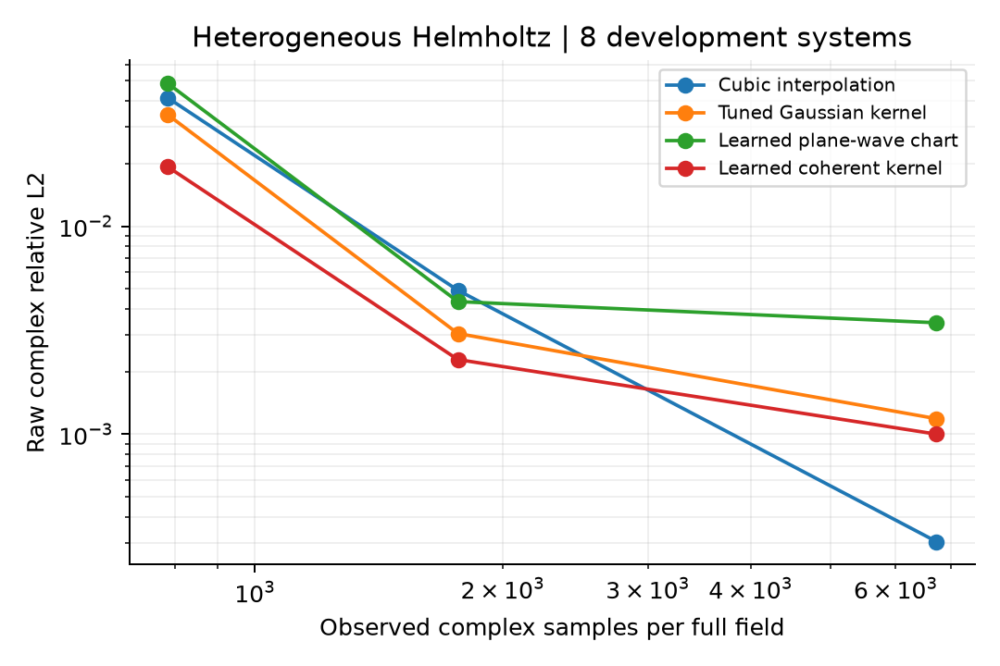

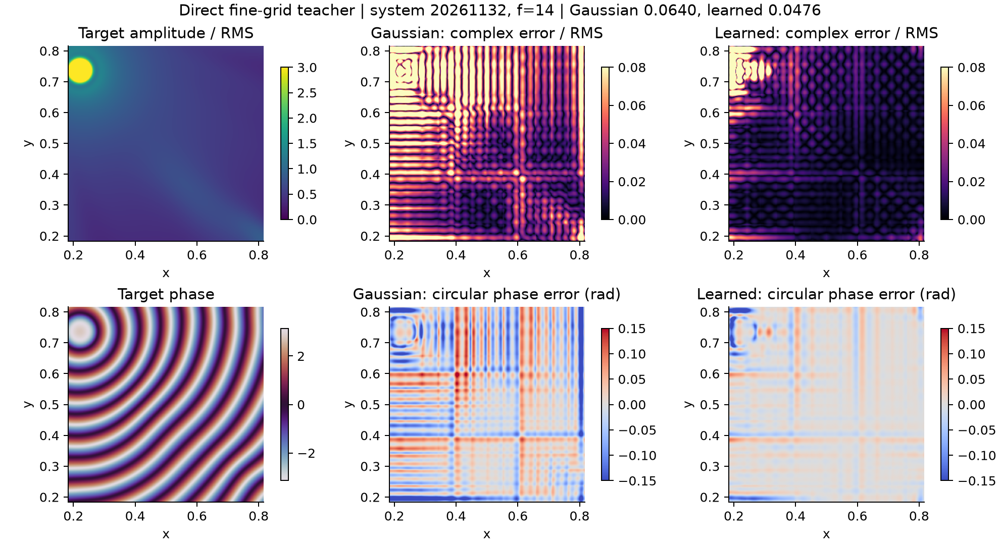

相位图仅为便于阅读而隐藏幅度低于目标RMS的1%的像素；数值指标保留它们。颜色上限截断也只影响显示。
图示固定为第一个开发环境的最高频，并非挑选最大增益样例；该例误差高于宏平均。

### 更强的现场优化改变了learning结论

对完全相同的64个context样本，直接优化同一核族的8个实参数，不用任何query标签：

| 参数如何得到 | 局部复场误差 | 证据含义 |
|---|---:|---|
| 神经编码器直接预测，seed42 | 0.01196 | 快速共享预测 |
| 每patch按context留一误差优化200步 | 0.00877 | 非神经强对照 |
| 每patch按context边际似然优化200步 | **0.00725** | 比直接神经预测更准 |
| Gaussian初值 + 5步边际似然 | 0.00821 | 很少优化已很强 |
| 学习初值 + 5步边际似然 | 0.00725 | 约达到冷启动50–200步的精度 |

因此“神经模型比调参固定RBF好”不等于“神经模型优于所有经典方法”。当前learning的更可信价值是
摊销局部推断、减少迭代；是否有显著端到端速度/精度优势仍需公平计时。初步优化记录包含GPU冷启动，
不能拿其中首条运行时间计算加速倍数。

进一步的有归因尝试：

- 用query真值单独优化这8个参数，可拟合到0.00128；这是使用目标标签的容量诊断，绝不可当作预测结果。
- 保留完整样本集的单层cross-attention编码器为0.01317，训练误差也约0.01228；比原编码器更复杂但不更准。
- 将两步context-only似然调整纳入端到端训练，得到0.00783；比直接预测更好，但仍未超过经典优化或
  学习初值加5步的约0.00725。没有通过方法精度gate，暂不继续扫attention层数或unroll深度。

这一轮的结论不是“找到可发表的新网络”，而是已经把表示容量、现场推断、共享推断三者分开，并找到
一个很强的经典局部模型。局部插值分支先作为高精度基线与机制证据保留，下一轮优先把资源转向连续
谱中的成分演化，以及更接近真正算子预测的信息条件。

Ocean也补了更强的同patch对照：固定45°前向波 + `sqrt(r)`补偿 + 合理ridge达到 **0.0001835**，
学习二次核为 **0.001557**，全局8参数核为0.002572。该域的learning精度优势明确未成立。

## 5. 连续谱：空间重编码不够，传播模态有更强信号

在90–125 Hz内每5或10 Hz给一个完整观测场，所有其他频率完全留出。

- 原始复场插值很差；去除已知参考传播相位后明显改善，这是经典信号处理。
- 即使局部空间重建已非常准，对局部载波/包络做跨频三次插值，仍几乎等于直接对解调场插值；没有
  兑现额外收益。这是本轮重要负结果：**坐标压缩不自动等于频率动力学建模**。
- 用空间 DMD 从观测场识别传播模态，再插值其波数与复幅值，出现更强正信号。DMD也是经典方法。

四个开发系统、空间延迟嵌入修正弱模态漏检之后：

| 观测频率间距 | 参考传播相位 + 场插值 | 模态波数/幅值插值 | 误差降低 |
|---|---:|---:|---:|
| 5 Hz | 0.10099 | 0.04290 | 57.5% |
| 10 Hz | 0.22193 | 0.08451 | 61.9% |

单环境差异大：5 Hz协议下，有环境0.12475→0.01035，也有环境0.03252→0.03411轻微退化。
直接插值径向波数与插值色散坐标 `k0^2-kr^2` 差别很小，不能宣称后者已是关键创新。
最初简单DMD漏检弱模态导致排序错位，个别环境退化到0.34；完整失败 artifact 保留。

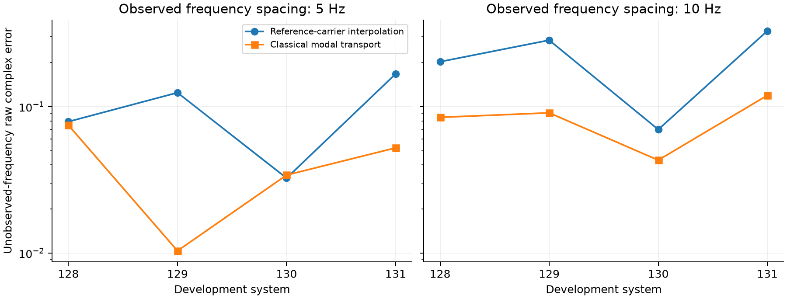

这条证据更接近连续谱表征的核心问题：既要准确分离相干成分，也要稳定描述它们随频率的变化。
目前仅针对距离不变 Ocean，不是异质介质的一般定理，也不是已训练出的 AI 方法。

### 新增归因：旧模态相位不是当前主要误差，模态出现边界才是

对同四个开发环境，将预测中的部分成分换成目标真值做**不可部署的归因实验**：
只换正确模态波数，误差几乎不变；补上旧实现漏掉的新模态，5 Hz间距下四个环境的误差分别降到
0.00042、0.00167、0.00014、0.00137。它说明当前相位跟踪已经很准，主要错误是：某个模态在两个
观测频率之间出现，旧实现却在首次观测到它之前始终设为零。不能把这一实现缺陷写成物理不可预测性。

随后新增92.5–122.5 Hz的7个非整数频率、95×767独立坐标的Pekeris直接真值，避免只在原网格检验。
加入“缺失模态零幅值锚点”或“线性估计截止频率”两种经典修正，5/10 Hz协议合并均值为：

| 方法 | 独立频率与坐标的复场误差 |
|---|---:|
| 参考载波 + 三次插值 | 0.17109 |
| 原模态插值/区间外置零 | 0.06226 |
| 模态幅值零锚点插值 | 0.05519 |
| 线性截止频率估计 | 0.05181 |

修正仅小幅改善均值，有些系统反而变差；例如环境129、5 Hz协议，原模态法0.01037，零锚点0.06155。
因此“知道误差来自新模态”不等于“已经学会新模态出现规律”。这一分支尚未兑现普遍高精度，且使用
均匀水层的正弦深度形状，不能直接泛化到任意介质。四个系统均保留，未按改善程度筛选。

### 已知介质：相位预处理的小型物理基空间出现更直接的正信号

这是**新的信息条件**：给定完整介质、源和离散波动方程，以及3或5个其他频率的完整场；目标频率没有
任何场样本。不能与前面的未知环境稀疏校准任务横向排榜。

做法是把已知场中的快速传播相位除去，保留缓变包络；在新频率重新乘回相位，形成随频率变化的小型
基空间。然后在这个空间中最小化波动方程残差，解出少数复系数，而不是直接插值系数。四个异质介质
开发环境、带内整数查询频率，采用完全相同的共轭基扩展：

| 表示/读出 | 3个观测频率 | 5个观测频率 |
|---|---:|---:|
| 原始复场基 + 最小残差投影 | 0.94938 | 0.88845 |
| 背景传播相位基 + 最小残差投影 | 0.06055 | 0.01732 |
| 介质直线走时相位 + 包络三次插值 | 0.07194 | 0.02424 |
| 介质直线走时相位基 + 最小残差投影 | **0.03243** | **0.01551** |

这里“走时”就是波沿一条给定路径走到某点需要的时间；当前只沿源到点的直线积分声速倒数，不是精确
弯曲射线，也不描述多条传播路径。该结果支持“选择合适的相位坐标，再做低维算子计算”这一方向，
**不是新的神经方法**。[PPRKS经典研究](https://arxiv.org/abs/1711.00942)早已提出去除快速相位来压缩
波传播降阶空间；我们的简化对照不是该论文完整算法的复现。后续必须先补更强的首达走时基线和基空间
容量诊断，才判断learning是否能改善表示、减少已知场数或提高复杂介质泛化。

### 学习相位/包络的最小增量检验：尚未通过gate

进一步扩展到32训练/8开发验证环境。输入为已知介质、源、PDE及6/10/14三个完整场，查询其间的6个
整数频率，均没有该频率样本。网络只学习连续相位坐标或包络因子，少数复系数由已知方程确定；
训练只用复场相对平方误差，不叠加多种损失。[详细方法与相关工作边界](../docs/LEARNED_PHASE_TRIAL_SPACE_POC_ZH.md)。

| 同信息方法 | 基函数列数 | 8环境复场误差 | 判定 |
|---|---:|---:|---|
| 固定直线介质走时 | 6 | 0.033352 | 强经典对照 |
| 经典首达走时 | 6 | 0.033425 | 未改善 |
| 学习单个全局相位混合系数 | 6 | 0.033351 | 可忽略改善 |
| 1409参数网络学习相位坐标 | 6 | 0.033352 | 最优仍为第0步，未通过 |
| 固定径向包络扩展 | 18 | 0.023793 | 增加基空间容量有用 |
| 学习两个全局包络指数 | 18 | 0.023790 | 可忽略改善 |
| 1442参数网络学习连续包络因子 | 18 | 0.023080 | 约3.0%改善，未达到20%门槛 |

相位网络又用相同配置做了双精度控制，结果不变；末步训练误差0.034998，初始化0.035037，不能把
失败解释成单纯开发集过拟合，也没有证据支持扩网络解决。以上只有一seed，属于选型负/弱信号，
尚不值得提前做正式三seed宣传。

另外按源区误差机制，使用与真实Gaussian源一致的均匀介质复Green响应替换纯相位载波，在前四个
环境中同样6列基空间为 **0.023159**，而18列径向基为0.023018。它是经典参考解，不是新神经模块；
说明部分收益来自更忠实地处理有限源的近场与频率响应，不来自learning。该参考解已通过独立径向
PDE残差和远场解析式测试，但与teacher的sponge边界不同；不假设其在复杂多路径中仍足够。

当前较可靠的方向性判断：**先分清“表示里遗漏了哪种物理结构”，再决定学习什么。** 只学习一个
已有物理公式已很准的走时坐标，不能保证AI增量；把函数数从6扩到18的收益也不能都记给网络。

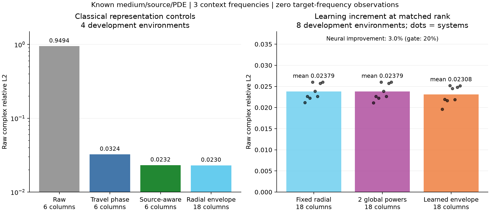

### 连续坐标的新风险：场值准确，不代表求导后仍准确

两环境、8个6.5–13.5 Hz非整数频率已直接求解257/513两套真值，最高网格差仅0.00113/0.00127。
然而从257-grid已知场编码，再到513-grid重新做物理投影，纯相位基的误差从0.02885升到0.39718；
固定/神经径向包络也分别升到0.04131/0.04116，原来约4%的学习增量几乎消失。有限源复参考为0.02616。
这一失败被保留，不能只凭在同一网格上的好结果宣传“连续坐标/网格无关”。

进一步在7.5/11.5/13.5 Hz做成对归因，同样6列基空间：

| 表示与读出 | 细网格复场误差 | 含义 |
|---|---:|---|
| 原相位基，沿用粗网格物理系数 | 0.02929 | 场值仍能迁移 |
| 原相位基，细网格重新解PDE投影 | 0.38812 | 求导/投影不稳定 |
| 原相位基，目标真值最佳拟合 | 0.02029 | 容量oracle，不是可部署结果 |
| 源尺度平滑相位，细网格PDE投影 | **0.02885** | 不加基函数，经典修正恢复稳定 |
| 有限源复参考 + 同样平滑修正 | **0.02046** | 同样6列，更忠实近场结构 |

第一行虽然场值误差不高，但细网格PDE相对残差约1.20，其中约99.91%的平方残差集中在源附近。
原载波用源到点的距离作为相位；这个距离函数在源点不光滑，而真实有限尺寸Gaussian源产生的场是
平滑的。把它强行除成“载波×包络”会要求两项的尖点精确抵消；插值包络后这种抵消不再稳定。
只用源宽度平滑载波，就能恢复细网格投影。这是有成对干预支持的当前归因，不是新的数学定理。

它提醒我们区分：**存/重建场值的表示，与可以稳定施加波动算子的表示。** 这不是“多加一个PDE loss”
就自动能解决的问题，也不是可以把0.39→0.03写成新AI方法收益的机会；首先是对参考表示物理适用域
和光滑性的修正。后续学习方法必须在这个修正后的强对照上证明增量。

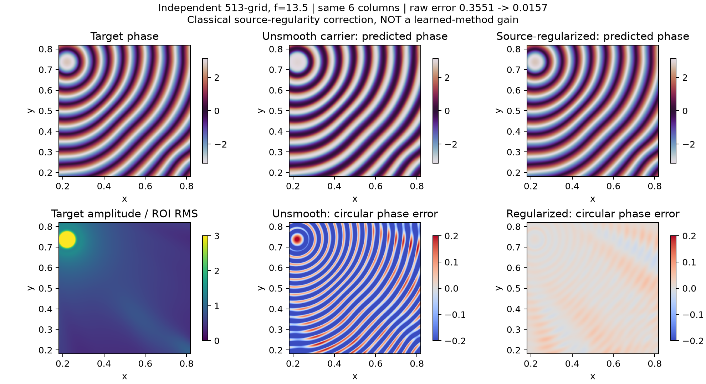

全8个非整数频率复验也恢复稳定：平滑相位257/513误差0.02838/0.02850，平滑有限源复参考
0.02110/0.02118。完整平滑神经输入和包络因子的重训在8个开发系统上为0.02273，对同18列平滑固定
基0.02371约改善4.1%，仍未过方法gate。独立非整数频率257/513验证为0.01946/0.02050；同18列固定
平滑基为0.02049/0.02160，而更简单的6列有限源复参考在细网格为0.02118。三者接近，不能把更多基
函数带来的小幅下降当成显著学习优势。前一稳定代码快照通过173项测试；新增试验另有对应测试。

三组配对结构数据已直接生成（源宽度减半、contrast加倍、二者同时改变）；最高257→513差分别为
0.00190、0.00316、0.00411，均低于0.005审计门槛。冻结旧神经包络、修正载波后，contrast加倍时
细网格误差约0.0854，而更简单的6列有限源复参考为0.0707。不能只拿神经模型相对较弱的18列固定
径向基的约16.6%改善来宣称优势。下一步完成原设置在同查询频率的配对控制，并进一步检查复杂
传播的缺失成分。所有这些仍是两环境开发机制实验，不是正式泛化数据。

## 6. 下一步有条件推进，不把所有组件一起加上

1. 局部表示已完成曲率、attention、少步展开、现场优化和三seed控制；精度有用，但还没有胜过最强方法。
   不继续无条件扫网络容量。
2. 连续谱优先拆解模态波数、深度形状、复幅值和模态出生的误差，再决定learning负责哪部分。
3. 进行独立非整数频率真值检验；空间与频率连续性不能只靠整数网格内重采样证明。
4. 真正算子预测可使用已知环境，避免把所有问题又缩回稀疏点插值。必须先说明其相对当前协议改变了什么。
5. 只有有竞争力的开发候选稳定后才冻结协议并生成正式新系统；不为击败较弱基线而提前打开test。

当前没有依据承诺一篇论文已成。值得长期投入的对象仍然是“可预测的连续相干表示”，而不是把某个
既有核方法或模态分解换一个现代名字。

代码验证：阶段一全套162个测试通过。新生成的3组数据共46个文件及本地checkpoint路径/校验值，见
`artifacts/coherent_stage1_inventory_20261003/inventory.json`。该清单是运行后的工作树快照，不冒充每次
实验启动时的源码证明；后续版本以Git提交与各输出config共同追踪。

## 7. 复现入口

代码都在 `src/spectral_continuation/`；用 `env PYTHONPATH=src .venv/bin/python -m spectral_continuation.<module>
--config configs/<dated-config>.json --output artifacts/<dated-output>`。每个artifact都有实际使用的config。

| 内容 | Artifact目录（仓库根目录下） |
|---|---|
| Ocean独立细坐标、强扩散补偿对照 | `artifacts/coherent_fine_ocean_audit_20261003` |
| 异质介质逐场容量 | `artifacts/coherent_representation_r0_helmholtz_capacity_20261003` |
| 异质介质共享大/小窗口 | `artifacts/learned_wave_chart_r2_helmholtz_pilot_20261003`、`artifacts/learned_wave_chart_r2_helmholtz_smallchart_20261003` |
| 强插值调参 | `artifacts/coherent_irregular_helmholtz_baselines_20261003`、`artifacts/coherent_irregular_helmholtz_gaussian_refinement_20261003` |
| 相位—包络核与消融 | `artifacts/learned_wave_chart_r2_helmholtz_kernel*_20261003` |
| 空间chart跨频无收益 | `artifacts/coherent_chart_spectral_transport_r1_20261003` |
| 经典模态连续谱/弱模态修正 | `artifacts/coherent_modal_spectral_transport_20261003`、`artifacts/coherent_modal_spectral_hankel_20261003` |
| 模态误差成分真值归因（oracle） | `artifacts/coherent_modal_component_audit_20261003` |
| 独立非整数频率、模态出现修正 | `artifacts/coherent_ocean_modal_birth_20261003` |
| 已知介质的相位预处理降阶对照 | `artifacts/coherent_known_medium_phase_rom_20261003` |
| 首达走时与基空间oracle | `artifacts/coherent_known_medium_eikonal_rom_20261003` |
| 学习相位/全局系数/精度控制 | `artifacts/coherent_learned_phase_{neural,scalar,double}_20261003` |
| 固定包络容量与源项归因 | `artifacts/coherent_phase_rom_envelopes_20261003` |
| 学习包络与两参数控制 | `artifacts/coherent_learned_envelope_{neural,scalar}_20261003` |
| 有限源复Green参考 | `artifacts/coherent_fundamental_solution_rom_20261003` |

## 8. 配对结构归因与后续学习尝试

以下是相同两个开发环境、相同8/12 Hz查询、独立513-grid真值的完整2×2配对控制。神经模型是冻结的
旧包络模型，仅统一修正载波光滑性；不是在压力数据上重新选最优checkpoint。主ROI保留源区。

| 物理条件 | 平滑相位6列 | 有限源复参考6列 | 固定径向18列 | 冻结神经包络18列 |
|---|---:|---:|---:|---:|
| 原始条件 | 0.03485 | 0.02426 | 0.02462 | 0.02290 |
| 源宽度减半 | 0.02492 | **0.02227** | 0.02499 | 0.02474 |
| 介质contrast加倍 | 0.08953 | **0.07069** | 0.10239 | 0.08540 |
| 源减半且contrast加倍 | 0.07173 | **0.07012** | 0.10926 | 0.08742 |

主要压力来自这组介质变化，但两环境不足以推出一般定律。特别不能将0.10239→0.08540单独宣传为
学习有效：同信息、更少列数的经典参考已是0.07069。contrast增大时，当前学习不能弥补错误传播结构。

另外完成两次单项学习试验，均使用原始32训练/8开发环境、相同单一复场loss、同样18列：

| 新试验 | 同结构固定基 | 学习结果 | 判断 |
|---|---:|---:|---|
| 有限源复参考载波 + 平滑神经实包络 | 0.023789 | 0.023518 | 约1.1%改善，未通过 |
| 平滑相位载波 + 神经复包络（幅值与分支相位） | 0.023711 | 0.022590 | 约4.7%改善，未通过 |

第二个网络1508参数；相位因子按查询频率线性缩放，最优为3000步中的2000步；4参数全局控制为
0.023705。它比实包络0.022731仅稍好，不支持“只要再加复数相位自由度就能突破”。这些仍为单seed
选型试验，没有做正式三seed确认；不值得在未胜过强经典方法时提前增加确认性计算。

下一项有界诊断换的是被表示的对象：把完整场改为介质产生的次级源，再由同边界背景传播算子合成
波场。先比较相同6列、相同context下的经典控制，计入背景求解成本，同时检查无限域参考与有限吸收
边界的差异。散射分解/Green传播不是新方法；只有其暴露出可学习的缺口，才考虑共享编码器。

对应artifact：`coherent_structural_*_evaluate_20261003`、
`coherent_smooth_envelope_continuous_evaluate_20261003`、
`coherent_learned_source_envelope_{neural,scalar}_20261003`、
`coherent_learned_complex_envelope_{neural,global}_20261003`。

## 9. 从“编码条纹”转向“编码产生条纹的次级源”

[完整POC与公式](../docs/CONTRAST_SOURCE_REPRESENTATION_POC_ZH.md)。这是按介质contrast压力实验
提出的对象变化，不是继续扩大同一种点式MLP。给定6/10/14完整场、已知介质/PDE，零目标频率样本。

四个环境、六个带内整数查询频率，保持六列：

| 方法 | raw complex error | 性质 |
|---|---:|---|
| 平滑相位场空间 + PDE投影 | 0.03198 | 经典 |
| 同相位基对应的次级源，经背景传播 | 0.01432 | 经典；增加背景逆算子成本 |
| 有限源复参考场空间 + PDE投影 | 0.02316 | 经典 |
| 同有限源基的次级源，经背景传播 | **0.01282** | 经典；不是AI增益 |
| 同次级源空间，用目标真值拟合系数 | 0.01202 | 容量oracle，不可部署 |
| 直接一次Born近似 | 1.42633 | 忽略多次作用不成立 |

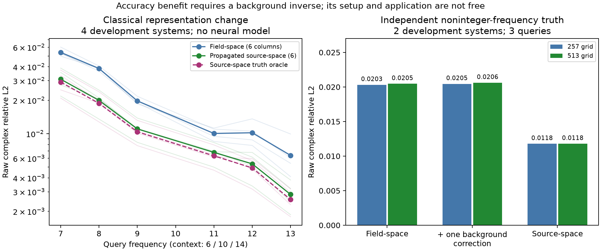

两个环境、三个非整数频率的独立细网格验证：六列源空间257/513分别0.011782/0.011794；六列直接
场空间0.020315/0.020461；更便宜的一次背景缺陷修正0.020454/0.020618。收益能迁移到细坐标，且不
是一次缺陷修正即可解释。

但是背景分解并不免费：当前CPU稀疏LU每频率约5.6秒，六个右端传播约0.37秒（非严格性能基准）。
若每个新频率、单一环境都重新分解，未必比直接完整求解快。我们没有把这些费用从报告中隐藏。

新的经典张量积背景解码器将二维逆算子化成两个一维特征分解与矩阵乘法；吸收角点的背景差异仍
作为contrast保留，所以没有换掉目标PDE。四环境×7/9/11/13 Hz误差0.01330，原非分离背景为0.01291；
背景相对残差约1e-12。GPU六列传播（含传输）约0.004–0.043秒，背景setup仍约1.5–4.5秒。GPU/CPU
硬件不同且有并发任务，不能将这些数直接写成公平加速倍数；它主要验证了可微连续解码的实现可行性。

源窗口容量pilot：六列误差0.01291，60列为0.00732，目标无关的源值POD六列却为0.08918。当前正在
准备32训练/8开发系统的共享学习：用介质—源—频率集合特征选择六个连续源通道，比较固定六列、
全局可学习常数、条件编码器和完整60列。没有将POD的单个失败升级为所有经典压缩都无效。

同时生成[距离相关理想波导数据](../docs/RANGE_DEPENDENT_WAVEGUIDE_DATA_ZH.md)，补充模态耦合机制。
其两个审计环境32模态/513距离相对48/1025最大差约1.4e-5，但这仅是规定的一向传播模型内的数值
收敛，不是相对真实海洋的精度。现有均匀Ocean经典方法占优的结果继续保留。

该新波导的40个开发环境、60–140 Hz九频、2049×129坐标已经生成。独立两环境pilot揭示另一个
实现风险：模态特征向量如果按“最大系数为正”定向，跨频可能换掉符号参考；其线性谱插值误差为
0.5567/0.1885。改为固定表面导数为正，变为0.2170/0.0831。没有对齐目标场相位，只有已知背景
模态的符号规范。这是经典表示/实现修正，不能称神经收益或新物理规律。

进一步用已知完整声速场累积对角模态相位，线性为0.2005/0.0816，三次为0.2050/0.0651；改善有限，
提示还需检查模态幅值与耦合。所有这些只有两个开发环境；不能仅取第二例低误差宣称第二域通过。

### 源空间学习试验的结果与下一步分叉

40系统×六频的预计算完成后，8开发环境固定六列0.014547、神经集合编码器0.014461、全局可学习
常数0.014465；完整60列经典空间0.008184。条件编码器没有胜过只学习常数，也没有达到20%gate。

为区分容量/编码，用同一个六列窗口调制参数化，逐实例做2500步优化：

| 参数如何得到 | 有界调制 | 无界调制 | 可部署性与成本 |
|---|---:|---:|---|
| 用目标场误差优化 | 0.00682 | 0.00667 | 目标oracle，不可部署 |
| 只用已知PDE残差优化 | 0.00924 | 0.00907 | 没有目标泄漏，但当前需完整60列cache |

因此当前组合形式确实有可达到的精度余量；主要失败不只是参数边界，更不能通过“稍加AI包装”解释。
该候选现已执行：加入已知PDE提供的梯度特征后为0.014157（约2.7%改善）；一参数梯度步为0.014351。
仍未达学习门槛，不能把目标oracle余量当作共享编码已经成功。
方法、公式、成本口径和停止条件均收于[次级源POC](../docs/CONTRAST_SOURCE_REPRESENTATION_POC_ZH.md)。

### 更强经典方法决定暂停源空间学习分支

在相同四开发环境、相同7/11/13查询频率、相同已知PDE及背景逆算子下，新增右预条件GMRES：

| 方法 | raw complex error | 说明 |
|---|---:|---|
| 六列有限源场空间 | 0.023459 | 作为迭代初值，不用背景逆 |
| 六列次级源空间 | 0.013523 | 六候选源传播，另有一次背景源求解 |
| 场空间初值 + GMRES两步 | 0.009752 | 目标无关PDE残差驱动 |
| 同初值 + GMRES四步 | **0.001987** | 四次背景逆作用 |
| 同初值 + GMRES六步 | **0.0003467** | 六次背景逆作用 |
| 零初值 + GMRES八步 | 0.001958 | 甚至不需要context场 |

主ROI完全不变；六步远离源区的辅助误差也只有0.000426，不是通过源区能量掩盖传播误差。
背景分解、初值/context获取成本仍不能省略；作用次数不等于批量/顺序算法的公平墙钟时间。
当前计时包含部分诊断开销，不能拿它作正式效率表。这些低误差针对同一离散PDE解，也不是连续
物理的误差保证。

这是有用但明确的NO-GO：当前源空间学习在适用强经典对照面前没有方法优势。保留它作为物理
表示/连续解码工具，暂停容量扫描；将后续学习问题重新限定为摊销预测、表示压缩或真正的跨查询
结构，而非把已知PDE在线迭代的精度当作AI新贡献。对应artifact为`coherent_background_krylov_20261003`。

## 10. 已有理论与本轮增量要分清

- [DMD理论与应用](https://arxiv.org/abs/1312.0041)：从观测识别线性演化成分是已有方法；本轮只验证其在
  Ocean跨频坐标中的作用和失败边界。
- [Spectral mixture kernels，ICML 2013](https://proceedings.mlr.press/v28/wilson13.html)：谱密度组织核和外推
  的思路早已存在，不能占用为本轮新颖性。
- [Deep Kernel Learning，AISTATS 2016](https://proceedings.mlr.press/v51/wilson16.html)：神经网络与核结合
  不是新概念。本轮新增的是当前数据、相位条件化参数化、严格观测协议下的实证；其研究贡献强度仍待检验。

## 11. 新波导把“空间压缩、频率变化、模态耦合”进一步分开

以下均为8个开发环境，不是只挑两个pilot中的较好例子。

### 已知背景/完整介质分别能做到什么

只给60/100/140三个完整场，查询70/80/90/110/120/130 Hz，没有目标频率样本：

| 经典表示与三次谱插值 | raw error | 物理信息 |
|---|---:|---|
| 固定背景模态的传播相位 | 0.21258 | 已知距离不变的背景SSP |
| 同基 + 距离相关对角相位 | 0.14009 | 已知完整SSP |
| 随距离变化的局部模态 + 对角相位 | 0.09241 | 已知完整SSP；每个距离解小特征问题 |
| 局部模态 + 已知源绝热响应作参考，只插值残差 | 0.08327 | 已知完整SSP和源 |

真值成分替换仅作为不可部署oracle：对角相位/三次插值0.14009，换真模态幅值后0.10443，换真模态
相位后0.09762。两者都有明显误差，不能把全部问题归为“相位难、幅值已经准确”。这些替换没有做
目标全局相位对齐，也不是两个误差可以直接相加的分解。

频率采样也重要：只比较共同的70/90/110/130 Hz，三个context的对角相位三次误差0.12772，五个
context为0.07133。不能把不同查询集合的均值拼成改善曲线。

### 更小的传播状态可以很准，但它还不是学习结果

保留完整模态混合，用已知介质构造频率无关的局部小算子，再解析推进快速相位：

| 距离单元数 | raw complex error | 能量加权圆相位RMSE |
|---|---:|---:|
| 8 | 0.06464 | 0.05219 |
| 16 | 0.01474 | 0.01178 |
| 32 | **0.002821** | **0.002380** |
| 64 | 0.000649 | 0.000560 |
| 128 | 0.000147 | 0.000131 |

完整输出有2049个距离节点。这里没有使用任何context场；介质完全已知。这是传统Galerkin/指数
推进对照，甚至可以理解成重新编码后的低维求解器，**不能自动当作学到的波场latent或AI新方法**。
不保留模态耦合、只让各局部模态独立传播的绝热近似误差0.2766。对该模型，真正重要的不只是
载波相位，还包括传播分量之间的相干交换。

### 低维包络能否承载准确场值？可以，但还要学会预测它

R0给同一频率的完整深度剖面，只重建其他距离，全部拟合距离从主指标中剔除：

| 剖面数 | 原始模态系数三次插值 | 背景相位解调后插值 |
|---|---:|---:|
| 17 | 1.3833 | 0.02295 |
| 33 | 1.3612 | 0.00580 |
| 65 | 1.3890 | 0.00156 |
| 129 | 1.4249 | 0.000372 |
| 257 | 0.7845 | 0.0000435 |
| 513 | 0.0408 | 0.00000187 |

这是相同空间采样下的经典编码对照，不是共享学习的大幅增益，不是无观测频率生成。背景模态来自
已知背景SSP；换成已知完整介质的对角相位仅小幅变化。说明空间存储可以很紧凑，而跨频预测仍然
存在独立的耦合/成分演化难题。也不要把原始系数严重欠采样的数值单独用作神经方法的强基线。

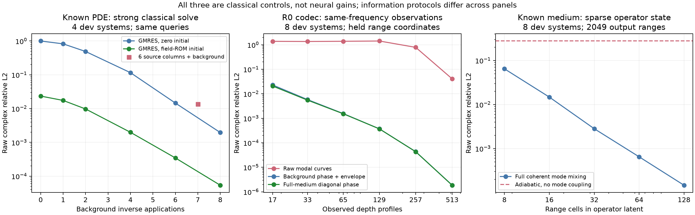

### 一项有界负结果：更多局部相位分量不自动改善现场编码

在原Helmholtz同一2048 patch、64个观测点、200步context-only边际似然优化下，将单相位曲率核
改成正权重的2/4分量混合。单分量复现0.007247，2/4分量为0.008415/0.010201，均更差。正定性、
相位等变和受控双向平面波测试通过，但当前推断没有收益。它不证明多分量没有容量；按预设停止线
不进入共享模型训练或继续分量数扫描。首个启动因双精度记录数组的dtype问题停止，修复后才产生
上述结果；失败启动无性能数据。

### 下一学习试验应满足的条件

这轮强控制说明：完整PDE已知时，AI必须证明摊销速度/存储/跨查询能力，不能只胜过弱的场值插值。
另一独立问题是从已有复场context编码连续谱，不要求提供完整介质；这时已知完整介质求解器只能作
额外信息上限，不应混为同信息基线。两个任务都要保留，不为排除强方法而暗改输入条件。

当前可检验的学习候选是：共享编码器读完整context的紧凑模态包络，学习跨频率的相干耦合修正；
解析载波负责密集相位读出。先验证训练误差、未见环境、非整数频率，再看是否值得扩数据。它不是
已通过的方法，也不能靠“FNO/Transformer”名称获得贡献。若给完整SSP，则同时比较上面的稀疏
传播算子；若不给，必须明确记录背景/源信息与context数量。

文献边界也已补查：[2023散射矩阵DNN](https://onlinelibrary.wiley.com/doi/10.1515/nanoph-2022-0770)
与[2026谱域T矩阵学习](https://arxiv.org/abs/2607.10570)已经学习内禀复散射响应。因此“把图像换成
散射矩阵/模态token”本身不能声明首次；可迁移的高精度表示、严谨的信息条件与真实成本仍需实证。

新增复现artifact：`coherent_waveguide_components*`、`coherent_waveguide_local_frame*`、
`coherent_waveguide_adiabatic_reference*`、`coherent_waveguide_coarse_operator*`、
`coherent_waveguide_curve_codec*`、`coherent_kernel_mixture_capacity*`（均为20261003）。

### 首轮共享包络FNO：未通过，不以扩数据掩盖训练失败

该独立协议提供三个完整频率场及已知距离不变背景，不提供完整距离相关SSP。编码65个剖面上的
复模态包络，4层1D FNO、width64、16谱系数，预测对三次插值的复修正，解析载波读出完整场。
训练32系统×6query，开发8系统×6query。模型没有推断时的完整PDE求解，也没有目标频率样本。

三次插值0.212574；相同输入的训练集RBF残差回归，在12组开发超参数选型中最好0.211940；FNO
4000步后的开发误差为0.310725，最优仍是第0步0.212574。首轮未保存末步状态，随后仅增加训练
诊断进行同seed同配置重跑，开发轨迹逐点复现；末步训练误差为0.105016，未达到0.05训练门槛。
因此不能只说它是小样本过拟合，也不能宣称紧凑decoder已经等于成功的共享频率模型。

扩至512训练环境的压缩模态teacher脚本/配置已经准备，但**尚未启动生成**。按预设停止条件，先
定位训练容量/条件化/耦合表示问题，再考虑增加环境数量。新训练缓存不能因为配置存在就计入数据
清单。FNO本身是已有架构，不将这一负结果包装为新方法。

证据：`coherent_waveguide_envelope_operator_20261003`与
`coherent_waveguide_envelope_operator_train_audit_20261003`。前者只保存最佳初值，后者另存末步。

随后仅改变查询条件化：用f及已知背景色散通过FiLM调制各层，保持FNO宽度、解码、样本和loss不变。
4000步末步train为0.05229；同架构延长优化至12000步后train为0.026657，dev仍0.302861。说明训练
容量现在达到预设0.05线，但泛化没有通过；最优开发模型依然是第0步插值。它有634176个实自由度
（torch原生numel为372032，复参数每个含两个实数），不能误报成37万实参数。

20:22 UTC才据此启动512环境的训练数据规模控制；使用同模型与原8开发环境，先做256/512传播
单元的数值审计。尚不能说数据生成或更大规模训练已经成功。FiLM是已有方法，仅是本轮有归因的
条件化改进。`coherent_waveguide_query_modulation_20261003`及`*_long_20261003`保留完整负结果。

两个经典替代也未通过：全局多载波系数在截止/衰减分量上会产生巨大的跨频系数不稳定；改成
局部单位模相位、包含每个输出的自身载波后虽恢复有界，但同64系数预算下，最好的4/8分支仍约
0.230/0.240，弱于单载波0.213。停止该系数族的共享训练。另一幅相拆分控制，按空间展开模态相位
并未改善；16种小控制里最好为沿频率展开+三次幅值、弱源模态回退的0.2062，仅比0.2126小幅改善。
这些结果不证明多路径或相位展开无效，只否定当前参数化和迁移规则，不继续枚举更多分支/展开策略。

### 数据规模控制完成：泛化改善，但当前神经表示仍非最强

512个训练缓存已全部生成，256/512传播单元审计最大差0.00004214。验证始终使用原8环境的
2049距离完整场；训练缓存使用129距离模态轨迹，未把验证真值换成较粗缓存。32环境缓存对照
复现原结果（末步train 0.02670、dev 0.30366），排除了teacher压缩带来的主要变化。

| 训练环境数 | 最优FiLM开发误差 | 同输入最优核回归 | FiLM末步训练误差 |
|---|---:|---:|---:|
| 32 | 0.212574（初值） | 0.211940 | 0.026701 |
| 128 | 0.201853 | 0.200983 | 0.050134 |
| 512 | 0.175268 | 0.161893 | 0.091232 |

固定模型、loss、12k优化步、开发查询和主指标；只改变训练环境多样性。最佳开发checkpoint按同一
预定规则选择，末步结果也完整保存。学习在更多环境下开始有益，但神经模型仍弱于强同信息核基线；
不能只拿0.175与插值0.213比较就宣布方法gate通过。原定0.10绝对误差和20%强基线增量均未达到。

结论是“数据不足贡献了一部分误差，但独立预测各频率包络的模型仍缺少有效结构”，不是已经证明
问题不可辨识。下一项有条件假设：把多个频率约束为同一频率无关传播生成器的响应，能否改善预测。
先做识别/容量审计与经典反演对照，再训练；不会仅继续扩大FNO或换一个网络名。

对应artifacts：`coherent_waveguide_query_modulation_cache32_20261003`、`*_cache128_20261003`、
`*_cache512_20261003`；种子、实际训练ID、缓存路径与覆盖配置均在各自config.json。

## 12. 共同传播生成器：同信息的经典识别显著强于包络预测

这是新的表征机制审计，不是神经成功。只读相同60/100/140Hz场及静态背景，从观测的模态导数
建立实最小二乘，估计慢度平方扰动的16个深度余弦系数；64个距离单元共享这个频率无关表示。
查询时使用频率平方律与解析矩阵传播产生复相位，没有目标频率样本，没有读取真实距离相关声速。

| 编码/识别方式 | 8环境×6频率 raw complex error | 信息说明 |
|---|---:|---|
| 直接包络FiLM，512训练环境 | 0.175268 | 三context，各65剖面 |
| 同输入包络核回归 | 0.161893 | 同上 |
| 经典共同生成器，三次导数 | **0.016010** | 同上，无训练 |
| 五次导数+距离平滑正则 | **0.011362** | 同上，开发选型，无训练 |
| 经典共同生成器，257剖面 | 0.001801 | 使用更多观测剖面，不混为同预算 |
| 经典共同生成器，2049剖面 | 0.000789 | 完整观测剖面，不混为同预算 |
| 真慢度投影到相同基 | 0.000782 | 真介质oracle，不可当部署性能 |

全部主ROI、绝对相位和验证真值不变。二阶识别近似遗漏了单向生成器的距离导数项，因此不是理论上
精确的反演；这里是给定平滑介质族的经验结果。总慢度平方预设正值边界，裁剪比例也保存。

这个结果修正了此前的归因：三个完整频率包含的信息远多于当前包络回归有效利用的内容。不能因
FNO/RBF误差较高，就宣称此处频率查询本质上不可辨识。**共同生成规律是有力的表示，但当前收益
主要来自经典物理逆问题结构。** 学习必须额外胜过0.01136这个更强同信息基线。

下一最小神经试验已经启动：编码器读取context导出的实正规方程统计量，预测实生成器系数的修正；
解析传播负责相位。只用训练环境的真实慢度系数作监督，开发实例真实介质只作oracle。该监督比
直接包络网络增加了训练期介质标签，必须明确，不能称完全同监督优势。推断输入条件不变。
使用单一系数MSE，开发集按raw field error选checkpoint；共同相位/幅度缩放不改变编码统计量，
源的复初值保留在decoder。另有相同监督的核回归对照。尚无学习结果，详见
[POC协议](../docs/SHARED_PROPAGATION_GENERATOR_POC_ZH.md)。

证据：`coherent_waveguide_generator_identification_20261003`、
`coherent_waveguide_generator_smoothing_20261003`。没有打开正式test。

首轮共享生成器学习已完成：512训练环境、240304实自由度的三层小FNO，最佳开发raw为
**0.008142**；相同介质监督的RBF修正为**0.008874**。相对0.011362经典逆问题是正结果，但比更强
同监督核方法只好约8.2%，仍未过20%gate。它没有使用新的频率标签或开发介质输入，主增量不能
全归给网络：绝大部分改善在采用共同生成器的经典0.016/0.011阶段就已经出现。

下一控制仅改变优化目标：通过可微的同一相干矩阵传播，以单一raw复场平方相对误差训练，不叠加
系数、幅值、相位或PDE loss。两种初始化分别为上述系数监督checkpoint和原经典估计；后者不读取
训练介质标签，可区分额外监督的作用。解析decoder与独立NumPy实现一致到1e-10，自动微分已通过
有限差分检查。两个训练正在运行，结果尚未验收。证据`coherent_waveguide_learned_generator_20261003`。

后续结果：系数预训练后改用复场loss为**0.006954**，相对同监督核回归改善约21.6%；从经典初值直接
用复场loss训练3000步为0.012349。两者总训练步数/计算不同，不能仅据此证明介质标签不可替代。
更强的context-only非线性反演不能省略：同65剖面、相同生成器，在原观测频率做固定步数L-BFGS，
5/10/20/50/100步查询误差为0.007527/0.006668/0.005983/0.004680/**0.003503**。
目标频率不参与优化/停止，全部步数曲线保留。由此神经预测仍不是绝对精度最优，原定强基线gate
不能仅凭胜过核回归就宣布通过。下一新假设限定为**精度—编码时间—存储的摊销优势**，必须测量
完整输入编码和查询成本，不能只对比神经forward与经典全部求解。

同时启动冻结生成器的能力审计：相同8开发介质，直接生成非整数频率/新连续坐标/源深度移动15m
的真值。带内查询与150/170/200Hz压力测试分开；新增数据先做32/48模态、1024/2048传播单元
收敛。它不是新的正式环境，不能据此宣布OOD或跨域通过。这项检验表示能否支持新query，而不是
先假定神经方法在这些query上也领先经典。

### 冻结查询能力与成本：已有单域正信号，但不是最终论文结论

新增16份直接真值已全部完成，数值审计最大差7.254e-6。编码器完全不变，换频率/坐标/源不重新
提供场观测，预测的仍是原环境那一组1024个实慢度系数（另需已知背景、源请求与物理decoder）。

| 方法 | 新带内频率/原源 | 新带内频率/移源15m | 150–200Hz/原源 | 150–200Hz/移源15m |
|---|---:|---:|---:|---:|
| 经典正则生成器 | 0.01187 | 0.01345 | 0.02093 | 0.02330 |
| 同监督核生成器 | 0.00935 | 0.01212 | 0.01675 | 0.01937 |
| 学习生成器+复场微调 | **0.00723** | **0.00775** | **0.01361** | **0.01335** |
| 经典context反演100步 | 0.00329 | 0.00447 | 0.00602 | 0.00658 |

学习模型对应四列相位RMSE为0.00540/0.00576/0.01029/0.01015 rad。此表证明当前生成器能支持
新的请求，不证明网络比充分优化的经典方法更准。经典100步同样支持这些能力，物理结构的贡献
不可归给learning。只查询正频率；源线性/共同相位等变由decoder结构保证，不宣称已实现完整的
双向互易Green算子或一般因果性。

独立逐实例成本pilot，所有方法计入context投影、背景构造、识别、模型/优化、CPU–GPU传输和六个
完整场读出；共同的磁盘IO、指标计算、离线训练/模型加载不计。8系统、3次重复，先每系统取中位数
再等权平均。后来对所有方法统一缓存与环境无关的Gauss积分规则，数值完全不变：

| 方法 | raw error | 编码秒 | 编码+六query秒 |
|---|---:|---:|---:|
| 经典正则识别 | 0.01136 | 0.0481 | 0.1752 |
| 核生成器 | 0.00887 | 0.0732 | 0.2008 |
| 学习生成器 | **0.00695** | **0.0435** | **0.1710** |
| 经典非线性5步 | 0.00735 | 0.6983 | 0.8266 |
| 经典非线性10步 | 0.00623 | 1.4012 | 1.5311 |
| 经典非线性20步 | 0.00513 | 2.9013 | 3.0294 |

独立实例优化与之前8实例一起优化并非完全相同的L-BFGS轨迹，分别报告，不偷换较有利误差。
神经相对核约21.6%误差改善、约15%端到端时间降低；相对精度接近的经典5步约4.8×，**不是已经
达到5×正式gate**。核推断数组约52.7MB，神经参数约0.961MB（不含共同物理和latent存储）。
这些是共享A100机器的warm pilot，当时还有无关VLLM进程驻留；不是独占硬件认证，不能推广为
真实海洋部署加速。训练、标签生成和多查询摊销也需另报告。当前正在补训练seed和等更新步数的
无介质标签控制；第二域先做经典识别审计，尚未有两域神经优势。

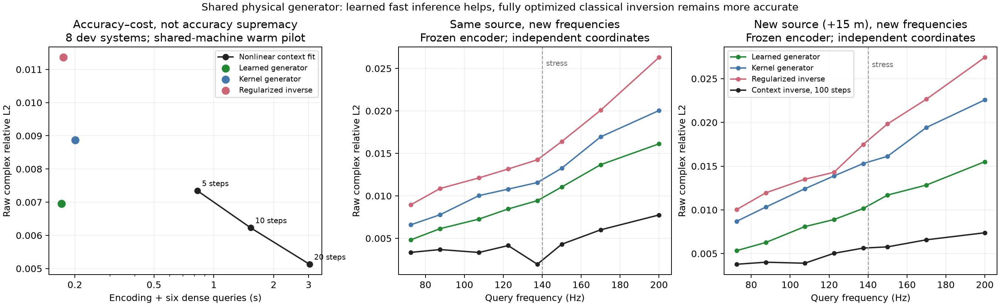

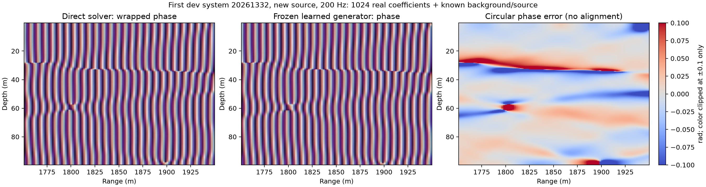

相位图固定取第一个开发环境、最高查询频率，不挑最优样本；误差颜色截断±0.1rad仅为显示，未对齐
相位、未删低幅值点，所有数值指标仍用完整预定ROI。

### 三seed、训练标签和更强统计先验：修正单次成功的解读

| 种子 | 系数监督预训练 | 再用单一复场loss微调 |
|---|---:|---:|
| 42 | 0.008142 | 0.006954 |
| 43 | 0.007720 | 0.007153 |
| 44 | 0.008228 | 0.007894 |

三seed微调均值为**0.007333**，对同监督核基线0.008874的改善约**17.4%**，因此不能把seed42的
21.6%写为稳定通过20%门槛。所有seed分别选原开发集checkpoint，没有模型挑选/集成后替代主指标。
无介质标签从经典初值训练，同样11k次更新，最佳0.010589；这比之前3k步0.012349好，仍弱于有标签
预训练。两种loss的单步成本/优化几何不同，该控制不证明额外物理标签理论上必要。

另外补齐同监督的经典统计先验：512训练介质的实生成器系数拟合Gaussian/PCA prior，用当前观测
导出的物理正规方程做条件推断；不对振荡复场做旧式PCA重建。预设16/32/64/128秩×五个正则值，
20组选型中最好0.009872，仍弱于核回归0.008874。它是必要的强控制而非新AI贡献；所有失败选项保留，
不继续枚举PCA尾空间。artifact为`coherent_waveguide_generator_prior_20261003`。

### 高频分辨率应由实际激发尺度检验，而不只看Hz

两个预定开发环境扩展到400Hz、独立新坐标直接真值。宽源6–10m下，32→64解码模态几乎不改变
任何方法的误差；学习生成器400Hz约0.044，真介质投影oracle约0.00378。此时主要是生成器识别/表示
误差，不是输出像素或模态数不足。不能用“频率更高”自动声称自适应网格有益。

再固定同一环境、同一组1024实系数与原低频宽源观测，只把**公开查询源宽度改为2m**。并不提供
新源场样本。新的空间成分被激发后，同一表示的解码分辨率开始重要：

| 两环境窄源，400Hz | 32模态解码 | 64模态解码 |
|---|---:|---:|
| 核生成器 | 0.13835 | 0.05863 |
| 学习生成器seed42 | 0.13183 | 0.04559 |
| 原context非线性反演100步 | 0.14424 | 0.05995 |
| 真介质投影oracle | 0.12243 | 0.00675 |

这是真实的“环境隐变量不变、查询分辨率可变”机制正信号，但这种能力也来自经典物理解码，不是
网络独占能力。尤其oracle32→64的变化直接定位了模态截断瓶颈。64/96模态与1024/2048距离单元
的teacher对比最大差5.676e-6。更高频/窄源下识别误差仍然被放大，不能承诺任意倍频保持同误差。

窄源初步结果中充分拟合旧观测的经典反演反而比学习差，可能与旧宽源没有充分激发某些方向有关；
这只是待验证解释，不是已证明可辨识性结论。正扩到原8开发环境、三seed、同监督统计先验和无标签
控制，模型全冻结；不只报告这两个有利环境。尚没有新增独立正式测试系统。

第二域二维Helmholtz结果相反：65²观测下经典谱微分识别已到0.0000989（相对同离散teacher），
应停止在该协议盲加网络，见[第二域完整审计](../docs/GENERATOR_SECOND_DOMAIN_AUDIT_ZH.md)。
目前仍未通过“两域共享学习优势”的总gate，也不足以宣布顶会论文核心方法成立。

完整八环境窄源验证随后完成：400Hz时，三seed的64模态误差分别为
**0.03616/0.03754/0.03695**，32模态则为0.12262/0.12336/0.12331。不是仅前两个环境上的现象。
同样64模态的核生成器0.04296、Gaussian物理先验0.05492、正则逆0.07398、经典100步0.04058、
无介质标签11k神经0.07954、真介质oracle0.00558。对核的三seed平均增量约14.2%，对经典100步
约9.1%，仍不够宣称独占优势。经典优化延至固定2000步的控制正在运行；必须先排除其优化不足。
证据`coherent_waveguide_narrow_source_modes_full_20261003`，全部576行频率/模态/环境/方法结果保留。

**随后更强优化控制推翻了“可能是不可辨识方向导致神经更好”的直接解读。** 原context反演500/2000步
在旧声源带内查询为0.001669/0.001634，窄源400Hz为0.02180/**0.02114**，已经优于三seed神经约
0.0369。固定2000步约279秒为八实例联合优化时间，不是逐实例部署延迟；不能混入前面的warm成本表。
该控制没有新query标签参与优化/停止。拟合观测的平方相对loss在500→2000从8.66e-8到8.42e-8，
剩余误差可能混合表示截断、离散teacher差异和仍未完全收敛，不能因此证明信息论不可辨识。

只有系数监督、不经复场微调的三seed在窄源400Hz为0.03831/0.03620/0.03791，与微调后接近。
原声源微调没有带来同等幅度的新源收益，值得做“训练响应覆盖”的单机制对照，而不是继续加宽网络。
详见[新的作用loss协议](../docs/GENERATOR_OPERATOR_ACTION_POC_ZH.md)。
证据`coherent_waveguide_generator_context_fit_long_20261003`及
`coherent_waveguide_narrow_source_optimization_control_20261003`。

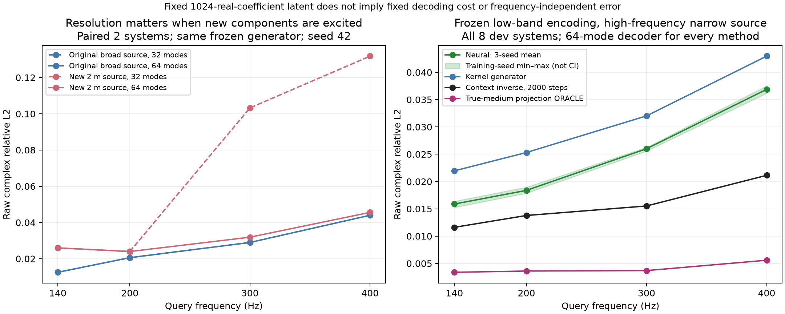

左图严格配对原两个环境，右图为全部8环境；阴影仅为三训练seed的范围，不是统计置信区间。经典
2000步与真介质oracle均保留，避免只展示32→64模态的大降幅后暗示神经独占该能力。

“随机源作用loss”首轮未通过：同投影teacher固定源原query0.006926，随机源0.007660（退化10.6%）；
窄源400Hz为0.03585/0.03791，随机源也没有优势。它未解决当前共享预测瓶颈，停止三seed扩展和
源分布扫描。没有用窄源结果重选checkpoint；[完整协议/结果](../docs/GENERATOR_OPERATOR_ACTION_POC_ZH.md)。

### 物理校正的初始化：较清楚但仍需增强对照的learning信号

所有初始化随后执行完全相同的context-only L-BFGS，不增加目标频率观测或新loss。成本包含新鲜
编码、传输、线搜索和六个完整query，不包含离线训练/磁盘IO；8环境×3次warm重复，共享机器。

| 初始化 | 5步raw / 总秒 | 20步raw / 总秒 |
|---|---:|---:|
| 经典正则估计 | 0.007346 / 0.855 | 0.005130 / 3.035 |
| 同监督核回归 | 0.006568 / 0.895 | 0.004642 / 3.085 |
| 学习生成器seed42 | **0.005045 / 0.865** | **0.003444 / 3.031** |

这比“网络独立取代经典求解”更符合当前证据：神经学习生成器的可用初值，物理校正负责符合观测。
20步比同预算核初始化改善约25.8%，5步约23.2%。但目前只有seed42，正在补其余seed与真实生成器
Gaussian prior初始化；后者也必须有同样的物理校正机会，不只拿其未经校正的0.00987比较。
这不是对神经warm-start一般思想的新颖性声明，独立环境/第二域仍未通过。

另做了缺失物理项控制：原二阶识别省略的距离导数项，可通过直接拟合一阶平方根生成器作用避开。
解析Fréchet导数经传播/衰减模态的有限差分测试。三/五次context导数×有/无距离平滑四个固定选项、
最多20步局部Gauss–Newton，最好约0.01069，仅比原0.01136小幅改善；不如已有学习或全轨迹非线性
反演。说明仅修复这一项未解决问题，不能把全部learning增量归给它，也不继续迭代/正则扫描。
证据`coherent_waveguide_generator_warm_start_cost_20261003`与`coherent_waveguide_first_order_inverse_20261003`。

三seed/更强初始化对照已完成：20步神经0.003444/0.003436/0.003637，均值0.003506；Gaussian prior
同20步为**0.004153**，优于核初始化0.004642。相对最强该预算参照的三seed增量只有约**15.6%**，
没有通过20%门槛。5步神经均值0.005156，Gaussian0.005933，约13.1%。新三seed仅一次计时，个别
时段还有数据生成/共享作业，不能拿不同运行的有利秒数制造速度优势。

为避免围绕8开发环境无限调参，现已冻结三seed模型、基线超参数和比较协议，生成64个从未用于
训练/开发的IID系统；[独立审计协议](../docs/GENERATOR_FROZEN_SYSTEM_AUDIT_ZH.md)明确不降低原gate、
不以新系统选择模型。数据生成前已有checkpoint哈希，旧Ocean封存集不动。
128份独立真值现已生成完毕，数值加密最大差1.004e-5。seed42的64系统原query评估完成：
直接神经0.008498、核0.010215；神经20步0.004127、Gaussian20步0.004702。
其余两个seed尚未完成，不先用单seed宣布gate。第一次进程以SIGTERM结束，原因未证实；严格
保留已完成系统并按同配置恢复，不能把恢复或共享机器的时间波动算成算法差异。首次恢复前的
runtime元数据未单独保存，后续已加备份；配置、模型哈希与逐系统数值记录保留。

另外两项有停止条件的科学控制均完成：

- 128维训练介质线性先验投影oracle0.000810，几乎达到全1024系数真介质表示0.000782。
  在该先验内做非线性context反演没有胜过自由系数优化；不支持继续堆非线性隐空间。
  [协议与结果](../docs/GENERATOR_NONLINEAR_PRIOR_CONTROL_ZH.md)。
- 原两开发环境的实际物理参数扰动：低带观测差对110Hz查询放大约1.56–1.86倍，对400Hz
  约8.33–12.25倍。实际扰动很小且受参数边界约束，不能外推成全局不可辨识定理；不代表神经
  模型达到噪声极限。[通俗稳定性诊断](../docs/GENERATOR_LOCAL_STABILITY_AUDIT_ZH.md)。

## 13. 全程物理校正重新改变方法判断

额外观测残差输入的单机制检验完成：同参数数目、同3000步、相同初始预测，残差输入0.006907，
零输入续训控制0.006855，没有收益。按停止规则不扩大此分支。

随后引入更强、但完全经典的校正：在512训练介质的128维PCA方向内，解析计算完整传播轨迹的
Jacobian，用Gauss–Newton直接调整系数。这不是此前局部导数匹配，也不是更长L-BFGS；没有用
query truth决定步长。传播/衰减模态的全轨迹导数通过独立有限差分测试。

| 原8开发环境的初值 | 0步 | 1步 | 2步 | 5步 |
|---|---:|---:|---:|---:|
| Gaussian先验条件估计 | 0.009872 | **0.000734** | 0.000703 | 0.000702 |
| 原冻结神经输出 | 0.006954 | 0.005711 | 0.005812 | 0.005909 |
| 神经输出先投影回训练先验 | 0.006284 | 0.000865 | 0.000750 | 0.000709 |

神经初值较好的旧结论并不适用于所有校正器：128方向更新无法消除初值在子空间外的误差，先投影
后大幅恢复。这是表示/优化兼容性问题，不是“神经一定有害”，也不是单凭相位图得到的判断。
Gaussian一次校正约0.336秒/实例，仅校正部分；未含初始编码、query、离线拟合，不是正式端到端
加速认证，但已足够否定“128维精确校正必然太贵，所以必须学习近似”的未经验证前提。

该PCA prior本身由训练介质学得，不能说完全不需要数据学习；正确结论是**当前深神经编码的新增
价值尚未证明，而数据先验+准确物理推断非常强**。0.000810真介质投影是一个特定oracle，不是所有
响应拟合的严格下界，因此新方法略低于它没有矛盾。后续独立复核如下，不声称任意环境/频率成功。
64冻结审计的原比较保留，新增强基线若扩展到它，必须标记为后补对照，不能冒称原预注册项。
详见[协议](../docs/GENERATOR_TRAJECTORY_NEWTON_CONTROL_ZH.md)；原始artifact为
`coherent_waveguide_trajectory_newton_20261003`与`coherent_waveguide_neural_projection_newton_20261003`。

### 64个独立环境：原冻结比较与后补强控制分别报告

原冻结三seed全部完成，逐系统先平均训练seed误差（不是预测集成），再按系统bootstrap：

| 原预设比较 | 神经 / 对照 raw | 改善 | 95%配对区间 |
|---|---:|---:|---:|
| 直接预测，对核回归 | 0.008560 / 0.010215 | 16.2% | 12.9%–19.3% |
| 5步校正，对Gaussian初值+同校正 | 0.006032 / 0.007599 | 20.6% | 14.9%–25.5% |
| 20步校正，对Gaussian初值+同校正 | 0.004105 / 0.004702 | 12.7% | 3.4%–20.2% |

不能因为5步均值略超20%就宣布稳健达标。新集合上核初值5步0.007527也略优于Gaussian5步，
全部表保留，不按新结果偷改预先选定对照。

随后将**旧8开发环境确定参数**的全程GN追加到64系统，明确标为后补强控制，不冒充原预注册候选。
没有在64系统上选rank、damping或步长；读取前核验原始truth的SHA256。

| 后补Gaussian先验+全程GN | 1步 | 2步 | 5步 |
|---|---:|---:|---:|
| 原声源、带内未见频率 | 0.000824 | 0.000684 | 0.000677 |
| 新窄源400Hz、新连续坐标 | 0.005930 | 0.005240 | 0.005273 |
| 同400Hz能量加权相位RMSE / rad | 0.004637 | 0.004147 | 0.004175 |

同64环境，神经三seed的新窄源400Hz均值0.04524；神经+20步0.03023；真介质投影oracle0.004073。
1/2/5步均保留，不用新query挑2步后包装成推断策略。窄源解码统一64模态，所有方法都只从原
60/100/140Hz宽源观测编码一次；窄源参数是query信息，没有新query场观测。

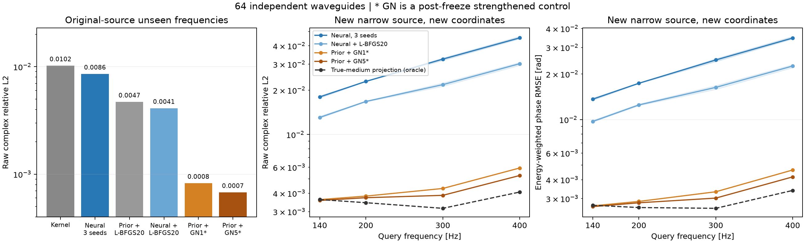

图中神经阴影为三个训练seed的范围，不是置信区间。GN星号表示后补强对照。共同生成器的跨请求
能力得到独立证据，但这主要支持表示/物理推断的机制，不支持当前网络已经构成顶会新方法。
精度还限定于一向、平滑、无噪声、已知背景/源/边界的合成波导，不是完整海洋实测认证。

### 观测减少后的机制检查

仍在原8开发环境，不改变主协议：17个完整垂向剖面时，Gaussian初值0.09595经5步到0.000730。
5剖面时0.4133经50步到0.07774；先验均值初始化50步反而0.7211。几乎拟合观测不代表新频率
准确。当前检验完整Gaussian先验惩罚，因为旧ridge只限制单步更新；在排除优化/先验失配前，
不把退化称作不可辨识。详见[有停止规则的诊断](../docs/GENERATOR_PROFILE_BUDGET_AUDIT_ZH.md)。

该检查随后完成：相同5剖面、相同128维先验、相同50步，完整先验强度1e-8/1e-6/1e-4分别达到
**0.008790/0.007623/0.01410**。三个预设选项均比仅步长正则的0.07774明显改善，不是不可辨识
已获证明，也没有新增神经必要性。选项全保留；1e-6为开发表现最好，不称为独立预注册结果。
下一步回到固定表示与解码精度边界，不继续扫正则强度或借此改写主任务。

## 14. 固定代码维数与物理读出带宽：第一轮正结果

现在每个环境不是存一张相位图，而是训练先验内的128个实坐标。把它们对应的生成器基函数在
距离方向连续化，同样128维代码可以用64、128、256个传播单元读出。仍只在原8开发环境测试。

| 表示/读出 | 带内六频率raw | 新窄源400Hz raw |
|---|---:|---:|
| 16深度项、64段、原GN5代码 | 0.000702 | 0.006088 |
| 同代码，直接128段读出 | 0.000589 | 0.005824 |
| 同代码，直接256段读出 | 0.000622 | 0.005843 |
| 16深度项、256段，同观测再校正5步 | 0.000226 | 0.005106 |
| 32深度项、256段，仍128维代码，同观测5步 | **0.000127** | **0.001552** |
| 32深度项训练先验容量投影oracle | 0.000184 | 0.001335 |
| 32深度项完整真介质投影oracle | 0.0000368 | 0.000835 |

最后两行额外使用真实开发介质，只解释容量，不是部署方法，也不是严格query误差下界。32深度
项的先验只由原512训练系统的介质标签构建，没有新增训练场或开发标签进入推断；低16项的旧
context推断值提供初始代码。源、背景、观测数和主指标均不变，不根据400Hz标签挑停止步数。

**具体正发现：固定隐变量数量不要求固定生成器的读出带宽。** 训练数据提供的跨尺度相关性，
可以让同样128维代码携带对高频query有用的较细介质结构。与此同时，单纯加密距离读出并不单调
更准；重新匹配原观测才明显改善，说明代码与数值解码偏差存在耦合。不能把“能在任意坐标求值”
写成自动高精度或无成本的网格无关性。

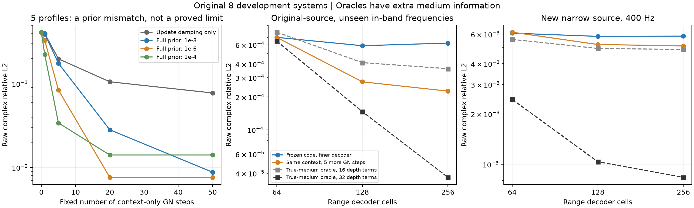

图中后两幅固定16项推断表示，灰色oracle比较16/32项。新的32项、128维训练先验结果在上表，
并未塞进旧图冒充同一表示。详见[机制备忘第8–9节](../docs/GENERATOR_REPRESENTATION_MECHANISM_ZH.md)。
该先验仍是线性统计学习 + 经典物理解码；正结果不等于深神经创新已经成立。下一步优先检验
“估计的是真正可复用的响应算子，还是只适合几个Gaussian声源”，不盲增网络。

该算子作用审计也完成：原8环境、400Hz、40个正交深度模态源（均没有用于编码），32项/256段
的新128维代码平均raw为**0.001700**，优于旧16项/64段0.006941或16项/256段0.005488。
在每个环境中直接计算这40维源空间内任意复组合的最坏相对误差，其跨系统平均为0.005189，
最大系统为0.01534；因此平均好不等于所有请求一样好。它比只测几个Gaussian源更接近算子级
验证，但仍是开发环境和理想单向模型，非新深学习方法。协议、指标与复用矩阵数据见
[算子作用审计](../docs/GENERATOR_OPERATOR_ACTION_AUDIT_ZH.md)。

## 15. 表示的适用对象：源响应rank与第二域压缩

先解释一个容易混淆的关系：紧凑的环境代码可以生成满秩响应算子，不要求所有声源的场都落在
一个很小的固定输出子空间。前述40源直接矩阵在三种接收ROI上奇异值近乎平坦；即便只留最末
接收剖面，rank8/16/32固定场基的最优raw Frobenius误差仍约0.8944/0.7746/0.4472。
相比之下，推断生成器的40源平均raw为0.00170。两者不是同参数/同成本算法排行，而是说明
“latent维数”“函数张量空间rank”“source-to-field矩阵rank”不能混为一谈。

该rank结果来自传统线性代数与本模型近能量保持性质，不是新定理；完整孔径、均匀损耗和单向
假设重要。它不否定源自适应基、整个算子做PCA或一般FNO。细节与复现见
[机制备忘第10节](../docs/GENERATOR_REPRESENTATION_MECHANISM_ZH.md)。

另一物理域保留最强正弦谱识别，比较压缩同一估计速度场后对新频率的影响：

| 二维Helmholtz表示 | 每环境实数 | 共享实数 | 推断raw | 真介质压缩oracle |
|---|---:|---:|---:|---:|
| 不压缩内点速度 | 3969 | 0 | **0.00009838** | 0.000006876 |
| 分离rank4 | 508 | 0 | 0.00039284 | 0.000006876 |
| 分离rank8 | 1016 | 0 | 0.00020506 | 0.000006876 |
| 训练PCA128 | 128 | 512001 | 0.00171262 | 0.00079710 |

4个旧开发系统、6/10/14观测、7/11/13查询，目标频率零观测。介质由4个轴对齐Gaussian合成，
所以rank4 oracle本来就有结构优势，不是普适低秩结论。PCA用512个新训练介质标签，未用开发
真介质编码；统一内点插值/外推，保留原未压缩q控制0.00009886。全部误差针对同257离散teacher，
不能略过原257→513误差约0.001–0.002而宣传连续PDE达到1e-4。

这里**没有一种压缩提高绝对精度**，但有可量化的存储—误差取舍。它支持用实生成器组织复响应，
不支持PCA128在所有域最优，也不构成两个物理域上的深神经胜出。下一研究问题应关心查询相位
对编码方向的敏感度，而不是只问介质图片的重建MSE。该想法仍待机制验证；不自动新增网络。
完整协议、相位指标、成本与来源见[第二域审计](../docs/GENERATOR_SECOND_DOMAIN_AUDIT_ZH.md)。

## 16. 频率升至800Hz：固定代码与按需物理读出

先在原8开发环境固定已经从60/100/140Hz观测拟合好的128维代码，直接查询新频率、宽/窄两种
源与独立偏移坐标。新真值由1024段/160模态/384点积分求解；3组独立数值审计在140/400/
800Hz、两源上，1024/160与2048/192的最坏raw差为**2.67e-5**，低于预定0.001门槛。
GPU双精度批量特征分解也与独立SciPy逐段实现核对；这仍只是单向理想波导内的收敛证据。

完整>=50m ROI、8系统等权的raw complex相对L2如下。所有行推断代码相同，只有查询物理分辨率
不同；oracle行额外使用真实开发介质，不是部署方法：

| 固定代码/读出 | 400Hz宽源 | 400Hz窄源 | 800Hz宽源 | 800Hz窄源 |
|---|---:|---:|---:|---:|
| 32项代码，256段、32模态 | 0.001185 | 0.116636 | 0.179917 | 0.371450 |
| 同代码，256段、64模态 | 0.001185 | 0.001552 | **0.003508** | 0.003671 |
| 同代码，256段、128模态 | 0.001185 | **0.001552** | **0.003508** | **0.003556** |
| 同代码，512段、128模态 | 0.001172 | 0.001553 | 0.003471 | 0.003540 |
| 真介质32项、512段、128模态，oracle | 0.000246 | 0.000815 | 0.001350 | 0.002152 |
| 完整真介质、512段、128模态，oracle | 0.000028 | 0.000028 | 0.000054 | 0.000057 |

800Hz与观测最高140Hz的频率比约5.7；这不是在800Hz重新校准代码。两个源同代码128模态下的
能量加权相位RMSE分别为0.00289和0.00271rad。距离末端更难：800Hz/128模态时，<=500m、
<=1000m、完整2000m宽源raw约0.00124/0.00200/0.00351，窄源约0.00138/0.00218/0.00356。
这与相位误差随传播累积的机制相符，但单组离散点不应拟合成普适定律。

**重要归因：** 32模态在300Hz窄源及800Hz双源明显截断了真实传播分量；64/128模态恢复精度。
当输出模态已足够，再把256段变512段收益很小；32深度项真介质oracle在800Hz仍明显高于
完整真介质oracle，表明生成器垂向带宽也有限。推断代码又高于同带宽oracle，编码误差仍存在。
这些差距不是严格相加的误差分解。更高频需要更准确的代码和更充分的读出，不是“128实数可以
免费查询任意高频”的证明。

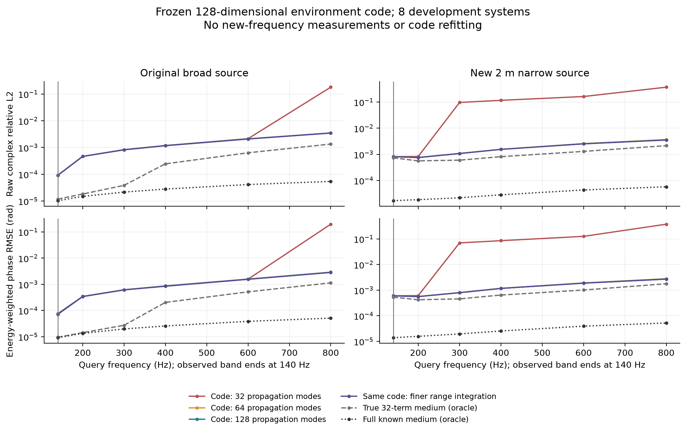

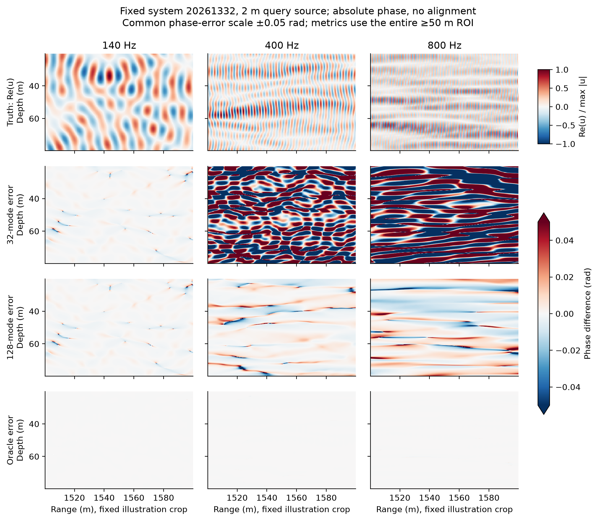

第二图固定第一个开发系统20261332和1500–1600m视窗，仅用于显示密集相位纹理；主数值使用
全ROI。展示时将真值低于该视窗最大幅值0.1%的像素置空，**主指标完全不遮罩**，颜色上限统一
0.05rad并标记饱和；不得从插图读取总体误差。全部代码、teacher模态、数值审计和配置见
`audit_waveguide_frequency_scaling.py`与`coherent_waveguide_frequency_scaling_20261004`。

该8系统已多次使用，属于开发机制实验。为检验独立系统而登记的32新环境协议见
[高频冻结复核](../docs/GENERATOR_NEW_SYSTEMS_HIGH_FREQUENCY_ZH.md)。64深度项同128维的单一
开发诊断已在查看这批新系统结果前登记；不会把它事后写成新32环境的原冻结候选。

## 17. 固定128坐标增加垂向带宽：有益，但不是新网络贡献

在旧8开发系统、相同60/100/140Hz×65剖面观测上，把每环境实代码仍设为128维，将训练介质的全局PCA基从64×32改为64×64深度—距离系数，先用原代码初始化，再固定5次全程GN。800Hz读出统一256距离段、128模态、384点积分；目标频率/新窄源仍无观测。完整对照见[预登记与结果](../docs/GENERATOR_DEPTH64_DEV_DIAGNOSTIC_ZH.md)。

| 800Hz、旧8系统平均raw complex相对L2 | 宽源 | 2m窄源 |
|---|---:|---:|
| 原32深度项、128实坐标 | 0.003508 | 0.003556 |
| 新64深度项、128实坐标 | **0.002902** | **0.002841** |
| 新64项PCA投影真实介质，额外信息oracle | 0.001814 | 0.001901 |

改善17.3%/20.1%，宽源6/8、窄源8/8系统获益。代码维数不变，但全局基、训练标签与解码计算变大。投影真实介质不由context求得，也不是误差严格下界。旧512段下真实64项介质oracle达0.000124/0.000213，但与本256段推断设置不匹配；下节报告匹配256段数值。剩余误差仍有较大的环境反演空间，不能据此宣称表示容量是唯一瓶颈。

## 18. 边界谐波闭合：系数近乎准确，复场收益却不足

一个传统Fourier分部积分恒等式将高阶深度系数表达为上下边界斜率项与二阶导数内部残差。对旧8开发介质，在m=32…63上用真实边界斜率生成的高阶项，相对真实系数尾部均值误差仅0.00408；这是物理规律的正结果，但需要额外真实介质信息。固定原低32项推断代码后，在同一256段读出下，800Hz宽/窄源raw从0.003508/0.003556改善到0.002998/0.002975，仅14.5%/16.4%，7/8系统获益；直接给真实64项介质的额外信息oracle为0.000311/0.000375。

预登记M1门槛要求两源均改善至少30%且不少于6/8系统获益，故**停止**，未训练预测边界斜率的小网络。这揭示“高阶介质谱系数可预测”与“最终相干波场足够准”是不同命题；当前低阶环境反演误差会传递并积累到相位。公式、残差、全部系统结果见[边界闭合记录](../docs/GENERATOR_BOUNDARY_HARMONIC_CLOSURE_ZH.md)。不能把解析恒等式或oracle收益称为已实现的学习方法。

## 19. 冻结后32个新环境：更高垂向带宽的独立同族证据

在生成任何新环境真值之前，固定训练512介质先验、旧8开发中选定的16/32深度项、128实坐标、相同5次+5次GN、256段/128模态读出、60/100/140Hz宽源×65剖面context，冻结manifest存下源码和先验SHA。新IID系统20263400–431没有参加训练、旧8开发或先前64环境测试。两目标频率400/800Hz、原声源/新2m窄源均无目标场观测，目标4097×513独立坐标直接求解。6次独立数值审计的最坏raw差2.50e-5，通过0.001预门槛。详情见[完整预登记和结果](../docs/GENERATOR_NEW_SYSTEMS_HIGH_FREQUENCY_ZH.md)。

| 新32系统、全ROI raw complex相对L2 | 16项先验 | 32项先验 | 相对改善、95%系统配对区间 |
|---|---:|---:|---:|
| 400Hz原宽源 | 0.005966 | **0.001767** | 70.4% [58.5%, 81.1%] |
| 400Hz新窄源 | 0.006084 | **0.002072** | 65.9% [55.2%, 75.8%] |
| 800Hz原宽源 | 0.011958 | **0.004967** | 58.5% [46.5%, 68.0%] |
| 800Hz新窄源 | 0.012180 | **0.005429** | 55.4% [43.5%, 65.3%] |

32项版本在800Hz宽/窄源的能量加权圆相位RMSE为0.00399/0.00425rad。四组各31/32系统获益；系统20263421在四组都略退化，800Hz窄源最高个例0.02314，不能只看漂亮的平均数。此证据支持**同一合成物理族、独立环境中，在固定每环境代码维数时提高垂向先验分辨率能改善相干连续查询**。它不支持“代码/全局basis/推断/读出成本全部固定”，也不支持跨物理域的神经方法优势。真实32项介质oracle在800Hz宽/窄源为0.00254/0.00273，真实64项约0.00031/0.00034，说明反演与容量两者仍有空间；这些oracle额外知道测试介质。

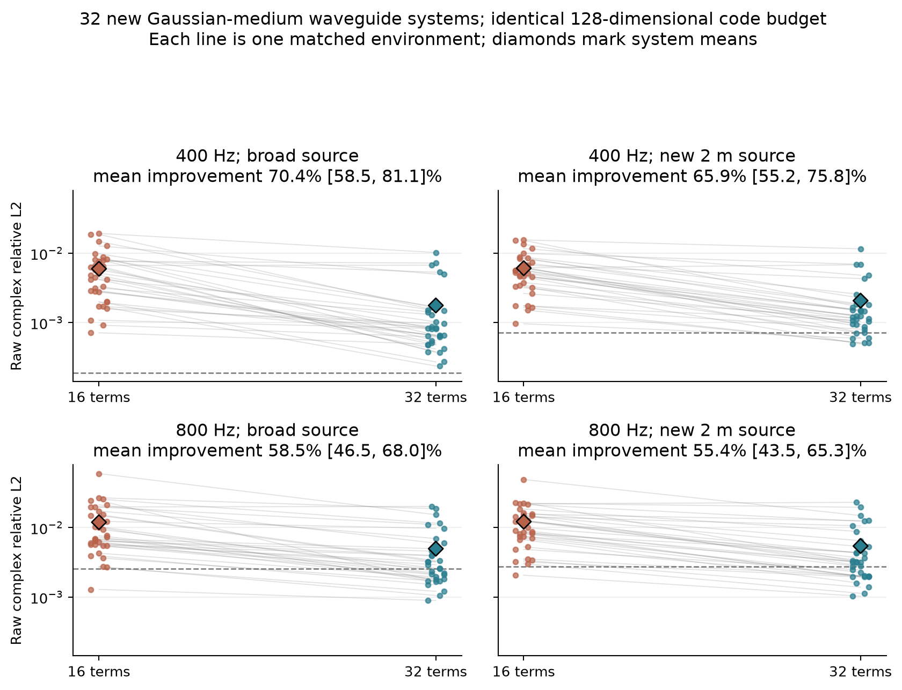

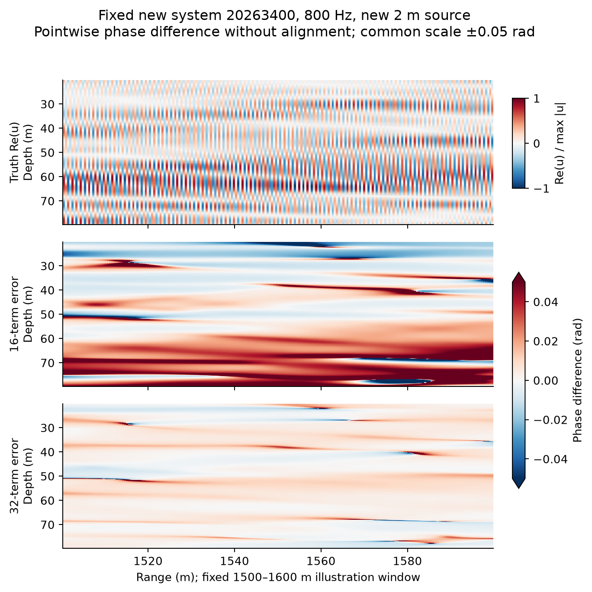

相位图只在展示时遮罩局部真幅值小于0.1%最大值处，主指标完全不遮罩、不相位对齐。图色标±0.05rad，超界会饱和，不能以图替代整个ROI的数值。

**主要反例与下一判断。** 这个环境的隐藏扰动由3个Gaussian、合计15个参数生成；在如此低维且光滑的族上，强物理代码很准不等于复杂真实海洋中也能泛化。旧8开发集已经预登记[已知15参数生成族反演](../docs/GENERATOR_KNOWN_FAMILY_BASELINE_ZH.md)作为**额外解析结构**的上限对照；它不能被伪装成同信息网络基线。第二域2D Helmholtz仍无学习必要性，当前不具备一篇以“新AI方法跨域优越性”为核心的论文证据。

## 20. 已知精确15参数生成族：决定性的合成问题边界

进一步在原8开发系统做一次**额外解析结构信息**对照：假定知道未知声速扰动恰由3个二维Gaussian构成（共15参数），但不读取测试环境的真实参数。初始3个训练邻居、多初值介质投影拟合+同低频context五次GN，在6/8环境几乎达到数值误差，另2例陷入局部最优：800Hz新源系统均值0.00496，中位数约0.00037。故不能把优化失败解释为物理不可辨识。看到这两个失败后，**明确标记事后增强**、对所有8系统统一改用24个训练邻居初值，仍只按60/100/140Hz context选择。8/8系统context平方误差≤1.60e-9；400Hz宽/窄源raw0.000126/0.000118，800Hz宽/窄源0.000266/0.000254，后者相位RMSE0.000250/0.000236rad。它约比旧128维PCA+GN在800Hz小13–14倍。
这不是同信息、同成本“我们的新方法被公平打败”的比较：参数反演知道精确合成家族，还用更多初值。但它是非常强的**数据集难度反例**：当前漂亮的紧凑代码和高频查询，可能主要来自目标物理系统本身就只有15个隐参数。为了排除这个原因，已在生成前登记[16×16相关随机谱介质压力测试](../docs/SPECTRAL_MEDIUM_STRESS_POC_ZH.md)，训练512、新32环境、相同context/query/主指标。它仍只是第二个**介质统计族**，不是第二物理方程。若它也只呈现接近低秩的统计先验、或经典反演更强，则不能继续把结果写成泛化表征的AI方法贡献。

## 21. 更丰富的介质揭示真实瓶颈：高方差覆盖率不等于相干相位保真

为了正视上一节15参数族太简单的反例，在**同一个单向波导PDE**下，将隐藏介质改成16×16个相关余弦系数（固定RMS15m/s），训练512个介质先验，再生成与训练/旧开发均不重叠的32个系统。公开温跃层、源与边界不变；每个系统仍只给60/100/140Hz宽源×65个完整深度剖面，目标400/800Hz宽源及新2m窄源**均无目标观测**。初始128实坐标、16/32深度项、5+5次物理校正与256段/128模态读出在新真值生成前固定，主指标完整>=50m ROI的未对齐raw complex相对L2。6次独立数值审计最大差5.75e-5，远小于0.001。这里的场不是完整Helmholtz/真实海洋，有反向散射与海底的缺失。

| 原32复杂介质，系统等权raw | 400Hz宽源 | 400Hz窄源 | 800Hz宽源 | 800Hz窄源 |
|---|---:|---:|---:|---:|
| 原冻结128维、16深度项 | 0.2423 | 0.2356 | 0.5176 | 0.5026 |
| 原冻结128维、32深度项 | 0.2422 | 0.2355 | 0.5175 | 0.5024 |
| 真实介质的32项投影，额外信息 | 0.00056 | 0.00055 | 0.00111 | 0.00114 |

800Hz原候选相位RMSE约0.499/0.482rad，全部失败；16→32项的平均相对改善仅0.02%–0.05%，系统胜率也只有18–21/32。真实介质oracle足够好，因此不是增加垂向项或数值teacher能够修好；原128维能解释训练介质99.8637%系数方差，也**不能**推出高频复场保真。两族的扰动RMS不同（新族15m/s、旧Gaussian示例约8.8m/s），跨族差距不能单独归因于维数。

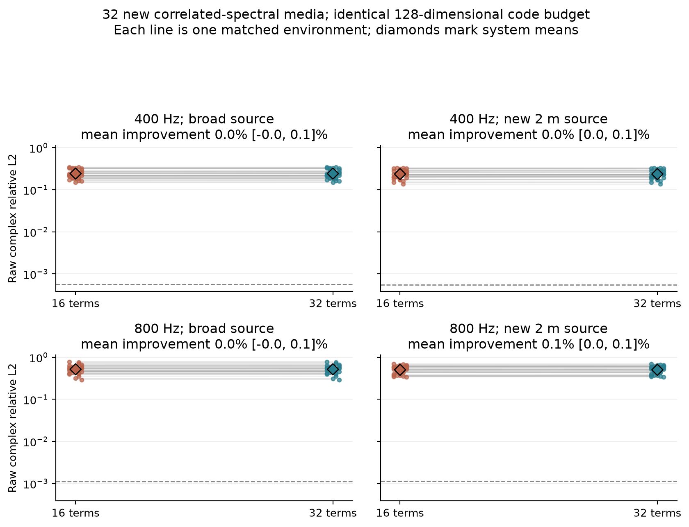

局部相位图见[这里](figures/spectral_medium_stress_phase.png)：为避免把大误差全部截成一色，此图显示色标改成±0.75rad；选定首系统和1500–1600m仅做直观展示，主指标不遮罩、不配准。更重要的是以下**额外信息容量诊断**，不能把它们误写成可部署方法：把真实测试介质投到训练PCA先验，再用同一物理解码；rank128的800Hz宽/窄源仍为0.3906/0.3859，rank256突然降至0.00809/0.00797，rank384为0.00207/0.00210，rank511为0.00132/0.00137。400Hz同样从rank128的0.1829/0.1763降至rank256的0.00384/0.00383。真实介质的rank128系数相对误差均值仅0.0511，却足以在800Hz造成约0.39场误差。随着rank从128变256，训练介质方差解释率从99.8637%升至99.999956%。**这是经验性的相干响应误差—代码维数曲线，不是严格信息论rate–distortion函数，更不是所有128维表征失败的定理。** 欧氏PCA投影并不最小化最终复响应误差。

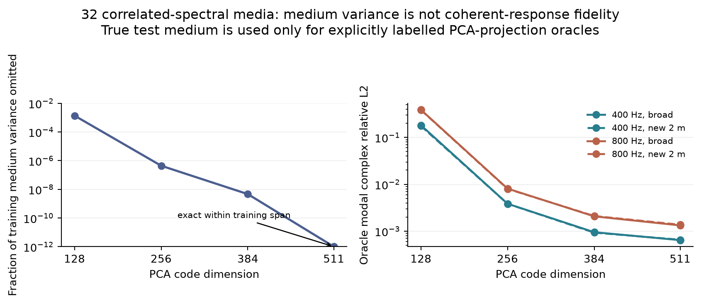

我们进一步在训练介质的两个固定背景处，计算800Hz双源响应相对于介质PCA代码的局部Jacobian，用其Gram重排128个方向。这一“物理响应感知基”的真介质投影oracle在800Hz宽/窄源仅0.3796/0.3846（原欧氏128基0.3906/0.3859），400Hz还退化，因此预设的≤0.15及双源≥30%改善gate失败。**没有继续训练这个基的编码器。** 失败只针对当前局部线性化、两代表背景和固定128维，不否认非线性或查询自适应表征的可能。

容量曲线提示可先检验一个更朴素的问题：多给代码128个自由度，低频观测是否足以估准？固定最早8个**已看过的开发系统**，用训练512介质的32项rank256先验直接拟合相同低频context，64段5次GN再256段5次GN。无需读取目标频率或测试介质，800Hz宽/窄源raw为**0.01489/0.01638**，相位RMSE为**0.01154/0.01276rad**；400Hz raw为0.00737/0.00826。匹配的直接rank128在800Hz为0.53366/0.54360，几乎等于原冻结的两段式rank128。低频context平方误差从rank128的1.73e-4降到rank256的4.94e-8。开发gate通过，但这8个系统不具独立验证资格；rank256也确实加倍了每环境代码维数、全局基和GN线性系统规模，当前仍是训练数据PCA先验+经典物理逆解，**不是现代深网络贡献**。

现已在生成前固定[全新32系统确认协议](../docs/SPECTRAL_MEDIUM_STRESS_POC_ZH.md)（20265000–20265031、数值审计20265100–20265102；训练与旧数据完全隔离），并先存协议manifest和Git/标签SHA，再启动真值生成。目标门槛为rank256在800Hz两源系统平均raw/相位各≤0.05、相对原128维各至少改善70%、两源各≥28/32系统胜出，最差系统raw各≤0.10。**开发成绩在确认前没有写成独立测试；确认结果见本节末。** 即使确认通过，它也只支持同PDE、同相关谱介质统计族的容量与反演结果，距离跨域、真实海洋和有实质神经学习增量仍有距离。

另一个固定开发成本诊断让rank256只做1+1步或2+2步物理校正，而非确认候选的5+5步；旧8系统800Hz两源raw分别为0.0270/0.0277、0.0169/0.0182，均远低于rank128约0.53。1+1步相位RMSE仅0.0212/0.0216rad，已经过预设0.05阈值。因此在当前密集、无噪声、已知背景的protocol里，不能仅凭“加速在线反演”包装一个尚未验证必要性的神经warm-start；新32仍坚持原冻结5+5步，1+1/2+2只是已看过的开发成本曲线。

为反驳“训练PCA才会有效”，旧8开发系统又用已知16×16余弦合成族构造一个255维**一阶解析慢度基**，同低频观测与5+5次GN；800Hz宽/窄源raw为0.2058/0.2276，未过与PCA256接近的预设门槛。读取真实介质做该基的欧氏投影oracle，系数相对误差虽只有0.01488，800Hz raw却为0.5635/0.5661，比部署反演更差。这不是“解析族输给机器学习”的证明：其速度→慢度平方映射仅一阶近似，真实非线性255参数逆解未实现；介质欧氏投影也不是最佳响应代码。它再次说明介质参数MSE与相干场误差的目标错位，同一函数族内的误差补偿不可忽视。

### 独立32环境复核：高精度成立，但压缩与方法贡献尚未成立

新环境全部完成，数值审计最坏5.93e-5。使用注册时固定的方法、512个训练介质标签和相同低频观测，在新32系统800Hz宽/新2m窄源，原128维raw为0.51131/0.49965，rank256降至**0.01475/0.01532**，能量加权圆相位RMSE为**0.01123/0.01170rad**；系统等权改善97.11%/96.93%，按32个物理系统配对bootstrap的95%区间[96.82%,97.39%]/[96.62%,97.22%]。两源都是32/32获益，最差系统raw0.02263/0.02439。预设的五项确认gate全部通过。400Hz宽/窄源raw也从0.23703/0.24059降至0.00623/0.00749，phase RMSE0.00467/0.00557rad；直接rank128 matched分支与原128冻结分支近乎相同。逐环境配对图和固定首系统局部相位图见下；后者两幅误差色标不同，主指标不遮罩、不做相位配准。

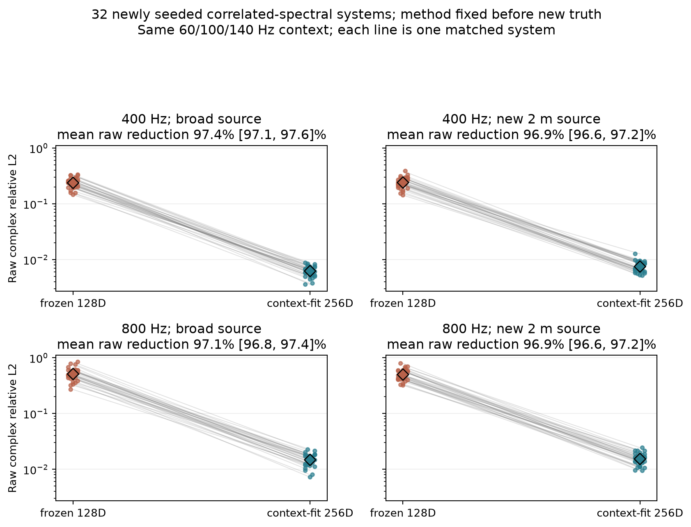

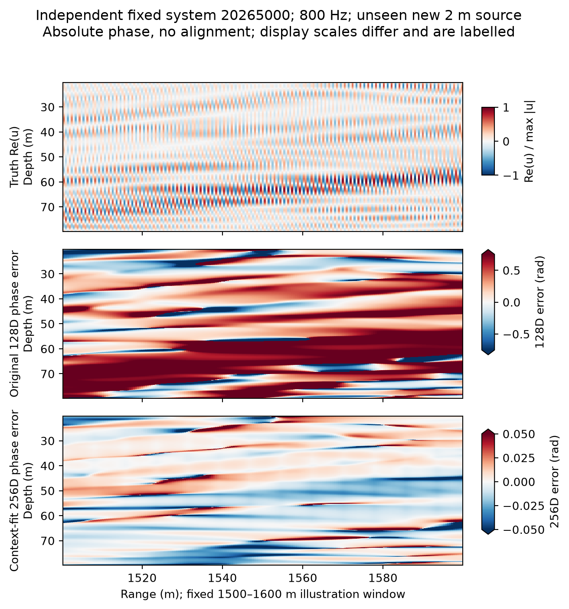

这些数据给出**同一单向PDE、同一相关谱介质统计族**下可靠的容量—相位正发现，也验证目标频率和新声源在观测之外。然而rank256已经接近16×16余弦族的255个随机自由系数：它提供近完整的统计介质坐标，而非高度压缩的波场隐空间。训练介质PCA是学习的统计先验，在线推断与读出仍是已知物理模型和经典GN，不存在已证实的现代神经算子增量。每环境隐坐标维数翻倍、全局基存储约翻倍、GN系统阶数翻倍；当前密集无噪声观测和已知背景/源仍比真实海洋条件容易。已知完整非线性谱合成族的255参数经典逆解仍未测试；前述失败的只是一阶解析基，不能把本结果包装成“学习打败物理”。下一步按已注册条件执行固定代码200/300/500/600/1000Hz曲线；低RMS控制的结果见下，两者都不能替代跨统计族/跨PDE与真正可学习核心的gate。

同谱形状**低RMS配对对照**也已完成：在旧8开发种子上把谱扰动RMS从15降至原Gaussian训练族平均8.168874841m/s，并用相同训练种子重新拟合128维先验，800Hz宽/窄源原128维raw从0.53366/0.54360降到0.30562/0.30982，仍远大于预定0.10判别阈值；400Hz从0.26494/0.24705降至0.14018/0.12746。数值审计最坏3.65e-5。强度解释了近43%的相对下降，但不能单独解释该128维方案对谱介质的失败；这仍只是post-hoc旧8控制，不是新独立集合。

确认gate通过后才执行的**预登记五频点补充**也已完成。固定新32中的前8环境及其已确认的128/256维代码，在原400/800Hz以外直接生成200/300/500/600/1000Hz真值；教师与更细离散的数值差最大7.22e-5。1000Hz宽/新窄源rank256 raw0.02081/0.02016，相位RMSE0.01615/0.01588rad，最坏单环境raw0.02407/0.02395，三项预定门槛全过。窄源200→300→400→500→600→800→1000Hz的raw为0.00297→0.00508→0.00744→0.00946→0.01229→0.01584→0.02016；原128维在1000Hz窄源约0.629。固定代码可在多个未观测频点连续查询，但这仍是**同一批独立确认系统的子集补充**，不是新数据分布或无限远频率外推；误差仍随频率上升。

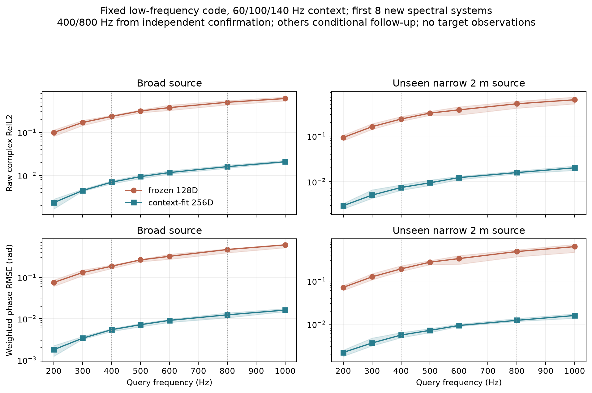

再检验了**输入条件**，但严格只用已看过的旧8谱介质开发系统，不能增加独立样本数。保持rank256/5+5GN/目标真值不变，原65条干净低频剖面稀疏到33条时800Hz宽/窄源raw0.01487/0.01654，17条时0.01809/0.01877；0.1%复模态观测噪声时0.02427/0.02487，均过对应预设门槛。**1%噪声**则升至raw0.17235/0.17822、相位0.13745/0.14693rad，失败。这说明当前成功不完全依赖65条密集剖面，但对不小的复观测噪声脆弱。原因可能是带噪场的二阶空间求导初始化和无显式噪声先验的GN，而非信息论不可辨识；下一最小对照应先隔离这两种算法因素。首次稀疏版本因未传观测边界索引而报维度错误、没有性能结果，修正版v2及事故记录均保留在[压力测试记录](../docs/SPECTRAL_MEDIUM_STRESS_POC_ZH.md)。

进一步固定同一1%噪声和rank256/5+5GN做三项**旧8开发**初始化隔离：只把介质初始化改训练均值，800Hz宽/窄raw恶化到0.4886/0.4824；只把源初态改成由**已知源形状**解析计算的无噪模态投影，raw降到**0.08455/0.08887**、相位0.06749/0.07238rad，通过事前双源均值≤0.10门槛；两个初始化都改为已知/均值则raw0.4499/0.4340，仍失败。已知源是原问题明确公开的信息，不能把它算作额外目标场，但相对“未知源只给带噪初态”的任务也不能暗中同榜。已知源最坏系统raw仍0.180/0.168，且均值远高于干净协议。因此1%失败的很大部分是算法把源初态测量噪声误传进传播链，并非单靠可学习表征就能说明的不可辨识；后续噪声鲁棒方法必须以此强经典修正为对照。

**一个更决定性的额外结构强基线修正方法论判断。** 旧8开发上的一阶解析余弦基曾失败，但它近似了速度到慢度平方的非线性映射，不能代表知道真生成族的最佳经典法。固定完整16×16余弦**速度**函数族（255坐标、无测试系数），用精确非线性`c^{-2}`链式导数及同低频观测做5+5次GN，旧8开发800Hz宽/窄源raw0.00750/0.00798；随后把算法和门槛固定，在**已用于PCA确认的32环境**上得raw**0.00942/0.01033**、相位0.00703/0.00765rad，最差raw0.02229/0.02145。相同32环境PCA256为0.01475/0.01532；结构法系统均值再好36.1%/32.6%，宽/窄源28/32、25/32胜出。配对bootstrap的800Hz两源降幅95%区间约[23.2%,47.6%]/[19.8%,44.4%]。这不是同信息/同成本算法胜负，因为结构法额外知道数据**真正生成机制**、PCA用512训练介质标签；这32环境也不再是新方法的“全新未开封test”。但它清楚说明：**“一阶解析基失败 ⇒ 训练PCA不可替代”是错误推理。** 当前合成族更适合支持相位容量/可识别性事实，不适合单独支撑现代AI学习模块的必要性。

**1%噪声修正也在已用32环境的新观测条件复核通过，但留下明显精度缺口。** 冻结旧8开发选出的已知源解析初态、rank256先验和5+5GN后，800Hz宽/窄源raw由带噪初态的0.15054/0.16094降到**0.08619/0.08805**，相位由0.11720/0.12764降到**0.06791/0.06901rad**；32/32、31/32系统改善，最差raw0.12740/0.14945。原预设均值、相位、胜出数、最差≤0.25门槛全部过。它不是另一批独立环境，更不是现实水听器噪声：输入是每个低频复模态矩阵严格相对1%的理想Gaussian扰动，源形状已知。相较无噪声0.01475/0.01532仍高约六倍，所以不能只挑“修复成功”而隐去余量。完整256行与先前失败的旧8控制见[压力测试记录](../docs/SPECTRAL_MEDIUM_STRESS_POC_ZH.md)。

**新16环境的介质相关尺度变化揭示严重的统计泛化失败。** 训练介质为16×16余弦谱、RMS15m/s、衰减尺度5；新seed20267000–015只把衰减尺度变10，RMS、背景/源、单向方程、完整低频context、rank256子空间和5+5GN均保持。直接真值独立审计最坏2.39e-4<0.001。800Hz宽/窄源部署raw**0.41554/0.43498**、相位**0.37434/0.40407rad**，最差0.6553/0.7719，0/16系统raw≤0.10；预设均值raw/相位与系统数门槛都失败。400Hz raw也有0.1810/0.1952。读取**真实测试介质**后作训练PCA256欧氏投影，800Hz仍raw0.2925/0.2789；直接用真介质32垂向项投影的物理oracle仅0.00285/0.00281。因此数值求解与32项物理解码本身不是主障碍，当前训练统计子空间＋欧氏投影对细尺度变化不保真，部署反演还进一步恶化。但欧氏投影不是最优响应代码，不能由它证明256维空间绝无合适代码；已另行冻结[读取800Hz目标宽源的事后响应优化oracle](../docs/SPECTRAL_TAPER_RESPONSE_ORACLE_ZH.md)来隔离此问题。详见[OOD压力测试](../docs/SPECTRAL_TAPER_SHIFT_POC_ZH.md)。这还是**同一一向方程**，不解决第二物理域论文gate，反而使“通用表示”主张更不成立。

该**额外信息的单目标响应oracle**已经完成：以真实介质的训练PCA256欧氏投影为初值，直接读取800Hz**宽源目标场**在257条完整深度剖面的复模态观测，在原rank256子空间固定5步GN，宽源raw从0.29251降至**0.07536**、相位0.05620rad；没有参与拟合的窄源从0.27887只降至**0.22321**，相位0.18228rad。宽源3/16系统≤0.05、窄源0/16。它证明先前欧氏投影高误差**不能**被当作PCA256子空间的最佳单场响应误差；但此目标泄漏优化仍未恢复稳定的跨源系统表示。也不能仅据窄源高误差证明共同代码不可能，因为窄源目标完全未交给它；故另固定[最后一次双源目标泄漏oracle](../docs/SPECTRAL_TAPER_JOINT_ORACLE_ZH.md)，之后无论结果如何都停止同批系统上的oracle调参。两项均不改原低频部署失败，也不构成第二域。

**最后两个归因控制均已完成，仍未出现论文方法gate。** 双源共同目标泄漏oracle从旧PCA256真介质欧氏投影出发、固定5步后800Hz宽/窄raw**0.08293/0.08303**、相位0.06232/0.06265rad；未达到两源≤0.05，第5步16/16仍接受更新，故这不是子空间最优值的下界。它把先前未监督窄源0.223降到0.083，不能再说“同维代码原则上无法跨源”，只能说当前**从低频识别**的代码没有做到。另一非oracle控制额外给512个taper10训练介质标签，用相同rank256、相同context与5+5GN重拟合新统计先验：800Hz宽/窄部署raw从旧先验0.41554/0.43498降到**0.12705/0.13668**，相位0.10172/0.10970rad；raw相对改善69.43%/68.58%，仍未过事后预设各≥70%、均值raw/相位≤0.05门槛。新匹配先验的**真介质欧氏投影oracle**仍raw0.06728/0.06516，尽管训练介质前256个PCA方向解释约99.99675%方差。结论不是“重训无用”——它明显有用；但有限维欧氏统计码和低频推断在更细尺度介质上都没有达到原同族精度。新标签是明确额外分布信息，不是旧模型跨统计泛化；双目标oracle还直接使用目标真值，不能混入部署表。细节见[匹配先验控制](../docs/SPECTRAL_TAPER_MATCHED_PRIOR_ZH.md)与[共同目标oracle](../docs/SPECTRAL_TAPER_JOINT_ORACLE_ZH.md)。

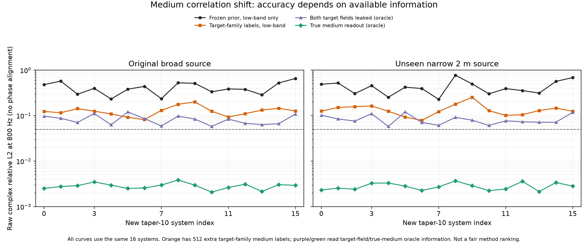

**最后一个最强物理信息控制把“不可辨识”解释排除在当前理想化任务之外。** 用额外知道的真实16×16余弦**速度**函数族及taper10谱衰减构造精确`c^{-2}`非线性物理坐标，不用训练介质标签、不读真实测试255系数或任何400/800Hz目标，只用同60/100/140Hz×65完整复场和原已知源，固定旧8开发的一次线性初始化岭1e-7、5+5GN。在全部**已看过的同16个taper10系统**，800Hz宽/窄源raw**0.003880/0.004129**，相位**0.003021/0.003217rad**，最差raw0.005807/0.006825；400Hz raw0.001745/0.001906；预设均值raw、相位、最差门槛全部通过。1+1步的信息泄漏复核表明，固定观测和公开参数后，从测试spec删除整块真谱系数，估计坐标和生成器逐元素差0。这是额外知道**真数据函数族**的后补强结构基线，成本/信息条件不同，不能写成经典普遍优于学习；它具体证明的是：在本已知一向PDE/源且密集无噪声的taper10任务中，低频响应有能力识别足够准确的高频相位生成机制，PCA256的0.415/0.435失败绝不是“物理信息论上无解”。读[完整协议和结果](../docs/SPECTRAL_TAPER_EXACT_FAMILY_ZH.md)。这也进一步表明，下一篇AI方法必须在**不知道真合成族**的现实条件下学习可迁移的生成机制，而不是在这个数据族里拿弱解析一阶基作对手。

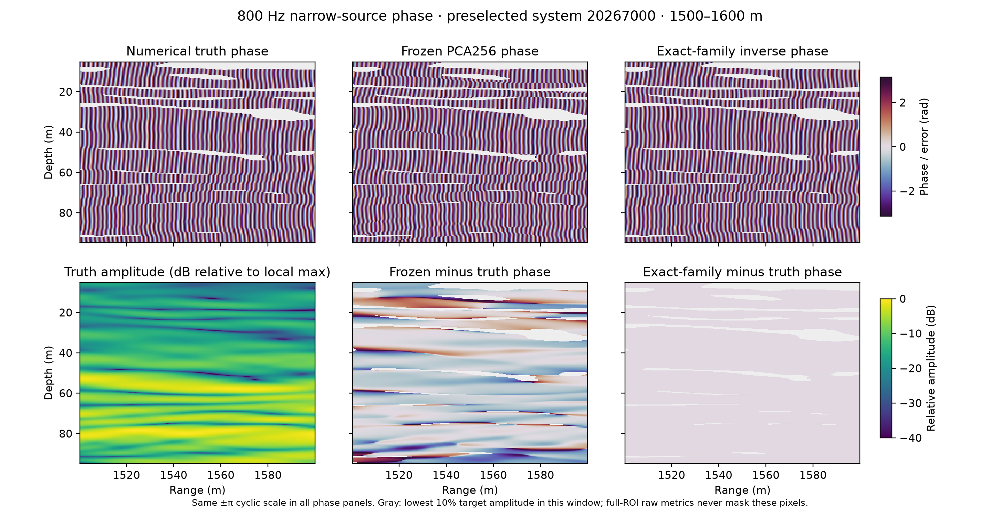

## 22. 学得声速流形＋精确非线性物理映射：一个强但有限的表征正结果

第21节的三个结果连起来构成了一条很清楚的因果线索：旧taper5统计PCA在taper10崩溃；给taper10训练标签重拟合**慢度平方系数**PCA后仍约0.13；若直接给出真实合成器的**声速**函数族，精确非线性低频反演却约0.004。这并不意味着必须用深网络，但提示我们原来选错了统计学习变量：线性拟合`(c_ref/c)^2`的投影会把声速的有限秩非线性族弯成难以保相位的曲面。最小新方法只做一处改变：从1024份介质**网格标签**学习255维声速场PCA，不预置余弦基；在线仍用同60/100/140Hz宽源×65完整复剖面识别代码，已知`c^{-2}`物理映射和一向传播读出不变。强对照用**同1024份训练介质标签**学习同255维慢度平方PCA，也用相同64＋256距离段各5步GN。这个“表征变量＋非线性物理组合”是当前的最小可测试贡献；不是新端到端神经算子。

代数机制不是新理论：`c = c_bg + delta_c`时，`c^{-2}`包含`delta_c`的一次、二次与更高阶乘积，因此声速变量中的线性子空间经过物理变换后可能在q变量里要求更多线性方向。训练数据上，混合taper5/10余弦族的速度PCA255保留约100%速度方差，q-PCA255仍保留99.99745% q投影方差；但高频相干响应对那小部分q残差非常敏感。局部Gaussian家族的q-PCA128已保留99.9999842%方差，且本来就有约0.0035 raw，因此变换回声速并未带来大增量。**“什么时候物理变量变换引起相位敏感秩膨胀”**是接下来更一般化的科学问题，而不是“声速PCA永远优于q-PCA”的结论。

开发协议/代码在提交`e7768fc`后才读取已用taper10的16环境完整结果：800Hz宽/窄raw**0.00859/0.00928**，相位0.00662/0.00729rad；同标签q-PCA较强预置初始化raw0.11564/0.12707。开发gate全部通过，16/16环境逐源改进，但它是**已用系统的机制筛选**。之后新确认taper7.5的16环境/2审计seed、目标设置、同信息对照和严格门槛在任何新真值前提交`5fe88a5`。确认系统20268000–015与训练、旧开发、原32系统均不交叉；taper7.5处在训练taper5和10之间，故是**同族统计插值**，而非困难的外推或新物理域。其教师数值审计最坏raw9.13e-5。

| 新16系统系统宏均值 | 400Hz宽/窄raw | 800Hz宽源raw / phase | 800Hz新窄源raw / phase |
|---|---:|---:|---:|
| 冻结学得声速基＋`c^{-2}`＋低频GN | 0.002045 / 0.002487 | **0.005375 / 0.004197rad** | **0.005052 / 0.003915rad** |
| 同标签同代码q-PCA＋低频GN（两个预置岭的较强者） | 0.034906 / 0.038761 | 0.080678 / 0.064441rad | 0.081965 / 0.065206rad |

800Hz raw相对降低93.34%/93.84%，双源各16/16环境raw≤0.05，最差0.01769/0.01624，预注册的raw、phase、相对收益、所有系统及数值审计五个gate全部通过。16×2×2×3=192条评价完整保留；每环境速度反演在线均值9.04秒，q-PCA两个初始化各7.83/7.93秒，**离线标签和共享基训练成本没有计入**。逐环境同信息比较见图；图中每个q点甚至取该系统两条预置初始化的较低误差，不给新方法放松对照。

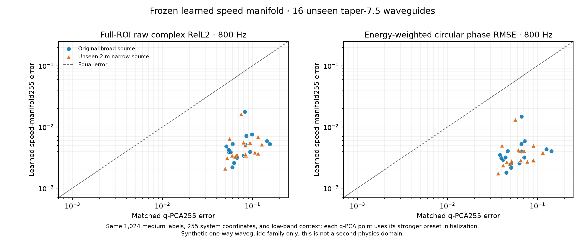

固定第一个新系统20268000，800Hz新窄源、1500–1600m窗口的相位图更容易看到机制：q-PCA有系统性局部相位偏移，学得声速基更接近直接数值真值。为显示小残差，下排误差色标**放大为±0.15rad并明确允许超界饱和**；上排相位仍±π。目标幅值最低10%的像素仅在图中置灰，不从完整ROI指标中删除，也没有全局相位配准。这是预选系统的**说明图**，不是胜率证据；前一张16系统全量配对图与JSON才承担统计证据。

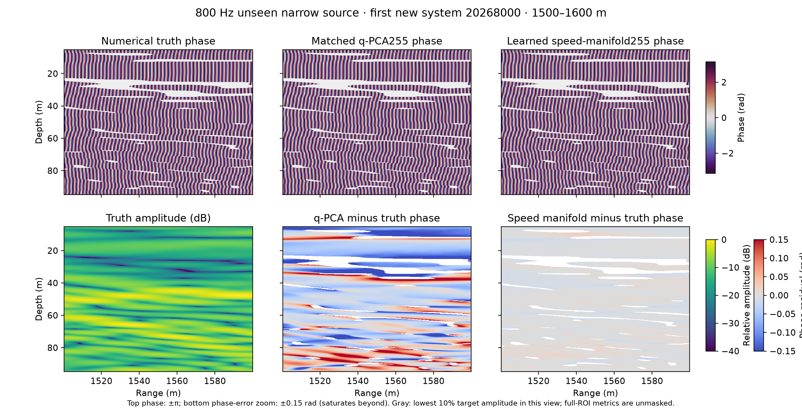

**成本与结构审计改变了表面上的5倍共享存储劣势，但没有增加预测证据。** 原始声速基64×160×255＋均值为2,621,440个float64，q-PCA为524,288个。先在已固定声速基上，对深度曲线做纯数据SVD：第16奇异值100.86，第17仅5.88e-12；rank16的函数张量分离可将共享数值个数降到**264,704**，即原速度基的10.1%、q-PCA的50.5%。整个先验重建相对误差2.56e-15；预选旧开发代码的256段物理生成器相对差3.91e-15，预设门槛通过。此时仍先展开基，**推断时间没有因存储压缩而改善**；低秩之所以精确，是此数据合成器本来有16个余弦深度模态，不能向真实海洋/3D直接外推。详见[开发机制](../docs/LEARNED_SPEED_MANIFOLD_POC_ZH.md)、[新确认](../docs/LEARNED_SPEED_MANIFOLD_CONFIRM_ZH.md)和[存储审计](../docs/LEARNED_SPEED_BASIS_STORAGE_AUDIT_ZH.md)。

**当前论文边界不应被大幅收益冲昏。** 这是一个对合成族内部、密集干净低频观测有说服力的“学习正确物理变量”机制例子；尚没有**两个不同波动物理域**的同信息确认、真实海洋高精度相位、稀疏带噪鲁棒或优于知道真实合成函数族的经典反演。255维代码几乎等于真实随机自由度，且一向传播方程已知、解码器仍是物理求解器。它可成为更强AI方法的**第一块可信积木**，不能单靠本结果撑起“通用高精度波场神经表征”的顶会主张。下一阶段应先以不同物理域和未知/不完备介质族测试上述变量选择，再考虑学得连续传播算子、神经参数化或生成式不确定性；不要马上叠flow/注意力/多loss。

**同一天的第二介质统计族开发给出了必要负反馈。** 在三局部Gaussian声速扰动族中，从与既有q-PCA完全相同的512个训练系统网格标签学rank128声速基，仍用相同低频复剖面/5+5GN/800Hz双源；已多次使用的旧8开发环境声速raw**0.003219/0.003435**、相位0.002667/0.002630rad，q-PCA较强预置初始化raw**0.003415/0.003528**。绝对精度过预设0.005，但相对仅改善**5.74%/2.64%**，双源各只有4/8环境改善，预设≥20%增量门槛失败；速度方法最差环境反而更差。训练速度PCA128保留99.9999816%速度网格方差，q-PCA128同标签保留约99.9999842%慢度平方标签方差，说明该族里两种统计表示都已很接近原介质分布；这些高方差数字仍不自动等于响应误差证书。此结果**不是新独立系统或第二PDE**，不能给Gaussian家族方法下泛化定论；但至少反对“只要换物理变量就普遍有数量级改善”。按[事前协议](../docs/GAUSSIAN_SPEED_VARIABLE_DEV_ZH.md)停止，不生成Gaussian新确认，也不在旧8上扫rank/岭/步数。更可取的科学假设是：**当非线性物理变换使一个在声速变量中近线性的复杂介质族在慢度平方系数中产生显著秩膨胀，而且相位查询放大了这部分残差时，学习声速变量才可能带来显著收益；在本来就容易被q-PCA表示的平滑低维家族里收益有限。** 这是假设性机制解释，尚未成为跨族定理。

**频率升高后的分辨率诊断也与直觉不完全相同。** 在新确认前8个**已使用**taper7.5系统固定环境代码，不重新推断，协议`a7363b7`先于额外1000/1200Hz真值冻结了256/512距离段×128/192传播模态四种物理读出。教师1024段×256模态与审计2048×320在新2系统的最坏raw差1.935e-4。原256×128在1200Hz宽/窄raw仍仅**0.006741/0.006537**、相位0.005435/0.005189rad；512×192为0.006526/0.006527，raw只改善**3.19%/0.15%**。绝对误差与数值门槛通过，事前≥20%读出收益门槛**失败**；仅扩模态几乎不起作用，距离加密收益也小。这个频带残差目前不能主要甩锅给输出网格不够细，也不能由此断言更高频不存在截止/分辨率问题。该实验无1200Hz q-PCA同频对照，只报告固定代码的频率压力和物理读出容量，**不把它称为新方法胜负**。详见[高频分辨率审计](../docs/SPEED_RESOLUTION_SCALING_ZH.md)；目标16NPZ与128行评价的SHA保留。

**最后的真介质投影oracle让“变量效应”更能归因，而不是让部署成绩更好。** 协议`f5e29b5`在读取这些oracle结果前固定两族、同一800Hz双源、欧氏投影定义与机制检查。余弦新16中，读取真实测试介质并投到**学得声速PCA255**的800Hz宽/窄raw为**0.002391/0.002404**，投到同标签**q-PCA255**则为**0.077785/0.075747**；两者原先只用低频的部署分别约0.0054/0.0051与0.0807/0.0820。Gaussian旧8中，速度/q真介质投影宽源0.002448/0.002484、窄源0.003065/0.002884，基本没有余弦族那种分叉；对应低频部署也相近。训练q方差解释率余弦99.997452%、Gaussian99.9999842%；余弦测试q系数欧氏投影平均相对残差**0.00664**却产生约0.076–0.078的相干响应误差，Gaussian q投影残差0.000469、响应约0.0025–0.0029。四项事前机制检查全过。**这仍不是rank255 q子空间的最佳响应误差下界**：欧氏投影没有用目标响应寻找最优代码，两个轴还都额外读取真测试介质，绝非可部署成绩。更窄但有力的事实是：在已训练表示和常用介质欧氏投影下，余弦q残差的相位放大远强于Gaussian，和两族部署增量的正/负结果方向一致。逐系统[归因图](figures/spectral_variable_projection_attribution.png)和[完整协议/结果](../docs/VARIABLE_PROJECTION_ATTRIBUTION_ZH.md)保留这一信息等级。

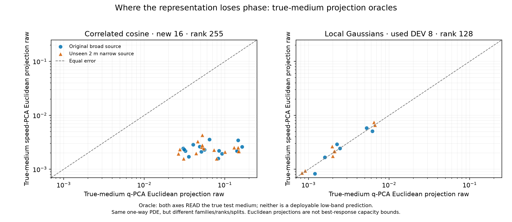

## 23. 容量和可辨识性不是一回事：q-PCA更高维的强基线审计

第22节的同255维比较足以说明当前**同预算**声速坐标更好，却不足以声称慢度平方变量本身“无法表示”正确相位。我们在已用余弦taper7.5新16上，从同1024训练介质标签拟合线性q-PCA255/384/512/768，并直接读取真实测试介质做**不可部署欧氏投影oracle**。800Hz宽/窄源raw随rank依次为0.07779/0.07575、0.01926/0.01928、0.01159/0.01124、**0.00309/0.00311**；255维结果与第22节既有q投影归因在约1e-14内复现。故只要花约3倍环境代码与q共享基，q线性空间也能几乎表示真介质投影响应；原来q255的损失是**有限容量/表示效率**现象，绝非q原则上无解。这里的投影仍不是该子空间目标响应最优下界，不能拿它与只读低频部署表同列评价。

用AI读者熟悉的语言，这是**表示能力**和**从观测辨识表示**的区别。设环境坐标为`z`，`c(z)=c0+Bz`，实际传播系数由非线性物理映射`q(z)=(c_ref/c(z))²`产生；低频观察为`y_L(z)=M H_L(q(z))`，目标高频响应为`y_H(z)=H_H(q(z))`。局部小扰动满足`Δy_L≈J_L Δz`、`Δy_H≈J_H Δz`。如果某些方向令`J_L Δz`很小但`J_H Δz`很大，低频拟合再好也无法保证目标相位；增加q基维数既可能修复表达误差，也可能引入更多这种近不可辨方向。持续代码先验相当于在这些方向上做统计选择。这里的链式法则、逆问题病态和正则化思想都属**传统理论**；我们自己的增量是固定数据/信息条件下实测到“q投影容量变好、部署反而变差、MAP部分救回、非线性声速坐标更稳”的**具体相位响应曲线**。它尚未构成普适可辨识性定理，未来可用低频与目标响应Jacobian的广义奇异值来量化哪些方向最危险，而不能只看训练介质PCA方差。

真正惊讶的是**低频代码识别**。固定同已知PDE/源、60/100/140Hz宽源×65完整复剖面与原5+5步GN，q-PCA768不持续施加高斯代码先验时，800Hz宽/窄raw竟为**0.12308/0.12337**，比原q255的0.08068/0.08197更差；首8从0+0、1+1、3+3到5+5步不断改善，不能简化为“晚几步过拟合”。无先验末步能把低频context平方误差压到首系统约2.9e-7，却没有找对高频相位相关的代码方向。新增有界高斯MAP对照将`mean(code²)`放入每步目标：在已用首8开发系统，强度1e-6使q768 raw从0.126/0.131降到**0.0313/0.0350**；1e-4与1e-2又明显过强。固定1e-6后只在同样已用、但未用于MAP强度反馈的后8系统检查，得**0.0324/0.0321**。合并16为**0.03185/0.03353**、相位0.02425/0.02570rad，仍高于冻结声速255的0.00538/0.00505、相位0.00420/0.00391rad。高维q MAP在线约14–15秒/系统，声速255原约9秒；两者均未计离线训练，跨运行时资源竞争使时间仅作量级参考。

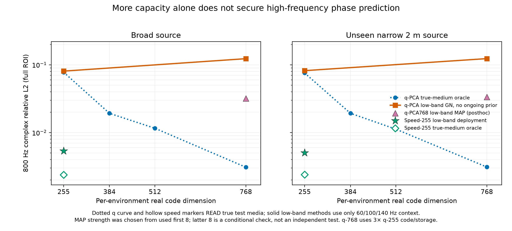

这个结果让论文表述更克制，也更有价值：**选对物理生成变量不仅使表示紧凑，还可能限制低频逆问题的不确定方向。** 但“高维q+合适先验”已把无正则化误差显著降下，当前搜索远非穷尽，不能称声速方法击败一切q模型。所用16系统都已被反复看过，后8只是**MAP强度的条件性复核**，不是新独立测试；Gaussian第二介质族又显示变量优势可能消失。下一个真正的论文gate仍是非余弦、不同波动方程/实际Ocean中同信息、同成本的正则化物理逆解对照和一个确有必要的学习模块；[详细容量、步数、MAP协议与全部结果](../docs/Q_CAPACITY_ORACLE_AUDIT_ZH.md)及[第二域计划](../docs/NEXT_CROSS_PHYSICS_POC_ZH.md)给出了可复用入口。

## 24. 二维多尺度回散射M0：新数据可用，但完整场仍是经典法的容易任务

为了真正碰第二物理方程，而不再把同一波导里的两种统计族误称为“两个域”，本轮在原二维Helmholtz上新增了**16×16随机多尺度纹理＋3个局部包体**介质生成器。512个训练系统只保存65×65实声速标签；另外8个不交叉开发系统生成6/10/14、带内11.3和高频17的257×257复场，2个独立系统以257→513审计14/17。M0生成设置/数值gate先于新真值在`518ff59`提交。最坏每波长采样12.17点、线性系统残差约3.2e-13、网格审计raw最坏**0.001984<0.005**，所以数据源在这个频带数值可用；但没有64验证/64封存、没有正式学习方法或第二域论文gate。

完整65×65低频复场的经典正弦谱识别先出现11.3/17查询raw**0.145/0.129**，表面像巨大余量。进一步把完整输入加密到129/257，误差几乎不变、约40%像素被裁掉；发现旧Gaussian专用程序把慢度平方硬约束为`q≥1`，而新纹理同时有局部**快于背景的波速**，合法q可以小于1。这不是空间aliasing，也不是神经方法机会，而是我们自己给经典基线加了错误物理先验。原始错误脚本和结果保留；修正版先提交`68bc0f2`，仅把可行范围放宽到统一的`[0.5,6.25]`，所有真值/频率/源码中的PDE求解器与split不变。修正后65完整场raw降至**0.000123/0.0000684**、相位0.000101/0.0000608rad；129/257完整场约0.0000695/0.0000610。完整场经典反演在这个**同257离散teacher**的比较里依然接近数值极限。不能用修正前的0.145/0.129“证明”AI进步，更不能偷换成“新介质复杂所以物理方法失效”。[数据/数值/纠错全过程](../docs/HELMHOLTZ_MULTISCALE_M0_PILOT_ZH.md)和artifact来源SHA保留。

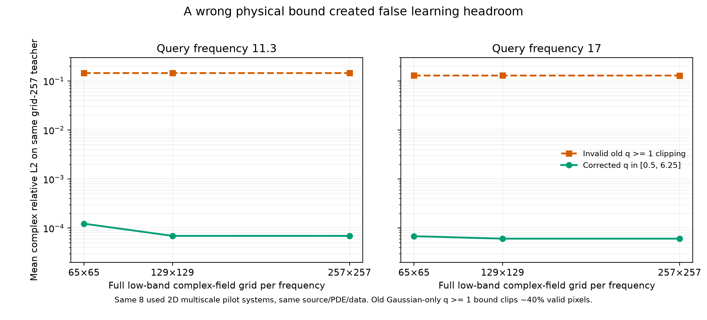

第二域本身仍有研究价值，但主任务必须变成**有限接收线中的环境识别＋新频率/新源相位查询**；这更接近海洋水声有限水听器阵列，也真正考验隐变量表示、可辨识性和正则化。即使转稀疏观测，也必须与同信息的PDE约束反演、正确物理范围、高维q-MAP比较，不能靠削弱经典基线制造学习必要性。本轮至此**尚未**完成这项方法实验或跨域量化门槛。

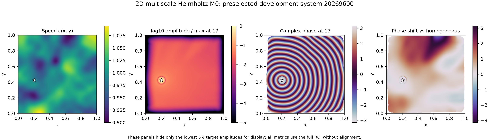

后续已把同8开发系统的低频完整场按**四条固定接收线**切成模型侧公开NPZ：每个环境只有780个复数样本与已知源/边界信息；真实速度、隐藏生成参数、随机种子和未测11.3/17响应都不在公开NPZ中。完整协议与路径见[四线输入记录](../docs/HELMHOLTZ_SPARSE_CONTEXT_ZH.md)。这只是为有研究意义的有限观测任务准备输入，**不是四线方法结果、不是8个新独立环境**；同信息PDE-MAP和新表示的量化比较仍属下一阶段。

四线后续[局部信息—容量双审计](../docs/HELMHOLTZ_SPARSE_INFO_AUDIT_ZH.md)给出一个清楚的权衡：训练均值附近的物理切线＋假定1%噪声，64/256维声速先验的四线11.3/17查询raw模型内预期分别0.00382/0.00322与0.01307/0.01023；但**读取真实测试介质**的同8开发系统欧氏投影oracle，64维raw0.0623/0.0633、256维0.00819/0.00935。低维容易辨识却遗漏相位敏感方向，高维容量足够但需更稳的观测反演。左者不是测得模型分数，右者不可部署，两者也不能简单相加。

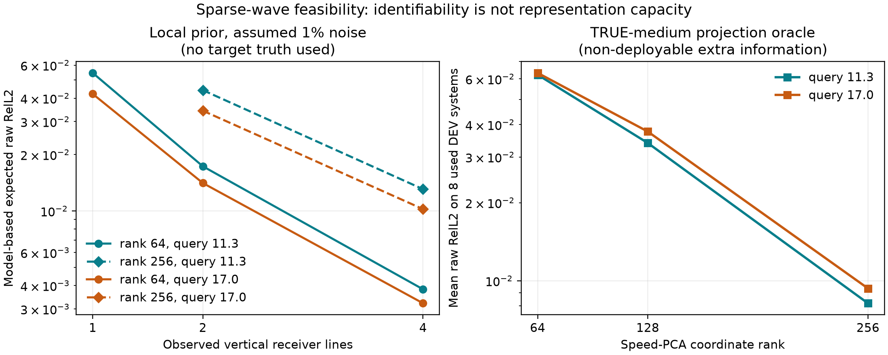

紧接着做的[真实介质线性化余项检查](../docs/HELMHOLTZ_SPARSE_INFO_AUDIT_ZH.md)为上述左图加了**强限制**：在已用8系统即使把真实介质差值额外交给训练均值处的一阶Helmholtz切线，11.3/17的raw仍0.238/0.251（中位0.104/0.138）。直接给129网格求解器真实介质，对257教师的17 raw也0.0285。故左图只能做局部可辨识性设计，不是四线任务的实际性能预测；后续必须用足够收敛的非线性求解器做同信息基线。
