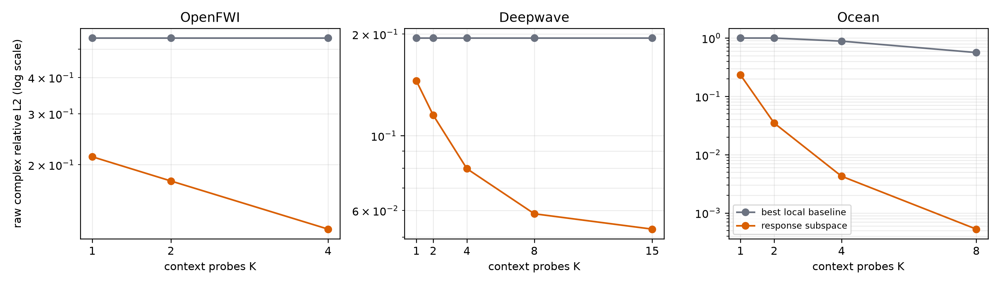
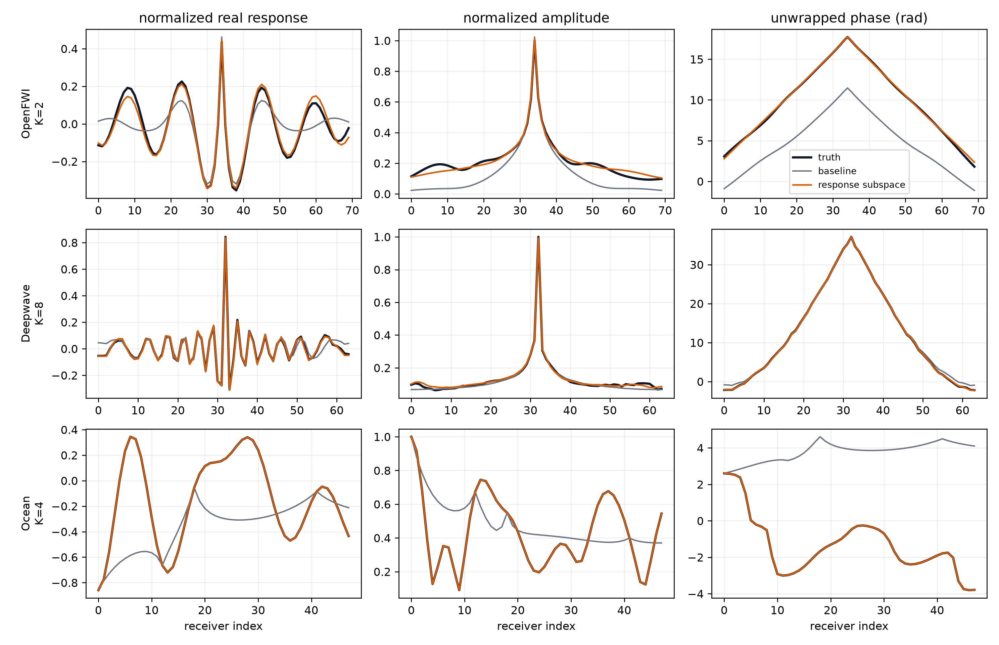
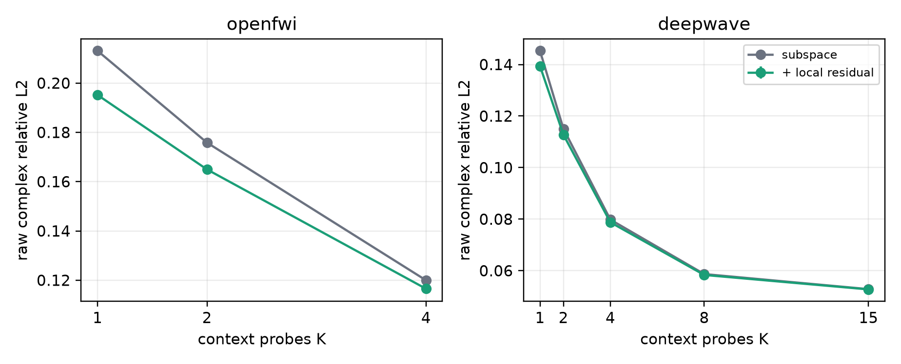

# Wave Response Query 跨域 POC：阶段报告

> 日期：2026-09-24
>
> 状态：M0 已在三个多系统域通过；M1 完成首轮
> 主指标：逐物理系统等权的 raw complex relative L2

## 1. 一句话结论

这轮结果支持一个比“从一张波场预测另一张波场”更稳定的方向：

> 给定新环境中少量 source--response probes，先在训练环境中学习一个复响应子空间，再在测试时用 probes 识别当前系统在该子空间中的坐标，最后回答未测 source 的完整接收阵列响应。

该最小模型在 OpenFWI、Deepwave 与 Ocean 三个相互独立的多系统域都通过了预注册 gate。它不是最终论文方法，但已经把
response query 从 framing 变成了可重复的正结果。



## 2. 问题设定

每个环境 `e` 有复响应：

$$
Y_e(s,f,r) \in \mathbb{C}.
$$

在一个目标频率 `f` 上，观测 `K` 个 source 的完整接收阵列响应：

$$
D_K = \{(s_i, Y_e(s_i,f,:))\}_{i=1}^{K}.
$$

目标是回答一个未测 source：

$$
D_K, s_* , f \longrightarrow \widehat{Y}_e(s_*,f,:).
$$

train、validation、test 按物理系统切分；目标 source 从 context 中严格排除。频率在第一阶段固定，因此这里只宣称
held-out-source query，不把它写成 joint source--frequency query。

## 3. 为什么局部互易性不等于问题已经被解掉

若 source 与部分 receivers 共址，互易性给出：

$$
Y_e(s_*,f,r=s_i) = Y_e(s_i,f,r=s_*).
$$

每个 context probe 因而只提供目标响应上的一个准确 anchor；它并不给出其余几十个 receiver 的复值。Ocean 是最清楚的例子：
数值互易误差为零，但 4/8 个 anchor 的 inverse-distance interpolation 误差仍为 0.886/0.564。真正困难的是从少量局部
anchor 和完整 context responses 推断当前环境的全局干涉状态。

## 4. M0：最小 response-subspace query model

对每个频率，把一个环境的完整 source--receiver table 拉直为向量：

$$
x_e = \mathrm{vec}(Y_e(:,:,f)).
$$

只用 train systems 计算均值 `mu` 与 rank-`q` 复 SVD 基 `B`：

$$
x_e \approx \mu + B z_e.
$$

对测试环境，context sources 决定可观测行集合 `O`。环境坐标通过一个带 ridge 的复最小二乘问题得到：

$$
L(z) =
\left\|P_O(\mu + Bz) - Y_{e,O}\right\|_2^2
+ \lambda \|z\|_2^2,
$$

其中 `z_e^*` 是使 `L(z)` 最小的系数。随后读取目标 source 对应的行：

$$
\widehat{Y}_e(s_*,f,:) = P_*(\mu + Bz_e^*).
$$

这里最重要的不是 PCA 本身，而是任务分解：

1. 训练阶段学习跨环境共享的 response representation；
2. 测试阶段用少量真实 probes 做 in-context system identification；
3. query head 在同一个隐式系统状态下回答新的 source intervention。

rank 与 ridge 只在 validation 选择；test 不参与选择。复数 SVD 的合成矩阵必须是 `Vh.T` 而不是
`Vh.conj().T`，这一点已有单元测试覆盖。

## 5. M0 正式结果

| 数据域 | K | 最强同预算局部 baseline | response subspace | 相对改善 | 逐系统胜率 |
|---|---:|---:|---:|---:|---:|
| OpenFWI | 1 | 0.547 | 0.213 | 61.3% | 99.0% |
| OpenFWI | 2 | 0.547 | 0.176 | 68.5% | 99.6% |
| OpenFWI | 4 | 0.547 | 0.120 | 78.7% | 100% |
| Deepwave | 1 | 0.195 | 0.145 | 24.6% | 92.2% |
| Deepwave | 2 | 0.195 | 0.115 | 40.4% | 99.6% |
| Deepwave | 4 | 0.195 | 0.080 | 58.7% | 100% |
| Deepwave | 8 | 0.195 | 0.059 | 69.6% | 100% |
| Deepwave | 15 | 0.195 | 0.053 | 72.6% | 100% |
| Ocean | 1 | 1.001 | 0.233 | 76.7% | 100% |
| Ocean | 2 | 1.001 | 0.0348 | 96.5% | 100% |
| Ocean | 4 | 0.886 | 0.0043 | 99.5% | 100% |
| Ocean | 8 | 0.564 | 0.00053 | 99.9% | 100% |

OpenFWI 和 Deepwave 的 paired-system bootstrap 95% improvement 下界，在最小预算处分别仍为 60.0% 与
22.7%；并非由少数容易系统拉动。

半预算相对 full-budget local baseline 的误差比：

- OpenFWI：K=2 对 K=4，`0.322`；
- Deepwave：K=8 对 K=15，`0.302`；
- Ocean：K=4 对 K=8，`0.0076`。

Deepwave 的形状/contrast OOD 上，K=4/8/15 为 0.122/0.094/0.085，仍明显优于 OOD train-mean
0.256。Ocean 参数区间 OOD 更难，K=4/8 为 0.325/0.199；这说明低维表征有效，但外推不能写成“已经解决”。

### 5.1 幅值与相位归因

幅值/相位指标只用于解释，不替代 raw complex 主指标：

| 数据域与预算 | 方法 | amplitude RelL2 | weighted phase coherence | weighted phase MAE |
|---|---|---:|---:|---:|
| OpenFWI K=2 | baseline | 0.375 | 0.560 | 0.806 rad |
| OpenFWI K=2 | subspace | **0.118** | **0.961** | **0.142 rad** |
| Deepwave K=8 | baseline | 0.0715 | 0.941 | 0.215 rad |
| Deepwave K=8 | subspace | **0.0414** | **0.997** | **0.043 rad** |
| Ocean K=4 | baseline | 0.519 | 0.437 | 0.955 rad |
| Ocean K=4 | subspace | **0.0030** | **0.9998** | **0.0013 rad** |

最能排除“只是在容易的幅值上刷分”的对照来自 Deepwave K=1：subspace 的 amplitude error 为 0.0717，
并不优于 train mean 的 0.0715；但 raw complex error 仍从 0.195 降到 0.145，因为 weighted phase MAE
从 0.215 rad 降到 0.142 rad。当前 query formulation 与最初的 amplitude--phase 动机因而可以更精确地
连接：**幅值先验给出稳定 population mean，而少量 probes 的关键增量是识别当前环境特有的相位与干涉状态。**



## 6. M1：receiver-preserving residual query operator

M1 没有替换 M0，而是把它作为 frozen routed baseline，学习一个小残差：

```text
complex context responses
  -> shared 1D receiver convolutions
  -> source/frequency FiLM
  -> permutation-invariant mean/std + query attention
  -> receiver coordinate embedding
  -> zero-initialized local residual decoder
  -> subspace prediction + residual
```

该模型有约 293k 参数。line receiver 使用普通 padding，ring array 使用 circular padding；没有加入 PDE loss、flow、额外介质输入或
多分支 token。

三 seed 的 test 结果：

| 数据域 | K | M0 subspace | M1 residual | M1 相对 M0 |
|---|---:|---:|---:|---:|
| OpenFWI | 1 | 0.213 | 0.1952 ± 0.0008 | 8.7% |
| OpenFWI | 2 | 0.176 | 0.1650 ± 0.0004 | 6.3% |
| OpenFWI | 4 | 0.120 | 0.1165 ± 0.0003 | 2.4% |
| Deepwave | 1 | 0.145 | 0.13940 ± 0.00002 | 3.5% |
| Deepwave | 8 | 0.0587 | 0.05835 ± 0.00001 | 0.44% |
| Deepwave | 15 | 0.05285 | 0.05274 ± 0.00001 | 0.04% |

OpenFWI 的三项 paired bootstrap 下界都大于零；Deepwave K=1--8 下界也大于零，但 K=15 的区间跨零。
解释很直接：OpenFWI 仍有可学习的 receiver-local 残差；Deepwave 在大预算下已接近 rank-32 subspace 的
可辨识上限，增加网络容量几乎没有收益。这是一个有价值的负结果：当前证据不支持用更大 Transformer 或
更多 loss 取代简单子空间。



## 7. 哪些 gate 已通过

- 同预算相对 baseline 至少 20%：三个多系统域通过；
- bootstrap 下界大于零：OpenFWI、Deepwave、Ocean 均通过；
- 至少 75% systems 改善：全部通过；
- 绝对误差：OpenFWI 小于 0.40、Deepwave 小于 0.35、Ocean 小于 0.45；
- 半预算测量效率：三个域均通过；
- 至少两个独立多系统域：通过，实际为三个。

M0 是确定性表示学习器，随机性来自冻结的 context orders。M1 虽已完成三 seed，但相对 M0 的增益只有
0.04%--8.7%，因此仍不把 residual network 写成核心贡献。

## 8. 负结果与不能越界的结论

1. The Well HDF5 缺 source coordinate metadata，26 条 trajectory 的反推峰全部重合；当前只能做数据语义审计，不能计作第四个成功域。
2. Deepwave M1 在 K=8/15 几乎不超过 M0，说明网络复杂度不是当前瓶颈。
3. Ocean IID 极低误差来自 range-invariant Pekeris family 的低维结构；必须同时展示 OOD 退化，不能用 0.00053 暗示一般海洋已经解决。
4. 当前只完成同频 held-out-source query。没有证据支持 joint unseen source + unseen frequency，也没有 active query policy 结论。
5. baseline 是严格的 train mean、nearest/kernel source interpolation 与 reciprocity-anchor interpolation；下一阶段还需要加入参数匹配的
   generic masked Transformer、system retrieval 与 direct supervised ridge，排除“baseline 太弱”的攻击。

## 9. 当前最可信的科学结论

跨环境的复波响应虽然在像素空间高度振荡，但 source--receiver response table 在三个域里都存在可由少量 probes 识别的低维环境状态。
互易性有用，却只提供 anchors；真正带来 measurement compression 的是跨系统学习到的全局 response representation。

这比“一个网络把 source A 图像回归成 source B 图像”更接近可推广的 AI 命题：

> wave measurements are prompts for identifying a latent physical operator, and new sources are queries to that operator.

## 10. 复现入口

- 冻结计划：`docs/CROSS_DOMAIN_RESPONSE_QUERY_24H_PLAN_ZH.md`；
- 数据与 provenance：`docs/CROSS_DOMAIN_DATA_PROVENANCE_ZH.md`；
- adapter：`src/spectral_continuation/cross_domain_response_data.py`；
- M0 审计：`src/spectral_continuation/cross_domain_query_audit.py`；
- M1 训练：`src/spectral_continuation/train_cross_domain_query.py`；
- 图：`src/spectral_continuation/plot_cross_domain_query.py`；
- 汇总 JSON：`artifacts/cross_domain_response_query/*/audit_summary.json`；
- 主图：`artifacts/cross_domain_response_query/main_budget_curves.png` 与
  `artifacts/cross_domain_response_query/representative_responses.png`。
