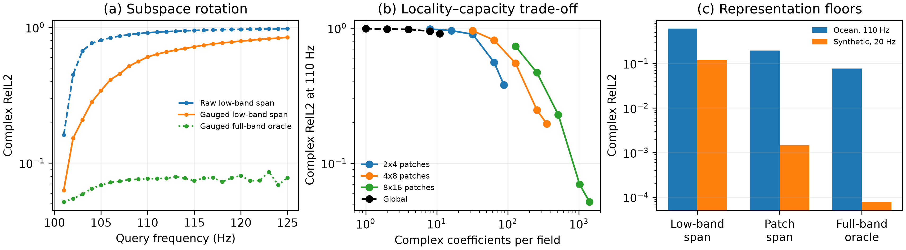

# 全局隐空间、局部 token 与随机掩码：诊断报告

日期：2026-09-16

## 0. 结论先行

同目录的 `wavefield-low-rank-representation` 不是旁支，而是本课题非常重要的前置证据。
它已经完成了三件这里不应重复包装成新贡献的工作：

1. 频率轴有效秩主要由“带宽乘以延迟占据”控制，而不是由中心频率单独控制；
2. 载波对齐、低秩补全和随机空间掩码在合适物理区间内有效，但在强散射区间收益会消失；
3. staircase 数据上的低频到高频解析外推已经全线失败，原因包括色散、模式截止和高频新模态。

本轮新诊断回答的是一个更窄、也更直接服务当前 spectral continuation 的问题：

> 对同一个物理环境，低频带产生的空间子空间究竟能否表示更高频场；如果不能，问题来自
> 整个全频场不可压缩，还是来自子空间随频率旋转？局部 patch token 能否缓解这种旋转？

答案很明确：

- Ocean 数据的全频载波对齐场本身很可压缩，但低频子空间不能覆盖远处高频；
- 局部 patch 表示显著降低表示误差，说明需要空间位置相关的混合系数；
- 单一全局载波在 Ocean 上有用，在三路径合成场上反而有害，不能作为普适唯一坐标；
- 低阶多项式预测 latent 系数在频带外数值爆炸，失败不等于 latent 不存在，而是系数演化不可由这种外推辨识；
- 因而下一条最可能的路线不是更大的全局 ODE，也不是立即上 Transformer，而是
  **局部复数 token + raw/gauged 双坐标 + 跨样本学习到的频率条件先验**。

## 1. 从旧项目继承什么

旧项目的完整结论见
[`REPORT_ZH.md`](../../wavefield-low-rank-representation/docs/REPORT_ZH.md) 和
[`REPRESENTATION_ROADMAP_ZH.md`](../../wavefield-low-rank-representation/docs/REPRESENTATION_ROADMAP_ZH.md)。

### 1.1 已知的频率轴秩规律

旧项目已经在合成多路径、FDTD 和 The Well acoustic maze 上验证：

$$
r_\epsilon(U) \lesssim B\,\Lambda_B,
$$

其中 $B$ 是带宽，$\Lambda_B$ 是在分辨率 $1/B$ 下仍承载主要能量的到达时间集合测度。
三个数据族的拟合决定系数分别达到 0.998、0.944 和 0.954。该结果告诉我们：

- “高频所以高秩”不是充分解释；
- 解调只有在显著缩短相对延迟占据时才有收益；
- 强混响场的延迟占据接近饱和，单载波不会产生低维全局 residual。

### 1.2 已知的跨频负结果

旧项目的 staircase 实验用 6–12 个低频点外推更高频，copy、逐点多项式、幅相分离、
对齐低秩和 raw 低秩全部约等于零预测。它不是当前 Ocean 任务的直接反证，因为物理和频率
采样不同；但它排除了一个过强主张：**低秩或解调本身不保证频带外可预测。**

### 1.3 随机 mask 成功依赖跨样本 prior

旧项目既做过单实例随机 entry completion，也做过监督式跨实例重建。最重要的归因是：
监督网络把误差从单实例界 0.256 降到 0.114，真正新增的信息来自训练分布中的跨样本先验，
而不是参数量本身。

这直接限定了我们对“random mask + conditional generation”的表述：

- 单实例 POD oracle 只证明表示存在；
- 从可见 token 恢复被遮挡 token，需要跨样本学到的 prior；
- Transformer 只是承载 prior 的一种模型，不是结论本身；
- 若条件对应唯一确定解，首先应比较确定性 masked predictor，而不能仅凭使用 flow/diffusion
  就声称多模态生成更合理。

## 2. 本轮诊断定义

对一个环境，把 $m$ 个可见频率场展平为列：

$$
U_L = [u(f_1),\ldots,u(f_m)].
$$

令 $B_L^{(r)}$ 为 $U_L$ 的前 $r$ 个左奇异向量。目标高频场的低频张成误差为：

$$
E_{\mathrm{span}}(f,r)
=
\frac{\left\|u(f)-B_L^{(r)}(B_L^{(r)})^*u(f)\right\|_2}
{\left\|u(f)\right\|_2}.
$$

投影系数使用了目标真值，因此这是 representation oracle，不是可部署预测器。它回答：
即使系数预测完全正确，低频 basis 最多能做到多好。

另构造使用可见与查询全频场得到的 $B_F^{(r)}$。对应误差是 full-band oracle，用于区分：

- full-band oracle 也高：给定 rank 的表示容量不足；
- full-band oracle 低、low-band span 高：表示容量存在，但子空间随频率旋转；
- 两者都低、真实模型仍高：瓶颈在系数辨识或学习。

此外比较三种处理：

- raw complex field；
- 仅用最后两个可见频率估计的 endpoint carrier gauge；
- 把空间切成规则 patch，每个 patch 独立使用低频 snapshot span。

## 3. Ocean：主要问题是子空间旋转

协议为 90–100 Hz 可见，101–125 Hz 查询，32 个 validation 环境。

### 3.1 有效秩

| 表示 | 可见带 95% rank | 可见带 99% rank | 全频 95% rank | 全频 99% rank |
|---|---:|---:|---:|---:|
| raw | 6.00 | 7.03 | 16.75 | 19.88 |
| endpoint-gauged | **1.84** | **2.88** | **4.41** | **8.56** |

载波 gauge 确实形成了低秩全频表示；所以当前失败不能简单归因为“波场没有低维结构”。

### 3.2 110 Hz 的表示下界

| 方法 | raw RelL2 | gauged RelL2 | 性质 |
|---|---:|---:|---|
| 全局 low-band span，rank 11 | 0.911 | **0.605** | 目标系数 oracle |
| 4×8 patch span，rank 11/patch | **0.196** | 0.393 | 目标系数 oracle |
| full-band basis，rank 11 | 0.418 | **0.077** | 使用查询频率构 basis，仅作下界 |
| latent 三次多项式，rank 6 | 43.220 | 7.921 | 可部署，但外推不稳定 |

最关键的差值是 0.605 对 0.077：同样 rank 11、同样 gauged 表示，低频 basis 与全频 basis
相差近八倍。这是明确的 subspace rotation 证据。增加全局回归器容量无法消除 basis mismatch。

### 3.3 局部化收益与容量代价

对 raw 场在 110 Hz 做 patch 粒度扫描：

| patch 网格 | rank/patch | 复系数总数 | RelL2 |
|---|---:|---:|---:|
| 全局 | 11 | 11 | 0.911 |
| 2×4 | 11 | 88 | 0.379 |
| 4×8 | 11 | 352 | 0.196 |
| 8×16 | 8 | 1024 | 0.070 |
| 8×16 | 11 | 1408 | **0.052** |

该结果支持局部 token，但必须保留容量限定：patch 化同时增加了系数数量，因此 0.052 不是
“同预算优于全局 POD”的证据。它证明的是另一件事：**高频新结构在局部低频 span 中几乎都能
找到，而无法由一套全局混合系数统一表示。** 后续模型必须压缩或关联这些局部系数，attention、
state-space mixer 或低秩 token interaction 都是候选。

### 3.4 带内随机频率 mask

只保留 90、92、94、96、98、100 Hz，用三次多项式恢复被遮挡的奇数频率：

| 表示 | 被遮挡频率平均 RelL2 |
|---|---:|
| raw | 0.918 |
| endpoint-gauged | **0.089** |

这说明“masked token pretraining”有正信号，但正信号来自选对坐标，不来自 Transformer 本身。
0.089 也是未来 learned masked-frequency model 必须比较的强解析 baseline。

## 4. 可控三路径合成场：单一 gauge 不普适

协议为 1–14 可见、15–24 查询，32 个 validation 环境。20 Hz 结果：

| 方法 | raw RelL2 | endpoint-gauged RelL2 |
|---|---:|---:|
| 全局 low-band span，rank 14 | **0.122** | 0.829 |
| 4×8 patch span，rank 14/patch | **0.0015** | 0.282 |
| full-band basis，rank 14 | **0.00008** | 0.108 |
| latent 三次多项式，rank 6 | 7.678 | 7.675 |

这里每个样本含三个不同方向、延迟与曲率的路径。由最后两个频点估计的单 slope 会把多条路径
压成错误的平均 carrier，因此 gauge 反而破坏表示。这个反例很有价值：最终 encoder 不应强制
所有数据进入单一载波坐标，而应允许 raw/local carrier 多分支并由数据选择。

raw patch span 的极低误差也说明，在解析多路径场中局部 token 几乎可以精确表达高频；真正难点
不是 decoder，而是如何从低频与训练分布预测这些局部高频系数。

## 5. 对 random-mask conditional generation 的判断

这个想法值得保留，并且可以与连续频率查询共享同一个 tokenizer。但两个任务应严格区分：

1. **频率 continuation**：输入完整低频场，目标频率整场不可见；核心困难是跨频系数与新模态预测；
2. **空间 masked completion**：目标频率部分空间 token 可见；核心困难是利用跨样本 prior 补全空间；
3. **联合 mask**：同时隐藏部分频率和空间 token；这是最接近通用 wave foundation encoder 的预训练任务。

三者可以共享模型和单一 masked complex reconstruction objective，但不能把较容易的空间插值结果
当作频带外 continuation 的证据。

建议 token 形式为：

$$
z_{p,j}=E\big(u_p(f_j),\;\Delta_f u_p(f_j),\;f_j,\;x_p\big),
$$

其中 $p$ 是空间 patch，$j$ 是可见频率。encoder 同时保留 raw complex 特征与局部相位增量特征；
频率 mixer 预测查询频率状态，空间 mixer 交换相邻或远程 patch 信息，complex decoder 输出目标场。
这是一种轻量的 operator/representation learning 包装，不需要引入群论叙事。

## 6. 下一步：最小学习 POC，而非一次堆满组件

### M0：局部 token 是否能被学习

先不用生成模型。固定 4×8 和 8×16 两个粒度，用小型共享 patch encoder/decoder：

- 训练任务：随机遮挡可见频率 token 与空间 patch；
- 主损失：只在被遮挡 complex field 上计算 RelL2；
- 对照：raw polynomial、gauged polynomial、卷积 autoencoder、同参数量全局 latent；
- gate：Ocean 带内频率 mask 显著优于 raw 0.918，并接近或超过 gauged 解析基线 0.089；
- 目的：验证跨样本 prior 能否预测局部系数，而不是验证注意力机制。

### M1：把同一 tokenizer 接回 continuation

只在 M0 通过后，把查询频率作为条件并沿用当前 calibrated protocol：

- 90–100 Hz 输入；
- 101–106 Hz development supervision；
- 107–125 Hz 冻结评估；
- 直接对照当前 hyper-pole 0.447、recurrence 0.474 和 query U-Net 0.613；
- 同时报告模型误差与本报告中的 patch-span oracle gap。

首个成功标准不是远频全部变好，而是 107–112 Hz 的 raw RelL2 明显低于 0.447，并且优势能由
“局部系数预测更准”解释。若模型已经接近 patch oracle，再增加容量没有意义；若仍远离 oracle，
才考虑 token Transformer、neural ODE 或 hypernetwork。

### M2：何时才上 conditional generation

只有出现以下任一证据才值得上 flow/diffusion：

- 同一低频条件对应多个真实可行高频解；
- deterministic token operator 的均值模糊掉稳定存在的高频模态；
- 多样本预测能改善覆盖率或校准，而不仅是 best-of-N error。

否则，masked deterministic operator 更简洁，也更容易把增益归因到表征本身。

## 7. 当前路线取舍

本轮结果使路线更聚焦：

- 不再做“更大的全局 ODE/pole 数量扫描”；
- 不把 generic low-rank、随机矩阵补全或 delay-rank law 当作新贡献；
- 不使用单一 endpoint carrier 作为普适 encoder；
- 保留局部 complex token、跨样本 prior 和频率条件 operator；
- 把 random spatial mask 作为共享 tokenizer 的第二个下游任务，而不是替代当前主问题；
- Transformer 是否必要，交给 M0 的同预算对照决定。

机器可读结果位于 `artifacts/global_subspace/`；生成代码为
`spectral_continuation.diagnose_global_subspace` 和
`spectral_continuation.summarize_global_subspace`。
