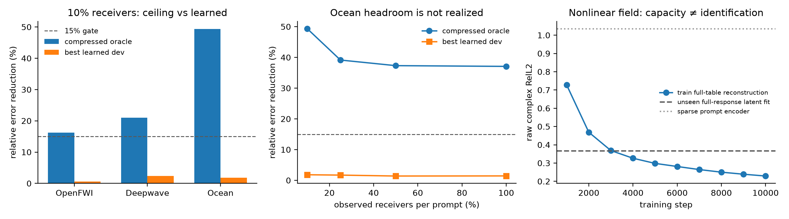

# Heterogeneous Functional Operator M0：为什么不能直接用 learned latent 替换可观测后验坐标

> 历史证据 / 技术参考（2026-10-05 归档标记）：保留原实验、数值和复现路径。
> 文内“当前/下一步/待完成”描述属于当时阶段，不是现行任务；请先读[三条 Wave as Prompt 路线](../docs/wave_as_prompt/README.md)。

> 日期：2026-09-26
>
> 状态：oracle 通过，三类 learning-based 表征均未通过方法 gate
>
> 任务：strict-Q3，K=2，每个 prompt 使用独立 receiver mask
>
> 主指标：逐 physical system 等权的 raw complex relative L2

## 1. 一句话结论

我们验证了用户提出的关键质疑：固定 PCA--MAP 看起来过于简单，并且不自然支持不规则、不同数量的输入。
实验确实发现了很大的 nonlinear / retrieval headroom，但目前三类现代学习方法都无法在 unseen physical
systems 上兑现它：

1. coordinate-aware functional evidence encoder 在 Deepwave 最多改善 2.4%，OpenFWI 约为零，Ocean 回退；
2. learned functional reranker 与 listwise response metric 最多改善约 1%--2%，远低于候选 oracle；
3. nonlinear complex neural field 可以表示完整 response family 的一部分，却无法从两个稀疏 prompts 稳定识别
   latent，test error 约 1.04。

因此本轮的结论不是“PCA 已经足够先进”，而是：

> **对于 sparse wave-system identification，一个坐标是否容易被观测，比它是否 nonlinear 或 modern 更重要。**

当前线性 response chart 的价值在于它允许从任意 mask 写出稳定的复数后验；不能在没有更强可辨识结构时，
把它替换成任意的 nonlinear latent。下一代方法应把 learned operator 放在 posterior chart 之上，或者学习
具有明确观测方程的 chart，而不是删除解析 chart。

## 2. 为什么做这轮实验

此前最强方法把完整训练 response table 展平成复向量，只用 train systems 学一个全局 response basis：

$$
x = \mu + Bz + \epsilon.
$$

给定任意 observed coordinate 集合 $O$，测试系统的 latent posterior 可以闭式求解：

$$
\widehat z =
\left(B_O^* B_O + \Lambda\right)^{-1}
B_O^*\left(x_O-\mu_O\right).
$$

它稳定、便宜，而且支持 arbitrary masks；但 $B$ 仍来自固定 PCA chart。我们希望回答三个问题：

1. PCA 的误差是否来自线性 representation capacity 不够？
2. 任意坐标复样本能否由 learned set encoder 形成更好的 system token？
3. 能否直接学习 nonlinear complex neural field，彻底摆脱固定离散 basis？

## 3. 冻结协议

### 3.1 数据与任务

- OpenFWI CurveFault-A：500 / 500 / 500 个 train / validation / test systems；
- Deepwave ring ultrasound：512 / 128 / 256；
- Ocean Pekeris multistatic：256 / 64 / 128；
- strict-Q3：target source 与 target frequency 都不允许出现在两个 context prompts 中；
- 每个 prompt 独立采样 receivers，观测比例为 10%、25%、50%、100%；
- split 单位始终是完整 physical system，同一系统的 response views 不跨 split。

### 3.2 强基线

基线是 M4 的 rank-16 posterior memory / spectral dictionary，而不是 train mean、普通插值或弱 CNP。所有
learning correction 都有明确的 zero-update fallback；若没有稳定证据，必须回到该基线。

## 4. 第一层：是否真的存在 representation headroom

我们先不训练复杂网络，而是在 posterior 检索出的候选系统中使用 target truth 事后挑选最佳候选。这不是
可部署方法，只回答“当前候选集合里是否存在更好的答案”。候选 value 仍只保存 rank-16 complex coefficients，
因此结果没有借用完整 response bank。

| 数据域 | Receiver 比例 | 强基线 | rank-16 全候选 oracle | 可利用空间 |
|---|---:|---:|---:|---:|
| OpenFWI | 10% | 0.1511 | 0.1266 | 16.2% |
| Deepwave | 10% | 0.1313 | 0.1037 | 21.0% |
| Ocean | 10% | 0.6226 | 0.3155 | 49.3% |
| Ocean | 25% | 0.5185 | 0.3155 | 39.1% |
| Ocean | 50% | 0.5034 | 0.3155 | 37.3% |
| Ocean | 100% | 0.5015 | 0.3155 | 37.1% |

结论：storage rank 不是主要瓶颈，尤其 Ocean 存在很大的候选空间。因此允许进入 learning POC。

## 5. 方法 A：Functional Evidence Operator

### 5.1 输入不是图片，而是不规则复采样集合

每个 prompt 是：

$$
D_i=\{(q_{ij}, y_{ij})\}_{j=1}^{m_i},
$$

其中 $q_{ij}$ 包含 source、frequency 和 receiver 坐标，$y_{ij}$ 是复响应。point encoder 读取 Fourier
coordinate features、实部、虚部和 log amplitude，再对 receivers 做 permutation-invariant pooling。

每个 prompt 输出一个 complex latent proposal $h_i$ 和正 precision $\tau_i$。多个 prompts 只通过自然参数
相加形成 posterior token：

$$
\tau_D=\tau_0+\sum_i\tau_i,
\qquad
h_D=\frac{\sum_i\tau_i h_i}{\tau_D}.
$$

continuous query decoder 接收 $h_D$、目标坐标和强基线预测，只输出有界 residual。decoder 最后一层零初始化，
所以 step 0 严格等于强基线。模型只有 64,226 个参数，训练只使用最终 raw complex RelL2。

### 5.2 结果

| 数据域 | 10% receivers | 25% | 50% | 100% |
|---|---:|---:|---:|---:|
| OpenFWI | +0.07% | +0.09% | +0.09% | +0.10% |
| Deepwave | +2.37% | +2.10% | +1.69% | +1.24% |
| Ocean | 0% | 0% | 0% | 0% |

Ocean 的最佳 checkpoint 始终是 step 0。说明它的巨大 oracle 空间并不是一个从 pooled prompt 到 target residual
的平滑回归问题。

## 6. 方法 B：Functional Prompt Reranking

### 6.1 从“生成 residual”改成“识别候选系统”

第二版先由解析 posterior 产生 64 个候选，再使用 shared set Transformer 将 query prompts 与候选 prompts
编码成 system fingerprints。模型学习候选 score，然后对 rank-16 candidate values 做 soft retrieval。输出有
zero-initialized gate，可精确回到强基线。参数量为 127,522。

端到端 raw error 训练后，Deepwave 改善 0.9%--1.6%，Ocean 1.4%--1.8%，OpenFWI 约为零。但 learned mix
为负，表明网络没有学到更好的候选，而是把较差的检索均值当成反向 residual 使用。

### 6.2 Listwise response metric

为了让监督与缺失能力完全对齐，第三版直接用候选 target-response error 定义 soft ranking labels：

$$
p_j \propto
\exp\left(-\frac{e_j-e_{\min}}{T s_e}\right),
$$

并用单一 listwise cross-entropy 学 prompt metric。训练 episode 从 1 个扩大到 16 个独立 query/mask，
validation/test 各用不同的 4 个 episodes。

多布局 test 最终为：

- OpenFWI：改善 0.62%--1.17%；
- Deepwave：安全选择为 0% blend，即回退基线；
- Ocean：10% receivers 改善 0.43%，其余约为零或轻微负值。

Ocean 的 learned top-1 与候选 oracle 的平均 regret 仍为 0.24--0.35。增加训练布局没有修复。

### 6.3 为什么普通 complex similarity 也不行

我们额外比较了 raw complex L2、允许最优 complex gain 后的 residual、coherence 和 amplitude distance。
Ocean 10% receivers 的 target-candidate error 分别为：

| 排序依据 | Target candidate error |
|---|---:|
| 解析 posterior distance | 0.698 |
| raw complex L2 | 0.804 |
| optimal-gain residual / coherence | 0.825 |
| amplitude distance | 0.911 |
| target-truth oracle | 0.360 |

这说明 prompt-space 相似性在未见 source-frequency query 上会被模态干涉重新排序；不是换一个更宽的 metric
network 就能解决。

## 7. 方法 C：Nonlinear Complex Neural Field

### 7.1 表示

我们训练 coordinate neural field：

$$
\widehat y(q)=f_\phi(z_\theta,q),
$$

其中 $z_\theta\in\mathbb R^{32}$ 是每个训练系统的 latent，$q$ 是任意 source-frequency-receiver 坐标。
decoder 使用多尺度 Fourier features 与 latent FiLM，共 212,354 个共享参数。测试时可从 prompts 优化 latent，
或用 328,736 参数 set Transformer 做 amortized inference。

### 7.2 容量与辨识必须分开

Ocean 结果：

| 层级 | Raw complex RelL2 |
|---|---:|
| train systems 完整表重建 | 0.229 |
| unseen validation，完整 response 拟合 latent | 0.383 |
| unseen test，完整 response 拟合 latent | 0.368 |
| K=2 sparse prompt，从零优化 latent | 1.09--1.27 |
| K=2 amortized prompt encoder | 约 1.035 |

因此 decoder 确实学到某种 nonlinear response manifold，但这个 latent chart 在稀疏 Q3 观测下不可稳定辨识。
从 prompt encoder 初始化继续 MAP refinement 还会恶化，排除了“只差一个更好的初始化”这一简单解释。

## 8. 本轮最重要的科学归因

### 8.1 Oracle headroom 不等于 conditional identifiability

候选 oracle 使用目标 truth 决定哪个训练系统在目标 query 上相似；部署模型只看两个不同 source-frequency
prompts。波场的 modal interference 可以让这两个排序完全不同。因此 Ocean 的 49% oracle 是 existence
证据，不是模型应当自动关闭的 reducible gap。

### 8.2 Nonlinear manifold capacity 不等于 sparse inverse stability

neural field 能拟合完整表，但从少量 samples 推断 arbitrary latent 是另一个 inverse problem。一个自由
nonlinear chart 会折叠、旋转或拉伸 latent；它没有保证观测 Jacobian 在随机 prompt masks 下良态。

### 8.3 为什么线性 posterior chart 暂时不可替代

固定 basis 看起来简单，但它提供明确的观测方程 $x_O=B_O z$，可计算 posterior precision，并天然支持任意
mask。它不是最终“AI 创新点”，而是当前唯一通过跨域 raw-error gate 的可观测坐标系。

## 9. 对方法故事的修正

不再讲：

> “我们用一个更现代的 nonlinear encoder 替换 PCA，所以泛化更强。”

更可信的讲法是：

> “我们把 wave prompts 转成带 uncertainty 的 system posterior token。线性 response chart 提供稳定、
> 可观测的初始坐标；learning 负责在该后验之上做 operator prior、query composition 与受控 chart transport。”

这仍然是 representation / operator learning，但不会为了 AI 外观删除真正保证 sparse inference 稳定性的结构。

## 10. 决策与重启条件

### 当前决定

1. 不把本轮 learned functional encoder 写成性能贡献；
2. 不继续扫 width、depth、attention heads、辅助 loss 或 neural-field latent dimension；
3. 保留代码作为 heterogeneous-input 与 identifiability benchmark；
4. 当前论文方法仍以 M4 posterior token、spectral dictionary、neural transport 和连续 prior composition 为主；
5. 将“capacity 与 identifiability 的分离”写成方法设计原则和负结果。

### 只有以下新条件之一满足才重启

1. 增加真正改变 conditional identifiability 的 prompts，例如频率 bracket、co-located reciprocal links 或更大 K；
2. latent 具有显式物理观测方程或稳定 Jacobian，而不是任意 neural-field code；
3. 获得新的真实 multistatic 数据，证明当前 PCA chart 的跨设备失效而 functional input encoder 有清晰优势；
4. 在不读 target truth 的 oracle 中，target-free ranking 相对 M4 仍保留至少 15% 可利用空间。

## 11. 复现入口

- 头部空间审计：`audit_heterogeneous_prompt_headroom.py`；
- functional evidence：`train_functional_evidence_operator.py`；
- functional reranker：`train_functional_prompt_reranker.py`；
- listwise metric：`train_functional_response_metric.py`；
- neural field：`train_wave_neural_field_autodecoder.py`；
- amortized encoder：`train_wave_neural_field_prompt_encoder.py`；
- 冻结机器汇总：`artifacts/heterogeneous_functional_operator_m0_summary/summary.json`；
- 主表：`artifacts/heterogeneous_functional_operator_m0_summary/heterogeneous_operator_results.csv`。
