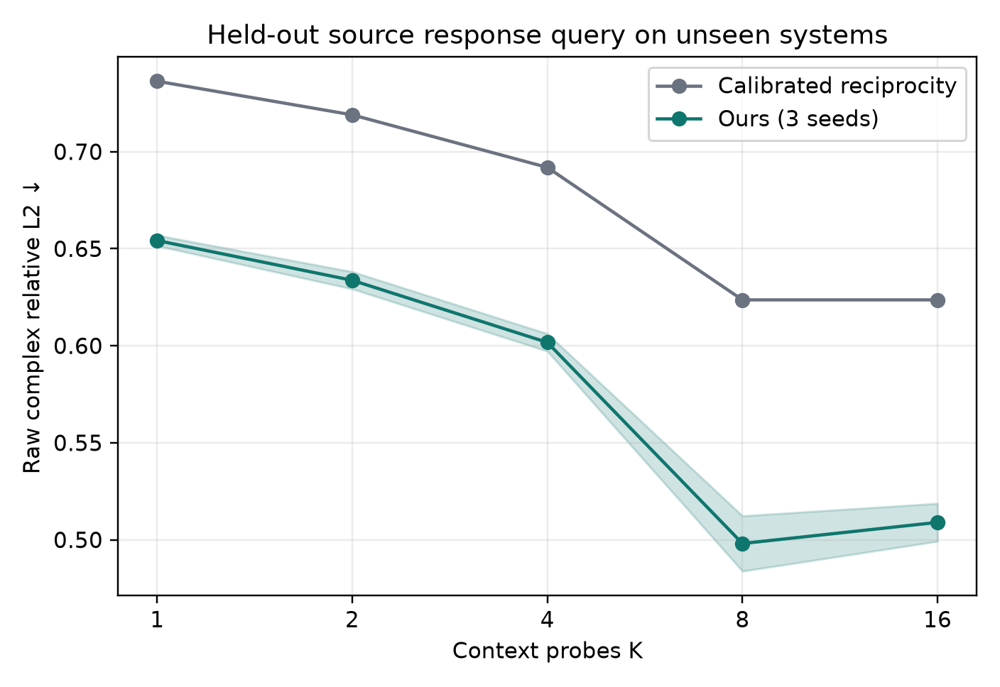
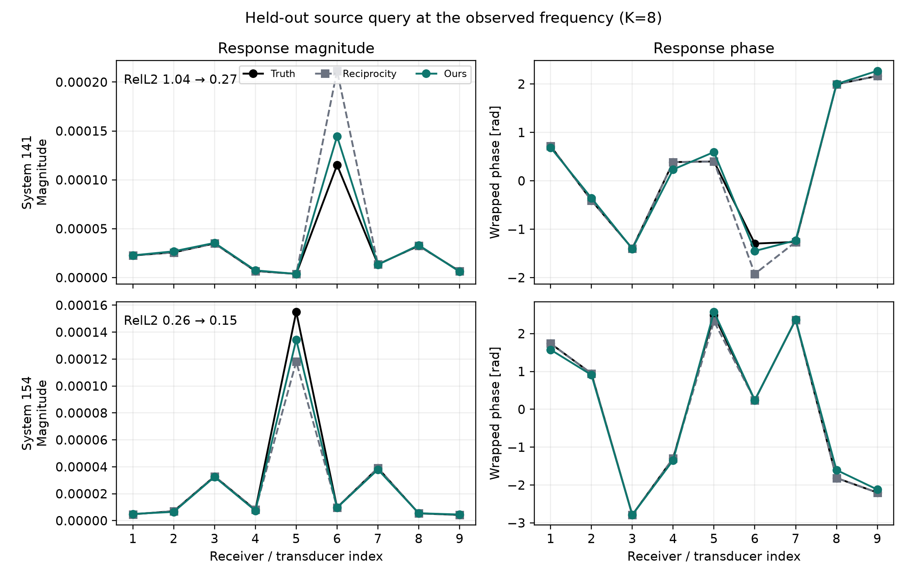

# In-Context Wave Response Query RQ-1：多静态阵列上的物理路由与轻量表征学习

> 日期：2026-09-24  
> 状态：三 seed、system-held-out test、geometry OOD 均已完成  
> 结论：Q2 held-out-source query 通过；Q3 joint source-frequency query 尚未通过。

## 1. 一句话结论

对于由 9 个可发射、也可接收的换能器组成的 multistatic array，给定同一未知环境中其他 source 的复响应，
我们可以查询一个从未作为 context source 出现的换能器响应。一个只有 121,938 参数的模型，把互易性作为
零参数 routing layer，只学习介质相关的 gain 和 self-response 残差：

- IID test、K=8：raw complex RelL2 为 **0.498 ± 0.014**；
- gain-calibrated reciprocity baseline：0.624；
- 相对提升：**20.1%**，physical-system paired bootstrap 95% 区间为 **[12.7%, 28.7%]**；
- ellipse geometry OOD：**0.427 ± 0.002 vs 0.558**，相对提升 **23.5%**。

这不是完整的 source-frequency joint query，也不是 active agent，但它已经证明：将 frequency/source 视为对
未知物理系统的 query，并把波动方程结构写成 information routing，而不是普通 image prior，可以得到稳定、
可解释且有统计显著性的正结果。

## 2. 问题设定

隐藏环境为 $\theta$。9 个位置相同的发射/接收换能器构成阵列。固定频率 $\omega$ 下，一次 source probe
返回所有换能器处的复响应：

$$
y_i(\omega)=
[G_\theta(r_1,s_i,\omega),\ldots,G_\theta(r_9,s_i,\omega)]\in\mathbb C^9.
$$

目标 source $s_\star$ 完全不出现在 context。模型接收：

$$
D_K=\{(s_i,\omega,y_i)\}_{i=1}^{K}
$$

并预测：

$$
\widehat y_\star(\omega)=F(D_K,s_\star,\omega).
$$

Q2 中 target frequency 已出现在 context，但 target source 未见。K=8 时，context 覆盖其余 8 个 source；
K=16 继续加入异频 probes。train/validation/test 按 physical system 做 112/24/24 划分，同一系统不跨 split。

这个 setting 对 ultrasound、NDT、seismic acquisition、radar/sonar multistatic array 都自然：硬件常常既能发射
又能接收，某个 transmitter 缺失、损坏、昂贵或尚未触发时，希望由其他 channel responses 回答它的响应。

## 3. 为什么 co-located array 是关键，而不是挑简单任务

最初的 8×8 Cartesian receivers 与 9 个 source 不重合。该任务上：

| 方法 / 审计 | Validation raw complex RelL2 |
|---|---:|
| train mean / PCA，Q3 K=8 | 约 0.939 |
| global DeepSets CNP | 0.936 |
| query-to-context cross-attention | 0.927 |
| spatial set operator | 0.934 |
| 4-layer masked Transformer | 0.911 |
| true-medium ordinary CNN decoder | 最佳约 0.908 |
| true-medium background-residual FNO | 最佳约 0.851 |

这些负结果表明，任意稀疏 receiver grid 上的 joint source-frequency complex response 不是靠换一个 backbone 就能
解决。甚至提供 true medium，普通 learned decoder 仍难以生成高频复响应。

co-located multistatic array 改变的不是评价指标，而是 observation operator。它让 Green-function reciprocity
成为可用的信息路由：context source $j$ 在 receiver $s_\star$ 处的观测，可以路由到 target source
$s_\star$ 在 receiver $j$ 处的响应。这个结构是波系统特有的，不是图像插值捷径。

## 4. 方法

### 4.1 解析 reciprocity routing

在离散介质和局部 source coupling 下，交换 source 与 receiver 后通常还带有位置相关增益。用 $a_i>0$
表示第 $i$ 个换能器位置的有效 gain，可写成近似关系：

$$
\frac{G(r_j,s_i,\omega)}{a_i}
\approx
\frac{G(r_i,s_j,\omega)}{a_j}.
$$

对 context 中同时作为 source 出现的换能器对，利用 cross responses 解一个很小的 least-squares 问题：

$$
\log a_i-\log a_j
\approx
-\log
\frac{|G(r_j,s_i,\omega)|}{|G(r_i,s_j,\omega)|},
$$

并用 $\sum_i\log a_i=0$ 固定整体尺度。得到的 gain-calibrated reciprocity prediction 填充可路由的非对角
response entries；不能解析得到的 target self-response 和未覆盖 entries 使用 training-only mean。

这一步没有可训练参数。

### 4.2 Masked residual Transformer

每个 context probe 编码为：

$$
t_i=E_y(y_i)+E_q(s_i,\omega)+e_{\mathrm{observed}}.
$$

target 是只有 query coordinate、没有 response 的 masked token：

$$
t_\star=E_q(s_\star,\omega)+e_{\mathrm{masked}}.
$$

两层、hidden width 64、4 heads 的 Transformer 对这些 token 联合推理，并只预测解析 baseline 的残差：

$$
\widehat y_\star
=
y_\star^{\mathrm{reciprocity}}
+
D\bigl(T(\{t_i\},t_\star)\bigr).
$$

它不需要恢复完整 medium，也不需要生成 64×64 oscillatory image。网络只学习互易性没有解释的部分：

- target self-response；
- 离散 source coupling / local-medium gain 的剩余误差；
- 多个 context probes 对同一未知 system 的联合修正。

总参数量为 **121,938**。

### 4.3 两阶段 loss

第一阶段用 train-only querywise mean/RMS 标准化后的 SmoothL1，训练 4,000 steps。第二阶段从 validation 最佳
checkpoint 继续 2,000 steps，加入与最终指标完全一致的 physical raw complex relative L2：

$$
L=L_{\mathrm{SmoothL1}}+0.5
\frac{\|\widehat y-y\|_2}{\|y\|_2}.
$$

这个简单改变主要压低了少数低能量、高 relative-error systems；它把 validation K=8 从约 0.486 降到约
0.401，而没有改变模型结构。

## 5. 正式结果

### 5.1 IID system-held-out test

下表为 3 个训练 seed 的均值；`±` 是 seed 标准差，bootstrap 区间按 24 个 physical systems 重采样。

| Context K | Ours | Calibrated reciprocity | 相对提升 | 95% interval |
|---:|---:|---:|---:|---:|
| 1 | 0.654 ± 0.003 | 0.736 | 11.1% | [6.7%, 16.0%] |
| 2 | 0.634 ± 0.004 | 0.719 | 11.9% | [7.2%, 17.1%] |
| 4 | 0.602 ± 0.005 | 0.692 | 13.0% | [7.9%, 18.9%] |
| **8** | **0.498 ± 0.014** | **0.624** | **20.1%** | **[12.7%, 28.7%]** |
| 16 | 0.509 ± 0.010 | 0.624 | 18.4% | [11.3%, 26.8%] |

K=8 是物理上的 saturation point：其余 8 个 source 已全部观测。K=16 增加的是异频 probes，对 Q2 没有新的
reciprocal entries，轻微退化说明当前 Transformer 尚未学会完全忽略 task-irrelevant context。

### 5.2 未见 ellipse geometry

训练只使用 circular inclusions；ellipse systems 不参与模型选择或 normalization。

| Context K | Ours | Calibrated reciprocity | 相对提升 |
|---:|---:|---:|---:|
| 1 | 0.552 ± 0.003 | 0.635 | 13.1% |
| 2 | 0.534 ± 0.005 | 0.623 | 14.4% |
| 4 | 0.504 ± 0.001 | 0.599 | 15.9% |
| **8** | **0.427 ± 0.002** | **0.558** | **23.5%** |
| 16 | 0.429 ± 0.003 | 0.558 | 23.1% |

这支持 geometry OOD，而不是独立 PDE 或真实数据泛化。

## 6. 我们现在可以和不可以声称什么

可以声称：

1. source 可以被形式化为对未知 wave system 的 query，而不只是输入 channel；
2. co-located multistatic response matrix 暴露了可用于 in-context prediction 的 reciprocity structure；
3. 显式物理 routing + 小型 learned residual 明显优于让大模型重新发现 reciprocity；
4. response-query error 随 context budget 改善，并跨 ellipse geometry 保持。

暂时不能声称：

1. Q3 source 与 frequency 同时 held out 已解决；当前 Cartesian-array Q3 最好仍约 0.91；
2. 任意 receiver geometry 都能工作；当前正结果依赖 source/receiver co-location；
3. active sensing、belief posterior 或 world model 已成立；
4. 已跨 PDE、3D 或真实实验数据验证；
5. 0.50 raw RelL2 已足够所有工程任务。当前贡献首先是 setting、结构和相对增益。

## 7. 下一阶段主线

### M2-A：第二个真正独立的 multistatic 数据域

优先找或生成具有 co-located source/receiver response matrix 的公开或标准 benchmark，例如 ultrasound/NDT、
elastic/acoustic scattering array。只迁移 frozen architecture；不先做 active RL。通过条件是：K=8 相对强
reciprocity baseline 至少 15%，并报告 raw complex error。

### M2-B：从 Q2 推进到 Q3，但保留可辨识性

目标 frequency 未见时，reciprocity 只能把问题转成每条 source-receiver link 的 spectral continuation，不能
直接给答案。下一版应把：

$$
\text{reciprocal spatial routing}
+
\text{per-link spectral state}
$$

组合起来；先做 bracketed/interior frequency query，再做远频 extrapolation。只有 Q3 相对完整的 rational、
PCA 和 masked Transformer baselines 有显著提升，才重新把 joint query 升为 headline。

### M2-C：active acquisition

本轮 K=8 的突降说明 source coverage 有离散组合价值。下一步先用 complete table 计算 best-next-source oracle；
只有 error-AUC headroom 超过 15% 才训练 acquisition policy，仍不从 RL 开始。

该 oracle 审计已经完成：192 个 test episodes 上，random、nearest-first 与逐步使用真值选择的 greedy oracle
error-AUC 分别为 0.645、0.642、0.603。oracle 相对最佳 fixed schedule 只改善 **6.0%**，未过 15% gate。
因此当前 Q2 setting **不训练 active policy/RL**；active 方向只有在加入 frequency/receiver action 或新的任务
utility 后才重启。

## 8. 复现与 provenance

- 正式配置：`configs/in_context_response_query_rq1_formal_20260924.json`；
- 核心代码：`response_query.py`、`train_response_query.py`、`evaluate_response_query_checkpoint.py`；
- 三 seed 汇总：`artifacts/in_context_response_query_rq0/summary/summary.json`；
- IID data SHA256：`589980296257e2e3077312bc39e861aafb162bfec533e7ae0dd302e193e2f80c`；
- ellipse data SHA256：`48a354a3520fbbf0f81b83865b3ffc6afb6f84350a649c59415987e9080fa466`；
- 三个最终 checkpoint SHA256：
  - `707e14bda14152c475a1e6e8ba124d596146a10608d300ce41fc141f86833dbd`；
  - `dba65e578152e74676d3eff5b55d8045e27128ecc99bcbce4cb23ad36463b42f`；
  - `ab3a167aba1a60eee066849d32a5c7db4d239b977b6b5c869955596e8beb1073`。

大型 checkpoints 不进 Git；聚合 JSON/CSV、PNG/PDF、配置、代码和报告进入版本管理。
