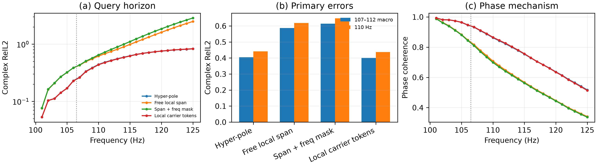

# 局部复谱 Token POC：结果与归因

> 历史证据 / 技术参考（2026-10-05 归档标记）：保留原实验、数值和复现路径。
> 文内“当前/下一步/待完成”描述属于当时阶段，不是现行任务；请先读[三条 Wave as Prompt 路线](../docs/wave_as_prompt/README.md)。

日期：2026-09-16  
协议：development；strict environments 未读取

## 0. 结论

本轮 POC 完整回答了“局部 token 应该承担什么”的问题：

> 局部低频 span 在表示上足够，但其自由复系数不能从当前低频条件中稳定外推；局部 token
> 放在受物理约束的 carrier generator 上有稳定但很小的正收益。

主要结果：

- 自由 local-span query 在 110 Hz 为 `0.6186`，明显差于 hyper-pole 的 `0.4409`；
- frequency-mask 辅助训练进一步恶化到 `0.6479`，没有迁移到频带外查询；
- 在原 hyper-pole 上增加 39,236 个局部 slope/curvature token 参数，冻结原 backbone 后，
  110 Hz 从 `0.4409` 降至 `0.4367`；
- paired improvement 为 **0.97%**，32 个环境中 29 个改善，95% bootstrap CI 为
  `[0.00265, 0.00614]` raw RelL2；
- phase coherence 从 `0.8630` 升至 `0.8654`，amplitude error 完全不变，说明微小收益确实来自相位；
- 该结果没有通过预设的 `0.40` 主 gate，也没有达到 5% representation gain gate。

因此本轮结论是 **mechanism-level weak positive，method-level NO-GO**。不继续扩大 token 网络、
不解冻全模型、不启动 Transformer 或 conditional generation。

## 1. 预先冻结的问题与停止规则

技术方案在实验前写入
[`LOCAL_SPECTRAL_TOKEN_POC_ZH.md`](../docs/LOCAL_SPECTRAL_TOKEN_POC_ZH.md)。层级为：

- 研究对象：局部复谱表示；
- 主任务：90–100 Hz 到未见查询频率；
- 辅助任务：可见频率或 frequency–patch mask 重建。

主协议：

- 128 个 development training environments；
- 32 个 development validation environments；
- 101–106 Hz 用于训练和 checkpoint 选择；
- 107–112 Hz 为主要 extrapolation 区间；
- 113–125 Hz 只作为 horizon stress test；
- 主频率为 110 Hz；
- 主指标为逐环境等权 raw complex relative L2。

预设 gate：110 Hz 小于 0.40，并且 107–112 Hz macro 优于 hyper-pole；masked variant 相对同网格
无 mask 版本至少改善 5%。若局部自由系数失败，只允许一次零初始化、冻结 backbone 的局部
carrier-token fallback。

## 2. 方法一：自由 Local Span Query Operator

把场切成 4×8 或 8×16 patch。encoder 只接收相位不变的局部统计：

- 各频率幅值；
- 相邻频率归一化复相关；
- 相对 endpoint 的复相关；
- patch 坐标、环境通道和 observation mask。

每个 patch 输出 11 个可见复场的复系数，然后平滑上采样：

$$
\widehat u(x,f_q)=\sum_{j=1}^{11}a_j(x,f_q)u(x,f_j).
$$

该 decoder 与 patch-span oracle 一致。为了避免直接 query MLP 在训练区间外任意延拓，最终版本
让 encoder 输出与查询无关的 slope 和 curvature：

$$
a_j(f_q)=e_j+\delta s_j+\frac{1}{2}\delta^2c_j,
\qquad
\delta=(f_q-100)/10.
$$

$s_j$ 与 $c_j$ 均有界；模型保持全局复相位等变。

### 2.1 为什么使用 endpoint-gauged 坐标

最初 raw 版本在 101–106 Hz 可以继续降低训练误差，但到 110 Hz 发生灾难性外推。加入由
99–100 Hz 相位增量构造的显式 carrier 后，外推不再数值崩溃。模型实际组合的是局部 gauged
residual，输出时再乘回查询 carrier。

这个结果与先前诊断一致：raw patch span 的 oracle 更低，但它的系数随频率快速旋转；gauged
span 的表示下界略高，却更可能形成可学习的系数轨迹。

## 3. 方法二：局部 Carrier Tokens

自由系数未通过 gate 后，按预注册 fallback 从 seed-42 hyper-pole checkpoint 精确初始化：

- 保留原有四 pole、全局 latent 和 global hyper-carrier；
- 新增 8×16 局部 token branch；
- 每个 token 只输出 endpoint carrier 的 slope 与 curvature 修正；
- 新 head 零初始化，epoch 0 与原 checkpoint 完全相同；
- 冻结原模型的 1,470,240 个参数，只训练新增 39,236 个参数。

于是该对照不依赖更大的通用 backbone，也不能通过改变 amplitude 或 pole residue 偷取收益。

## 4. 定量结果

### 4.1 主表

| 方法 | 总参数 | 本轮可训练参数 | 101–106 macro | 107–112 macro | 110 Hz RelL2 | 110 Hz coherence |
|---|---:|---:|---:|---:|---:|---:|
| Hyper-pole checkpoint | 1,470,240 | — | 0.1349 | 0.4042 | 0.4409 | 0.8630 |
| Free local span, 8×16 | 303,984 | 303,984 | 0.2366 | 0.5866 | 0.6186 | 0.7078 |
| Free span + frequency mask | 303,984 | 303,984 | 0.2375 | 0.6142 | 0.6479 | 0.6991 |
| Hyper-pole + local carrier tokens | 1,509,476 | **39,236** | **0.1344** | **0.4004** | **0.4367** | **0.8654** |

### 4.2 Mask 任务没有迁移

frequency mask 把 110 Hz 从 `0.6186` 恶化到 `0.6479`，相对退化 4.7%；107–112 macro 从
`0.5866` 恶化到 `0.6142`。因此没有继续 joint spatial/frequency mask。

这不是说 masked reconstruction 本身无效。先前解析实验已经表明 gauged 坐标上的带内 mask
可以做到 0.089。这里的结论更严格：**带内重建能力没有自动转化为带外系数可辨识性。**

### 4.3 局部 carrier token 是统计显著但作用很小的正结果

与同一个 frozen hyper-pole checkpoint 逐环境比较：

| 统计量 | 结果 |
|---|---:|
| 平均绝对 RelL2 改善 | 0.00427 |
| 相对改善 | 0.97% |
| 改善环境比例 | 29/32 |
| 95% bootstrap CI | [0.00265, 0.00614] |

amplitude RelL2 在两种模型中同为 `0.26275`，而 phase coherence 提升 0.00237。这验证了实现和
归因：新增 token 只修正相位生成器，观测到的增益也只来自相位。

## 5. 为什么 oracle 很好，学习模型却不工作

110 Hz 的 raw 8×16 patch-span oracle 可到 0.052，gauged oracle 可到 0.237；但这些 oracle
使用了 110 Hz 真值来拟合每个 patch 的系数。它们证明的是：

> 目标场位于一个很大的局部低频张成空间附近。

它们没有证明：

> 只看 90–100 Hz，就能确定该空间中 110 Hz 对应的坐标。

自由 local-span 每个场包含 $11\times8\times16=1408$ 个复系数。虽然表示误差低，但低频条件
没有唯一指定这些系数；101–106 Hz 监督可以拟合训练查询，却不能决定更远处的坐标轨迹。更多
patch 主要扩大了可表示空间，没有补充缺失的信息。

受约束 carrier token 只预测局部 slope/curvature，维度小、频率演化形式固定，因此能产生一致
的小幅改善；但原 hyper-pole 已经包含 per-pixel poles、residues 和全局 hyper-carrier，可学习的
剩余局部相位信号很少。

## 6. 对后续路线的影响

本 POC 排除了三条近期路线：

1. 不把 patch-span oracle 直接包装成可学习方法贡献；
2. 不把 masked reconstruction 当作频率查询成功的代理指标；
3. 不通过更细 patch、更宽 token 网络或 Transformer 搜索正结果。

仍然成立的结论是：

- global image latent 不是最自然的表示；
- local propagation state 比 local free coefficients 更可辨识；
- representation 必须同时满足低重构误差和可预测动力学，只有前者不够；
- 若未来重新研究 token，应改变信息来源或训练分布，例如更宽的预训练频带、跨数据族预训练、
  显式多路径标签或真正重复条件下的生成分布，而不是继续在同一 90–106 Hz 协议上加容量。

## 7. 复现与产物

机器可读汇总：

- `artifacts/token_poc/token_poc_summary.json`；
- `artifacts/token_poc/token_poc_records.csv`；
- `artifacts/token_poc/token_poc.png` 与 PDF。

训练入口仍为 `spectral_continuation.train_representation_poc`，新增模型名为 `local_span`；
汇总入口为 `spectral_continuation.summarize_token_poc`。完整命令记录在
[`REPRODUCIBILITY_ZH.md`](../docs/REPRODUCIBILITY_ZH.md)。
