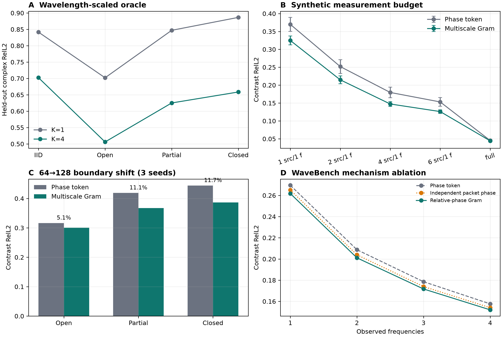

# 多分支相空间波表征 MPS-0/1 报告

> 日期：2026-09-23
>
> 状态：oracle 机制成立；fixed multiscale Gram 方法未通过预注册 15% promotion gate
>
> 一句话结论：**复杂波场的局部表示确实需要多个相干传播分量，但“固定滤波器组 + 手工 Gram
> 通道”只关闭了部分 oracle gap，还不足以成为下一篇论文的主方法。**

## 1. 为什么做这一轮

当前最强的五通道表示由归一化幅值，以及水平、竖直两个方向的局部复相位增量组成。它比 raw complex
image 更容易跨 source、frequency 和 system 复用，但隐含了一个强假设：每个局部邻域可以用一个主导
传播关系概括。

复杂波场通常不是这样。在同一点附近，直达波、反射、绕射和局部驻波可以同时存在：

$$
u(x) \approx \sum_{m=1}^{K} a_m(x)\exp\left(i\phi_m(x)\right).
$$

单个相位增量读取的是混合场：

$$
u(x+\delta)\overline{u(x)}
=\sum_{m,n}a_m(x+\delta)\overline{a_n(x)}
\exp\left(i[\phi_m(x+\delta)-\phi_n(x)]\right).
$$

它同时包含分支内部项和分支之间的交叉项。因此，一个局部平均波矢可能既不对应直达波，也不对应任一
反射波。MPS 的核心问题不是“多加几个 phase channels 是否有用”，而是：

> 当前失败是否来自局部多分支信息被压缩；如果是，怎样在去掉无意义的全局相位后，仍保留分支之间
> 有物理意义的相对相位？

## 2. Gate-driven 研究设计

本轮没有直接训练大 Transformer，而是把命题分成三层。

### 2.1 MPS-0：受控可辨识性

在 1--3 个随机复平面波的混合上，用局部 plane-wave dictionary 和 spatial holdout 比较 K=1、K=2、K=4
稀疏重建。拟合只看 70% 空间位置，指标在另外 30% 像素计算，避免把训练残差误当作可辨识性。

### 2.2 MPS-0b：真实场 oracle 与尺度审计

在 synthetic acoustic 的 IID、open、partial 和 closed boundary 场上重复相同 oracle。预注册 gate 是：在
partial 或 closed 条件中，K=4 相对 K=1 的逐物理系统改善至少 15%，且 system bootstrap 95% 区间下界
大于零。

### 2.3 MPS-1：matched downstream readout

只有 oracle 通过才实现固定 complex wave-packet 表示。候选模型与五通道 phase-token baseline 使用：

- 同一个 set operator 和 decoder；
- 同一个已有 checkpoint；
- 相同的额外 800 个训练 steps 和 learning rate；
- 原有五个输入通道的权重完全复制；
- 新增通道对应的第一层权重初始化为零。

因此比较的是新增表示能否在同一个优化起点上提供信息，而不是 candidate 多训练了 800 steps。

## 3. 第一个重要发现：局部窗口必须按波长定标

第一次真实场审计使用 33 像素窗口。K=4 相对 K=1 只改善 4.7%--8.3%，oracle gate 失败。若在这里直接
停止，会得到错误的“真实场没有多分支结构”结论。

尺度敏感性诊断显示，同样的 K=4 oracle 在 128-grid boundary 数据上的改善为：

| patch size | Open | Partial | Closed |
|---:|---:|---:|---:|
| 9 px | 41.0% | 37.8% | 32.9% |
| 17 px | 16.0% | 17.8% | 18.0% |
| 25 px | 8.0% | 9.6% | 9.4% |
| 33 px | 4.7% | 6.3% | 6.5% |

这不是通过挑窗口制造好数字。固定大窗口跨越了太多局部波长，介质、传播方向和散射结构已在窗口内
发生变化，此时“几个平面波”模型本身失效。最终冻结规则只读取公开 frequency、grid spacing 与一个
reference speed，把窗口设为约 1.5 个波长，并限制在 7--17 像素；不读取 query truth 或 boundary label。

三 patch seeds 下的 wavelength-scaled oracle 为：

| 条件 | K=1 RelL2 | K=4 RelL2 | 逐系统改善 | 95% 区间 |
|---|---:|---:|---:|---:|
| IID | 0.841 | 0.702 | 17.6% | 13.6%--21.9% |
| Open | 0.702 | 0.506 | 28.1% | 26.4%--29.4% |
| Partial | 0.847 | 0.625 | 26.3% | 24.0%--28.6% |
| Closed | 0.886 | 0.659 | 25.7% | 24.1%--27.5% |

oracle gate 因而通过。它证明的是：**一个波长量级的邻域内，多个相干分量比单一局部波矢具有显著的
表示余量。** Open 的增益同样很大，所以它不能被解释为已经恢复了带名字的“反射路径”。

受控混合提供了更直接的 sanity check：两分支场的 K=1/K=2 误差从 0.664 降到 0.313；三分支场的
K=1/K=2/K=4 误差为 0.772/0.550/0.326。所选 dictionary index 在全局相位旋转后保持 100% 不变，平均
波矢误差约 0.010。

## 4. MPS-1 表示：一个全局 gauge，而不是逐分支抹掉相位

### 4.1 波长感知的复 wave-packet bank

对于频率为 $f$ 的复场，先在 Fourier 空间放置具有多个方向与半径的 Gaussian windows：

$$
z_m(x)=\mathcal{F}^{-1}\left\{\widehat{u}(\xi)g_m(\xi;f)\right\}(x).
$$

当前候选使用 8 个方向和两个径向尺度 0.75、1.5。filter center 随 $f\Delta x/c_{ref}$ 缩放，所以处理的
是近似固定波长关系，而不是固定像素纹理。

### 4.2 为什么 branch-wise phase advance 不够

第一版对每个 $z_m$ 单独计算 phase advance。这样会把每个分支都独立地 quotient 掉一个相位。可是复波场
真正任意的是所有分支共同的一个 global phase：

$$
z_m(x)\longrightarrow \exp(i\alpha)z_m(x).
$$

分支 $m$ 与 $n$ 之间的相对相位决定 constructive/destructive interference，不应被一起删除。因此第二版
使用局部复 Gram edge：

$$
G_{mn}(x)=
\frac{z_n(x)\overline{z_m(x)}}
{\sqrt{|z_m(x)|^2|z_n(x)|^2}+\epsilon(x)}.
$$

在共同 global phase 旋转下，$G_{mn}$ 不变；但它保留两个 packet 的相对相位。节点特征还包括归一化
packet energy：

$$
p_m(x)=\frac{|z_m(x)|^2}{\sum_j |z_j(x)|^2}.
$$

最终输入由原来的五通道 token、16 个 packet energy，以及同尺度和跨尺度相邻 packet 的复 Gram edges
组成，共 69 个实通道。它仍然是固定前端 POC，不是 learned routing，也没有声称 packet 等同于真实物理
路径。

## 5. 下游结果

### 5.1 从头训练的简单前端大多失败

在 WaveBench 2,000-system pilot 上，800 steps 从头训练得到：

| 表示 | 1 frequency | 4 frequencies | 判断 |
|---|---:|---:|---|
| 5-channel phase token | 0.396 | 0.283 | 对照 |
| windowed coherence only | 0.619 | 0.365 | 明显退化 |
| phase + coherence | 0.470 | 0.293 | 退化 |
| phase + branch-wise packets | 0.559 | 0.314 | 退化 |

固定局部平均会损失精细相位；把大量新通道从随机初始化塞给网络也引入明显的优化混淆。这支持 residual
initialization 的必要性，但不代表 coherence 在所有模型中无用。

### 5.2 WaveBench：相对相位 Gram 给出小而一致的机制信号

从完整训练的五通道 checkpoint 出发，matched 追加 800 steps：

| 表示 | 1 frequency | 2 frequencies | 3 frequencies | 4 frequencies |
|---|---:|---:|---:|---:|
| Phase token control | 0.2695 | 0.2087 | 0.1786 | 0.1577 |
| Independent packet phase | 0.2651 | 0.2039 | 0.1740 | 0.1541 |
| Relative-phase Gram | **0.2618** | **0.2011** | **0.1717** | **0.1520** |

Gram 版本完整四频逐系统改善为 3.54%，95% bootstrap 区间 3.39%--3.68%，98.4% 测试系统改善。这是单
seed development result，不能当作正式跨 seed 结论。它的价值在机制上：保留分支相对相位，比把每个
packet 的相位独立消掉更好。

### 5.3 Synthetic：优势集中在 frequency-poor regime

三 seed、matched extra training 的结果为：

| 观测预算 | Phase token | Multiscale Gram | 相对改善 |
|---|---:|---:|---:|
| 1 source × 1 frequency | 0.370 ± 0.019 | **0.325 ± 0.012** | 12.1% |
| 2 sources × 1 frequency | 0.252 ± 0.019 | **0.215 ± 0.011** | 14.5% |
| 4 sources × 1 frequency | 0.180 ± 0.015 | **0.147 ± 0.007** | 17.7% |
| 6 sources × 1 frequency | 0.153 ± 0.012 | **0.126 ± 0.005** | 17.3% |
| full 6 sources × 4 frequencies | 0.0453 ± 0.0038 | **0.0444 ± 0.0031** | 1.9% |

这说明新增分支坐标主要提高观测效率；当完整上下文已经把介质辨识问题做得很准时，它几乎不改变上限。

### 5.4 64→128 + boundary shift：全部系统同向，但强度未过 gate

对每个物理系统先平均三个 seed，再做配对统计：

| Boundary | Phase token | Multiscale Gram | 逐系统改善 | 95% 区间 | 改善系统比例 |
|---|---:|---:|---:|---:|---:|
| Open | 0.316 | **0.300** | 5.1% | 4.3%--5.7% | 100% |
| Partial | 0.419 | **0.367** | 11.1% | 8.9%--13.2% | 100% |
| Closed | 0.444 | **0.386** | 11.7% | 9.5%--13.9% | 100% |

反射更强的 partial/closed 获益约为 open 的两倍，符合原机制假设；但两项都低于预注册 15%。若用
ratio-of-means，会得到 12.3% 和 13.0%，仍未过 gate。某一个 seed 曾达到 15%--16%，但三 seed 聚合后
不能保留这个说法。

IID full-context 平均变化为改善 1.94%，通过“不退化超过 2%”安全边界。

## 6. 这轮真正新增了什么认识

### 6.1 可以较强地相信

1. **单个局部 phase advance 不是复杂波场的充分局部统计量。** 受控混合和真实场 oracle 都给出直接
   证据。
2. **局部性的自然单位是波长，而不是像素。** 33-pixel 的失败和 9--17-pixel 的成功并非小超参数差异，
   而是局部平面波假设的适用尺度不同。
3. **复分支表示应 quotient 一个共同 global phase，同时保留分支间相对相位。** Gram 明确优于逐分支
   phase quotient，是本轮最有价值的表征设计原则。
4. **多分支信息主要帮助 information-poor 与 multipath regime。** 完整上下文接近饱和时增益很小；
   单频和反射边界增益更大。

### 6.2 还不能声称

- 不能说 fixed packet 已经恢复直达/反射/绕射的语义路径；
- 不能说方法达到论文级显著架构贡献；
- 不能用 oracle 的 26% 替代 learned downstream 的 11%--12%；
- 不能将 WaveBench 单 seed 3.5% 写成正式独立验证；
- 不能说更多方向、更密 filter bank 会自然关闭剩余 gap。

## 7. 为什么 oracle 与 learned method 有明显差距

oracle 对每个 patch 使用目标复场本身选择 top-K atoms 并拟合系数；它回答“信息是否存在”。固定 Gram
前端则必须用同一个预设 filter bank 服务所有位置、介质与频率，且后端要自己学习哪些分量可信。剩余
gap 至少混合了四件事：

1. Fourier Gaussian packet 与真实曲面波前不完全匹配；
2. 固定中心频率和 bandwidth 无法适应局部 wavespeed 与 dispersion；
3. 69-channel raster 把 branch identity 隐含在通道顺序中，没有显式 sparse routing；
4. system-readout loss 只间接监督局部分支，没有要求 token 可重建局部复场。

因此，继续枚举第三组半径或更多手工 edge 的科学收益很低。若以后重启，应该检验一个新的、可归因的
能力，例如可学习但受波长约束的 analysis filters、显式 soft branch routing，或者直接以 multipath query
为目标；而不是继续增加固定通道。

## 8. 最终决策

| Gate | 结果 | 决策 |
|---|---|---|
| 受控多分支可辨识 | 通过 | 进入真实场 oracle |
| 波长自适应真实场 oracle ≥15% | 通过，partial/closed 约 26% | 实现 matched POC |
| 下游 partial/closed 三 seed ≥15% | **未通过，11.1%/11.7%** | 不提升为主方法 |
| IID 不退化超过 2% | 通过，反而改善 1.9% | 方法无明显安全性回归 |

这一轮不是失败：它把“复杂波场需要什么特殊表示”从宽泛直觉推进成了两个可复用原则——波长尺度的
局部多分量分析，以及保留分支相对相位的 global-gauge quotient；同时，它也及时否定了固定 69-channel
Gram 前端作为最终方法的充分性。

## 9. 证据与复现入口

- 冻结问题与相关工作：[`docs/MULTIBRANCH_PHASE_SPACE_REPRESENTATION_ZH.md`](../docs/MULTIBRANCH_PHASE_SPACE_REPRESENTATION_ZH.md)
- MPS-0 配置：[`configs/multibranch_phase_space_mps0_20260923.json`](../configs/multibranch_phase_space_mps0_20260923.json)
- MPS-0b 配置：[`configs/multibranch_phase_space_mps0b_20260923.json`](../configs/multibranch_phase_space_mps0b_20260923.json)
- MPS-1 配置：[`configs/multibranch_phase_space_mps1_20260923.json`](../configs/multibranch_phase_space_mps1_20260923.json)
- 机器可读汇总：[`summary.json`](../artifacts/multibranch_phase_space_mps1/summary/summary.json)
- 数据与 source-checkpoint hash：[`manifest.json`](../artifacts/multibranch_phase_space_mps1/summary/manifest.json)
- 三 seed boundary 表：[`boundary_summary.csv`](../artifacts/multibranch_phase_space_mps1/summary/boundary_summary.csv)
- 汇总代码：[`summarize_multibranch_phase_space.py`](../src/spectral_continuation/summarize_multibranch_phase_space.py)

完整命令见 [`docs/REPRODUCIBILITY_ZH.md`](../docs/REPRODUCIBILITY_ZH.md)。逐系统 CSV、checkpoint 和
prediction arrays 按仓库规则只保留在本地，不进入 Git。
