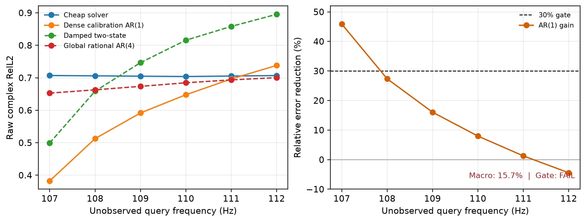

# 独立多保真 Spectral Calibration：P0 Gate 报告

> 历史证据 / 技术参考（2026-10-05 归档标记）：保留原实验、数值和复现路径。
> 文内“当前/下一步/待完成”描述属于当时阶段，不是现行任务；请先读[三条 Wave as Prompt 路线](../docs/wave_as_prompt/README.md)。
> 解释更正：本报告的 dense AR/oracle 只约束所试校准族；不是任意方法的信息论上限。

日期：2026-09-16

结论：**P0 task gate 未通过，因此本阶段不训练新的 calibrator。** 这不是“方法训练失败”，而是更早的
信息可辨识性检查失败：即使提供完整的 101--106 Hz 高保真场，最佳闭式 oracle 在 107--112 Hz 上也只
比独立 cheap solver 降低 15.69% raw complex RelL2，低于预注册的 30%，而且收益随频率距离快速消失。

## 1. 本阶段真正补齐了什么

此前 POC 的“低保真输入”来自目标高保真 archive，不能作为真实 multi-fidelity evidence。本阶段补齐了
三个基础设施：

1. 使用 UnderwaterAcoustics.jl 的 Pekeris 模态求解器独立生成 low/high fidelity；
2. 引入 fail-closed archive 协议，绑定 environment、source、split、频率和空间坐标，并拒绝任何从
   high target 下采样、滤波或插值得到的伪低保真；
3. 冻结 calibration/query 访问边界，预测器只读取 101--106 Hz 高保真 calibration 和 107--112 Hz
   cheap query，107--112 Hz 高保真场只在预测完成后用于评价。

对应代码为：

- `paired_fidelity_protocol.py`：正式 archive、identity/provenance guard、A/B/C/strict episodes；
- `ocean_multifidelity_solver.py`：独立 Pekeris low/high solve；
- `generate_ocean_multifidelity_pilot.py`：正式双 archive pilot；
- `paired_fidelity_oracle_audit.py`：无训练 oracle、指标、成本和 gate；
- `plot_paired_fidelity_oracle.py`：冻结结果图。

## 2. Fidelity 选择是否真实

高保真使用全部传播模态，低保真固定截断为 8 个模态。LF 不是 HF 数组的变换，而是在 HF 求解开始前
完成的独立传播求解。

首先用现有 dense archive 中的一个 110 Hz 场复现 HF：

- float32 bitwise equal：true；
- 最大绝对差：0；
- fresh-vs-archive complex RelL2：$2.55\times10^{-8}$；
- phase coherence：约 1。

因此 paired gap 不是由换 solver 或错误配置制造的。

在 4 个 90--260 m 环境的预审计中，8-mode LF 的中位指标为：

| 指标 | 数值 |
|---|---:|
| wall-clock speedup | 1.784 倍 |
| allocation reduction | 1.537 倍 |
| LF-to-HF complex RelL2 | 0.665 |
| phase coherence | 0.738 |

这是**条件性 GO**。在 90--100 m 浅水环境中，全模型本来只有 7--8 个传播模态，8-mode LF 与 HF
完全相同，既无误差也无成本优势。它只在实际模态数显著大于 8 时构成有意义的 fidelity hierarchy。

正式 tiny pilot 包含 3 个环境、101--112 Hz、$32\times128$ 网格。两个 validation 环境上，逐频配对
求解的中位 speedup 为 2.125 倍，allocation reduction 为 1.767 倍；cheap solver 自身的中位 complex
RelL2 为 0.693，phase coherence 为 0.693。

## 3. Oracle 设置

输入：

- 独立 LF 在 101--112 Hz 的完整场；
- HF 在 101--106 Hz 的完整 calibration 场。

输出：

- HF 在 107--112 Hz 的完整场；
- query band 没有任何 HF sensor access。

这比后续计划的稀疏 $K=92$ calibration 更宽松：oracle 看到了 calibration band 的全部 $32\times128$
位置。因此 dense oracle 若仍无法持续外推，稀疏神经 calibrator 没有可信理由被期待稳定通过 gate。

测试了四类零训练 discrepancy dynamics：

- 每个空间位置独立的 stable complex AR(1)；
- residual 加 damped velocity 的二状态系统；
- 每个环境共享空间系数的二阶 rational AR；
- 每个环境共享空间系数的四阶 rational AR。

## 4. 主要结果

| 方法 | 107--112 Hz complex RelL2 | 相对 cheap solver |
|---|---:|---:|
| cheap solver query | 0.7057 | 0.00% |
| dense calibration AR(1) | **0.5950** | **+15.69%** |
| global rational AR(2) | 0.6872 | +2.62% |
| global rational AR(4) | 0.6780 | +3.92% |
| damped two-state | 0.7457 | -5.67% |

最佳 AR(1) 的逐频收益为：

| Query | 107 Hz | 108 Hz | 109 Hz | 110 Hz | 111 Hz | 112 Hz |
|---|---:|---:|---:|---:|---:|---:|
| error reduction | 45.88% | 27.36% | 16.06% | 7.97% | 1.28% | -4.43% |

同时，AR(1) 将 macro amplitude RelL2 从 0.5103 降至 0.3824，将 phase coherence 从 0.6761 提高到
0.7088；因此 107 Hz 的正信号并非只来自幅值归一化。但到 112 Hz，AR(1) 的 complex RelL2 已从
cheap solver 的 0.7069 恶化到 0.7383。

预注册 gate 要求：107--112 Hz macro 至少改善 30%，且 107--110 Hz 每个频率都至少改善 30%。实际
只有 107 Hz 满足。因此 verdict 为 **FAIL**。

## 5. 第一性原理归因

8-mode LF 缺失的是一组随频率出现、消失和重新干涉的高阶传播模态。101--106 Hz 的 dense calibration
能够修正边界附近 107 Hz 的局部 phase state，但它并没有唯一确定这些遗漏模态在更远频率的演化。
这解释了三个现象：

1. 一步预测明显有效，但误差随 horizon 单调回到 cheap solver；
2. 更高阶的共享 rational dynamics 没有帮助，说明 gap 不是一个全场共享的低阶极点系统；
3. 二状态局部模型更差，说明用更多不受约束的状态并不能弥补短 calibration band 的不可辨识性。

换言之，当前 fidelity gap 同时具有“足够大、值得校准”和“高阶缺失模态太多、难以远距辨识”两面。
固定 8-mode 截断并不是理想的论文级 LF：浅水时退化为 HF，深水时又可能删除太多独立谱分量。

## 6. 决策与下一步边界

按预注册规则，本阶段停止，不启动 M0/M1 神经 calibrator，也不通过改主指标或缩短 macro 区间来把
FAIL 包装成 PASS。当前能成立的窄结论是：**真实 solver gap 下，dense calibration 对一个频率步长的
spectral tracking 有强正信号，但不能支撑 6 Hz open-loop continuation。**

若以后重启这一方向，优先改变信息结构，而不是增加网络容量：

1. 将任务改为 sequential/receding-horizon calibration：每隔若干频率补一次真实校准，而不是一次
   support 后 open-loop 六步；
2. 设计连续的 fidelity knob，例如自适应保留能量比例或误差控制的 modal truncation，使成本差和
   可校准性都跨环境稳定；
3. 先做缺失 modal subspace 的可观测性分析，再决定 support bandwidth 和 sensor placement；
4. 只有在新的 dense oracle 跨至少 30 个实例稳定通过后，才重新进入表征学习。

这次失败仍有明确价值：它排除了“把原有 sparse calibration 网络直接迁移到任意真实 LF/HF gap”这条
昂贵但缺乏信息论依据的路线。

## 7. 可复现入口

关键产物：

- `artifacts/ocean_multifidelity_solver_audit/summary.json`：solver fidelity/cost 审计；
- `artifacts/ocean_multifidelity_formal_pilot/manifest.json`：双 archive lineage；
- `artifacts/ocean_paired_fidelity_oracle_20260916/summary.json`：正式 oracle gate；
- `artifacts/ocean_paired_fidelity_oracle_20260916/query_curve.csv`：逐频指标；
- `figures/ocean_paired_fidelity_oracle_gate_20260916.png`：正文级 gate 图。

正式 archive 的 SHA-256：

- low：`d40fe727f5ff13ca079f321bacc1b8f048daad932969e67dc983354ecf71f89e`；
- high：`7f94aecbaac3a3cf1f62f395a72dd59d229a49a0b3a525656a1187a4459ce5d3`；
- paired identity：`834451c6f6486a76448861d4f558c949b08b999e6633d434eaa8692f909f6f91`。

NPZ 体积较大，按仓库规则不提交；manifest、代码、测试、CSV、JSON 和图提交到 Git。执行命令与绝对
数据路径记录在各 artifact 中。
