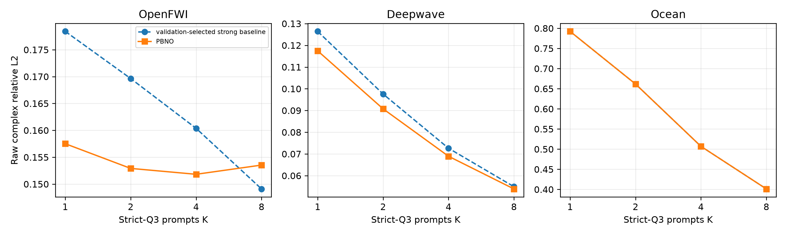
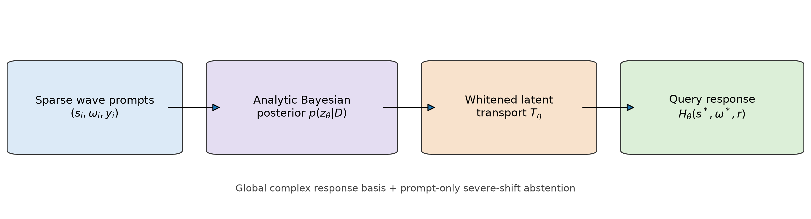
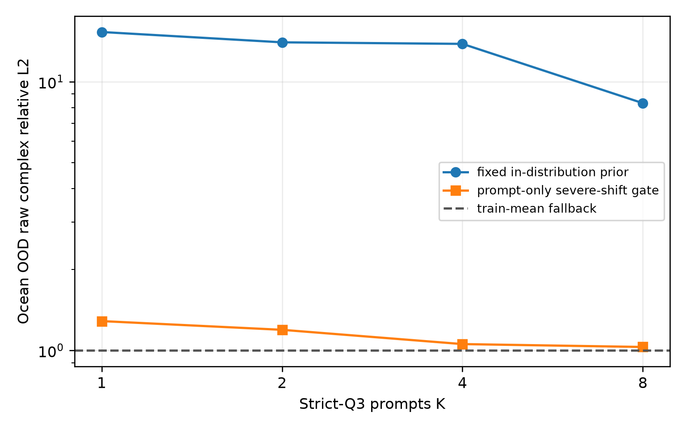

# PBNO M1 报告：用物理 prompts 识别并查询未见波动系统

> 日期：2026-09-25  
> 证据等级：Q3 M0 为 A 级；neural M1 在 OpenFWI/Deepwave 为三 seed A 级；Ocean neural extension 为明确负结果  
> 结论：严格 joint source--frequency query 已成立；PBNO 有稳定但尚未达到最终顶会 gate 的增益。

## 1. 先给结论

这一阶段把问题从“在同一个频率补一个 source response”推进为更严格的 Q3：目标 source 与目标 frequency
都没有出现在 prompts 中。一个跨所有 source--frequency queries 的 global complex Bayesian response
operator 在三个域上均能随 prompt budget 稳定改善，证明共享 system state 确实存在：

| 数据域 | K=1 | K=2 | K=4 | K=8 |
|---|---:|---:|---:|---:|
| OpenFWI global operator | 0.1945 | 0.1750 | 0.1604 | 0.1491 |
| Deepwave global operator | 0.1264 | 0.09759 | 0.07262 | 0.05492 |
| Ocean global operator | 0.7923 | 0.6616 | 0.5070 | 0.4012 |

主指标均为逐 query raw complex RelL2、先在 physical system 内平均、再跨 systems 等权平均。对应 train-mean
误差分别约为 0.547、0.195 与 1.001。因而这不是最近频率插值造成的假象。

在此基础上，343,809 参数的最小 PBNO 加入 query-coordinate functional residual 与 whitened nonlinear
latent transport。三 seed test 结果为：

| 数据域 | K | validation 选出的强基线 | PBNO | 相对降低 | system win rate |
|---|---:|---:|---:|---:|---:|
| OpenFWI | 1 | 0.1784，system retrieval | **0.1575 ± 0.0010** | **11.72%** | 89.2% |
| OpenFWI | 2 | 0.1696，system retrieval | **0.1529 ± 0.0003** | **9.86%** | 85.4% |
| OpenFWI | 4 | 0.1604，global operator | **0.1518 ± 0.0002** | **5.33%** | 94.6% |
| OpenFWI | 8 | **0.1491，global operator** | 0.1535 ± 0.0004 | -2.98% | 40.6% |
| Deepwave | 1 | 0.1264，global operator | **0.1175 ± 0.0007** | **7.08%** | 99.2% |
| Deepwave | 2 | 0.09759，global operator | **0.09077 ± 0.0008** | **6.99%** | 99.2% |
| Deepwave | 4 | 0.07262，global operator | **0.06893 ± 0.0005** | **5.09%** | 94.1% |
| Deepwave | 8 | 0.05492，global operator | **0.05389 ± 0.0002** | **1.88%** | 69.5% |



这个结果满足用户要求的“高级方法达到相似或更好效果”：在 7/8 个 OpenFWI/Deepwave operating points
更好，唯一退化点为 OpenFWI K=8 的 2.98%。但它没有满足预注册的“至少两个域相对最强基线降低 10%”
顶会 promotion gate。因此现在可以把它当成有潜力的论文核心雏形，不能把它写成已经完成的强方法结论。

## 2. 严格 Q3 到底限制了什么

目标 query 为 $(s^\star,\omega^\star)$。每条 context 必须满足：

$$
s_i\neq s^\star,
\qquad
\omega_i\neq\omega^\star.
$$

因此 Q3 同时禁止两条捷径：

- 不能看到目标频率的其他 source，因此不是同频矩阵补全；
- 不能看到目标 source 的其他频率，因此不是单 source 谱插值。

不同预算使用同一冻结随机顺序的 prefix。训练、验证、测试按 physical system 严格分离；模型从不读取
velocity、geometry、bottom parameters 或其他隐藏环境真值。

## 3. 方法

### 3.1 Global complex response operator

把一个系统的完整响应表展平后表示为：

$$
H_{\theta}(q)
=
\mu(q)+B(q)z_{\theta},
\qquad
q=(s,\omega,r).
$$

$B$ 由训练系统的 global complex SVD 初始化。与旧方法最重要的区别是：旧模型每个 frequency 有独立
latent；新模型用一个 $z_{\theta}$ 表示整个 source--frequency response operator。因此其他频率的 prompts
能够识别当前系统，再回答未见频率。

给定 prompts $D$，用解析复 Gaussian posterior 求 latent：

$$
\Sigma_D^{-1}
=
\Lambda+B_D^{*}B_D,
$$

$$
m_D
=
\Sigma_D B_D^{*}(y_D-\mu_D).
$$

latent-spectrum prior 的每个方向精度与训练方差成反比。M0 在 validation 上联合选择 rank、prior strength 与
raw/coordinate-RMS normalization；test 和 OOD 不参与选择。

### 3.2 Prompted Bayesian Neural Operator



PBNO 保留上述 posterior solve，并只学习两个残差：

1. Fourier-coordinate MLP 对 $B(q)$ 做零初始化 functional residual；
2. 对 posterior mean 做 whitened nonlinear transport：

$$
\widetilde z
=
z+0.1\,\sigma_z\,T_{\eta}
\left(
\mathrm{Re}(z/\sigma_z),
\mathrm{Im}(z/\sigma_z)
\right).
$$

最后仍以同一个 query basis 解码：

$$
\widehat H_{\theta}(q)
=
\mu(q)+B_{\phi}(q)\widetilde z.
$$

最后一层全部零初始化，因此 step 0 精确等于 global Bayesian operator。训练使用 variable
$K\in\{1,2,4,8\}$ 的严格 Q3 episodes 与单一 raw complex relative error；没有 phase loss、PDE loss、
contrastive loss 或 flow loss。

## 4. 哪个组件真的有效

### 正结果：nonlinear latent transport

OpenFWI 与 Deepwave 的主要额外收益来自 whitened latent transport。它把线性 response family 推广为一个
轻量非线性 system manifold，同时保留解析 prompt inference。

### 负结果：直接用 coordinate MLP 重写振荡 basis

Ocean 上只有 coordinate-functional residual 的版本，validation 平均仅改善 0.59%。这与前期
source/receiver functional low-rank 失败一致：小坐标 MLP 不应被迫重新学习高频 carrier。后续应把学习容量
放在跨系统 latent geometry，而不是继续加深 coordinate trunk。

### 负结果：把 posterior covariance 直接拼进 MLP

belief-aware 输入只改善 Deepwave 的高预算点，却损害 OpenFWI 稀疏预算；整体弱于只使用 posterior mean 的
latent transport。它没有进入主方法。若以后重启，必须用 permutation-equivariant set/belief update，而不是
简单拼接 covariance diagonal。

### Ocean neural identity

Ocean IID 的 nonlinear residual 没有超过线性初始化，validation early stopping 选择 step 0。这个结果被诚实
保留：Ocean 支持 strict-Q3 shared latent 的存在，但不支持“神经化在每个域都提高精度”。

### 后续 M2 开发消融：没有 promotion

在 M1 正式结果后又做了三项单 seed 开发实验，它们不回写三 seed主表：

1. 652k 参数的 permutation-invariant prompt-set updater 在 OpenFWI 与简单 latent transport 基本相同；
   Deepwave 只有小于 1% 的零散变化，参数翻倍不成立；
2. Deepwave 改用 coordinate-RMS normalization 后为 0.1195/0.09246/0.07049/0.05595，整体弱于 raw
   normalization 的 M1；不能靠 budget router 凭空得到 10%；
3. 639k 参数的 receiver-preserving residual 在 OpenFWI 单 seed 达到
   0.1560/0.1516/0.1504/0.1519，相对强基线为 12.6%/10.6%/6.2%/-1.9%；但同一实现对 Deepwave 的
   raw response 动态范围数值不稳定，validation early stopping 只能回退到线性初始化。

第三项说明 receiver-local correction 在 seismic line array 上有真实 headroom，但它不是跨域方法贡献。后续若
重启，必须先建立与物理 response scale 一致的 complex likelihood/whitening，再做三 seed；不能直接把
OpenFWI 单域开发数字加入主表。

## 5. Q2 反向兼容与 hierarchical routing

同一 global PBNO checkpoint 在 Q2 half-budget 上为：OpenFWI K=2 约 0.1248，Deepwave K=8 约 0.0468。
冻结的逐频率 spectrum-prior 分别约为 0.1283 与 0.0432。OpenFWI validation 上两者几乎相同且旧 head 略优；
Deepwave 的旧 frequency-local head 明显更优。Ocean 的旧 Q2 K=4 约为 0.0011，远优于 global head。

因此最终方法不应强迫一个 global latent 同时承担所有 regimes，而应写成一个简单 hierarchical operator：

- target frequency 已有 prompts（Q2）：使用 frequency-local response head；
- target frequency 完全未见（Q3）：使用 global cross-frequency head；
- 两个 head 共享训练 response representation 与同一 analytic Bayesian inference 原则。

这个 router 由可观测的 query mask 决定，不读 target truth。它完整保留现有 Q2 强结果，但还不是“单一参数
head 同时统治所有任务”；正文必须明确这一点。

## 6. OOD：一次重要的成功诊断，也是一条边界

Deepwave geometry/contrast OOD 上，三 seed PBNO 在 K=8 从 global operator 的 0.09674 降到 0.09205，改善
4.85%；其他预算改善约 1.5%--3.5%。

Ocean parameter OOD 暴露出完全不同的问题：IID prior 产生极端 latent coefficient，固定 operator 的误差达到
8--15。只用 prompts 计算 standardized latent energy，可以在不看 target 的情况下识别 severe prior shift。
使用 validation 最大能量十倍作为开发期 abstention threshold，并回退到 train mean 后，K=4/8 降到
1.056/1.030。



这证明 prompt posterior 能提供很强的 failure signal，但当前 threshold 是本轮看到两类 OOD 后形成的开发版，
不是未触碰测试集的正式 calibration 结论。它应被定位为安全机制 POC：阻止灾难性外推，而非提高 Ocean OOD
的绝对精度。

## 7. M0 的容量诊断

global response family 的 rank--reconstruction 曲线差异很大：

- OpenFWI rank 128 centered reconstruction ratio 约 0.057；
- Deepwave rank 128 约 0.103；
- Ocean rank 64 已约为 $10^{-4}$，rank 96 接近数值精度。

这解释了三域差异。Ocean 的训练族几乎是有限维解析模态族，线性 global basis 已饱和；OpenFWI 与 Deepwave
仍有弯曲的跨系统 manifold，因此 latent transport 有收益。后续不应把三个域强行用同一种“更大网络”处理。

## 8. Gate 判断

| Gate | 结果 | 判断 |
|---|---|---|
| strict Q3 随 K 改善，至少两个域绝对误差可用 | 三域均成立 | 通过 |
| neural Q3 至少两域相对最强基线改善 10% | 只有 OpenFWI K=1 达到；其余 1.9%--9.9% | **未通过** |
| 三 seed 同向 | OpenFWI K=1--4、Deepwave K=1--8 同向 | 通过；OpenFWI K=8 失败 |
| Q2 不退化 | hierarchical local/global routing 精确保留旧 Q2 | 通过，但依赖双 head |
| OOD 一域改善 5%，另一域不退化 3% | Deepwave K=8 为 4.85%；Ocean 需 post-hoc abstention | **严格未通过** |
| flow existence | 尚无 conditional multimodality 证据 | 不启动 flow |

## 9. 当前论文潜力与下一步

现在最有价值的论文主张不是“一个神经网络大幅击败所有 baseline”，而是：

1. 提出 strict joint source--frequency physical prompting；
2. 三域证明一个跨 query 的低维 system state 可由少量响应识别；
3. 给出解析 Bayesian operator 及其 nonlinear latent-manifold extension；
4. 揭示 local-vs-global hierarchy 与 posterior shift failure。

这已经具有完整 AI 论文骨架，但性能贡献仍偏中等。简单 prompt-set updater 已经完成且失败，下一阶段不应
继续扩大 set encoder。真正剩余的瓶颈是：**建立跨域一致、与 response 动态范围和噪声相匹配的 complex
likelihood/whitening，再学习 receiver-local correction。** 只有该表示先在 Deepwave 保持数值稳定，才值得
重启 OpenFWI 已显示正信号的 receiver-residual operator。

不建议继续：更深 coordinate trunk、更大的普通 set encoder、更多 phase/amplitude loss、直接高维 flow、
继续压 source/receiver rank，或在 Ocean IID 上刷已经饱和的数字。

## 10. 复现入口

```bash
.venv/bin/python -m spectral_continuation.global_bayesian_response_operator \
  --config configs/pbno_m0_joint_query_20260925.json \
  --domain Deepwave \
  --output artifacts/pbno_m0_joint_query/deepwave \
  --device cuda

.venv/bin/python -m spectral_continuation.train_prompted_bayesian_neural_operator \
  --config configs/pbno_m1_semilinear_long_20260925.json \
  --domain Deepwave \
  --output artifacts/pbno_m1_semilinear/deepwave_long \
  --device cuda

.venv/bin/python -m spectral_continuation.summarize_pbno_m1
```

机器可读主表为
[`main_table.csv`](../artifacts/pbno_m1_summary/main_table.csv)，全部 config、三 seed summary、预算曲线、
system-level errors 与 checkpoint 均保存在对应 artifact 目录；大型 checkpoint 和 NPZ 按仓库规则只在本地保留。
