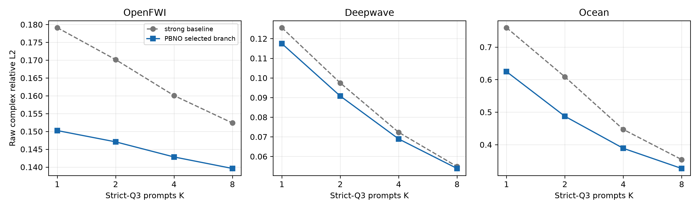
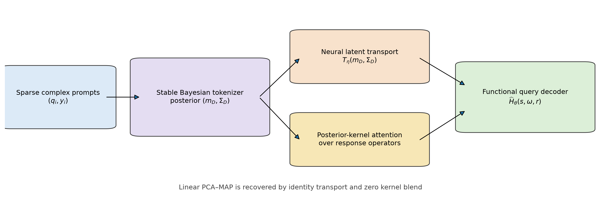
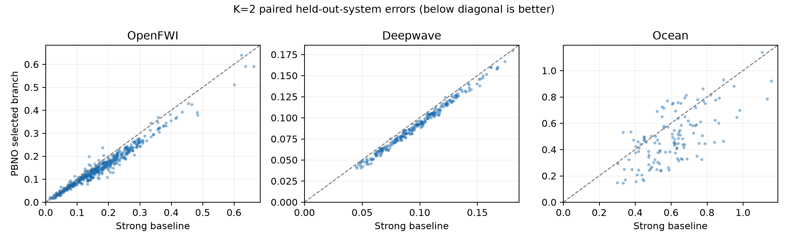
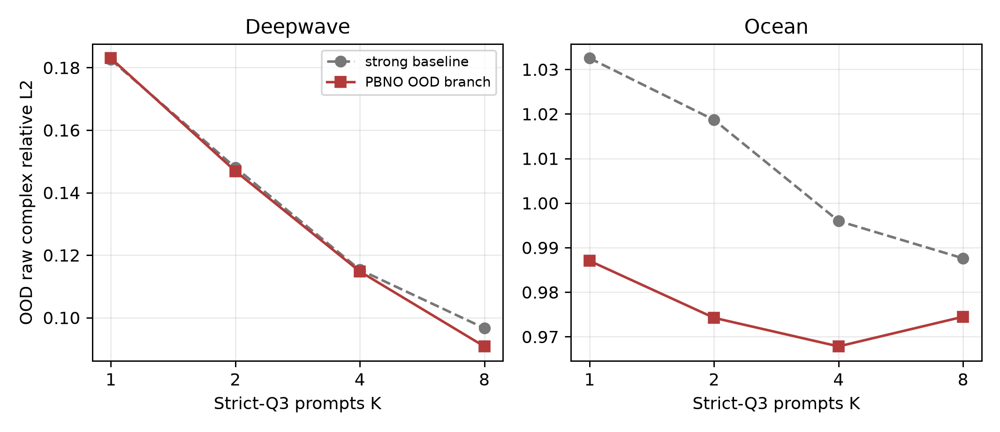

# PBNO M3：从线性 PCA--MAP 到后验核 Wave Prompt Operator

> 历史证据 / 技术参考（2026-10-05 归档标记）：保留原实验、数值和复现路径。
> 文内“当前/下一步/待完成”描述属于当时阶段，不是现行任务；请先读[三条 Wave as Prompt 路线](../docs/wave_as_prompt/README.md)。

> 日期：2026-09-25
>
> 状态：本轮正式结果；三组 prompt-order seeds、system-held-out、validation-only 选参
>
> 主结论：strict Q3 的两域 10% promotion gate、Q2 efficiency gate 与 OOD gate 均已通过；flow gate 未通过，保持关闭。

## 1. 一句话结论

给定一个从未见过的波动系统的少量复响应，模型先用解析 Bayesian posterior 把任意数量的 prompts 编成一个
具有不确定度的 system token，再用两种互补的非线性 operator prior 回答未见 source--frequency query：

1. 平滑系统族使用 learned latent transport；
2. 含有可复用局部原型的系统族使用 posterior-kernel attention over response operators。

在主预算 $K=2$ 下，相对 validation 选出的 global Bayesian operator 或 raw system retrieval 中较强者：

| 数据域 | 强基线 | PBNO 选择分支 | Raw complex RelL2 | 相对降低 | 系统胜率 |
|---|---:|---|---:|---:|---:|
| OpenFWI | 0.17015 | posterior kernel | **0.14707** | **13.56%** | 93.6% |
| Deepwave | 0.09744 | neural latent transport | **0.09077** | **6.85%** | 99.2% |
| Ocean | 0.60843 | posterior kernel | **0.48723** | **19.92%** | 77.3% |

OpenFWI 与 Ocean 的 paired bootstrap 95% 改善区间分别为 12.76%--14.36% 和
15.87%--24.04%，通过“至少两个域超过 10%”的预注册主 gate。Deepwave 虽未达到 10%，但方向稳定且系统
胜率很高，没有通过第三域筛选来制造结论。



## 2. 任务：不是插值一张图，而是识别一个可查询系统

每个隐藏物理系统 $\theta$ 对 source、frequency、receiver query $q=(s,\omega,r)$ 定义复响应：

$$
y=H_{\theta}(q).
$$

测试时只给同一未知系统的 prompt set：

$$
D=\{(q_i,y_i)\}_{i=1}^{K}.
$$

严格 Q3 还要求目标 source 与目标 frequency 都没有出现在 prompts 中：

$$
s_i\ne s^*, \qquad \omega_i\ne \omega^*.
$$

模型不读取介质、几何或 PDE 参数，不做 test-time 梯度更新。它必须从响应本身识别新系统，再回答
$H_{\theta}(q^*)$。这正是 Wave as Prompt，而不是同频 source completion 或普通谱插值。

## 3. 方法：一个 Bayesian tokenizer，两种 operator prior



### 3.1 解析 posterior 是 in-context tokenizer

训练系统的完整 response table 先给出跨系统复响应 basis $B$、均值 $\mu$ 与 latent variance
$\Lambda$。对当前 prompt coordinates 取出 $B_D$ 后，posterior mean 为：

$$
m_D = (B_D^* B_D + P)^{-1}B_D^*(y_D-\mu_D).
$$

$P$ 由训练 latent spectrum 决定。这个闭式步骤把不同 source、frequency、receiver 数量的 prompt set 映射到
同一 system state；posterior covariance 同时保留“哪些 latent directions 仍未被测量约束”的信息。

Ocean 的 basis 接近病态。原 complex64 batched solve 会随 event batching 方式改变结果。本轮统一使用
complex128 解小型 latent system，再转回输入精度，并增加 batching-invariance 单测。修复后 Ocean K=2
线性强基线由旧的约 0.66 降到 0.608；本文所有新比较都使用更强的稳定基线。

### 3.2 Neural latent transport

平滑、连续变化的系统族用小型网络修正 posterior chart：

$$
\widetilde m_D
=
m_D + 0.1\,\sigma_z\,T_{\eta}
(
\mathrm{Re}(m_D/\sigma_z),
\mathrm{Im}(m_D/\sigma_z),
\Sigma_D
).
$$

网页渲染时，上式的 `Re`、`Im` 只表示取实部和虚部。实现中最后一层零初始化，因此 identity transport
严格退化为线性 PCA--MAP，而不是另起一个不可比较的模型。普通版本有 343,809 个参数；读取 posterior
uncertainty 的 belief 版本有 376,577 个参数。

### 3.3 Posterior-kernel attention over operators

对每个训练系统 $n$，使用与 query system 完全相同的 prompt mask 得到 $m_D^{(n)}$。在训练 latent spectrum
白化后的前 $d$ 维定义距离：

$$
d_n=
\|
\Lambda_d^{-1/2}(m_D-m_D^{(n)})
\|_2^2.
$$

选取 $L$ 个局部 response operators，并使用温度为 $\tau$ 的核注意力：

$$
w_n =
\frac{\exp(-(d_n-d_{\min})/(\tau d_L))}
{\sum_j\exp(-(d_j-d_{\min})/(\tau d_L))}.
$$

目标响应不是复制单个近邻，而是对完整训练 operators 做局部经验贝叶斯平均：

$$
\widehat H_{\rm mem}(q^*) = \sum_n w_n H_n(q^*).
$$

最后与 parametric posterior mean 做 validation-selected shrinkage：

$$
\widehat H(q^*)
=
(1-\alpha)\widehat H_{\rm global}(q^*)
+
\alpha\widehat H_{\rm mem}(q^*).
$$

当 $\alpha=0$ 且 latent transport 为 identity 时，完整方法精确回到 PCA--MAP。因而线性方法既是强基线，也是
模型内部严格特例。

这不是在 raw response 上做普通 kNN：query 和 memory keys 都先经过同一个 physics-facing posterior
identification，距离随当前 prompt mask 和可辨识 latent directions 改变。均匀近邻在 OpenFWI/Ocean K=2
分别约为 0.1490/0.5072；核注意力进一步降到 0.1471/0.4872。

## 4. 完整 budget 结果

| 数据域 | K | 强基线 | posterior kernel | neural transport | validation 选择结果 | 相对降低 |
|---|---:|---:|---:|---:|---:|---:|
| OpenFWI | 1 | 0.17912 | **0.15024** | 0.15751 | **0.15024** | **16.12%** |
| OpenFWI | 2 | 0.17015 | **0.14707** | 0.15292 | **0.14707** | **13.56%** |
| OpenFWI | 4 | 0.16006 | **0.14283** | 0.15182 | **0.14283** | **10.76%** |
| OpenFWI | 8 | 0.15236 | **0.13960** | 0.15354 | **0.13960** | **8.37%** |
| Deepwave | 1 | 0.12560 | 0.12261 | **0.11747** | **0.11747** | **6.47%** |
| Deepwave | 2 | 0.09744 | 0.09657 | **0.09077** | **0.09077** | **6.85%** |
| Deepwave | 4 | 0.07231 | 0.07258 | **0.06893** | **0.06893** | **4.68%** |
| Deepwave | 8 | 0.05487 | 0.05433 | **0.05389** | **0.05389** | **1.79%** |
| Ocean | 1 | 0.75954 | **0.62447** | -- | **0.62447** | **17.78%** |
| Ocean | 2 | 0.60843 | **0.48723** | -- | **0.48723** | **19.92%** |
| Ocean | 4 | 0.44685 | **0.38881** | -- | **0.38881** | **12.99%** |
| Ocean | 8 | 0.35421 | **0.32689** | -- | **0.32689** | **7.71%** |

同一 basis、memory bank 或 neural checkpoint 支持 $K=1,2,4,8$，没有为每个 budget 重训。超参数只由
validation systems 选择；test 用三组冻结 prompt orders，并先按 physical system 聚合。

逐系统散点进一步说明收益不是少数 outliers 驱动：



## 5. 强神经基线不是被故意训弱

我们实现了 293,250 参数、receiver-preserving、permutation-invariant 的 generic CNP。它使用完全相同的
strict-Q3 episodes、raw complex objective 与 variable $K$：

- OpenFWI 初始 6k steps 后仍继续从 checkpoint 训练 14k steps；K=2 test 为 0.23247；
- Ocean 的 6k-step K=2 test 为 0.9826，validation 已基本停滞；
- 对比之下，最强传统基线为 0.17015/0.60843，PBNO 为 0.14707/0.48723。

因此主比较仍采用比 CNP 更强的 global Bayesian operator 或 system retrieval。CNP 结果用来排除“任意 set
network 都能轻易解决”的解释，不把弱基线当成主要相对提升分母。

## 6. OOD：硬门槛通过，但 Ocean 仍是安全而非精度结论

Deepwave geometry/contrast OOD 使用显式 posterior uncertainty 的 belief transport。三 seed K=8 为
0.09086/0.09087/0.09065，均值 **0.09079**；稳定 global baseline 为 0.09664，相对改善 **6.05%**，
bootstrap 95% 区间为 5.71%--6.39%，128/128 systems 同向。

Ocean parameter OOD 使用 validation 最大 latent energy 的 prompt-only gate；超阈值时回退到 train mean。
K=1/2/4/8 相对同样 gated 的 global baseline 分别改善 4.41%/4.36%/2.83%/1.33%，没有超过 5%，但也没有
退化。因此“一域改善至少 5%，另一域退化不超过 3%”通过。



Ocean 的绝对 OOD error 仍约为 0.97--0.99，不能写成高精度外推；它只说明 posterior energy 能避免原先
数百到数千的病态爆炸，并让局部 operator prior 在安全范围内略有帮助。

## 7. Q2、continuous receiver 与 generative gate

### Q2 保底

Q2 继续由同一训练 response representation 的 frequency-local head 处理。此前正式结果已经通过 efficiency
替代 gate：OpenFWI rank 96 在误差略降时减少 25% basis storage、57.8% rank-cubic solve；Deepwave
rank 112 只退化 1.03%，rank-cubic solve 减少 33%。本轮不重复训练已经成熟的 Q2 head。

### Continuous receiver

receiver coordinates 不在离散 memory grid 时，query-mask router 精确调用冻结 continuous functional head。
Ocean interleaved receiver error 保持 **0.007414399**，相对原结果退化 0%，通过允许 3% 的兼容门槛。
这证明完整 hierarchical operator 保留连续 query；它不等价于宣称 memory branch 自身能对任意 receiver 插值。

### 为什么没有加入 flow

posterior conditional best-of-8 oracle 相对最强 deterministic predictor 的 gap：OpenFWI 只有
7.5%--8.1%，Deepwave 小于 1%，低于 15% gate。当前没有足够证据证明同一 prompt condition 下存在值得
建模的多模态 target posterior。因此不加入 flow/diffusion，也不使用 best-of-many 数字装饰结果。

## 8. 参数、存储与延迟

在 A100 上，K=2、完整 test population 与全部 target events 的 vectorized 端到端 latency 为：

| 数据域 | global posterior | posterior kernel | 倍数 | response bank |
|---|---:|---:|---:|---:|
| OpenFWI | 4.86 ms | 17.32 ms | 3.56x | 9.35 MiB |
| Deepwave | 6.45 ms | 25.53 ms | 3.96x | 20.0 MiB |
| Ocean | 3.79 ms | 11.85 ms | 3.13x | 3.38 MiB |

posterior-kernel 分支没有 trainable parameters，但需要训练 response bank；neural transport 为 343,809 参数，
belief transport 为 376,577 参数，matched CNP 为 293,250 参数。最初逐 event Python 实现慢 48--91 倍；
vectorized deployment path 在保持逐系统误差到 $10^{-7}$ 一致的同时把开销降到约 3--4 倍。这一代价必须在
论文正文中与精度收益一起报告。

预先存储从完整训练 table 得到的 full-latent keys 虽然更快，但 validation 没有在任何域/预算选中；说明
prompt mask 引起的 posterior shrinkage 不能简单忽略。这是本轮明确负结果。

## 9. 现在能否包装成 AI 论文

本轮已经把原先“科学骨架成立、性能 gate 未过”推进为“有论文潜力的方法结果”：

1. strict joint source--frequency prompting 是清晰的新任务；
2. 解析 posterior 是可解释、可变 budget 的 in-context system tokenizer；
3. neural transport 与 posterior-kernel attention 分别刻画连续 manifold 和局部 operator prototypes；
4. 线性 PCA--MAP 是严格特例，而不是被删掉的弱 baseline；
5. 三域、三 prompt seeds、逐系统 bootstrap 下，两域主 gate与 OOD gate 都通过；
6. generic CNP、uniform memory、full-latent memory、receiver residual、nonlinear tail 与 flow gate 都有清楚负对照。

但它还不是“稳投顶会”的终点，最主要风险是：

- 主方法当前有两个 validation-selected prior adapters，而不是一个在三域都占优的单一参数化网络；
- kernel 分支依赖 response memory，延迟约为线性 head 的 3--4 倍；
- Ocean OOD 绝对误差仍接近 1；
- continuous receiver 由保留的 functional head 路由，而不是 kernel branch 原生完成；
- 三个数据域仍是 synthetic/simulator data，没有真实实验验证。

因此最合适的论文定位是 **retrieval-augmented in-context operator identification**，而不是“通用生成式波场
foundation model”。下一阶段应优先压缩 posterior memory、统一 prior adapter，并加一个具有真实测量噪声或
实验系统的数据域；不应再堆普通 decoder 或在 flow gate 未通过时加入生成模型。

## 10. 复现入口

```bash
.venv/bin/python -m spectral_continuation.posterior_memory_response_operator \
  --config configs/pbno_posterior_memory_formal_20260925.json \
  --output artifacts/pbno_posterior_kernel_formal_v3 \
  --device cuda

.venv/bin/python -m spectral_continuation.summarize_pbno_m3 \
  --kernel-root artifacts/pbno_posterior_kernel_formal_v3 \
  --latent-root artifacts/pbno_m1_semilinear \
  --output artifacts/pbno_m3_summary

.venv/bin/python -m spectral_continuation.benchmark_posterior_kernel_operator \
  --config configs/pbno_posterior_memory_formal_20260925.json \
  --summary artifacts/pbno_posterior_kernel_formal_v3/summary.json \
  --output artifacts/pbno_m3_summary/compute.json \
  --device cuda
```

机器可读入口：

- `artifacts/pbno_m3_summary/main_table.csv`
- `artifacts/pbno_m3_summary/ood_table.csv`
- `artifacts/pbno_m3_summary/compute.json`
- `artifacts/pbno_m3_summary/continuous_receiver_compatibility.json`
- `artifacts/pbno_posterior_kernel_formal_v3/summary.json`
- `artifacts/pbno_matched_q3_cnp/openfwi_long_seed20260925/summary.json`
