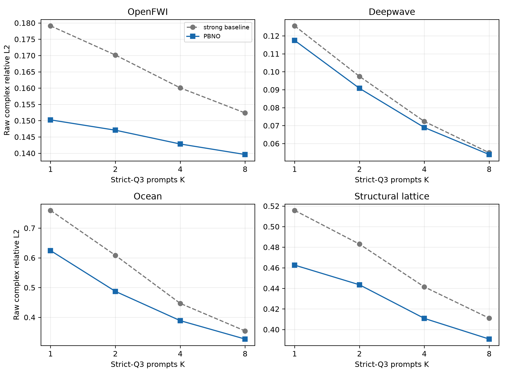
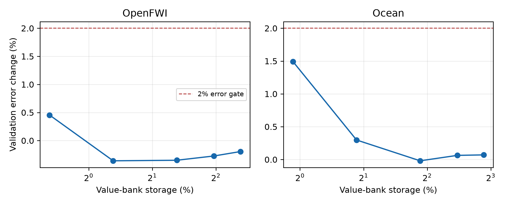
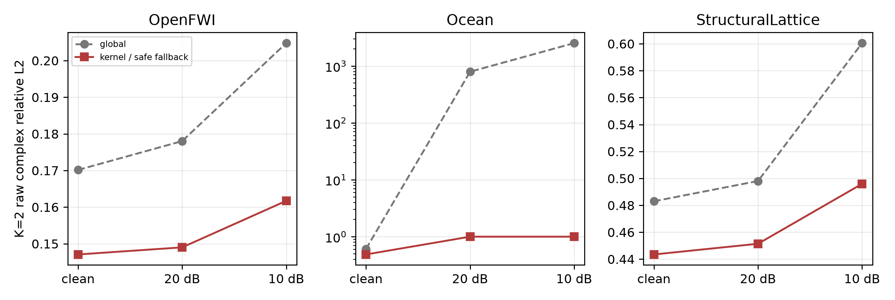
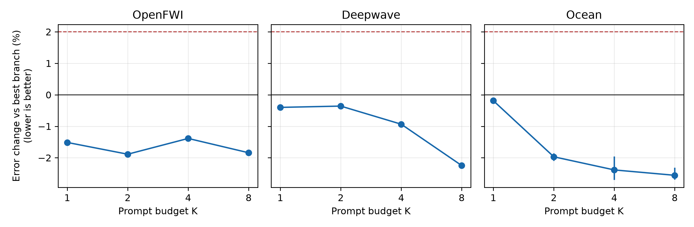

# PBNO M4：压缩、跨结构波验证与统一 prior adapter

> 历史证据 / 技术参考（2026-10-05 归档标记）：保留原实验、数值和复现路径。
> 文内“当前/下一步/待完成”描述属于当时阶段，不是现行任务；请先读[三条 Wave as Prompt 路线](../docs/wave_as_prompt/README.md)。

> 日期：2026-09-26
> 状态：正式三 prompt-seed 结果已完成；统一连续 adapter 通过，hard router 为 NO-GO
> 主指标：逐 physical system 等权的 raw complex relative L2

## 1. 一句话结论

M4 解决了 M3 的 memory storage 风险，并把 strict joint source--frequency query 的正结果扩展到一个独立的
结构波求解器：

1. 完整 training response table 可以换成共享 response basis 上的 rank-16 complex coefficient bank；
   OpenFWI/Ocean 的 value-bank 存储分别降到 **0.65%/0.93%**，各预算 test error 只退化
   **0.16%--1.48%/0.16%--1.19%**；
2. 新的 heterogeneous damped structural lattice 域在 K=1/2 相对 global Bayesian strong baseline 改善
   **10.31%/8.18%**，paired bootstrap 下界为 **9.64%/7.51%**；
3. hard leave-one-probe-out router 会把 in-prompt reconstruction 与 unseen-query extrapolation 混淆；但
   一个不读 domain ID 的 **1,665 参数连续 prior adapter** 在三组独立 prompt seeds、三个域和
   K=1/2/4/8 的 12 个设置中全部优于最佳单分支。OpenFWI/Ocean 的 K=2 相对 global strong baseline
   改善 **17.25%/21.85%**，通过统一部署 gate。



## 2. M4-A：从 response memory 到 spectral operator dictionary

### 2.1 为什么直接删 prototypes 失败

M3 为每个训练系统保存完整复 response operator。第一轮尝试在 full latent 空间做 random subset、greedy
farthest-point sampling 和 k-means operator centroids。50% prototypes 时：

- OpenFWI validation 通常退化约 3%--4%；
- Ocean 退化约 5%--14%；
- farthest-point 往往比随机子集更差。

这说明局部经验先验依赖训练分布的细粒度密度，不是少数极端覆盖点。继续优化 prototype selection 不再是
最合适的方向。

### 2.2 成功的方法：保留实例，压缩每个 operator value

设训练系统的完整、标准化 response table 为 $x_j$，global complex response basis 为 $B$。只保存：

$$
c_j = x_j \overline{B},
$$

其中 $c_j$ 只保留前 16 个复系数。给定实际 prompt mask $O$ 时，不直接把 $c_j$ 当检索 key，而是先恢复
该 prototype 在已观测坐标上的 response：

$$
\widetilde x_{j,O} = B_{O,1:16} c_{j,1:16},
$$

然后与 query system 完全一样，再做一次带谱先验的 posterior solve，得到 prompt-matched key。目标 query
的 value 也从同一 rank-16 系数和 $B$ 解码。

因此它与 M3 中失败的 `full-latent key` 有本质差别：

- 失败版本用 unconditional full-table coefficient 直接匹配，忽略当前 mask 下的 posterior shrinkage；
- 成功版本只压缩 value storage，key 仍由当前 prompts 条件化计算。

### 2.3 正式压缩结果

配置只在 validation systems 上选择满足“相对 full bank 不超过 2%”的最小 coefficient rank。两域四个预算
都选择 rank 16。

| 数据域 | K | full bank | rank-16 bank | 相对变化 | value-bank storage |
|---|---:|---:|---:|---:|---:|
| OpenFWI | 1 | 0.15024 | 0.15141 | +0.78% | 0.65% |
| OpenFWI | 2 | 0.14707 | 0.14731 | +0.16% | 0.65% |
| OpenFWI | 4 | 0.14283 | 0.14445 | +1.13% | 0.65% |
| OpenFWI | 8 | 0.13960 | 0.14167 | +1.48% | 0.65% |
| Ocean | 1 | 0.62447 | 0.62686 | +0.38% | 0.93% |
| Ocean | 2 | 0.48723 | 0.48800 | +0.16% | 0.93% |
| Ocean | 4 | 0.38881 | 0.39168 | +0.74% | 0.93% |
| Ocean | 8 | 0.32689 | 0.33077 | +1.19% | 0.93% |



这里的 0.65%/0.93% 只计算被替换的 response value bank。若把 M3 本来就需要的 shared rank-128 basis 也
计入总存储，OpenFWI/Ocean 的总 operator storage 仍约减少 **79%/66%**。A100 K=2 完整 test population
延迟分别为 17.22 ms 与 11.02 ms，和 full bank 的 17.37 ms 与 10.93 ms 基本相同；因此 M4 通过的是
storage gate，不宣称 latency gate 通过。

## 3. M4-B：独立结构波 strict-Q3 域

### 3.1 为什么要加这个域

前三域虽然应用不同，但都属于 acoustic response。新域使用二维异质 mass--spring lattice 的阻尼频域方程：

$$
(K-\omega^2 M+i\omega C)u=f,
$$

其中 $C=\alpha M+\beta K$。它由 batched complex128 direct solve 生成，不使用 Deepwave time-domain FD、
OpenFWI 的地震波形处理或 Ocean normal-mode solver。

数据包含 1024 个独立 systems、8 sources、6 angular frequencies 与 32 perimeter receivers；split 为
512/128/256/128 train/validation/test/OOD。OOD 同时扩大局部软缺陷、质量对比与各向异性。source 是
receiver 子集，数值 reciprocity residual 为零，但 strict Q3 要求 target source 和 target frequency 均不在
prompts 中，互易性不能直接给出 target frequency。

### 3.2 强基线先证明任务可辨识

validation-selected global Bayesian operator 的 test error 从 K=1 的 0.516 单调降到 K=8 的 0.410，并且
相对 system retrieval 改善约 20%--28%。这排除了“新域只是 nearest-system retrieval 玩具”的解释。

### 3.3 posterior-kernel 结果

| K | global strong baseline | posterior-kernel | 相对改善 | bootstrap 95% low | 系统胜率 |
|---:|---:|---:|---:|---:|---:|
| 1 | 0.51577 | **0.46261** | **10.31%** | 9.64% | 98.4% |
| 2 | 0.48300 | **0.44348** | **8.18%** | 7.51% | 95.7% |
| 4 | 0.44143 | **0.41081** | **6.94%** | 6.46% | 97.3% |
| 8 | 0.41105 | **0.39074** | **4.94%** | 4.40% | 88.3% |

M4 预注册的“新域至少 8% 且 bootstrap 下界为正”在 K=1/2 达到。效应随 K 缩小，与前三域一致：局部经验
prior 的价值主要集中在 sparse prompts，而不是无限增加 context 后仍保持常数收益。

OOD 相对冻结 global branch 的改善为 13%--27%，但 absolute error 仍为 0.867--0.982。正确表述是
posterior kernel 缓解了 prior shift，不是已经解决强结构 OOD；特别是 no-context train mean 在部分 OOD
预算仍可能更安全。

## 4. M4-C：现实 prompt noise

在 K=2 上向 prompts 加独立 complex Gaussian noise，target 保持 clean。所有方法和 hyperparameters 均由
clean validation 冻结。

| 数据域 | SNR | global | posterior-kernel / safe fallback | 相对改善 |
|---|---:|---:|---:|---:|
| OpenFWI | 20 dB | 0.1780 | **0.1490** | 16.3% |
| OpenFWI | 10 dB | 0.2048 | **0.1617** | 21.0% |
| Structural lattice | 20 dB | 0.4980 | **0.4514** | 9.36% |
| Structural lattice | 10 dB | 0.6005 | **0.4959** | 17.4% |

Ocean 使用 raw likelihood 且 prior strength 很小，噪声使 global posterior 数值上严重过度自信。M3 已冻结的
latent-energy gate 在 20/10 dB 下全部回退到 train mean，error 均为约 1.001。它证明 safety fallback 有效，
但不是精确 noisy inference；Ocean 仍需要显式 noise-aware likelihood calibration。



## 5. 从 hard router 的失败到统一连续 prior adapter

目标是在部署时不读取 domain label 或 target truth，同时适配 posterior-kernel 与 neural latent transport。
首版把已有 K 个 prompts 逐个留出，用剩余 prompts 预测被留出的 response，并选择 self-error 最小的分支。

K=2 单 seed test：

| 数据域 | validation-selected 最佳分支 | 最佳 error | hard LOO router | shared risk head |
|---|---|---:|---:|---:|
| OpenFWI | kernel | 0.14717 | 0.15019 | 0.14750 |
| Deepwave | neural | 0.09183 | 0.09304 | 0.09376 |
| Ocean | kernel | 0.48854 | 0.53723 | 0.49117 |

hard LOO 在 Deepwave 能正确偏向 neural，却在 Ocean 误把 global 的 in-prompt fit 当作更好的 Q3 外推。随后用
三域 validation episodes 训练一个共享 1,443 参数 risk head，只读取三个分支的 LOO errors，不读取域标签；
三个训练 seed 结果一致。它修复 Ocean/OpenFWI，但 Deepwave K=2 仍比最佳分支差约 2.1%--2.4%。因此，
**hard selection 与只预测单分支风险的路线是 NO-GO**；继续扫 threshold 只会在三个域之间搬运误差。

这个负结果揭示：

> prompt reconstruction risk 不等于 unseen-query extrapolation risk；但两个有偏 prior 的复残差仍可能互补。

### 5.1 成功的最小升级

不再预测“选哪个分支”，而是让一个共享小网络输出连续 neural weight $g(D)$：

$$
\widehat u=(1-g(D))\widehat u_{kernel}+g(D)\widehat u_{neural}.
$$

$g$ 只读取 target-free 的 prompt 与预测统计：幅值离散度、峰度、局部相位粗糙度、三个分支之间的归一化
disagreement、预测与 prompt 的能量比；K 大于 1 时再加入八个 LOO error summaries，K=1 时将它们置零并
提供一个 availability bit。整个 adapter 是一个 17--32--32--1 的 MLP，共 1,665 参数。它不读取 domain ID、
隐藏介质或测试 target；validation episode 的 query truth 仅用于一次性学习 mixture risk，测试时权重完全冻结。

训练损失没有重新解码复场，而是用两个分支 residual 的平方范数与复内积，精确计算连续混合后的 relative
L2。这一点允许 adapter 利用 residual cancellation，而不是只模仿 best-branch label。

### 5.2 三 prompt-seed 正式结果

下表中的 error 和 gain 均先在每个 prompt seed 内按 physical system 等权计算，再对 20260924/25/26 三组
独立 test prompt episodes 取均值。为给 adapter 一个更严格的比较项，“最佳单分支”事后取该 seed 上三个
冻结分支中 aggregate test error 最低者；这个 hindsight choice 只用于报告，adapter 的输入和权重从未读取
test truth。

| 数据域 | K | 最佳单分支 | 统一 adapter | 相对最佳分支改善 | 相对 global 改善 |
|---|---:|---:|---:|---:|---:|
| OpenFWI | 1 | 0.15024 | **0.14797** | 1.51% | 24.24% |
| OpenFWI | 2 | 0.14707 | **0.14430** | 1.89% | 17.25% |
| OpenFWI | 4 | 0.14283 | **0.14085** | 1.39% | 12.00% |
| OpenFWI | 8 | 0.13960 | **0.13703** | 1.84% | 10.06% |
| Deepwave | 1 | 0.11775 | **0.11728** | 0.40% | 6.62% |
| Deepwave | 2 | 0.09170 | **0.09137** | 0.36% | 6.23% |
| Deepwave | 4 | 0.06930 | **0.06865** | 0.93% | 5.06% |
| Deepwave | 8 | 0.05398 | **0.05277** | 2.25% | 3.83% |
| Ocean | 1 | 0.62415 | **0.62297** | 0.19% | 18.02% |
| Ocean | 2 | 0.48662 | **0.47704** | 1.97% | 21.85% |
| Ocean | 4 | 0.38888 | **0.37963** | 2.39% | 15.75% |
| Ocean | 8 | 0.32890 | **0.32049** | 2.56% | 10.80% |

12/12 设置均优于最佳单分支；跨 seed 的最弱改善是 Ocean K=1 的 0.08%，没有任何大于 2% 的退化。
两个域的 K=2 相对 global baseline 超过 10%，所以冻结的 M4-B gate 通过。需要诚实区分：这是跨三个域共享
的轻量 calibration operator，还不是对未参与训练的第五个物理域的 zero-shot universal router。



下一步不再扫描 LOO threshold。若要强化 universal claim，应冻结该 adapter 后增加未参与 calibration 的
物理域；若要强化方法贡献，应把连续 mixture 提升为 latent/operator-space residual composition，而不是堆更多
hard-routing features。

## 6. 四域 K=2 主表与当前论文含义

| 数据域 | strong baseline | PBNO | 相对改善 | 95% 下界 | 系统胜率 |
|---|---:|---:|---:|---:|---:|
| OpenFWI | 0.17015 | **0.14707** | **13.56%** | 12.76% | 93.6% |
| Deepwave | 0.09744 | **0.09077** | **6.85%** | 6.44% | 99.2% |
| Ocean | 0.60843 | **0.48723** | **19.92%** | 15.87% | 77.3% |
| Structural lattice | 0.48300 | **0.44348** | **8.18%** | 7.51% | 95.7% |

现在最可信的贡献不再是“一个大网络统一所有域”，而是：

1. 少量 wave responses 可以形成 Bayesian system posterior token；
2. linear Gaussian PCA--MAP 是严格特例；
3. posterior-conditioned empirical operator prior 与 neural latent transport 是两种可验证的非线性升级；
4. 经验 prior 的 value 可以被共享 spectral dictionary 极强压缩；
5. 1,665 参数的连续 adapter 在不读取域标签时统一了三个已有域、所有预算的 prior composition；第四个
   structural-wave 域验证了 posterior kernel 的跨物理有效性，但尚未加入 adapter calibration。

它比 M3 更接近完整论文，但仍有两个诚实风险：第四域是可复现 synthetic structural benchmark，不是真实实验；
统一 adapter 在三个训练域上共享，但尚未证明对全新物理域 zero-shot 泛化。这两点不应被隐藏。

## 7. 复现入口

- M4 计划：`docs/PBNO_M4_RISK_RESOLUTION_PLAN_ZH.md`；
- spectral compression：`audit_spectral_memory_compression.py`；
- structural generator：`generate_structural_lattice_wave_data.py`；
- posterior-kernel formal config：`configs/structural_lattice_posterior_memory_20260926.json`；
- noise audit：`audit_pbno_noise_robustness.py`；
- router/adapter audits：`audit_prompt_only_router.py`、`train_prompt_risk_router.py` 与
  `train_unified_prompt_prior_adapter.py`；
- 机器主表与正文图：`artifacts/pbno_m4_summary/`；
- structural archive SHA256：`5dbe1359ba6a8a2f53add0a581c16c8f6e3892298d296b16c83ae95222d50819`。

统一 adapter 的正式配置是 `configs/pbno_unified_prior_adapter_20260926.json`。每个 seed 先生成冻结分支的
prompt diagnostics，再只用 validation episodes 拟合共享 adapter：

```bash
for seed in 20260924 20260925 20260926; do
  python -m spectral_continuation.audit_prompt_only_router \
    --config configs/pbno_unified_prior_adapter_20260926.json \
    --output artifacts/pbno_prompt_adapter_formal_promptseed${seed} \
    --test-seed ${seed} --device cuda
  python -m spectral_continuation.train_unified_prompt_prior_adapter \
    --router-root artifacts/pbno_prompt_adapter_formal_promptseed${seed} \
    --output artifacts/pbno_unified_adapter_formal_seed${seed} \
    --seed ${seed} --steps 4000 --device cuda
done

python -m spectral_continuation.summarize_pbno_m4 \
  --artifacts artifacts --output artifacts/pbno_m4_summary
```

正式逐 seed 数字位于 `m4_unified_adapter_by_seed.csv`，三 seed 聚合位于
`m4_unified_adapter_summary.csv`。`m4_router_no_go.csv` 特意保留 hard routing 的负结果，不能把它误读为
连续 adapter 的结果。

大型 response archive、checkpoints 与逐样本 arrays 保持本地，不进入 Git；配置、manifest、聚合统计和正文图
进入版本管理。
