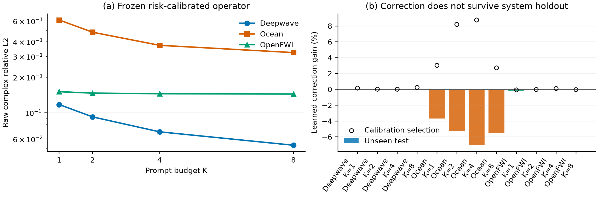

# PBNO Posterior Operator Composer M0：统一成功，学习修正未通过

> 日期：2026-09-26
> 状态：M0 **部分通过**；零修正统一算子成立，learned token correction 未通过 system-held-out gate；M1 未启动。
> 主指标：逐物理系统等权的 raw complex relative L2，越低越好。

## 1. 这一轮到底想验证什么

M4 已经有三个有效但看起来零散的部件：

1. Bayesian posterior 把少量复响应 prompts 变成系统状态；
2. posterior kernel 从训练系统字典检索经验先验；
3. neural transport 给出另一种目标 query 提案，再由一个小 adapter 做连续混合。

M0 的目标不是再堆一个 loss，而是检验这些部件能否写成一个小型、现代的 in-context latent operator：

```text
prompts -> posterior tokens -> dictionary cross-attention
        -> query-conditioned composition -> complex response
```

预注册的性能门槛是：

- 参数少于 1M；
- OpenFWI、Deepwave、Ocean，K=1/2/4/8 共 12 项，相对当前 unified adapter 最坏退化不超过 1%；
- 至少两个数据域的 K=2 再改善 3%；
- 只有 M0 通过后，才进入 continuous-coordinate decoder 的 M1。

## 2. 方法

### 2.1 解析 posterior 是 token 的起点

给定新系统的 prompts，先在共享复响应 basis 上求 posterior mean：

$$
\hat z
=
\left(B_O^H B_O+\Lambda\right)^{-1}B_O^H y_O.
$$

每个 latent mode 的 token 包含：

- posterior coefficient 的实部和虚部；
- posterior uncertainty；
- training spectrum variance；
- mode position；
- posterior-kernel proposal 和 neural proposal 相对当前 posterior 的复增量。

这保留了波动场的复数结构，没有把实部、虚部简单当作两张无关图片。

### 2.2 spectral operator dictionary

对训练系统只保存 rank-16 的复 value coefficients。检索 key 不预先固定，而是根据当前 prompt mask 重新求
posterior；距离用 training spectrum whitening：

$$
d_i
=
\sum_j
\frac{|\hat z_j-z_{i,j}|^2}{\sigma_j^2}.
$$

选出的邻居被编码成 dictionary tokens，posterior tokens 对它们做 cross-attention。该设计保留 M4 已验证的
instance identity，同时避免存储完整 response table。

### 2.3 风险校准的严格 fallback

现有 1,665 参数 adapter 只读 target-free 证据：prompt 幅相统计、三个 proposal 的分歧、K>1 时的
leave-one-prompt-out 自检误差。它给出 neural proposal 的系统级权重 $g_0$。

新 composer 不从头重学这个判断，而是在其 logit 上学习 mode-wise 修正：

$$
g_j
=
\sigma
\left[
\ell(g_0)+0.25\Delta g_j
\right],
\qquad
\ell(g)=\log\frac{g}{1-g}.
$$

最终 latent 为：

$$
z_j^{out}
=
z_j^{kernel}
+g_j\left(z_j^{neural}-z_j^{kernel}\right)
+\Delta z_j.
$$

代码将 $\Delta g_j$ 与 $\Delta z_j$ 的最后一层初始化为零。因此在 step 0，模型**精确退化为当前连续
adapter**，而不是一个碰巧接近它的随机网络。这是本轮最重要的安全性质。

模型总参数为 **121,603**，共享于三个数据域和四个 prompt budgets，不读取 domain ID。

### 2.4 唯一训练目标

没有幅值 loss、相位 loss、路由 loss 或蒸馏 loss。训练只优化最终 raw complex relative L2：

$$
L
=
\frac{1}{N}
\sum_i
\frac{\|\hat y_i-y_i\|_2}{\|y_i\|_2}.
$$

三域在每一步各采一个 budget，并用该域冻结基线误差做尺度归一化，避免 Ocean 的大 raw error 支配梯度。

## 3. 实验协议

- 数据：OpenFWI CurveFault-A、Deepwave ring ultrasound、Ocean multistatic；
- 任务：strict Q3，目标 source 与目标 frequency 均不出现在 prompts；
- budgets：K=1/2/4/8；
- system split：训练 memory、calibration systems、unseen test systems 严格分离；
- composer calibration：validation systems 的 75% 拟合，25% 选择 checkpoint；
- 正式 test：三个独立 prompt seeds，20260924/20260925/20260926；
- 配对单位：physical system；
- baseline：完全相同的 operator，把 learned correction 置零。

这一 baseline 比单独重跑旧方法更严格，因为除 learned correction 外，posterior、dictionary、neural proposal、
risk adapter 和 decoder 全部一致。

## 4. 多轮迭代与归因

| 版本 | 核心变化 | 结果与判断 |
|---|---|---|
| dev1 | 纯 learned composer | 复数 radial activation 在零点破坏梯度；修复 |
| dev2 | 从 global posterior 直接学习 | 只有约 0%--1.5%，高 K 退化；不应重学已知解析 prior |
| dev3--4 | 加入 analytic kernel anchor | Open/Ocean 提升，但 Deepwave 缺 neural prior |
| dev5--6 | neural proposal 投影到同一 latent；三域平衡训练 | step 0 仍最好；排除简单尺度失衡 |
| dev7 | 当前 adapter 成为严格 fallback | 零修正成功复现强基线，学习修正无增益 |
| dev8 | 改用 calibration-system split | selection 平均改善 1.45%，Ocean K=2 改善 6.8% |
| dev9 | 17 维 target-free 风险证据进入 query token | selection 平均改善 1.92%，Ocean K=2 改善 8.2% |
| formal | unseen systems、三 prompt seeds | Ocean 退化 3.7%--7.1%；learned correction gate 失败 |

这个过程排除了三种较浅的解释：不是梯度 bug，不只是 raw-error 尺度不平衡，也不是模型没看到 adapter 的
风险证据。真正的问题是 calibration selection 上学到的修正没有跨 system 泛化。

## 5. 正式 test 结果

### 5.1 零修正统一算子

三个 prompt seeds 平均的 baseline raw complex relative L2：

| 数据域 | K=1 | K=2 | K=4 | K=8 |
|---|---:|---:|---:|---:|
| Deepwave | 0.11733 | 0.09220 | 0.06889 | 0.05304 |
| Ocean | 0.61107 | 0.48116 | 0.37274 | 0.32348 |
| OpenFWI | 0.15081 | 0.14668 | 0.14489 | 0.14411 |

这说明统一 latent operator 的**表示与工程整合是成立的**：一个共享、无 domain ID、121k 参数的架构可以
稳定包含当前强方法，而且随 K 增加保持合理的预算曲线。

### 5.2 learned correction

| 数据域 | K=1 | K=2 | K=4 | K=8 |
|---|---:|---:|---:|---:|
| Deepwave 相对变化 | -0.003% | -0.041% | +0.016% | +0.026% |
| Ocean 相对变化 | **-3.69%** | **-5.22%** | **-7.06%** | **-5.51%** |
| OpenFWI 相对变化 | -0.23% | -0.11% | +0.05% | -0.06% |

表中正数表示误差降低，负数表示退化。Ocean 四项的 paired bootstrap 区间都完全低于零。因此不能把
calibration 上 3%--9% 的提升写成正式正结果。



### 5.3 延迟

在 A100-SXM4-80GB、OpenFWI K=2、500 个 test systems 整批推理、100 次重复下：

| latent update | 延迟 |
|---|---:|
| analytic posterior kernel | 0.607 ms |
| 2-layer composer | 6.383 ms |
| 比值 | 10.51 倍 |

该数字只计 latent composition，不计共同的数据加载和 proposal 生成。composer 未达到 1.5 倍门槛，说明当前
attention 实现也没有部署效率优势。

## 6. 第一性原理解释

### 6.1 为什么统一可以成功

posterior mean 和 uncertainty 是由已观测 response 确定的稳定系统坐标；kernel 与 neural proposal 都在
同一 latent basis 中表达；最终 query 仍由复 basis 解码。这些结构不依赖小 calibration set 去重新发现，
所以零修正模型稳定。

### 6.2 为什么 learned correction 容易失败

仅做 kernel/neural 的逐事件最优标量混合，相对逐事件最佳分支的额外 oracle 空间只有：

- Deepwave：约 0.4%--0.8%；
- OpenFWI：约 0.8%--1.1%；
- Ocean：约 1.0%--2.4%。

相对当前 adapter 仍有一些空间，但它主要来自非常细的 system-specific routing。Ocean calibration-selection
只有 16 个 systems，复杂 token correction 很容易把有限系统的 residual pattern 当成稳定规律。它在三个
test prompt seeds 上同方向失败，说明问题是跨 system 的可辨识性，而不是 prompt 随机性。

### 6.3 对论文故事的约束

目前可以严谨地说：

> Bayesian posterior tokens、spectral operator dictionary 与 target-free risk calibration 可以统一成一个
> 小型 in-context operator，并以严格 fallback 保留现有跨域性能。

目前不能说：

> Transformer token refinement 比简单连续 adapter 更准确，或已经形成新的端到端 neural operator 主结果。

## 7. Gate 决策

| Gate | 结果 |
|---|---|
| 参数小于 1M | 通过：121,603 |
| 当前 adapter 是严格特例 | 通过 |
| 12 项最坏退化不超过 1% | 零修正通过；learned correction 不通过 |
| 至少两域 K=2 再改善 3% | 不通过 |
| latent update 延迟不超过 kernel 的 1.5 倍 | 不通过：10.51 倍 |
| 启动 M1 continuous decoder | **不启动** |
| 启动 flow | **不启动**；没有新的多模态 oracle 证据 |

最终决定：冻结 zero-update composer 作为下一代方法接口；把 learned token correction 记录为 NO-GO，不用
更多 loss 或更大 Transformer 掩盖失败。

## 8. 何时值得重启

只有满足至少一项时才重开 learned refinement：

1. 每域有显著更多独立 calibration systems，并做 nested system-level cross-fitting；
2. 新真实/实验 multistatic 数据证明 residual routing 在跨设备或跨几何上存在稳定结构；
3. 新 oracle 显示 mode-wise composition 相对当前 adapter 至少有 10% 可辨识 headroom；
4. 表征学习目标能在不看 query truth 时预测 correction 的符号，并在完整 held-out systems 上先通过。

下一阶段若以论文为目标，优先级仍应是扩大真实数据外部有效性与明确 operator prior 的统一叙事，而不是进入
M1、flow 或更大的 latent Transformer。

## 9. 复现入口

训练：

```bash
CUDA_VISIBLE_DEVICES=0 .venv/bin/python -m spectral_continuation.train_posterior_operator_composer \
  --config configs/pbno_posterior_composer_m0_20260926.json \
  --output artifacts/pbno_posterior_composer_m0_dev9
```

正式 test：

```bash
CUDA_VISIBLE_DEVICES=0 .venv/bin/python -m spectral_continuation.evaluate_posterior_operator_composer \
  --config configs/pbno_posterior_composer_m0_20260926.json \
  --checkpoint artifacts/pbno_posterior_composer_m0_dev9/best.pt \
  --output artifacts/pbno_posterior_composer_m0_formal
```

冻结汇总：

- `artifacts/pbno_posterior_composer_m0_summary/summary.json`
- `artifacts/pbno_posterior_composer_m0_summary/m0_results.csv`
- `artifacts/pbno_posterior_composer_m0_summary/posterior_composer_m0.png`
- `artifacts/pbno_posterior_composer_m0_summary/latency.json`
