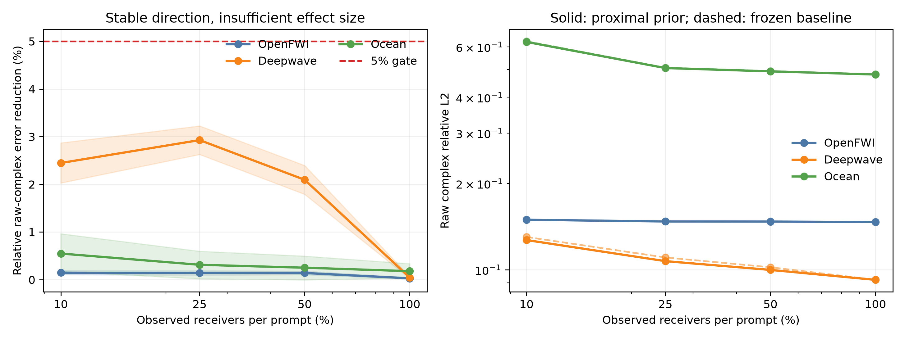

# Uncertainty-Conditioned Proximal Prior M0：学习应该放在哪里，以及为什么仍未过 Gate

> 历史证据 / 技术参考（2026-10-05 归档标记）：保留原实验、数值和复现路径。
> 文内“当前/下一步/待完成”描述属于当时阶段，不是现行任务；请先读[三条 Wave as Prompt 路线](../docs/wave_as_prompt/README.md)。

> 日期：2026-09-27
>
> 状态：机制方向稳定，但 5% promotion gate 未通过；M1 query decomposition 保持关闭
>
> 任务：strict-Q3，K=2，完整或每个 prompt 独立的 receiver mask
>
> 主指标：逐 physical system 等权的 raw complex relative L2

## 1. 一句话结论

本轮把 learning 限制在一个清楚的位置：网络只学习隐藏 wave response operator 的 latent prior；观测融合仍由
复数 Bayesian posterior 与闭式 proximal projection 完成，query 仍由冻结 response basis 解码。29,761 参数
模型在 Deepwave 的 10%/25%/50% receiver 条件下分别稳定改善 2.45%/2.93%/2.09%，bootstrap 区间均为正；
但 OpenFWI 只有约 0.14%，Ocean 最高 0.55%，完整 receivers 下三域都低于 0.2%。

因此它证明了“uncertainty-conditioned learning + analytic data consistency”可以产生稳定小增益，却没有证明
它足以成为新的论文主方法。预注册要求至少达到 5%，没有任何域通过；M1 不启动。



## 2. 为什么做这一步

上一版 posterior composer 允许 Transformer 直接修改 target-query latent。它在 calibration systems 上可改善
Ocean 约 8%，到 unseen systems 却退化 3.7%--7.1%。随后 functional encoder、reranker 与 nonlinear neural
field 也没有把 16%--49% 的 candidate oracle headroom 转成可部署增益。

共同问题不是模型容量不足，而是 learning 同时承担了三件不容易区分的事：

1. 从稀疏 prompts 识别系统；
2. 学习 response operator 的经验先验；
3. 针对 target source--frequency 直接修预测。

本轮把它们拆开：解析 posterior 负责第 1 件事，learning 只负责第 2 件事，冻结 query decoder 负责第 3 件事。

## 3. 方法

### 3.1 可观测 posterior chart

完整 response table 在训练数据学到的复 basis 中写成：

$$
x = \mu + Bz + \epsilon.
$$

给定 episode 的观测坐标集合 O，解析 posterior mean 为：

$$
m_D = (B_O^*B_O + \Lambda)^{-1}B_O^*y_O.
$$

同时保留 posterior variance。任意 receiver masks 只改变 B 的观测行，因此无需把缺失输入栅格化，也不需要
重新训练固定通道网络。

### 3.2 复数、相位等变的 learned prior

网络输入 posterior 或当前强基线 latent，经 bias-free complex linear layers 与 radial activation 输出复数
latent correction。若输入整体乘统一相位，输出也乘相同相位。实数 gate 只读取幅值、posterior uncertainty、
mode energy 与 mode position，因此不会把任意 phase reference 当成物理差异。

模型只有 29,761 个参数。最后的 complex output layer 零初始化，所以 step 0 的 correction 严格为零。

### 3.3 Proximal data consistency

learned correction 不直接加到输出场，而先通过 episode-specific posterior precision：

$$
P_D = (B_O^*B_O + \tau\Lambda)^{-1}\tau\Lambda,
$$

$$
z_{new} = z_{M4} + P_D\Delta_\phi(z_{M4},\Sigma_D).
$$

已被 prompts 强约束的 latent direction 会被压小，未被观测确定的方向允许 prior 更新。随后在 0 到 1 之间做
一维闭式 line search，保证 correction 不增加 prompt-space complex residual。最后只在 validation 上从包含 0
的离散集合选择一个 convex blend；blend 为 0 时严格回退冻结 baseline。

### 3.4 Query 仍只负责读出

目标 source、frequency 与 receivers 对应冻结 basis 的目标行：

$$
\widehat y_q = \mu_q + S_q B z_{new}.
$$

网络不读取 target truth，也不直接产生 target response residual。这是本轮与失败 composer 最重要的区别。

## 4. 冻结实验协议

- 数据：OpenFWI CurveFault-A、Deepwave ring ultrasound、Ocean multistatic；
- task：strict Q3，target source 和 target frequency 都不出现在两个 prompts 中；
- system split：500/500/500、512/128/256、256/64/128；
- receiver fractions：10%、25%、50%、100%，每个 prompt 使用独立 mask；
- 正式统计：三个 prompt seeds，先在每个 physical system 内平均，再做 paired bootstrap；
- baseline：完整 receivers 使用当前 M4 continuous adapter；稀疏 receivers 使用同一 rank-16 posterior-memory
  operator，learning correction 为零时精确恢复它；
- checkpoint 与 blend 只在 validation systems 选择；test systems 不参与选参。

## 5. 正式结果

### 5.1 Raw complex error 与相对增益

| 数据域 | receivers | baseline | proximal prior | 相对改善 | bootstrap 95% | 系统胜率 |
|---|---:|---:|---:|---:|---:|---:|
| OpenFWI | 10% | 0.14961 | 0.14939 | 0.15% | [0.11%, 0.19%] | 63.8% |
| OpenFWI | 25% | 0.14757 | 0.14736 | 0.14% | [0.10%, 0.19%] | 58.8% |
| OpenFWI | 50% | 0.14745 | 0.14724 | 0.14% | [0.11%, 0.18%] | 66.2% |
| OpenFWI | 100% | 0.14668 | 0.14664 | 0.03% | [0.01%, 0.04%] | 49.0% |
| Deepwave | 10% | 0.13010 | 0.12691 | **2.45%** | [2.03%, 2.87%] | 77.0% |
| Deepwave | 25% | 0.11035 | 0.10712 | **2.93%** | [2.63%, 3.23%] | 89.5% |
| Deepwave | 50% | 0.10196 | 0.09983 | **2.09%** | [1.79%, 2.39%] | 80.1% |
| Deepwave | 100% | 0.09220 | 0.09216 | 0.05% | [0.02%, 0.07%] | 60.2% |
| Ocean | 10% | 0.62762 | 0.62417 | 0.55% | [0.17%, 0.96%] | 55.5% |
| Ocean | 25% | 0.50754 | 0.50595 | 0.31% | [0.02%, 0.60%] | 61.7% |
| Ocean | 50% | 0.49398 | 0.49274 | 0.25% | [-0.00%, 0.50%] | 62.5% |
| Ocean | 100% | 0.48116 | 0.48030 | 0.18% | [0.03%, 0.34%] | 53.9% |

完整机器表见 `artifacts/pbno_uncertainty_proximal_prior_m0_summary/m0_mask_results.csv`。

### 5.2 Gate

| Gate | 结果 |
|---|---|
| OpenFWI/Ocean 平均额外改善至少 5% | 失败：各档均低于 0.6% |
| Deepwave 不退化超过 1% | 通过，并有 2%--3% masked gain |
| 任意 mask 不出现大于 2% 退化 | 通过；所有正式点同向或近似不变 |
| prompt consistency 不变差 | 通过；闭式 safeguard 保证 |
| correction 在独立 seeds 同方向 | 通过，但 effect size 太小 |
| 启动 M1 query decomposition | **不启动** |

## 6. 多轮迭代排除了什么

| 版本 | 改动 | 结论 |
|---|---|---|
| dev1--2 | learned prior 作为独立 predictor，再闭式 assimilate | prompt fit 更好，held-out query 三域更差；不能替代 M4 |
| dev3 | 只预测 M4 residual，再 precision projection | 三域同向但完整 receivers 增益低于 0.2% |
| single-domain | 排除跨域 PCA chart 未对齐 | 单域仍只有 0.03%--0.18%；chart alignment 不是唯一瓶颈 |
| 10% masks | 提高 posterior uncertainty | Deepwave 达到 2.45%，说明机制有作用；仍未过 5% |
| latent denoising pretrain | 先学完整 operator latent density | Deepwave 从 2.45% 降到 2.13%；普通 Gaussian corruption 不匹配 masked posterior residual |
| proximal strength 0.1/1/10 | 改变 prior--likelihood 权衡 | Deepwave 1.91%--2.45%，Ocean 均约 0.6%；结论不变 |
| 25%/50% masks | 冻结跨 mask 曲线 | Deepwave 25% 最好 2.93%；无 5% 点 |

## 7. 第一性原理归因

### 7.1 数据一致性不是主要瓶颈

proximal projection 可以显著降低 prompt residual，却不能自动降低 unseen source--frequency query error。
这再次说明：拟合已经观测到的 response，与识别决定未见干涉图样的隐藏 operator，是两件不同的事。

### 7.2 Oracle headroom 主要不是平滑 prior headroom

Ocean 10% masks 下的 candidate oracle 曾有约 49% 空间，但本轮最好的 target-free learned prior 只关闭 0.55%。
oracle 用 target truth 选择候选；两个稀疏 prompts 并没有足够信息预测该选择。剩余空间大部分属于 conditional
identifiability gap，而不是增加 prior 网络容量就可约减的 approximation gap。

### 7.3 learning 最有作用的区域是“中等不确定”

Deepwave 25% receivers 比 10% 和 50% 都好：

- 太稀疏时，posterior 本身缺信息，prior 难以判断 correction；
- 太密时，强 baseline 已接近饱和，剩余 residual 很小；
- 中间区域既有可修空间，又保留足够系统证据。

这是一个机制级正结果，但 2.93% 不足以支撑新的主方法 claim。

## 8. 决策与下一步边界

1. 保留代码作为 uncertainty-aware operator-prior benchmark；
2. 论文或项目主方法继续使用 M4 analytic posterior + empirical kernel/neural prior composition；
3. 不从这个 checkpoint 启动 source--frequency--receiver query decomposition M1；
4. 不再扫 width、depth、denoising noise、训练步数或 proximal strength；
5. 不把稳定但小于 3% 的结果包装成显著方法贡献。

只有满足至少一个新条件时才重启：

1. 新 prompts 真正改变 conditional identifiability，例如 reciprocal bracket、frequency bracket 或主动选择的
   source--receiver links；
2. target-free correction-sign oracle 在 held-out systems 上先显示至少 10% 可利用空间；
3. 有足够跨设备真实数据，使 learned functional chart 明确优于固定 PCA chart；
4. 学到可跨域对齐的 operator coordinates，而不是在任意 PCA mode index 上共享权重。

## 9. 复现入口

主配置：

```bash
configs/pbno_uncertainty_proximal_prior_m0_20260927.json
```

示例：Deepwave、25% receivers：

```bash
CUDA_VISIBLE_DEVICES=0 .venv/bin/python \
  -m spectral_continuation.train_uncertainty_proximal_prior \
  --config configs/pbno_uncertainty_proximal_prior_m0_20260927.json \
  --output artifacts/pbno_uncertainty_proximal_prior_m0_deepwave_r25 \
  --domains Deepwave --receiver-fraction 0.25 --steps 3000
```

冻结汇总：

```bash
.venv/bin/python -m spectral_continuation.summarize_uncertainty_proximal_prior \
  --output artifacts/pbno_uncertainty_proximal_prior_m0_summary
```

关键 artifacts：

- `summary.json`：gate、最佳结果与决策；
- `m0_mask_results.csv`：12 个正式点；
- `uncertainty_proximal_prior_m0.png` / `.pdf`：正文级主图；
- 各 run 的 `best.pt`、`summary.json` 与逐系统 `.npz`：完整复现统计。
