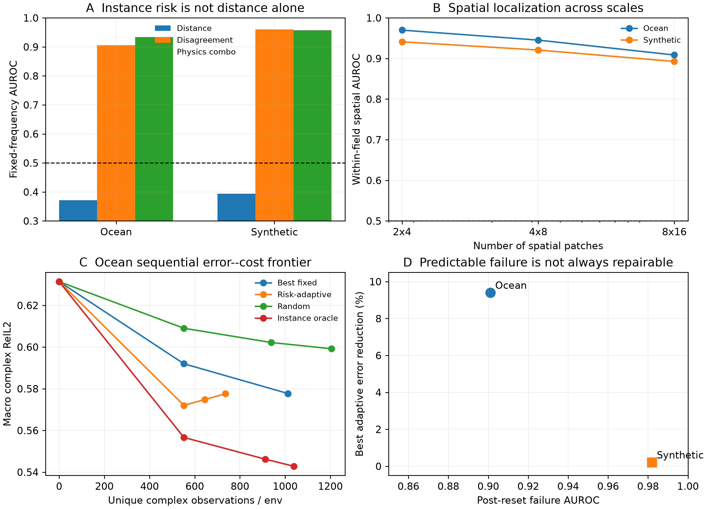
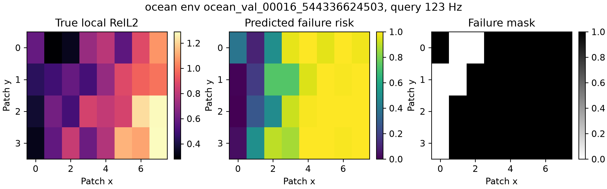
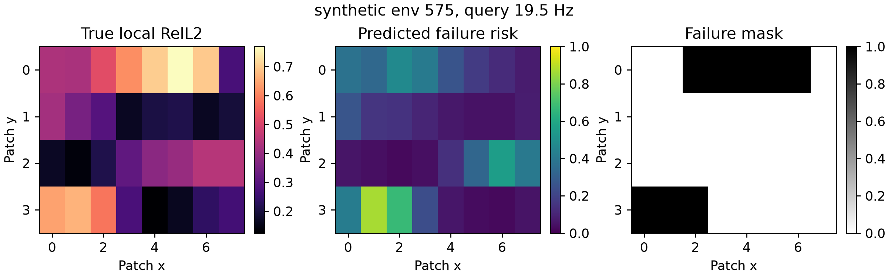

# Reliable-horizon Map POC 最终报告

> 历史证据 / 技术参考（2026-10-05 归档标记）：保留原实验、数值和复现路径。
> 文内“当前/下一步/待完成”描述属于当时阶段，不是现行任务；请先读[三条 Wave as Prompt 路线](../docs/wave_as_prompt/README.md)。

日期：2026-09-17

## 结论先行

本轮 POC 得到了一个明确、可复现、同时包含正结果和停止线的结论：

> 冻结波场算子的 seed disagreement 不仅能预测“哪个实例会先失效”，还能预测“同一实例、同一频率
> 的哪些空间区域会先失效”；但可预测的失败不等于现有 calibration action 一定能修复。

因此，**Reliable-horizon Map 本身是强 GO**；Ocean 上的一次 risk-triggered sparse calibration 是机制级
GO；“反复触发同一种 calibration 就能持续延长 horizon”则是 NO-GO。完整 M2 的预注册 10% raw-error
gate 没有通过，不能把当前结果写成成熟的 sequential-control 方法。

这张图概括了四个事实：

1. 实例风险不是 query distance 的替代写法；
2. 空间风险可以在三个 patch 尺度、两个数据域中稳定定位；
3. Ocean 的一次自适应 calibration 优于固定和随机触发，但更多 reset 没有继续改善；
4. synthetic 的 post-reset failure AUROC 接近 0.98，但 calibration 几乎不能降低误差。这直接区分了
   **predictability** 和 **controllability**。

## 1. 完整任务分解

一个真正可部署的频率延拓系统至少包含三层问题：

1. **预测层**：给出未来频率的复数场；
2. **可靠性层**：在不知道查询真值时预测该场是否可靠；
3. **干预层**：当风险升高时，判断某个 calibration action 是否值得购买。

过去容易把后两层混为一谈。本轮结果说明它们必须分开：failure risk 回答“当前预测可能错吗”，而
action value 回答“购买这一组观测后能改善多少”。高质量 failure ranking 并不能保证 action 有足够的
information headroom。

## 2. 实例—频率 Reliable horizon

第 $e$ 个实例在查询频率 $f$ 的复场误差定义为：

$$
E_e(f)=\frac{\|\widehat u_e(f)-u_e(f)\|_2}{\|u_e(f)\|_2}.
$$

主阈值为 $E_e(f)>0.5$。风险模型只读取 query offset、冻结 seed 预测及其 disagreement；真值仅用于
交叉验证标签。同一物理环境的所有频率严格留在同一个 fold。

| 数据域 | 方法 | Pooled AUROC | Fixed-frequency AUROC | Error Spearman | Unsafe overreach |
|---|---|---:|---:|---:|---:|
| Ocean | Distance only | 0.891 | 0.371 | 0.702 | 6.2% |
| Ocean | Disagreement only | 0.955 | 0.906 | 0.897 | 9.4% |
| Ocean | Physics combo | **0.972** | **0.934** | **0.925** | 12.5% |
| Synthetic | Distance only | 0.881 | 0.394 | 0.750 | 2.3% |
| Synthetic | Disagreement only | **0.980** | **0.960** | **0.960** | 3.9% |
| Synthetic | Physics combo | 0.980 | 0.957 | 0.959 | **3.1%** |

最关键的是 fixed-frequency AUROC：在查询频率相同的条件下，distance 已经是常数，只有实例差异仍然
存在。0.906 和 0.960 因此证明 disagreement 确实识别了实例相关的失效，而不是重新编码“越远越难”。

## 3. 空间 Reliable-horizon Map

### 3.1 局部误差定义

将场划成 $P$ 个 patch。第 $p$ 个 patch 的局部误差为：

$$
E_{e,f,p}=\sqrt{
\frac{\sum_{x\in p}|\widehat u_e(f,x)-u_e(f,x)|^2}
{\max\left(\sum_{x\in p}|u_e(f,x)|^2,
0.1\,P^{-1}\sum_x|u_e(f,x)|^2\right)}}.
$$

分母 floor 防止接近零能量的 patch 产生没有物理意义的巨大相对误差。它只参与标签构造，risk feature
不读取 target。

对应的核心 target-free feature 是局部 seed disagreement：

$$
D_{e,f,p}=\sqrt{
\frac{S^{-1}\sum_s\sum_{x\in p}|\widehat u_{s,e}(f,x)-\overline u_e(f,x)|^2}
{\max\left(\sum_{x\in p}|\overline u_e(f,x)|^2,\epsilon_{e,f}\right)}}.
$$

轻量 logistic risk head 还可读取局部幅值 disagreement、相位 disagreement、预测能量比例和 patch
坐标。所有结果仍按环境做四折交叉验证。

### 3.2 主结果

4×8 patch 网格：

| 数据域 | 方法 | Pooled AUROC | Fixed-frequency AUROC | 同一场内 spatial AUROC | Error Spearman | Safe rate |
|---|---|---:|---:|---:|---:|---:|
| Ocean | Global disagreement | 0.790 | 0.668 | 0.500 | 0.620 | 无 accepted patch |
| Ocean | Local disagreement | 0.921 | 0.898 | 0.929 | 0.827 | 87.2% |
| Ocean | Local combo | **0.938** | **0.917** | **0.945** | **0.844** | **91.1%** |
| Synthetic | Global disagreement | 0.809 | 0.697 | 0.500 | 0.603 | 96.9% |
| Synthetic | Local disagreement | 0.944 | 0.925 | 0.913 | 0.874 | 97.7% |
| Synthetic | Local combo | **0.947** | **0.930** | **0.921** | **0.876** | **97.4%** |

“同一场内 spatial AUROC”先固定环境和频率，再只对 32 个 patch 排序。global feature 在一个场内为
常数，所以其 AUROC 恰好是 0.5；local disagreement 达到 0.929 和 0.913。这是空间风险图最有辨识度
的证据。

### 3.3 Patch 尺度敏感性

| Patch 网格 | Ocean spatial AUROC | Synthetic spatial AUROC |
|---|---:|---:|
| 2×4 | 0.970 | 0.941 |
| 4×8 | 0.945 | 0.921 |
| 8×16 | 0.909 | 0.893 |

空间分辨率越细，单 patch 的能量和样本稳定性越低，因此性能平滑下降；但在 128 个 patch 时仍明显高于
随机。这说明正结果不是某个 4×8 网格偶然形成的。

## 4. Reset 后的 horizon 是否仍可预测

Ocean 中每个 action 是一个六频 rolling sweep，每频率读取 92 个固定位置的复数观测，约占全场
0.5%。冻结 AR calibrator 更新谱状态后，再从三个 seed 的 calibrated prediction 计算 disagreement。

Synthetic 使用更轻的无需训练 action：四频、每频率 10 个固定传感器，在三 seed 预测张成的复数
子空间中拟合 sum-to-one ridge mixture。该设置同样约观测 0.5% 空间点。

| 数据域 | Post-reset risk | AUROC | Fixed-query AUROC | Error Spearman | Safe rate |
|---|---|---:|---:|---:|---:|
| Ocean | Disagreement only | 0.901 | 0.792 | 0.718 | 88.0% |
| Ocean | Distance + disagreement | 0.927 | 0.808 | 0.759 | 95.2% |
| Ocean | Disagreement combo | **0.942** | **0.860** | **0.815** | 95.3% |
| Synthetic | Disagreement only | 0.982 | 0.961 | 0.953 | 98% 以上 |
| Synthetic | Disagreement combo | **0.982** | **0.963** | 0.953 | 98% 以上 |

所以 calibration 并没有破坏 uncertainty signal；reset 后的状态仍然能知道自己将在何时失效。

## 5. Sequential calibration

### 5.1 公平成本口径

报告两种成本：

- gross observations：每次 sweep 的全部读数都重新计费；
- unique observations：相邻 rolling sweep 可以复用已经购买的 sensor-frequency 对。

所有方法始终评价完整空间场，包括传感器位置；没有通过删除已观测 query 来降低 error。固定 schedule
在所有 106--120 Hz 组合中穷举开发集最优值；另有随机 schedule、shuffled-instance values 和逐实例
oracle。

### 5.2 Ocean

| 策略 | 最大 action | Mean unique observations | Macro RelL2 | 相对 no-cal 改善 |
|---|---:|---:|---:|---:|
| No calibration | 0 | 0 | 0.63138 | 0% |
| Best fixed | 1 | 552 | 0.59197 | 6.24% |
| **Risk adaptive** | **1** | **552** | **0.57202** | **9.40%** |
| Random | 1 | 552 | 0.60901 | 3.54% |
| Shuffled-instance values | 1 | 552 | 0.63118 | 0.03% |
| Instance oracle | 1 | 552 | 0.55664 | 11.84% |
| Best fixed | 最多 2 | 1012 | 0.57772 | 8.50% |
| Risk adaptive | 最多 2 | 644 | 0.57483 | 8.96% |
| Risk adaptive | 最多 3 | 736 | 0.57763 | 8.51% |

一次自适应 action 是最佳可部署点。它相对最佳单次固定触发改善 3.37%，关闭 56.5% 的单次
fixed-to-oracle gap，并显著优于随机和 shuffled-instance controls。

多次 action 没有继续降低 raw error。第二、三次 reset 的 risk trigger 常常出现在相邻频率；虽然复用
观测后成本很低，但当前 AR action 对刚 reset 的状态没有足够增量。三个 calibrated-risk feature 版本的
结论一致，并非选择 disagreement-only 导致。

### 5.3 Synthetic

| 策略 | 最大 action | Mean unique observations | Macro RelL2 |
|---|---:|---:|---:|
| No calibration | 0 | 0 | 0.52833 |
| Best fixed | 1 | 40 | 0.52773 |
| Risk adaptive | 1 | 39.7 | 0.52745 |
| Best fixed | 3 | 80 | 0.52721 |
| Risk adaptive | 3 | 59.0 | 0.52725 |
| Instance oracle | 最多 3 | 52.2 | 0.52566 |

虽然三次 adaptive 在几乎相同误差下比固定策略少约 26% unique observations，raw error 改善只有约
0.2%，没有科学意义。更重要的是，使用完整空间 calibration 的 dense mixture ceiling 也只能从
0.52833 降到 0.52372，说明 action 本身几乎没有修复空间。

该 synthetic 生成器还是少分量指数和；已有 analytic Prony baseline 的 RelL2 约为 0.043。因此它只适合
做 risk mechanism sanity check，不能承担现实应用证据，也不能为了获得 calibration 正结果而忽略该强
解析基线。

## 6. Gate 审计

### M1 reliability gate

- 两域实例 AUROC、Spearman、safe coverage、unsafe overreach：PASS；
- 两域 fixed-frequency 实例辨别：PASS；
- 两域、多尺度空间定位：PASS；
- reset 后风险排序：PASS。

### M2 sequential gate

预注册要求相同成本下相对最佳固定 schedule 改善至少 10%，或者相同误差下降低至少 20% 观测，并且
两域方向一致。

- Ocean 单次 raw improvement over best fixed：3.37%，FAIL；
- Ocean 多次 matched-cost improvement：最高 2.55%，FAIL；
- synthetic 存在形式上的 cost reduction，但 raw effect 约 0.2%，不接受为科学 PASS；
- shuffled-instance controls 明显更弱：PASS；
- worst-quartile 不退化：PASS。

**完整 M2 判定：NO-GO。** 不修改 gate，不训练 RL，也不把 Pareto 上的轻微支配写成成熟 sequential
policy。

## 7. 最重要的新认识

本轮真正新增的科学分解是：

可将可靠延拓简单写成 $R=F+V$：$F$ 表示 failure risk，$V$ 表示 calibration value。

其中第一项已经有跨域、实例级和空间级的强证据；第二项取决于 observation model、状态更新器和当前
误差是否落在 action 可表达的修正子空间内。

因此未来若继续，不应再训练更复杂的“failure risk head”，而应直接研究：

1. **Value-of-calibration map**：预测某个候选 sensor-frequency action 的期望误差下降，而非只预测
   当前误差；
2. **Actionable uncertainty**：把 epistemic disagreement 分解为“可由当前观测消除”和“当前 action
   无法消除”两部分；
3. **外部复杂数据域**：在带噪声、非平稳新模态或真实 solver mismatch 的数据上检验，而不是继续依赖
   可被 Prony 精确解出的 synthetic；
4. **Strict evaluation**：冻结 risk 方法、patch 网格和 action 后，再打开未参与开发的环境。

## 8. 当前可以安全声称的贡献

可以声称：

- 复杂波场频率延拓存在可学习、实例相关且空间异质的 reliable horizon；
- seed disagreement 在不知道查询真值时，能提前预测未来频率和空间 patch 的失效；
- 该信号在 Ocean 与 localized-multipath synthetic、三个空间尺度、初始状态与 reset 后状态上方向一致；
- 在 Ocean 中，它能把一次固定成本 calibration 放到更合适的实例频率，产生真实但有限的场误差收益；
- failure predictability 和 calibration controllability 是两个不同的科学量。

目前不能声称：

- repeated calibration 已形成通过 gate 的 sequential policy；
- risk 高就意味着当前 calibration 一定有效；
- synthetic sequential 的微小收益具有应用意义；
- 已在 strict external environments 或真实外部 benchmark 上验证部署泛化。

## 9. 复现入口

- `spectral_continuation.evaluate_horizon_features`：实例级 target-free features；
- `spectral_continuation.evaluate_horizon_risk`：实例级 OOF risk；
- `spectral_continuation.evaluate_spatial_horizon_risk`：patch risk 与多尺度图；
- `spectral_continuation.evaluate_sequential_calibration`：Ocean rolling sparse reset replay；
- `spectral_continuation.evaluate_calibrated_state_risk`：reset 后风险；
- `spectral_continuation.evaluate_ensemble_mixture_calibration`：synthetic 无训练 sparse action；
- `spectral_continuation.evaluate_repeated_calibration`：fixed/random/adaptive/oracle frontier；
- `spectral_continuation.summarize_reliable_horizon_final`：本报告总图。

完整命令见 `docs/REPRODUCIBILITY_ZH.md` 的 Reliable-horizon Map 小节。
