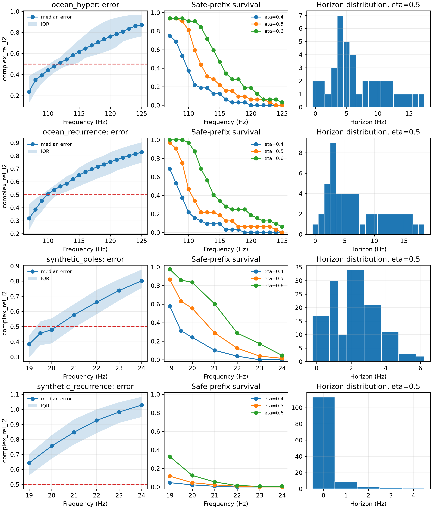

# Reliable-horizon Map M0：真实 Horizon 标签审计

> 历史证据 / 技术参考（2026-10-05 归档标记）：保留原实验、数值和复现路径。
> 文内“当前/下一步/待完成”描述属于当时阶段，不是现行任务；请先读[三条 Wave as Prompt 路线](../docs/wave_as_prompt/README.md)。

日期：2026-09-17

结论：**M0 GO。** 现有逐实例、逐频率指标足以定义稳定的 reliable-horizon 标签；Ocean hyper-pole
与 synthetic pole 两个主模型在 raw complex RelL2 阈值 0.5 下都有明显实例差异，适合进入 target-free
risk-score POC。Synthetic recurrence 在该阈值下几乎全体第一步失效，只保留为“always unsafe”
sanity control，不作为主分类任务。

## 1. 协议

- 主误差：逐环境 raw complex RelL2；
- 主阈值：0.5；敏感性阈值：0.4、0.6；
- 多 seed 合并：先对同一环境、同一频率的三 seed error 取均值，再计算首次越界；
- horizon：从最后可见或最后 development-calibration 频率开始，连续安全前缀的长度；
- 一旦某频率越界，即使更远频率偶然恢复，也不重新扩大可靠 horizon；
- 所有结果来自已有冻结 checkpoint 的 metric vectors，没有重新选择场预测模型。

完整实验前协议见
[Reliable-horizon Map 与 Sequential Calibration POC](../docs/RELIABLE_HORIZON_MAP_POC_ZH.md)。

## 2. 主图



左列给出逐环境误差的中位数与四分位区间；中列给出到达每个频率时仍保持整个前缀安全的环境比例；
右列给出主阈值 0.5 下的实例 horizon 分布。中列不是普通逐点准确率：某个环境一旦越界，后续全部
视为不再可靠，更符合 open-loop 部署语义。

## 3. 数值结果

### 3.1 主阈值 0.5

| 模型/数据域 | 环境数 | Median horizon | IQR | Mean horizon | 跨 seed horizon std | 越界后恢复率 |
|---|---:|---:|---:|---:|---:|---:|
| Ocean hyper-pole | 32 | 5.0 Hz | 4.0--8.0 Hz | 6.16 Hz | 0.37 Hz | 0% |
| Ocean recurrence | 32 | 3.0 Hz | 2.75--5.0 Hz | 4.94 Hz | 0.09 Hz | 0% |
| Synthetic poles | 128 | 2.0 Hz | 1.0--3.0 Hz | 1.93 Hz | 0.20 Hz | 1.6% |
| Synthetic recurrence | 128 | 0.0 Hz | 0.0--0.0 Hz | 0.20 Hz | 0.03 Hz | 0% |

### 3.2 阈值敏感性

| 模型/数据域 | Median horizon at 0.4 | Median horizon at 0.5 | Median horizon at 0.6 |
|---|---:|---:|---:|
| Ocean hyper-pole | 3.0 Hz | 5.0 Hz | 8.0 Hz |
| Ocean recurrence | 2.0 Hz | 3.0 Hz | 7.0 Hz |
| Synthetic poles | 1.0 Hz | 2.0 Hz | 3.0 Hz |
| Synthetic recurrence | 0.0 Hz | 0.0 Hz | 0.0 Hz |

## 4. 当前可以相信的发现

### 4.1 Horizon 不是只有群体平均意义

Ocean hyper-pole 的主阈值 horizon 从 0 Hz 分散到 18 Hz，四分位区间为 4--8 Hz。也就是说，虽然
群体中位误差大约在 112 Hz 越过 0.5，不同实例的可用范围差异很大。仅使用一个全局固定 cutoff 会
对一部分环境过度保守，对另一部分环境产生危险外推。

### 4.2 Prefix horizon 在当前两个主任务中是良定义的

Ocean 两个模型在三个阈值下均没有出现“越界后重新恢复”；Synthetic poles 的恢复率也只有
1.6%--3.1%。因此把首次越界作为停止点不是严重的人为简化。未来仍会同时保存逐点 risk，避免把
单调性当成普适物理定律。

### 4.3 Hyper-pole 延长平均 horizon，但没有消除实例风险

在 Ocean 主阈值下，hyper-pole 的 median horizon 比 recurrence 长 2 Hz，mean horizon 长约
1.22 Hz；但仍有实例在第一个未见频率就失败。这说明更强预测器和可靠性估计是互补问题：平均更好
不等于每个实例都安全。

### 4.4 标签相对 seed 稳定

两个主模型的平均跨 seed horizon 标准差分别只有 0.37 Hz 和 0.20 Hz，明显小于实例间 IQR。
因此 risk POC 学到的主要对象更可能是环境差异，而不是随机训练噪声。

## 5. 限制

- Ocean 只有 32 个 development validation environments，不足以支撑高容量 risk network；
- 当前 atlas 只有标签，没有证明任何 target-free feature 能预测标签；
- Synthetic recurrence 在主阈值下类别严重塌缩，AUROC 等分类指标没有意义；
- 0.5 是任务容忍度，不是波动方程给出的自然常数；
- 当前 horizon 是全场级，尚未构造空间 patch risk map。

## 6. M1 决策

下一步只做冻结预测器上的低容量风险估计：

1. query distance baseline；
2. 三 seed prediction disagreement；
3. hyper-pole 与 recurrence disagreement；
4. 预测场能量、相位增量和谱曲率；
5. 在环境级 folds 上做 isotonic 或 conformal calibration。

在证明这些 target-free signals 能稳定预测误差前，不训练空间 risk U-Net，也不启动 sequential policy。

## 7. 复现

```bash
.venv/bin/python -m spectral_continuation.summarize_horizon_atlas \
  --group 'ocean_hyper=experiments/runs/m4_balanced_train106_hyper_seed*/validation_metrics.npz' \
  --reference-frequency ocean_hyper=106 \
  --group 'ocean_recurrence=experiments/runs/m4_balanced_train106_recurrence_seed*/validation_metrics.npz' \
  --reference-frequency ocean_recurrence=106 \
  --group 'synthetic_poles=experiments/runs/m2_synthetic_endpoint_poles_seed*/validation_metrics.npz' \
  --reference-frequency synthetic_poles=18 \
  --group 'synthetic_recurrence=experiments/runs/m2_synthetic_recurrence_l1_seed*/validation_metrics.npz' \
  --reference-frequency synthetic_recurrence=18 \
  --thresholds 0.4,0.5,0.6 \
  --primary-threshold 0.5 \
  --output-dir artifacts/reliable_horizon_map/m0_atlas_20260917
```

实现入口：

- `spectral_continuation.horizon`：prefix-safe horizon 与恢复诊断；
- `spectral_continuation.summarize_horizon_atlas`：多 seed 标签聚合、表格和图；
- `configs/reliable_horizon_map_poc_20260917.json`：冻结阈值、指标和 gates。
