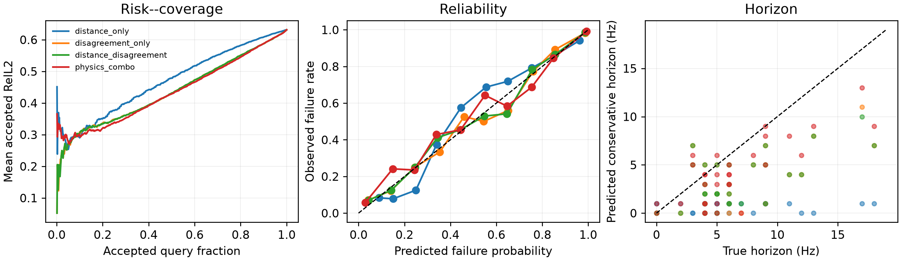
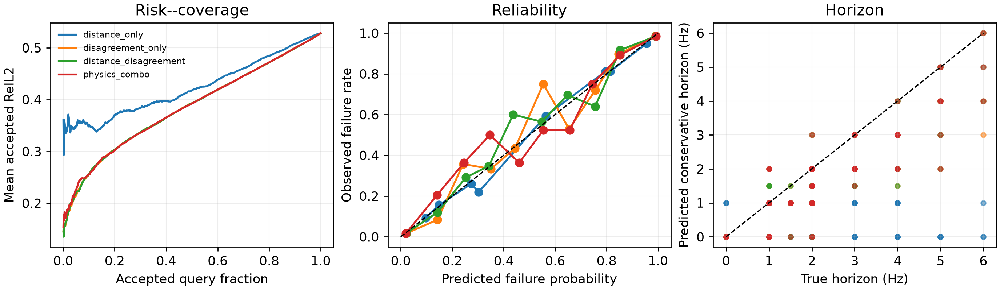

# Reliable-horizon Map M1：Target-free 风险预测

日期：2026-09-17

结论：**development GO，进入 sequential calibration POC。** 三 seed 冻结预测的 disagreement 在
Ocean 和 synthetic 两个域都能显著预测实例级频率外推失败，而且在固定查询频率内仍然有效。主阈值
0.5 下通过修正后的全部 M1 gates；strict environments 尚未打开，因此当前不是最终泛化结论。

## 1. 任务

部署预测是三个独立 seed 复场预测的逐点复均值。风险模型不能读取查询真值，只能读取：

- query distance；
- 三 seed 的 complex、amplitude 和 phase disagreement；
- 预测场 norm、低幅值比例和空间 roughness；
- 预测随频率的 step change 与 spectral curvature。

查询真值只用于产生监督标签：ensemble raw complex RelL2 是否超过 0.5。所有风险结果使用按物理环境
划分的四折交叉验证；同一环境的不同频率不会跨 fold。

## 2. 为什么必须报告 fixed-frequency 指标

如果把所有频率混在一起，单独使用 query distance 就有很高 AUROC，因为群体误差本来就随频率距离
增加。这只能回答“哪个频率更远”，不能回答“在同一个频率上哪个实例会先失败”。

因此本报告同时给出：

- **pooled AUROC/Spearman**：整体风险排序；
- **within-frequency AUROC/Spearman**：每个频率单独评价后再平均，衡量实例辨别能力。

后者是 Reliable-horizon Map 相比固定全局 cutoff 的核心增量。

## 3. 主结果

### 3.1 Ocean hyper-pole ensemble，90--100 Hz 输入，107--125 Hz 查询

| 方法 | Failure AUROC | Fixed-f AUROC | Error Spearman | Fixed-f Spearman | Oracle gap closed | Safe rate | Accepted queries | Horizon MAE | Unsafe overreach |
|---|---:|---:|---:|---:|---:|---:|---:|---:|---:|
| Distance only | 0.891 | 0.371 | 0.702 | -0.133 | 0% | 91.7% | 3.9% | 5.75 Hz | 6.2% |
| Disagreement only | 0.955 | 0.906 | 0.897 | 0.719 | 50.0% | 92.9% | 16.1% | 3.75 Hz | 9.4% |
| Distance + disagreement | 0.955 | 0.903 | 0.897 | 0.718 | 49.8% | 93.0% | 16.4% | 3.69 Hz | 9.4% |
| Physics combo | **0.972** | **0.934** | **0.925** | **0.793** | **50.4%** | **94.3%** | **23.2%** | **2.69 Hz** | 12.5% |

“Safe rate”是在预测失败概率不高于 0.1 的 accepted queries 中，真实误差没有超过 0.5 的比例。

### 3.2 Synthetic pole ensemble，19--24 Hz 查询

| 方法 | Failure AUROC | Fixed-f AUROC | Error Spearman | Fixed-f Spearman | Oracle gap closed | Safe rate | Accepted queries | Horizon MAE | Unsafe overreach |
|---|---:|---:|---:|---:|---:|---:|---:|---:|---:|
| Distance only | 0.881 | 0.394 | 0.750 | -0.091 | 0% | 90.6% | 3.6% | 2.17 Hz | 2.3% |
| Disagreement only | **0.980** | **0.960** | **0.960** | **0.898** | **85.7%** | 98.3% | 32.1% | 0.78 Hz | 3.9% |
| Distance + disagreement | 0.980 | 0.960 | 0.960 | 0.898 | 85.5% | 98.3% | 32.3% | 0.77 Hz | 3.9% |
| Physics combo | 0.980 | 0.957 | 0.959 | 0.884 | 84.1% | **98.4%** | **34.0%** | **0.68 Hz** | **3.1%** |

## 4. 最重要的科学发现

### 4.1 Disagreement 不是 query distance 的替代写法

Distance-only pooled AUROC 在两个域都约为 0.88--0.89，但 fixed-frequency AUROC 只有 0.37--0.39，
接近或低于随机排序。Disagreement 的 fixed-frequency AUROC 则达到 0.906 和 0.960。

因此当前正信号不是平凡的“频率越远，风险越高”，而是：

> 独立训练的物理结构算子在谱状态上何时开始分歧，能够预测同一频率下哪些物理实例会先失效。

### 4.2 简单 ensemble disagreement 已经解释大部分收益

Physics combo 在 Ocean 上进一步提高 AUROC、accepted coverage 和 horizon MAE，但在 synthetic 上没有
超过 disagreement-only 的排序性能。根据最小方法原则，下一阶段默认使用 disagreement-only 作为
trigger，并把 physics combo 作为上界/消融，不新增 risk U-Net。

### 4.3 Ensemble 同时改善预测本身

Ocean 在 107 Hz 的 ensemble RelL2 为 0.2603，三 seed error 平均为 0.2659；125 Hz 分别为 0.8485
和 0.8897。Synthetic 在 19 Hz 分别为 0.3424 和 0.3731，24 Hz 分别为 0.7205 和 0.7979。
所以 ensemble 不是只提供 uncertainty，也温和改善了主预测。

### 4.4 风险预测仍是阈值相关的

主阈值 0.5 和较宽松阈值 0.6 在两个域均表现稳定。严格阈值 0.4 下，Ocean physics combo 虽然 AUROC
仍为 0.946，但在 $p\leq0.1$ 的少量 accepted queries 上 safe rate 只有 71.4%，说明小样本概率尾部
校准还不可靠。Sequential POC 只使用预注册主阈值 0.5，不根据敏感性结果挑选阈值。

## 5. Gate 审计

| Gate | Ocean | Synthetic | 判定 |
|---|---:|---:|---|
| AUROC 至少 0.75 | 0.972 | 0.980 | PASS |
| Error Spearman 至少 0.50 | 0.925 | 0.959 | PASS |
| Oracle ranking gap closure 至少 50% | 50.4% | 84.1% | PASS，Ocean 接近边界 |
| 名义 90% safe 的实际 safe rate 至少 85% | 94.3% | 98.4% | PASS |
| Unsafe overreach 不高于 15% | 12.5% | 3.1% | PASS |
| 跨域方向一致 | 是 | 是 | PASS |

原协议的“raw risk--coverage AUC 相对 distance 改善 15%”在 pilot 后发现数学上不可达到：即使直接用
真实误差做 oracle 排序，Ocean 和 synthetic 的上限也只有约 13.4% 和 10.5%。协议已透明修正为
oracle attainable gap closure；原始改善仍报告为 7.2% 和 9.3%。这项修正不能被描述为结果盲预注册。

## 6. 限制

- Ocean 只有 32 个 development environments，四折结果可能乐观；
- 风险模型与场模型共享 development distribution，尚未做 strict environment 验证；
- 三 seed ensemble 增加三倍推理成本；后续需要检验深度 ensemble、checkpoint snapshot 或单模型
  state perturbation 能否提供更便宜 disagreement；
- 当前是实例—频率风险，不是空间 patch risk map；
- 好的 failure ranking 不自动保证 calibration action 真能降低后续场误差。

## 7. M2 决策

进入最小 sequential calibration replay，但严格限制复杂度：

1. 先固定传感器阵列，只让策略决定何时请求 calibration；
2. disagreement-only 是主 trigger，physics combo 是消融；
3. 对比 no-calibration、固定 schedule、随机 schedule 和 oracle trigger；
4. 同时报告 acquisition cost、未观测 query coverage 和 raw complex RelL2；
5. 若 adaptive trigger 不能改善 cost--error frontier，则停止，不训练 RL 或主动 sensor policy。

## 8. 复现入口

- `spectral_continuation.evaluate_horizon_features`：从冻结三 seed checkpoint 提取 target-free features；
- `spectral_continuation.evaluate_horizon_risk`：按环境交叉验证 risk baselines；
- `spectral_continuation.risk`：轻量 logistic calibration、AUROC、AUPRC 和 risk--coverage；
- `artifacts/reliable_horizon_map/features_*`：特征与 ensemble 标签；
- `artifacts/reliable_horizon_map/risk_*`：交叉验证概率、表格和图。

