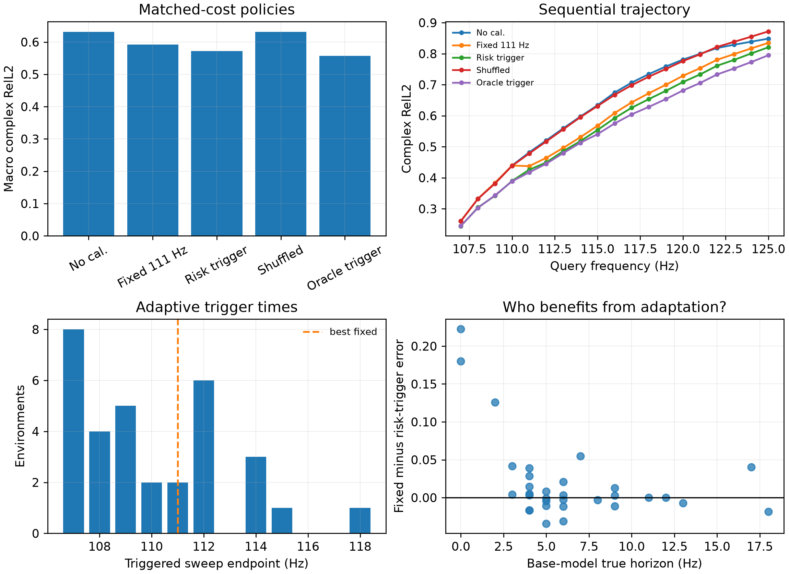

# Reliable-horizon Map M2a：Matched-cost 单次 Sequential Calibration

> 历史证据 / 技术参考（2026-10-05 归档标记）：保留原实验、数值和复现路径。
> 文内“当前/下一步/待完成”描述属于当时阶段，不是现行任务；请先读[三条 Wave as Prompt 路线](../docs/wave_as_prompt/README.md)。

日期：2026-09-17

结论：**机制级 GO，完整 M2 gate 尚未通过。** 在每个环境都只允许一次、且观测成本完全相同的条件
下，disagreement-triggered calibration 显著优于固定触发频率、随机实例—时间配对和 shuffled-instance
calibration，并关闭了 56.5% 的实例自适应 oracle gap。但它相对最佳固定策略的 raw error 改善为
3.37%，尚未达到完整 sequential 计划的 10% gate；下一步需要检验多次 horizon reset 的
error--cost frontier。

## 1. 最小 sequential 设置

### 1.1 初始状态

- 可见输入：90--100 Hz；
- 冻结场模型：三 seed Ocean hyper-pole ensemble；
- 风险 trigger：M1 的 disagreement-only 四折预测；
- 查询：107--125 Hz；
- 风险阈值：失败概率超过 0.1。

### 1.2 Calibration action

每个实例只允许触发一次六频短 sweep。若 trigger endpoint 为 $f_c$，固定稀疏阵列观测
$f_c-5$ 到 $f_c$，每个频率 92 个复数传感器值：

$$
6\times92=552
$$

个 complex observations。阵列位置、窗口宽度和 calibration 网络全部固定，策略只能决定 $f_c$。
滚动 sweep 可以理解为风险报警后对最近局部频带做一次短扫描。

所有策略继续评价完整空间场，包括 sweep 频率；没有因为购买 0.5% 的传感器而删除整个查询场。

### 1.3 对照

- no calibration；
- 对所有实例使用同一个 endpoint，并在 106--120 Hz 中报告开发集最佳固定 endpoint；
- disagreement risk trigger；
- physics-combo risk trigger；
- 将 risk trigger endpoints 在实例间随机置换；
- risk 时间不变，但使用其他实例的 calibration values；
- 每个实例事后选择最佳 endpoint 的 oracle trigger；
- dense calibration oracle，作为高成本上界。

## 2. 主结果

| 策略 | Complex observations / env | Macro raw complex RelL2 | 相对 no-cal 改善 |
|---|---:|---:|---:|
| No calibration | 0 | 0.63138 | 0% |
| Best fixed endpoint：111 Hz | 552 | 0.59197 | 6.24% |
| Physics-combo trigger | 552 | 0.57613 | 8.75% |
| **Disagreement trigger** | **552** | **0.57202** | **9.40%** |
| Shuffled-instance values | 552 | 0.63118 | 0.03% |
| Instance oracle trigger | 552 | 0.55664 | 11.84% |
| Dense calibration at risk time | 110,592 | 0.48491 | 23.19% |

Dense oracle 使用的观测数恰好是 sparse action 的 200 倍，不是 matched-cost competitor。

## 3. 自适应触发相对固定触发

Disagreement trigger 相比最佳固定 111 Hz：

- absolute RelL2 改善：0.01995；
- relative improvement：3.37%；
- environment-level paired 95% CI：0.00272--0.04134；
- 逐环境胜率：53.1%；
- 关闭 fixed-to-instance-oracle gap：56.46%。

胜率只有略高于一半，但均值和置信区间为正，是因为主要收益集中在 true horizon 很短、固定 111 Hz
触发已经过晚的困难实例。这与 reliable-horizon 的任务动机一致。

## 4. 随机配对与 shuffled-instance controls

保持 risk policy 产生的 32 个 trigger endpoints 完全不变，只在实例间做 20,000 次随机置换：

- risk 正确配对：0.57202；
- permutation mean：0.59966；
- permutation 95% range：0.58662--0.61271；
- one-sided permutation $p<5\times10^{-5}$；
- 相比 permutation mean 改善：4.61%。

如果进一步把 calibration values 换成其他实例，误差变为 0.63118，几乎退回 no-calibration 的
0.63138。这两个 control 共同说明：

> 正结果既需要把 calibration 放在合适的频率，也需要它来自正确的物理实例。

## 5. 为什么当前只判为 M2a 机制级 GO

完整 M2 预注册要求 matched-cost error 相比最佳固定 schedule 改善至少 10%，或匹配误差时减少至少
20% 观测。单次 action 的实际改善为 3.37%，没有通过该 gate。

另一方面，这个受限 one-trigger protocol 的 instance oracle 相比最佳固定策略最多只能改善 5.97%；
risk trigger 已经关闭其中 56.5%。因此当前瓶颈不是 trigger 完全无效，而是“一次局部 AR state reset”
本身可带来的总收益有限。这里不修改完整 M2 gate，也不把 oracle ceiling 当作最终成功标准。

## 6. 当前科学解释

1. **Risk map 具有决策价值。** M1 的 ranking 改善能转化成同成本下更低的场误差；
2. **全局固定 calibration time 不适合异质实例。** 最优固定点为 111 Hz，但风险策略分布在
   107--118 Hz；
3. **最困难实例需要更早 reset。** 主收益集中在 base true horizon 较短的环境；
4. **Calibration 仍然只有局部寿命。** 即使正确触发，误差仍随离 trigger 的距离上升；
5. **Dense observation 还有大 gap，但成本极高。** 后续重点应是多次廉价 reset，而不是把单次阵列
   扩大 200 倍。

## 7. 下一步 M2b

M2b 将继续保持固定阵列与冻结场模型，只增加 repeated decision：

1. 为每个 rolling calibrated state 计算三 seed disagreement；
2. 校准该状态自己的 failure risk，而不是继续使用初始 risk curve；
3. 比较 0、1、2、3 次 action 的 error--cost frontier；
4. 固定 schedule 允许在开发集上全局调到最优，形成强 baseline；
5. risk policy 按实例决定下一次 horizon reset；
6. 若相同成本下仍不能达到完整 M2 gate，则停止，不训练 RL。

## 8. 限制

- 结果来自 32 个 development Ocean environments，strict set 未打开；
- AR calibrator 只在 101--106 Hz 训练，本实验假设它可平移到后续六频窗口；
- 当前没有第二数据域的 sequential calibrator；
- endpoint selection 和 calibration 共享同一 development distribution；
- 只验证一次 action，尚不是完整 active acquisition policy。

## 9. 复现入口

- `spectral_continuation.evaluate_sequential_calibration`：冻结三 seed calibrator 的 rolling sweep replay；
- `spectral_continuation.summarize_sequential_calibration`：matched-cost policy、permutation control、
  oracle-gap 和图表；
- `artifacts/reliable_horizon_map/sequential_replay_ocean_20260917`：逐实例/endpoint error tensor；
- `artifacts/reliable_horizon_map/sequential_summary_ocean_20260917`：汇总与主图。
