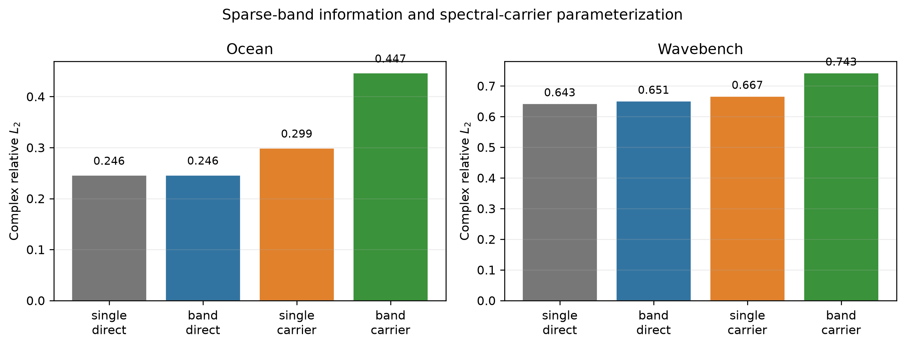
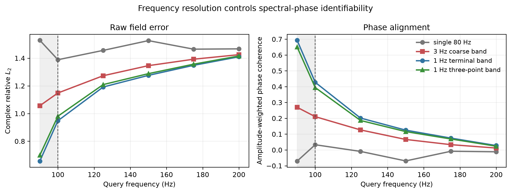
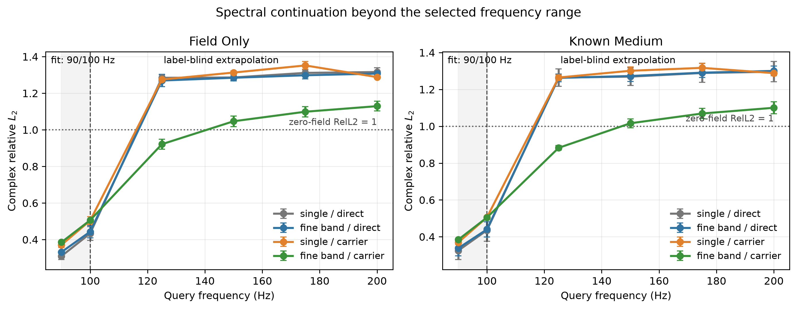
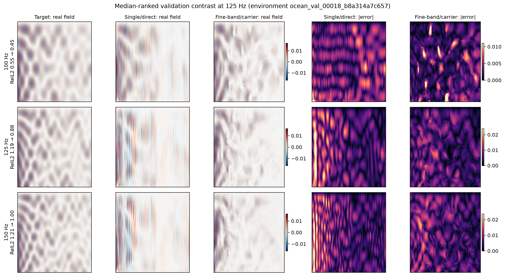
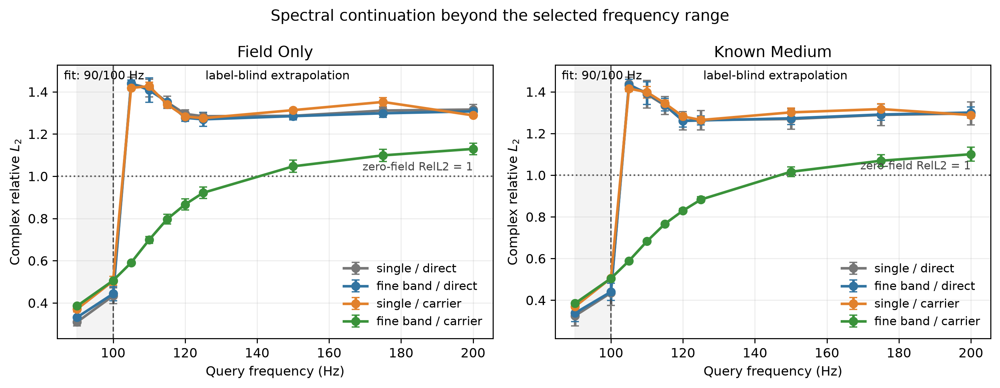

# 谱连续算子第一阶段报告

> 历史证据 / 技术参考（2026-10-05 归档标记）：保留原实验、数值和复现路径。
> 文内“当前/下一步/待完成”描述属于当时阶段，不是现行任务；请先读[三条 Wave as Prompt 路线](../docs/wave_as_prompt/README.md)。

> 状态：历史 M0/M1 报告。当前连续谱状态结果请先读
> [连续复谱状态](../docs/CONTINUOUS_SPECTRAL_STATE_ZH.md)。

更新时间：2026-09-15。本文是第一阶段历史报告；旧 APEX/APEX-H 证据的逐项来源见
[冻结证据与归因](../docs/APEX_LEGACY_EVIDENCE_ZH.md)，实验前计划见
[第一阶段计划](../docs/STAGE1_PLAN_ZH.md)。

## 1. 结论先行

第一阶段得到的不是“现有方法已经可以投稿”，而是一个比整数倍迁移更清楚、且经受住
反例的研究问题：

> 给定同一物理实例的一小段低频复波场，能否先辨识局部谱相位的传播速度，再把冻结的
> 传播表征查询到训练频带以外？

目前证据支持继续做这个问题，但不支持把当前 M1 当作最终方法。

1. 旧 APEX-H 最可信的收益仍是极少高频标签下约 7.5%–9.4% 的 sample-efficiency
   改善；它没有证明 fully supervised operator 更强，也没有证明 flow matching 必要。
2. 把任意几个低频简单拼起来不工作。WaveBench 的 10/15/20→40 Hz 和 Ocean 的
   50/100→200 Hz 都没有优于强单频 direct baseline。
3. 失败原因之一可被物理量化：相邻频率间隔必须足够小，才能从主值相位辨识传播延迟。
   在当前 Ocean 几何中，理论临界间隔约为 0.98 Hz；旧的 5–50 Hz 间隔已经严重混叠。
4. 使用 79/80 Hz 细频带后，无训练的 phase carrier 在 90 Hz 相对单频 carrier 将 raw
   complex RelL2 从 1.529 降到 0.656，下降 57.1%；3 Hz 间隔只能降到 1.056。
5. 在所有 checkpoint 冻结后新生成的 105/110 Hz 上，M1 的 known-medium raw error 为
   0.588/0.683，强单频 direct 为 1.437/1.389，三 seed 平均相对下降 **59.0%/50.7%**；
   每个 seed 的每个 validation 环境都改善。
6. 在 128 个训练环境上只拟合 90/100 Hz 查询、冻结 checkpoint 后，M1 在 125 Hz 的
   known-medium raw error 为 **0.883 ± 0.013**，强单频 direct 为
   **1.264 ± 0.047**，三 seed 平均相对下降 **30.0% ± 3.2%**。field-only 轨道相对
   下降 **28.2% ± 2.9%**。
7. 该收益确实来自相位而不是更好的幅值：125 Hz 时 M1 的 amplitude error 略差于
   direct（0.549 对 0.510），但 phase coherence 从 0.018 提高到 0.342。这既验证了
   相位先验，也暴露了下一阶段应补的幅值/路径包络表征。
8. 当前 M1 在 90/100 Hz 区间内拟合上明显弱于 direct，且优势随外推距离衰减；150 Hz
   后平均 raw error 又超过零预测基准的 1.0。因此它是一个有效的外推归纳偏置，不是完整
   解法。

阶段判断：**问题方向 GO；当前方法与投稿计划 NO-GO。** 下一阶段应围绕“可辨识的谱采样
与学习到的传播/包络表示”推进，而不是继续堆 loss 或恢复 flow matching。

## 2. 旧结果整理与保守归因

### 2.1 可以保留的事实

| 数据与任务 | Direct raw RelL2 | APEX-H R1 | 相对下降 | 统计证据 |
|---|---:|---:|---:|---|
| WaveBench 20→40 Hz，K=1 | 0.86688 | 0.80205 | 7.48% | 500 held-out fields，三 seed，98.6% 样本改善 |
| Ocean 100→200 Hz，K=1 | 0.80793 | 0.73190 | 9.41% | 96 strict environments，三 seed，96/96 改善 |

这说明 carrier-relative residual 在高频标签极少时提供了稳定 inductive bias。它不等价于
“低频可以唯一决定高频”，也不等价于“幅值完全不变”。

### 2.2 不再作为主张的内容

- 充分监督 source operator 没有稳定优于 raw/direct 表示；
- selective gate、local adapter、更深网络和等价 loss 没有稳定突破；
- 现有条件分布并未被证明为多模态，因此 flow matching 没有获得必要性证据；
- 非二倍频 development 结果只能说明旧公式不局限于平方操作，不能支撑任意倍率泛化。

最合理的旧结果归因是：单频 harmonic carrier 捕获了一部分传播相位结构，但单频只能看到
模 $2π$ 的相位，约 8%–10% 的平台更可能是信息可辨识性上限，而不只是优化不足。

## 3. 新任务的第一性原理

给定同一环境和源实例在若干低频处的复波场，以及可选介质信息，预测一个未见查询频率：

$$
[u(x,f_j)]_{j=1}^{m}, c(x), f_q
→ u_θ(x,f_q)
$$

其中查询频率 $f_q$ 高于所有已观测频率。

整数倍频只是一个容易理解的评测切片，模型定义并不要求 $f_q/f_j$ 为整数。

局部复波场可以写成传播分量的叠加：

$$
u(x,f) ≈ Σ_{p=1}^{P} a_p(x,f)e^{i2πfτ_p(x)}.
$$

相对稳定的对象不是干涉后的观测幅值 $|u|$，而更可能是缓变包络 $a_p$ 与旅行时间
$τ_p$。单频相位只提供相位在 $2π$ 周期下的等价类；相邻频率提供的比值则消除了绝对
相位 gauge。记 $A(z)$ 为复数 $z$ 的主值相角，则

$$
Δφ(x)=A(u(x,f_1)u(x,f_0)^*).
$$

若只使用主值相位，为避免单路径延迟发生频谱混叠，大致需要

$$
Δf < 1/(2τ_{max}).
$$

当前 Ocean 最大传播距离约 750 m，最低水中声速约 1470 m/s，因此
$τ_{max}≈0.51$ s，临界 $Δf≈0.98$ Hz。这给出了一个可证伪、可跨域
迁移的实验设计原则：**需要按传播时延选择频率采样密度，而不是任意增加低频数量。**

## 4. 最小方法：先检验信息，再检验表示

### 4.1 M0：matched direct query operator

输入采用三个固定频率 slot。每个 slot 含复场实部/虚部、频率图和存在 mask；80 Hz 在
单频与细频带条件中始终位于同一个 slot。另输入归一化空间坐标、查询频率，以及在
known-medium 轨道中的四个实际生效介质通道。四尺度 U-Net 直接回归
$u_θ(x,f_q)$。

### 4.2 M1：carrier-relative query operator

对 79/80 Hz 两个末端频率，构造局部谱割线 carrier：

$$
φ_c(x,f_q)=A(u(x,80))
+ ((f_q-80)/(80-79))A(u(x,80)u(x,79)^*),
$$

$$
c_q(x)=e^{iφ_c(x,f_q)},
u_θ(x,f_q)=c_q(x)z_θ(x,f_q).
$$

网络只需预测 carrier 坐标系中的复系数 $z_θ$。M0 和 M1 使用完全相同的输入、U-Net、
1,229,842 个参数、初始化、更新数和唯一最终损失：

$$
L=(1/B)Σ_{b=1}^{B}
(||u_{θ,b}-u_b||_2^2/||u_b||_2^2).
$$

没有 amplitude loss、phase loss、consistency loss 或 flow objective。因而 M1 与 M0 的差异
可直接归因于输出表示/坐标系，而不是 loss stacking。

## 5. 数据与无泄漏协议

### 5.1 WaveBench 固定目标对照

- isotropic acoustic，10/15/20/40 Hz；
- 使用旧项目冻结的 seed-42 development IDs；
- 2,000 train + 500 validation，另 500 个旧 held-out fields 从未读取；
- 只适合检验 20 Hz 单频与 10/15/20 Hz 粗频带预测 40 Hz，不足以检验连续查询。

### 5.2 Ocean Pekeris 细频带数据

- 128 train + 32 validation environments；另登记 32 strict environments，但不生成 strict
  fields；
- 每个环境跨频率严格配对，网格为 48×384，深度 1–78 m，距离 50–750 m；
- 初始频率为 74–80、90、100、125、150、175、200 Hz；
- source depth 和 source coordinate 不作为模型输入，只通过可见低频场隐式携带；
- Pekeris 求解器不使用 seabed attenuation，因此正式运行只保留 water speed、water
  depth、seabed speed、seabed density 四个 active channels。加载器会显式拒绝缺失通道，
  并在每个 summary 记录被排除的 nuisance channel。

训练只使用 90/100 Hz 查询。checkpoint 选择指标是这两个 validation 查询的 raw complex
RelL2 宏平均。125/150/175/200 Hz 不参与归一化、训练和选择，只在 checkpoint 冻结后评估
一次。三随机种子为 42/43/44。

## 6. 实验结果

### 6.1 粗频带反例：多频本身不够

| 域与设置 | 单频 direct | 粗频带 direct | 相对变化 |
|---|---:|---:|---:|
| WaveBench known-medium，20→40 对 10/15/20→40 | 0.64253 | 0.65078 | -1.28% |
| WaveBench field-only | 0.66763 | 0.67555 | -1.19% |
| Ocean known-medium，100→200 对 50/100→200 | 0.24613 | 0.24645 | -0.13% |
| Ocean field-only | 0.27052 | 0.27142 | -0.33% |

负号表示加入粗频带后反而更差。对应 coarse carrier 更差，符合相位增量已经 alias 的解释。
这些是单 seed development 对照，不作为性能 claim；它们的作用是排除“拼更多输入自然会
提升”的替代解释。Ocean known-medium 的这一轮早于 active-channel 审计，输入还包含求解器
不使用的 attenuation nuisance；field-only 与无训练相位结果不受其数值内容影响。它因此只
作为探索性反例，不与后续四通道正式统计混合。

### 6.2 无训练的相位可辨识性探针

以下方法都直接沿用 80 Hz 幅值，只改变 phase carrier，因此幅值误差完全相同；差异只来自
相位估计。

| 查询频率 | 单频 80 | 74/77/80（3 Hz） | 79/80（1 Hz） | 78/79/80（1 Hz） | 79/80 相对单频 |
|---:|---:|---:|---:|---:|---:|
| 90 | 1.529 | 1.056 | **0.656** | 0.699 | **57.1%** |
| 100 | 1.389 | 1.148 | **0.948** | 0.981 | **31.7%** |
| 125 | 1.456 | 1.273 | **1.192** | 1.209 | **18.2%** |
| 150 | 1.527 | 1.346 | **1.276** | 1.288 | **16.4%** |
| 175 | 1.465 | 1.392 | **1.348** | 1.357 | **8.0%** |
| 200 | 1.467 | 1.425 | **1.410** | 1.416 | **3.9%** |

两点 1 Hz terminal band 比三个 1 Hz 点略好，说明多路径谱曲率使“更多点的线性拟合”不一定
优于最靠近边界的局部导数。收益随外推距离衰减，符合局部 continuation 而不是全局
harmonic law。

### 6.3 学习算子：known-medium 主轨道

均值与标准差跨三个初始化 seed；主指标为逐环境等权 raw complex RelL2。

| 查询频率 | 单频/direct | 细频带/direct | 细频带/carrier M1 | M1 对强单频 | M1 对 matched band/direct |
|---:|---:|---:|---:|---:|---:|
| 90 | **0.325 ± 0.049** | 0.338 ± 0.041 | 0.384 ± 0.004 | -20.6% | -15.4% |
| 100 | **0.435 ± 0.060** | 0.440 ± 0.041 | 0.505 ± 0.002 | -18.0% | -15.7% |
| 125 | 1.264 ± 0.047 | 1.263 ± 0.021 | **0.883 ± 0.013** | **30.0%** | **30.1%** |
| 150 | 1.269 ± 0.049 | 1.273 ± 0.029 | **1.016 ± 0.024** | **19.8%** | **20.1%** |
| 175 | 1.289 ± 0.051 | 1.291 ± 0.027 | **1.069 ± 0.028** | **16.9%** | **17.2%** |
| 200 | 1.296 ± 0.055 | 1.300 ± 0.027 | **1.100 ± 0.033** | **14.8%** | **15.4%** |

125 Hz 上 M1 对 matched band/direct 的每-seed 相对改善为 29.31%、30.61%、30.28%，
标准差仅 0.55 个百分点；三个 seed 分别在 30/32、32/32、30/32 个 validation 环境上改善，
paired absolute-improvement 95% CI 均严格大于零。反过来，band/direct 相对 single/direct
在 125–200 Hz 的三-seed 平均变化始终约为 0%。因此因果分解很明确：**细频带信息只有
通过 phase-resolved 表示才转化为外推收益。**

### 6.4 field-only 压力测试

| 查询频率 | 单频/direct | 细频带/carrier M1 | 三-seed 相对下降 |
|---:|---:|---:|---:|
| 90 | 0.310 ± 0.019 | 0.386 ± 0.003 | -25.0% |
| 100 | 0.434 ± 0.038 | 0.506 ± 0.002 | -17.6% |
| 125 | 1.284 ± 0.016 | **0.921 ± 0.028** | **28.2%** |
| 150 | 1.286 ± 0.015 | **1.047 ± 0.029** | **18.6%** |
| 175 | 1.311 ± 0.016 | **1.099 ± 0.028** | **16.2%** |
| 200 | 1.316 ± 0.024 | **1.129 ± 0.027** | **14.1%** |

不提供显式介质仍保持同方向，说明结果不是从环境通道直接反演高频；但它同样存在明显的
in-range trade-off，不能据此声称 field-only 已经被解决。

### 6.5 幅值/相位归因

known-medium 125 Hz 的三-seed 均值：

| 方法 | complex RelL2 | amplitude RelL2 | 加权 phase MAE | phase coherence |
|---|---:|---:|---:|---:|
| 单频/direct | 1.264 | **0.510** | 1.548 rad | 0.018 |
| 细频带/carrier M1 | **0.883** | 0.549 | **1.116 rad** | **0.342** |

M1 并没有偷偷通过幅值指标获胜：它牺牲了一点幅值精度，靠显著更好的相位对齐降低复场误差。
这正好把旧 APEX 的 motivation 精炼为一个可操作结论：幅值/包络较平滑，但最先限制长程
迁移的是相位可辨识性；解决相位之后，包络误差成为新的瓶颈。

下图使用预先定义的可复现选择规则：按 125 Hz 的“baseline error − M1 error”排序，选取
中位 validation 环境，而非挑选最好案例。它显示 M1 在 125/150 Hz 保留了更多真实干涉
条纹，但仍有明显远距离幅值误差。

### 6.6 预登记的稠密外推窗口

24 个 checkpoint 全部冻结后，才生成 105/110/115/120 Hz 新标签。新 archive 包含相同的
160 个 development environments；评估器在读取结果前验证了 ID、split、四个 active
介质通道和所有共享频率 field 均 bitwise identical。

known-medium 的一次性结果如下：

| 新查询频率 | 单频/direct | 细频带/direct | 细频带/carrier M1 | M1 对强单频 | M1 对 matched band/direct |
|---:|---:|---:|---:|---:|---:|
| 105 | 1.437 ± 0.033 | 1.432 ± 0.028 | **0.588 ± 0.003** | **59.0% ± 1.1%** | **58.9% ± 0.9%** |
| 110 | 1.389 ± 0.066 | 1.394 ± 0.054 | **0.683 ± 0.004** | **50.7% ± 2.5%** | **51.0% ± 1.8%** |
| 115 | 1.334 ± 0.044 | 1.338 ± 0.030 | **0.766 ± 0.006** | **42.5% ± 2.1%** | **42.7% ± 0.9%** |
| 120 | 1.261 ± 0.044 | 1.260 ± 0.029 | **0.830 ± 0.010** | **34.1% ± 2.8%** | **34.1% ± 0.8%** |
| 125 | 1.264 ± 0.047 | 1.263 ± 0.021 | **0.883 ± 0.013** | **30.0% ± 3.2%** | **30.1% ± 0.6%** |

field-only 在 105/110 Hz 的 M1 raw error 为 0.590/0.699，强单频 direct 为
1.438/1.417，相对下降 58.9%/50.7%，方向与 known-medium 一致。105 和 110 Hz 上，两个
轨道、三个 seed 的每一个 validation environment 均由 M1 改善。

这组新标签给出了三个比单点 improvement 更有意义的量：

- **crossover 被夹在 100 与 105 Hz 之间。** 100 Hz 上 direct 更好，但只向训练频带外走
  5 Hz，direct 的绝对相位外推立即失效，M1 仍保持 0.588；
- **可用 horizon 从 100 延伸到 125 Hz。** 以零场预测必然得到 RelL2=1 为阈值，direct 在
  第一个未见点 105 Hz 已超过 1，M1 到 125 Hz 仍低于 1，到 150 Hz 才升到 1.016；
- **优势形成连续曲线而非挑出的频点。** 105→125 Hz 的相对下降随距离单调地从 59.0%
  变为 30.0%，符合局部 phase continuation 的预期。

## 7. 失败实验为何重要

| 观察 | 排除的解释 | 新归因 |
|---|---|---|
| WaveBench/Ocean 粗频带 direct 不改善 | 更多低频输入自然更强 | 需要与传播延迟匹配的频率分辨率 |
| 3 Hz carrier 明显弱于 1 Hz carrier | 任意两频割线都能外推 | 主值相位存在可计算的 alias 条件 |
| 细频带 direct 在 OOD 与单频持平 | 正结果仅来自多一个场 | 表示方式决定能否利用谱相位 |
| 单频 carrier 在 OOD 仍失败 | carrier 这个名字本身有效 | 必须先辨识相邻谱增量 |
| M1 幅值误差没有改善 | 幅值迁移已经被充分利用 | 下一瓶颈是路径包络/幅值表示 |
| M1 区间内拟合更差 | M1 是普遍更强的 operator | 它目前是外推偏置，存在明确 crossover |

## 8. 阶段判定与下一步

### 8.1 为什么这个问题值得继续

- 任务从“20→40 的固定映射”提升为 queryable spectral continuation，但仍保留低频到高频
  的一句话直觉；
- 频率采样密度由旅行时间给出物理准则，任务设计不再是随意挑倍率；
- matched 2×2 因子实验把额外信息与表示贡献拆开，当前 125 Hz 表示贡献约 30%，明显大于
  旧 APEX 的 8%–10%；
- field-only 与 known-medium 同方向，显示它具有成为通用频谱条件算子的潜力。

### 8.2 为什么当前版本仍不能投稿

- 只有 Ocean Pekeris 一个域拥有满足相位分辨率条件的密集频率数据；WaveBench 只能作为
  粗采样反例，不能算第二个正数据集；
- M1 在训练查询上损失 18%–25%，尚未形成统一优于 direct 的模型；
- 125 Hz 之后 raw error 很快回到 1 以上，可用 continuation horizon 虽被延长但仍短；
- 当前 carrier 是单局部谱斜率，不能分解多路径，也没有显式利用缓变包络；
- validation environments 只有 32 个，strict registry 尚未打开。

### 8.3 建议的 M2 顺序

1. **先做可用带宽与 crossover 建模。** 用本次稠密 105–125 Hz 曲线确定 direct 与
   carrier 各自优势区间；不增加新 loss，先尝试共享 encoder 的轻量双坐标解码或基于可见
   谱一致性的置信度混合。
2. **再做学习到的传播表示。** 将 79/80 Hz 频率集合编码为少量复包络与 delay tokens，
   用 $Σ_p a_p e^{i2πf_qτ_p}$ 解码。第一版只比较一个 path-token 模块与 M1，
   不同时堆幅值、相位和一致性 loss。
3. **把幅值作为结构，不作为额外指标游戏。** 学习缓变的 carrier-relative 包络，或在
   delay-token 解码器中让 $a_p(x,f)$ 低阶依赖频率；主损失仍保持 raw complex
   error。
4. **建立第二个 phase-resolved 域。** 优先生成具有连续频率控制的 variable-medium
   Helmholtz/elastic 数据；频率间隔按各域 $τ_{max}$ 预注册。不要强行把只有
   10/15/20/40 Hz 的 WaveBench 说成正验证。
5. **最后才决定是否需要生成式模型。** 只有在隐藏源/边界导致重复条件呈现多模态时，才用
   conditional distribution 或 flow；否则确定性谱算子更简洁。

## 9. 可复现性与证据边界

- Ocean fine-band archive SHA256：
  `603890808c6cbf541583203730f81abbf61f69ca779647441065db36d782323d`；
- generator manifest SHA256：
  `d95d7c7426c8535c49355dc2b9146ffa40df3f3f053c524e0b7c85c883e27e3c`；
- Ocean dense-horizon archive SHA256：
  `412e437d5c5cbf1b286f84af61e38aab3f896de25029b5a97a3f49a9bfa2383b`；
- dense-horizon manifest SHA256：
  `29a70954da0440abfb4690781f67d2cc4d8c27a4e37963975382f70f06f1100f`；
- APEX generator revision：`ebb305e17b15f1f15ed367ed6ffe7a83a8a78b83`；
- ocean-acoustic-agent revision：`12a59a0c13058b21522bde5b0d74fe6ad02ee973`；
- 24 个 checkpoint 均保留本地 SHA256、选择 epoch、逐环境 metric vectors 和完整参数；
- 32 个 strict Ocean environments 只登记参数，未生成或读取 fields；
- `artifacts/` 只提交 compact summary、CSV、图和 provenance；大型 checkpoint 与数据不进入
  Git。

所有数字都是 development-stage 证据。除旧 APEX 明确标为 locked/strict 的两行外，本文
不得把新结果称为 held-out test performance。
