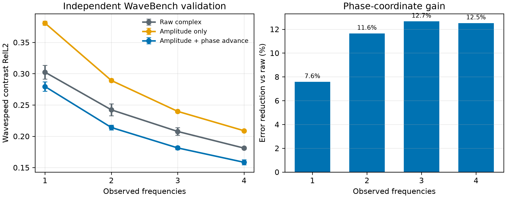
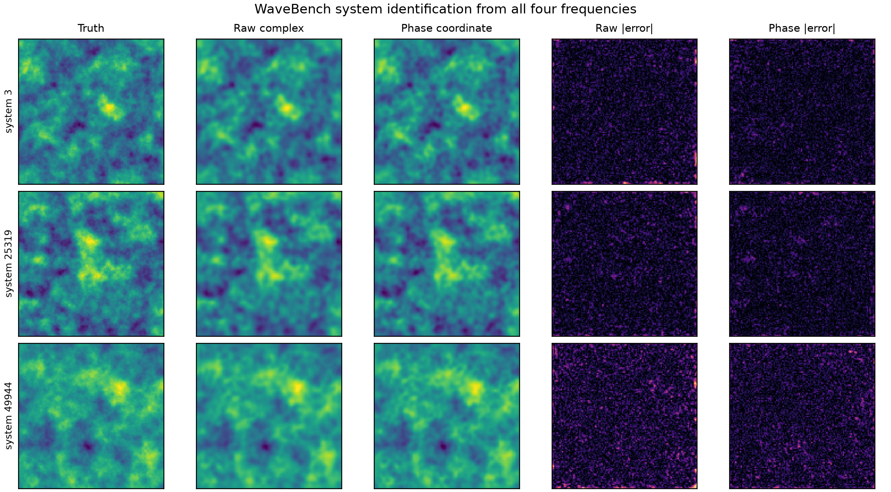

# M1：WaveBench 独立验证与高维复波场表示路线

> 历史证据 / 技术参考（2026-10-05 归档标记）：保留原实验、数值和复现路径。
> 文内“当前/下一步/待完成”描述属于当时阶段，不是现行任务；请先读[三条 Wave as Prompt 路线](../docs/wave_as_prompt/README.md)。

> 冻结日期：2026-09-23
> 结论级别：公开独立数据集上的三随机种子 matched comparison。
> 本报告回答两个问题：当前频率感知表示是否具有跨数据集实用性；如何从二维 raster token 走向
> 二维、三维乃至时空复数场的统一表示。

## 1. 先说结论

当前的 `amplitude + local phase advance` 表示在公开 WaveBench time-harmonic acoustic 数据上重复了正
信号。用 1、2、3、4 个频率响应反演同一个未知 wavespeed system 时，相对完全相同网络和训练预算的
raw real/imag 输入，三 seed 平均误差分别降低 **7.6%、11.6%、12.7%、12.5%**。

这证明了它不是只对我们自建 simulator 有效。但是，预先写下的强门槛是“至少两个 sparse budget 达到
15% 且三个 seed 同向”，本轮**没有通过 15% 效应量门槛**。正确的结论是：

> 局部相位推进是一个可复现、跨数据集的 measurement-efficiency inductive bias；它还不是足以单独
> 构成新架构论文的显著突破。

本轮还检验了两个更具复数几何味道的 edge-connection token。它们保持 global phase invariance，也能
自然扩展到任意维数，但都没有超过当前 soft phase-gradient token。因此，不应继续手工设计更多固定
通道；下一步应把复连接作为 observation primitive，学习 dimension-agnostic 的图或点集聚合算子。



## 2. 为什么 WaveBench 是有效的第二数据集

WaveBench 是公开的波动 PDE benchmark。这里使用 time-harmonic isotropic acoustic 子集：同一个
wavespeed realization 对应 10、15、20、40 Hz 四个对齐的 complex pressure fields。它与我们原来的
数据在 simulator、介质分布、网格、频率和任务代码上独立。

我们没有使用 WaveBench 最常见的 forward surrogate 任务，而是把四个响应看成同一隐藏系统的可变
观测集合：

```text
输入：同一系统的任意 1--4 个 complex pressure fields + 各自频率
输出：产生这些响应的 wavespeed field
目的：测量不同复场坐标保留了多少 system-identifying information
```

这仍是表示学习 probe，不是把研究主线切换到一般逆问题。选择 wavespeed recovery 的原因是它提供了
一个与绝对相位基准无关、逐系统可验证的 readout；所有表示使用同一个 shared set encoder 和 decoder。

## 3. 冻结协议

### 3.1 数据划分

- 数据：WaveBench isotropic time-harmonic，50,000 个对齐系统；
- 固定 split seed：42；
- train / validation / test：8,000 / 500 / 500 个系统；
- 同一系统的不同频率绝不跨 split；
- 正式随机种子：20260923、20260924、20260925。

### 3.2 三个 matched 输入表示

1. `raw complex`：real、imaginary 两通道；
2. `amplitude only`：view-RMS 归一化后的 log amplitude；
3. `amplitude + phase advance`：log amplitude，加水平和竖直相邻点复共轭乘积的 real/imag，共五通道。

第三个表示不做 phase unwrapping。若整幅场乘任意 global complex phase，局部共轭乘积保持不变；低
amplitude 区域用 soft energy floor 降低不可信相位的权重。

### 3.3 公平性

- 每个 view 使用同权重 convolutional encoder；
- unordered views 用同一个 4-slot aggregation；
- 一个 checkpoint 同时处理所有 frequency budgets；
- 三个表示使用相同 width、decoder、optimizer、训练步数和 model-selection protocol；
- 评价枚举每个预算下所有频率子集，而不是只挑有利组合。

主指标是 wavespeed contrast RelL2：误差相对于测试系统偏离训练均值的能量归一化。另报告普通 physical
RelL2，防止 contrast normalization 夸大数值。

## 4. 正式结果

### 4.1 三 seed 聚合

| 观测频率数 | Raw complex | Amplitude only | Amplitude + phase advance | 相对 raw 改善 |
|---:|---:|---:|---:|---:|
| 1 | 0.3024 ± 0.0109 | 0.3807 ± 0.0034 | **0.2794 ± 0.0075** | **7.6%** |
| 2 | 0.2422 ± 0.0095 | 0.2891 ± 0.0025 | **0.2140 ± 0.0039** | **11.6%** |
| 3 | 0.2077 ± 0.0061 | 0.2398 ± 0.0021 | **0.1814 ± 0.0027** | **12.7%** |
| 4 | 0.1811 ± 0.0019 | 0.2088 ± 0.0018 | **0.1584 ± 0.0040** | **12.5%** |

完整四频的普通 physical RelL2 从 raw 的 **0.0298** 降到 phase-coordinate 的 **0.0261**。按测试系统
聚类的 paired bootstrap 得到相对下降 **12.52%**，95% 区间为 **[12.10%, 12.93%]**。

### 4.2 跨 seed 稳定性

| Seed | 1 frequency | 2 frequencies | 3 frequencies | 4 frequencies |
|---:|---:|---:|---:|---:|
| 20260923 | +8.98% | +11.76% | +12.37% | +12.73% |
| 20260924 | +4.09% | +8.29% | +11.02% | +14.03% |
| 20260925 | +9.49% | +14.62% | +14.47% | +10.83% |

所有预算和 seed 都同向，但 sparse-budget 平均效应未达到 15% 预注册 gate。一个重要细节是：单独输入
40 Hz 时，raw 在两个 seed 上略优；phase coordinate 的优势主要来自较低频或多频观测更有效地组合。
这符合“局部传播坐标提高观测效率”，而不是“任何条件下都优于 raw”。

### 4.3 定性结果

下图使用固定 test ordering 的首、中、末三个系统，不按视觉效果挑样本。两种模型都能恢复大尺度
wavespeed texture；phase coordinate 的主要收益是减少分散的局部高频误差，而不是产生肉眼夸张的结构
变化。



## 5. amplitude 消融告诉了什么

Amplitude-only 在每个 budget 上都明显弱于 raw 和 phase-coordinate。这一点对故事很重要：

```text
amplitude：稳定的 envelope / system fingerprint，但丢失局部传播方向与波数；
absolute phase：包含信息，但对 phase reference 和快速振荡敏感；
local phase advance：保留局部传播信息，同时消除 arbitrary global phase。
```

所以本轮不是再次证明“相位无用”。恰恰相反，它把旧说法精确化为：**难迁移的是绝对相位坐标；经过
局部化和 gauge normalization 后，相位信息是系统辨识的有效补充。**

## 6. 两个增强表示为什么没有成功

本轮 development 阶段额外测试了：

- symmetric edge coherence：用边两端平均能量归一化复共轭乘积；
- directed transport connection：用起点能量归一化，使模长同时表示 amplitude transport ratio。

单 seed 的 1/2/3/4-frequency contrast RelL2 分别为：

| 表示 | 1 | 2 | 3 | 4 |
|---|---:|---:|---:|---:|
| 当前 soft phase advance | **0.2695** | **0.2087** | **0.1786** | **0.1577** |
| Symmetric edge | 0.2730 | 0.2143 | 0.1880 | 0.1686 |
| Directed transport | 0.2759 | 0.2150 | 0.1866 | 0.1672 |

负结果说明“公式更统一”不等于“有限样本下更容易学习”。保留 amplitude ratio 的 edge magnitude 会把
dynamic-range noise 和 phase confidence 再次纠缠；当前 soft phase channel 主动压缩幅值，并让独立
log-amplitude 通道负责 envelope，优化上反而更干净。

因此当前五通道 token 仍是冻结 baseline。高维扩展不能只是把每个方向的 edge real/imag 继续堆到
channel axis。

## 7. 从 HarmoCore 学到什么，又不应该照搬什么

[HarmoCore](https://arxiv.org/abs/2609.00679) 用 shared continuous spatial bases 与 per-field Functional
Tucker core 表示 joint real/imag field，再在紧凑 core 中学习 frequency-conditioned diffusion prior。
它在 1%--2% sparse sensing 和 3D 可扩展性上解决了几个真实问题：

- continuous coordinate decoder 避免把输出绑定到固定 raster；
- separable function bases 让 3D storage 与 dense pixel diffusion 相比更可控；
- sensor likelihood 可以直接作用在 latent core，而不必先生成整个 dense field。

但它没有解决我们当前关心的 system representation：

- 每个 sample-frequency 拥有独立 core，跨频共享主要来自条件生成 prior，而非同一系统的显式 latent；
- real/imag 被 joint factorize，但没有编码 global-phase invariance 或 local complex transport；
- sparse reconstruction 给了目标频率的测量约束，频率 extrapolation 则没有这些锚点；
- 因而“稀疏重构成功、直接低频到高频迁移失败”在结构上并不矛盾。

我们应继承的是**连续空间函数解码和高维可扩展性**，而不是重新把 sparse coefficient recovery 作为主
任务。

## 8. 下一代表征：Complex Connection Field，而不是更多 raster channels

### 8.1 表示 primitive

把一个 complex field 看成带复连接的空间图：

```text
node feature: log amplitude, coordinate, frequency, acquisition metadata
edge feature: u(x_j) * conjugate(u(x_i)), confidence, displacement x_j - x_i
```

global phase rotation 会在共轭乘积中抵消。边的角度编码 phase transport；模长和 node amplitude 一起
描述局部能量 transport。规则二维网格只是这个图的一个特例；三维增加邻接边，不要求重新定义物理量；
时空四维可以把 temporal/frequency displacement 当成带类型的 edge。

### 8.2 学习算子

不再把 `x/y/z/t` 每个方向硬编码成不同 channel，而使用 shared edge kernel：

```text
message_ij = EdgeOperator(node_i, node_j, complex_connection_ij,
                          spatial_or_temporal_displacement, frequency)
node_i_new = SetAggregate({message_ij})
```

`EdgeOperator` 在所有方向和维度共享参数。这样增加一个空间维只增加边的数量，不增加一套语义不同的
输入通道；irregular mesh、point cloud 和 partial sensors 也使用同一接口。

### 8.3 与 continuous functional decoder 的结合

建议的整体结构不是 per-frequency independent core，而是：

```text
multi-view complex connection observations
    -> dimension-agnostic graph/point encoder
    -> shared system latent field z(x)
    -> coordinate-continuous decoder queried by (x, frequency, source metadata)
```

其中 `z(x)` 表示系统，而 query token 表示要回答的 source/frequency。Functional Tucker、tensor-train 或
neural field 可以作为 decoder 的计算工具，但不能让每个频率重新拥有互不关联的 latent core。

## 9. 分阶段计划与 stop rules

### M1：独立数据集复现——已完成

目标是确认正信号不是自建 simulator artifact。WaveBench 三 seed 同向，故通过“值得继续”gate；但未过
15% 强效应 gate，因此不升级为架构论文 claim。

### M2：学习连接聚合——下一阶段唯一方法主任务

先在现有二维数据和 WaveBench 上做最小 graph/point operator。固定 encoder width、训练样本和 decoder，
只比较 raster soft-phase baseline 与 shared edge operator。

进入下一阶段的条件：两个数据集至少一个明显改善、另一个不退化；frequency-poor budget 平均至少 10%
paired reduction；参数量和 FLOPs 同时报告。若只改善训练集或 full-context，不推进。

### M3：3D existence gate——M2 通过后才做

优先复用已有 3D Helmholtz 或 HarmoCore 数据，先做 frozen-system readout，而不是昂贵 field generation。
比较 raster/voxel baseline 与同一个 connection operator。要求代码不新增维度专用物理公式，显存增长主要
来自采样点和边，而不是 dense 3D feature volume。

### M4：连续 query decoder——最后做

只有 encoder 在二维和三维 system-identification gate 都成立，才接 coordinate-continuous query decoder。
第一步仍先用 true system coefficient 做 oracle decoder；oracle 未达到 usable error，就不训练完整
encoder--decoder cascade。

## 10. 当前声明边界

可以声称：

- phase-coordinate representation 在两个不同二维 acoustic 数据生成域中都提高 hidden-system
  identification；
- WaveBench 上的改善跨三 seed、所有频率预算同向，并有逐系统配对统计支持；
- amplitude-only 的系统性落后证明局部 phase transport 提供独立信息。

不能声称：

- 已有通用的 2D/3D/4D wave foundation representation；
- 当前手工五通道 token 已经优雅地解决 irregular geometry；
- 12% 改善足以证明复杂新架构碾压 strong raw baseline；
- system identification 成功等于 unseen-frequency complex field generation 已解决。

本阶段最有价值的产物不是把所有问题一次做完，而是把下一步收敛为一个清楚问题：**能否把已经跨
数据集成立的 local complex transport principle，变成真正 dimension-agnostic、coordinate-continuous
且可学习的 wave-system operator？**

## 11. 复现入口

- 冻结配置：`configs/wavebench_representation_m1_20260923.json`；
- 训练：`src/spectral_continuation/train_wavebench_identifier.py`；
- 汇总：`src/spectral_continuation/summarize_wavebench_representation.py`；
- 定性图：`src/spectral_continuation/plot_wavebench_examples.py`；
- 机器可读汇总：
  `artifacts/wavebench_representation_m1/summary/wavebench_representation_summary.json`。

公开数据与代码入口：WaveBench
[官方仓库](https://github.com/wavebench/wavebench)、
[Zenodo 数据记录](https://zenodo.org/records/8015145)。
