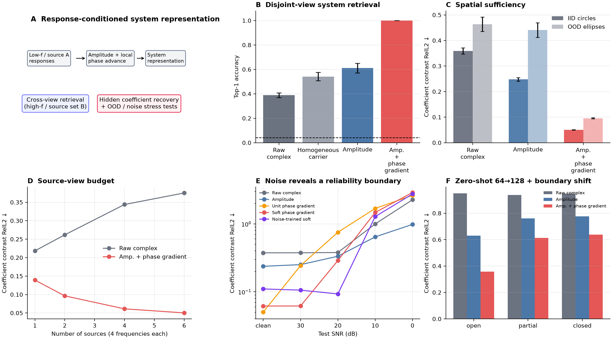
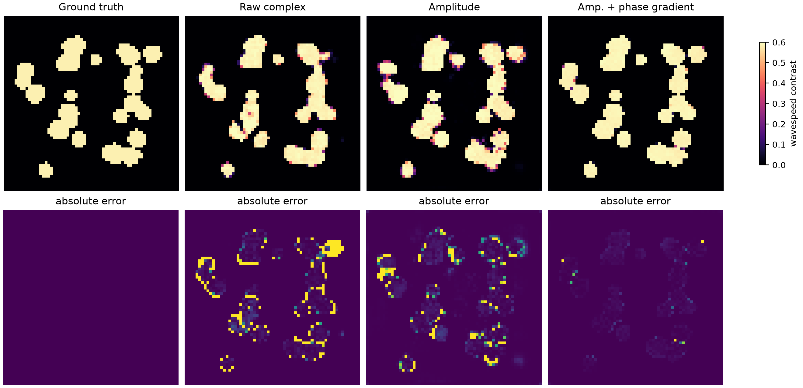

# 波动场表征学习 POC：从复数像素到局部传播 Token

> 历史证据 / 技术参考（2026-10-05 归档标记）：保留原实验、数值和复现路径。
> 文内“当前/下一步/待完成”描述属于当时阶段，不是现行任务；请先读[三条 Wave as Prompt 路线](../docs/wave_as_prompt/README.md)。

> 导航：[项目主页](../README.md) · [一页式当前状态](../docs/CURRENT_STATUS_ZH.md) ·
> [实验账本](../docs/EXPERIMENT_LEDGER_ZH.md) ·
> [下一阶段协议](../docs/WAVEFIELD_REPRESENTATION_NEXT_STAGE_ZH.md)

> 日期：2026-09-22
>
> 状态：第一阶段完成；形成强正结果，也识别出明确 failure boundary。
>
> 一句话结论：**完整复波场不适合直接当普通图片编码；“局部能量 + 固定物理间距上的复相位增量”能更稳定地识别产生这些响应的隐藏波动系统。**

正文级汇总图：

定性结果：

## 1. 为什么重启这个问题

前几轮项目主要问：给定低频场和少量校准观测，能否预测更高频的完整复场。这个方向得到过局部正信号，
但也反复遇到同一个边界：远距离频率延拓的 phase 不可辨识，改 recurrence、pole、Neural ODE 或
hypernetwork 都没有从根本上解决。

本轮因此先退回一个更基础的问题：

> 给定同一个未知物理系统的若干 response views，什么表示能跨 source、frequency、geometry 和
> discretization 保留这个系统的 identity 与局部物理结构？

这里的重点不是马上生成另一个频率，而是先判断是否存在一个可复用的系统级 latent。如果这个 latent
不存在，后面所有 query decoder 都只是在拟合像素相关性；如果它存在，再讨论 field generation 才有意义。

## 2. 问题形式化

令一个物理系统为 $h$，其频域响应写为

$$
u_h(x;s,f) \in \mathbb{C},
$$

其中 $x$ 是接收位置，$s$ 是源位置，$f$ 是频率。一个 response view 是三元组

$$
(s,f,u_h(\cdot;s,f)).
$$

模型只看到一个 context set

$$
C_h=\{(s_i,f_i,u_h(\cdot;s_i,f_i))\}_{i=1}^{m},
$$

并产生系统表示

$$
z_h=E(C_h).
$$

本轮依次使用三个越来越严格的充分性测试：

1. **Cross-view retrieval**：由低频、源组 A 得到的 $z_h$，能否在高频、完全不重叠的源组 B 中找到
   同一个系统？
2. **Spatial sufficiency**：context 是否足以恢复隐藏的波速系数图 $c_h(x)$？
3. **Stress tests**：该能力能否跨未见散射体几何、源预算、观测噪声、网格分辨率和边界条件保持？

完整场 query 仍是长期目标，但不是本轮成功与否的唯一标准。

## 3. 数据与无泄漏协议

### 3.1 主数据

本轮新生成 160 个独立二维变速声学系统：

- 网格：$64\times64$；
- 每个系统：9 个源、8 个频率，共 72 个 response views；
- 频带：约 6--24 Hz；
- 介质：随机圆形 inclusions，面积占比与 contrast 独立变化；
- 边界：open absorbing boundary；
- split：112 train / 24 validation / 24 test，严格按介质划分。

训练和测试之间没有共享介质。不能把同一个 Green operator 的不同列拆到不同 split。

### 3.2 Cross-view retrieval

- view set A：源 0--5、频率 0--3；
- view set B：源 6--8、频率 4--7；
- 两组 source 和 frequency 都不重叠；
- 测试集含 24 个新系统，因此随机 Top-1 为 $1/24=4.17\%$。

### 3.3 隐藏系数恢复

输入仍为 view set A，输出为完整 $c_h(x)$。主指标是 contrast field

$$
q_h(x)=1-c_h(x)
$$

的逐系统 relative L2；同时报告 inclusion IoU 和 pixel correlation。

这不是为了把 inverse scattering 本身包装成最终应用，而是把它当成 spatial sufficiency probe：如果一个
wavefield latent 连隐藏系统的空间结构都不能恢复，它很难成为通用 query operator 的充分状态。

## 4. 从经典相位理论得到的最小表示

把局部复场写成

$$
u(x)=A(x)e^{i\phi(x)}.
$$

在单分支、局部高频近似下，$\nabla\phi$ 与局部波向量有关，而波向量大小与 $f/c(x)$ 有关。因此：

- $A(x)$ 描述局部能量、衰减与干涉；
- $\phi(x)$ 的绝对值会 wrap，也受全局 time-zero 或仪器相位影响；
- 相邻位置的相位差比绝对相位更接近局部传播量。

本轮最终保留的最小 token 有 5 个实通道。先定义每个 view 的 RMS 尺度 $s$：

$$
s=\sqrt{\frac{1}{|\Omega|}\sum_x |u(x)|^2}.
$$

幅值通道为

$$
a(x)=\log\left(1+\frac{|u(x)|}{s}\right).
$$

横向和纵向复相位增量为

$$
g_x(x)=\frac{u(x+\Delta x)\overline{u(x)}}
{|u(x+\Delta x)\overline{u(x)}|+\alpha s^2+\epsilon},
$$

$$
g_y(x)=\frac{u(x+\Delta y)\overline{u(x)}}
{|u(x+\Delta y)\overline{u(x)}|+\alpha s^2+\epsilon}.
$$

最终 token 是

$$
T(u)=[a,Re(g_x),Im(g_x),Re(g_y),Im(g_y)].
$$

这里不做 phase unwrapping，也不需要源位置、解析 travel time 或 eikonal solver。

这个表示有四个直接性质：

1. 对每个 view 的全局相位旋转 $u\mapsto e^{i\theta}u$ 不变；
2. 保留局部相位 advance，而不是丢掉全部 phase；
3. 当局部幅值很低时，$\alpha s^2$ 会把不可信相位自动压到零；
4. $\Delta x$ 必须是固定物理距离，而不能永远取一个像素。

无噪声实验使用 $\alpha=0$ 的 unit phase increment；噪声实验使用 $\alpha=0.05$。

## 5. 结果

### 5.1 M0：普通坐标插值和低秩 Green completion 不成立

在旧的 10-medium / 3-boundary / 9-source 数据上：

- source--frequency RBF 的 missing-block complex RelL2 约 1.15；
- oracle eikonal demodulation 没有救活普通坐标插值；
- 6-source Nyström 即使修正物理 metric，RelL2 仍约 0.99；
- 每个系统的 72-view matrix 平均需要约 38 / 48 / 63 个 mode 才能解释 90% / 95% / 99% 能量。

结论：复杂散射场在这个预算下不是简单低秩矩阵，也不是把 frequency/source 当连续坐标做 kernel
regression 就能恢复。

### 5.2 一个额外的物理诊断：互易性依赖正确 metric

原方程写为

$$
p_{tt}+\sigma p_t=c(x)^2\Delta p+s.
$$

在普通像素内积下，源间 cross response 的 reciprocity error 约 0.84；用源点的 $c(s)^2$ 加权后降到
$2.1\times10^{-6}$。更重要的是，仅用低频 cross responses 就能把这些相对权重估到约
$5\times10^{-7}$ 的 log RMSE。

这是一个值得保留的科学事实：Green operator 的“对称性”取决于正确的物理测度。它没有直接救活
Nyström completion，但提示未来 latent operator 不应默认欧氏像素 metric。

### 5.3 直接生成完整复场仍失败

missing block 定义为：低频观察所有源，高频只观察 6 个源，预测剩余 3 个源的 4 个高频场。

| 输入或表示 | 测试 complex RelL2 |
|---|---:|
| raw response context | 0.968 |
| homogeneous-carrier context | 0.934 |
| oracle true medium | 0.965 |

oracle medium 也没有让普通 U-Net decoder 学会高频复场，说明当前瓶颈首先是数据量与 oscillatory decoder，
不能把失败简单归因给 response encoder。本轮因此没有继续堆更大生成器。

### 5.4 Cross-view system identity

三 seed 正式结果：

| 表示 | Test Top-1 | 相对随机倍数 |
|---|---:|---:|
| Random | 4.17% | 1.0x |
| Raw complex | 38.9% ± 2.0% | 9.3x |
| Homogeneous carrier | 54.2% ± 3.4% | 13.0x |
| Amplitude only | 61.1% ± 3.9% | 14.7x |
| Amplitude + local phase gradient | **100.0% ± 0.0%** | **24.0x** |

这里正负 view 没有共享 source 或 frequency。结果说明幅值确实是较稳定的 system fingerprint，但局部
phase advance 提供了幅值没有的传播信息。

初始 InfoNCE 会在部分 seed 塌缩到所有系统同一向量。加入 embedding variance 与去相关约束后，三个
seed 都稳定收敛。未经稳定化的单 seed 100% 结果不应使用。

### 5.5 隐藏介质恢复：最强正结果

| 表示 | IID contrast RelL2 | IID IoU | OOD ellipse RelL2 |
|---|---:|---:|---:|
| Raw complex | 0.3588 ± 0.0120 | 0.8595 ± 0.0071 | 0.4637 ± 0.0279 |
| Amplitude only | 0.2478 ± 0.0071 | 0.9172 ± 0.0037 | 0.4407 ± 0.0283 |
| Amplitude + local phase gradient | **0.0504 ± 0.0008** | **0.9962 ± 0.0006** | **0.0955 ± 0.0020** |

相对 raw：

- IID 误差降低 86.0%；
- OOD ellipse 误差降低 79.4%；
- 训练只见圆形 inclusion，测试 ellipse 的朝向和长宽比均未见。

重要消融：

| Token | IID contrast RelL2 |
|---|---:|
| Amplitude only | 0.238（seed 20260922） |
| Phase gradient only | 0.108 |
| Amplitude + phase gradient | **0.050** |
| 7-channel token，额外含绝对 normalized phase | 0.064 |

因此最终 5-channel 版本比更复杂的 7-channel 版本更好；幅值与局部相位差是互补信息。

### 5.6 Source budget

固定每个源 4 个低频响应，仅改变源数：

| 源数 | Raw | Amplitude + phase gradient |
|---:|---:|---:|
| 1 | 0.218 | 0.139 |
| 2 | 0.262 | 0.096 |
| 4 | 0.344 | 0.061 |
| 6 | 0.375 | 0.050 |

结构化 token 随 source 增多单调改善。raw 反而变差，主要是固定 channel-concatenation encoder 在更多
输入通道下优化更困难，不能解释成“更多 raw 观测有害”。正式预算实验必须换成共享 view encoder 和
set aggregation，避免参数化随 view 数改变。

### 5.7 噪声边界

clean-trained 模型：

| Test SNR | Raw | Amplitude | Unit phase gradient | Soft phase gradient |
|---:|---:|---:|---:|---:|
| clean | 0.375 | 0.238 | **0.050** | 0.062 |
| 30 dB | 0.376 | 0.251 | 0.244 | **0.062** |
| 20 dB | 0.379 | 0.334 | 0.753 | **0.289** |
| 10 dB | 1.000 | **0.644** | 1.690 | 1.475 |

在 20 dB 噪声上训练 soft phase-gradient 后，用独立噪声测试：

| Test SNR | Amplitude noise-trained | Soft phase-gradient noise-trained |
|---:|---:|---:|
| clean | 0.265 | **0.110** |
| 30 dB | 0.254 | **0.106** |
| 20 dB | 0.263 | **0.093** |
| 10 dB | **0.503** | 1.282 |

结论不是“phase 永远更好”，而是：

- 中高 SNR 时，amplitude-gated phase gradient 有显著优势；
- 10 dB 附近局部 phase 已不可靠，amplitude 是更安全的 fallback；
- 未来需要 confidence-aware fusion，而不是把所有像素的 phase 同等对待。

### 5.8 跨分辨率和强反射边界：部分通过

直接把 64-grid 模型用于旧 128-grid 数据时，一像素 phase increment 的物理距离减半，结果失败。
改为固定物理间距后，phase-gradient 总误差从 0.737 降到 0.536。

| 128-grid boundary | Raw | Amplitude | Physical-stride phase token |
|---|---:|---:|---:|
| open | 0.951 | 0.631 | **0.357** |
| partial | 0.938 | 0.760 | **0.614** |
| closed | 0.949 | 0.776 | **0.637** |

离散化修正有效，但 partial/closed 的多路径反射仍显著降低性能。当前 token 是单尺度、单局部增量，无法
显式区分多个传播分支。这是下一阶段最重要的结构性 failure，不应靠增加 U-Net 宽度掩盖。

## 6. 哪些是经典结论，哪些是本轮增量结果

### 6.1 经典信号处理或波动物理已经告诉我们的

1. 复场可分成 amplitude 与 phase；绝对 phase 存在 $2\pi$ wrapping。
2. 在局部单分支近似下，phase gradient 对应 local wavevector，和 eikonal / local wavenumber 有关。
3. 邻点复乘积 $u(x+\Delta)\overline{u(x)}$ 可以无显式 unwrap 地表示相位增量。
4. 相位估计在低幅值、低 SNR 区域不可靠，应使用 amplitude/coherence 加权。
5. 离散差分代表的是“每个网格步长的变化”，跨分辨率必须按物理 spacing 修正。
6. Green reciprocity 是否表现为普通矩阵对称，取决于方程的自伴随测度。

这些不是我们的新理论贡献，文稿必须诚实归因。

### 6.2 本轮在 AI 表征学习任务中的增量证据

1. 把 source 和 frequency 都不重叠的 response sets 定义为同一系统的正样本，可稳定学习
   response-conditioned system identity。
2. raw complex、amplitude、homogeneous carrier 与 local phase token 的 matched comparison 显示，
   “幅值稳定、绝对相位不稳定”不是完整结论；**局部相位增量是可迁移的，只是绝对相位不是。**
3. 5-channel token 在 hidden-medium recovery 上把 raw error 从 0.359 降到 0.050，并跨未见 ellipse
   geometry 保持 0.096。
4. amplitude 和 local phase gradient 的组合显著优于二者单独使用，支持“能量 + 局部传播”是更合适
   的波动场基础坐标。
5. unit phase increment 的噪声灾难、soft coherence 的修复以及 10 dB failure boundary，为表示何时可信
   给出了可量化判据。
6. 固定 physical stride 能显著改善 64→128 零重训迁移，但强反射边界仍要求 multi-scale / multi-branch
   表示。

## 7. 与近期工作的关系

- [ICON](https://arxiv.org/abs/2304.07993) 把少量 input-output demonstrations 当作 data prompt，研究
  inference-time operator learning。我们的长期任务与它相邻，但这里的 context item 是复波场 response
  view，核心问题是波动专用 representation，而不是通用 sequence architecture。
- [Neural Operator Processes](https://arxiv.org/abs/2606.22946) 把 neural-process conditioning 与
  neural-operator decoding 结合，强调 partial observation 下 local context-query geometry 的重要性。
  这支持下一阶段使用共享 set encoder，而不是固定 channel concatenation。
- [Riesz Neural Operator](https://proceedings.iclr.cc/paper_files/paper/2026/hash/ed3fea9033a80fea1376299fa7863f4a-Abstract-Conference.html)
  强调 PDE 的局部方向导数表示。它与本轮发现非常接近，意味着“局部方向信息”本身不能作为新颖性主张；
  我们潜在的差异应放在 **complex response 的 gauge-invariant phase advance、system identification、跨
  source-frequency context** 上。
- [MiNO](https://arxiv.org/abs/2608.15187) 直接学习 phase-space propagator，并用 eikonal 与 transport
  组织 amplitude/phase。它比本轮 token 更完整，也构成最重要的近期竞争工作。我们的潜在优势只能是：
  更轻量、无需解析相位分支、面向未知系统的 response-conditioned identification，而不是已知 PDE 的
  forward propagator。
- [Learning Green's functions](https://arxiv.org/abs/2204.12789) 给出学习 PDE Green function 的理论视角。
  本轮低秩 Nyström 失败提醒我们：理论上的层次低秩结构不等于少数全局源列就能恢复复杂散射响应。

## 8. 当前最诚实的判断

### 已经成立

- 波动场不是自然图片；局部 amplitude/phase-advance 坐标比 raw real/imag 更适合识别隐藏系统。
- 这个优势不只体现在检索，还体现在空间系数恢复、未见 geometry 和中高 SNR。
- 表示可压缩到 5 个明确、可解释、无需 source/travel-time 的通道。

### 仍未成立

- 还没有证明该表示能把 unseen source-frequency 的完整复场 error 降到可用水平。
- 主数据仍是一个二维 acoustic simulator；ellipse OOD 不是跨物理方程验证。
- 输入是 dense internal field，不等同于真实边界阵列或极稀疏传感器。
- 10 dB 下 phase-gradient 路径失败。
- 跨 closed/reverberant boundary 的零重训误差仍高。
- 当前 medium probe 使用固定 views 的 channel concatenation，不是最终 operator architecture。

因此这是一项值得继续的强 POC，但不是现在就可包装成完整顶会论文的结果。

## 9. 下一阶段：从 Token 到 Wave-System Encoder

### P0：共享 view encoder，消除固定通道拼接

每个 response view 独立编码：

$$
t_i=E_v(T(u_i),s_i,f_i,\Delta x),
$$

再用 permutation-invariant attention 聚合：

$$
Z_h=A(\{t_i\}_{i\in C_h}).
$$

训练时随机 source、frequency 和 spatial mask。必须同时给 mask 与物理坐标，避免零填充歧义。

Gate：在 1/2/4/6 source 和多个 frequency budget 下，参数量固定，性能随观测量单调改善。

### P1：multi-scale physical-stride phase token

在固定物理距离 $\delta_1,\delta_2,\delta_3$ 上计算 gated phase advance，而不是只看最近邻。短尺度负责
local wavenumber，长尺度负责跨低幅值区和部分多路径结构。用 learnable confidence gate 融合 amplitude
与不同尺度 phase，但不引入额外 physics losses。

Gate：

- 64→128 open boundary error 低于 0.20；
- partial/closed 每个边界都优于 amplitude-only 至少 20%；
- 20 dB 下保持低于 0.15；
- 10 dB 下不劣于 amplitude fallback。

### P2：从显式 medium latent 到 queryable operator

先采用最可诊断的两段式方法：

1. response context $\rightarrow$ coefficient-like spatial latent；
2. spatial latent + query $(s,f)$ $\rightarrow$ response field。

第二段必须先用 oracle medium 单独训练到合格，再接第一段；本轮 oracle-medium decoder 约 0.965 的失败
说明不能把两段同时训练后只看最终 loss。

可选 decoder 优先级：

1. differentiable solver 或 learned correction to solver；
2. wave-aware propagator / microlocal decoder；
3. neural operator；
4. 最后才是通用生成模型。

Gate：oracle-medium decoder 先低于 0.30 raw complex RelL2；随后 predicted-medium cascade 相对 raw
context baseline 至少改善 30%。

### P3：真正部分观测与第二物理域

优先级高于继续调 IID 圆形数据：

1. contiguous patch masks 与边界传感器，而不是随机孤立像素；
2. WaveBench 或 Helmholtz staircase 上构造同样的 coefficient-recovery / cross-view task；
3. 不同 PDE 或不同数值 solver 的外部数据；
4. 真实测量噪声、source phase jitter 和传感器 gain mismatch。

只有第二数据域也出现稳定优势，才讨论通用 wave representation。

## 10. 建议的新主线

不再以“低频直接生成高频”为唯一中心，而以更基础的问题作为总主线：

> **Can a model identify a reusable wave-system representation from a few complex response views?**

中文可以表述为：

> **从少量复波动响应中识别可复用的波动系统表示。**

最紧凑的核心发现是：

> 绝对 phase 难迁移，但局部 phase advance 并不难迁移；和 amplitude 结合后，它是识别隐藏传播介质的
> 强表征。

这既继承了 APEX 最初的 amplitude--phase 观察，又修正了“phase 整体不可迁移”的过强说法，并把问题
推进到 AI-native 的 representation learning 与 in-context operator identification。

## 11. 复现入口

- 数据配置：`configs/wave_operator_representation_poc_20260922.json`
- OOD 配置：`configs/wave_operator_ood_ellipses_20260922.json`
- 数据生成：`spectral_continuation.wave_operator_data`
- M0 审计：`spectral_continuation.audit_wave_operator_representation`
- missing-block field baseline：`spectral_continuation.train_wave_operator_identifier`
- cross-view contrastive：`spectral_continuation.train_wave_operator_contrastive`
- hidden-medium probe：`spectral_continuation.train_wave_medium_probe`
- OOD / noise：`spectral_continuation.evaluate_wave_medium_ood`
- 汇总图：`spectral_continuation.summarize_wave_representation_poc`
- 数值汇总：`artifacts/wave_operator_representation/summary/summary.json`
