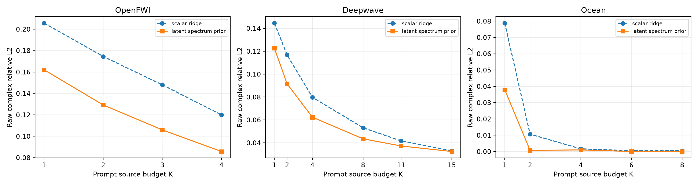
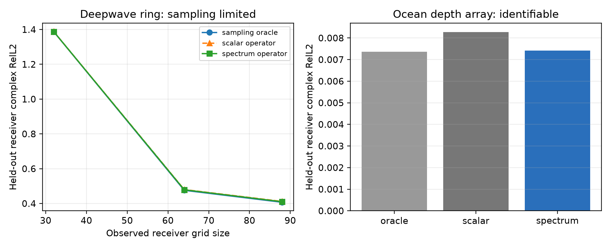

# Wave as Prompt M0：谱先验复响应算子

> 历史证据 / 技术参考（2026-10-05 归档标记）：保留原实验、数值和复现路径。
> 文内“当前/下一步/待完成”描述属于当时阶段，不是现行任务；请先读[三条 Wave as Prompt 路线](../docs/wave_as_prompt/README.md)。

> 日期：2026-09-25  
> 状态：M0 三域、三组 prompt-order seed与 continuous-query existence audit 完成  
> 结论：最小方法已通过预注册的 half-budget、raw error、probe saving、half-budget OOD 和“一域连续 query”
> gate；Deepwave continuous query 因空间 aliasing 失败，不能宣称通用连续坐标算子已经完成。

## 一句话结果

把未知波系统表示为训练响应子空间中的复隐变量，并用训练系统的隐变量能谱作为各向异性先验，比对每个
隐方向使用同一 ridge 的强基线，在 OpenFWI、Deepwave 和 Ocean 的 half-budget 设置分别降低 raw complex
RelL2 **25.9%、18.2% 和 39.3%**。OpenFWI 与 Ocean 还用少 25% 的 source probes 达到或超过 full-budget
scalar-ridge baseline。



## 1. 问题不是“补一张图”，而是从 prompts 识别响应算子

每个物理系统由未观测环境变量 $\theta$ 决定。在固定频率 $\omega$ 下，全部 source--receiver 响应构成
复矩阵：

$$
Y_{\theta,\omega}\in\mathbb C^{S\times R}.
$$

测试时只能执行 $K$ 个 source experiments，得到 prompt：

$$
D_K=\{(s_i,Y_{\theta,\omega}(s_i,:))\}_{i=1}^{K}.
$$

模型必须回答没有执行过的 source query $s_*$：

$$
D_K,s_*,\omega\longrightarrow \widehat Y_{\theta,\omega}(s_*,:).
$$

因此，模型在 inference time 面对的是一个未见物理系统；prompt 的作用是识别这个系统的 response
operator，而不是提供目标附近的普通图像像素。

## 2. 最小方法

### 2.1 从训练系统学习复响应表示

对每个频率，把 response matrix 展平为 $y_{\theta,\omega}\in\mathbb C^{SR}$，仅用 train systems 学：

$$
y_{\theta,\omega}=\mu_\omega+B_\omega z_{\theta,\omega}+\epsilon.
$$

其中 $B_\omega\in\mathbb C^{SR\times d}$ 是复响应基，$z$ 是描述当前系统的低维复坐标。这里的低秩是
**跨物理系统的 response-manifold rank**，不是强迫 source 或 receiver 空间本身低秩。

### 2.2 scalar ridge 强基线

令 $P_K$ 选择 prompt 中已经执行的 source rows，标准 response-subspace completion 解为：

$$
\widehat z=
\left(B_K^*B_K+\lambda I\right)^{-1}
B_K^*\left(y_K-\mu_K\right),
$$

其中 $B_K=P_KB$。rank 和 $\lambda$ 都在 validation 上重新搜索到 128；因此本文比较的不是早期容量
不足的 rank-32 baseline。

### 2.3 本期方法：训练分布诱导的 latent spectrum prior

训练系统在不同隐方向上的方差相差很大：

$$
z_j\sim\mathrm {CN}(0,\sigma_j^2).
$$

在 sparse prompts 下，低方差方向通常也是最难辨识、最容易被噪声或分布偏移放大的方向。我们因此用：

$$
\Lambda_{jj}
=
\beta\frac{\mathrm {median}_k(\sigma_k^2)}{\sigma_j^2},
$$

并进行闭式 MAP system identification：

$$
\widehat z=
\left(B_K^*B_K+\Lambda\right)^{-1}
B_K^*\left(y_K-\mu_K\right).
$$

最后只在 query rows 上解码：

$$
\widehat y_*=\mu_*+B_*\widehat z.
$$

与 scalar ridge 相比，新增的不是一个任意 loss，而是一个由训练 response manifold 的统计结构确定的
复高斯先验。它把“表示学习”和“prompt-conditioned operator identification”连接起来：训练阶段学习可迁移
响应坐标及其概率尺度，测试阶段用少量实验更新当前系统的 posterior coordinate。

## 3. 正式协议

- 数据域：OpenFWI CurveFault-A、Deepwave ring ultrasound、Ocean Pekeris multistatic；
- split 单位：physical system / environment，禁止 response-level 泄漏；
- selection：只在一组冻结 validation protocol 上选择一次 rank 与先验强度；
- evaluation：固定选择后，用三组独立 prompt orders，每组 3 repeats；
- 聚合：先在同一 physical system 内跨 query 和 seed 平均，再对 systems 做 paired bootstrap；
- 主指标：逐 held-out query 的 raw complex relative L2；
- baseline：同一复 PCA basis family、独立 validation 选 rank 与 scalar ridge strength；
- OOD 不参与选择。

## 4. 主结果

### 4.1 Half-budget 主表

| 数据域 | K / full K | scalar ridge | spectrum prior | 相对降低 | 95% paired CI | system win rate |
|---|---:|---:|---:|---:|---:|---:|
| OpenFWI | 2 / 4 | 0.1745 | **0.1292** | **25.9%** | [23.7%, 27.9%] | 98.8% |
| Deepwave | 8 / 15 | 0.05313 | **0.04349** | **18.2%** | [17.7%, 18.6%] | 100% |
| Ocean IID | 4 / 8 | 0.001678 | **0.001018** | **39.3%** | [36.0%, 42.8%] | 100% |

三个域均超过预先设定的 10% promotion threshold，且 raw error 通过 OpenFWI $\leq0.15$、Deepwave
$\leq0.055$ 的绝对门槛。

### 4.2 Measurement efficiency

| 数据域 | full-budget scalar | 最小等效 K | 该 K 的 spectrum error | probe saving |
|---|---:|---:|---:|---:|
| OpenFWI | K=4，0.1200 | K=3 | 0.1059 | **25%** |
| Ocean | K=8，0.000486 | K=6 | 0.0000564 | **25%** |
| Deepwave | K=15，0.03307 | K=15 | 0.03240 | 0% |

所以“至少两个域节省 25% probes”的 gate 通过。Deepwave 没有被隐藏：K=11 虽比同预算 scalar
改善 10.6%，但 0.03724 仍未达到 K=15 scalar 的 0.03307。

### 4.3 OOD

在论文主设置 half-budget 下：

| 数据域 | scalar OOD | spectrum OOD | 相对降低 | system win rate |
|---|---:|---:|---:|---:|
| Deepwave shape/contrast OOD，K=8 | 0.09004 | **0.07552** | **16.1%** | 100% |
| Ocean parameter OOD，K=4 | 1.208 | **1.032** | **14.6%** | 76.6% |

相对改善 gate 通过，但 Ocean 的绝对误差大于 1，代表训练 response manifold 对更快、更密 seabed 的外推
仍然失败，不能写成“解决了海洋 OOD”。此外 Ocean K=1 和 K=8 分别退化 455% 和 24%；这暴露出固定
IID latent prior 在远分布系统上的过度自信，也给下一阶段的 prompt-adaptive posterior calibration 提供了
明确目标。

### 4.4 Interleaved continuous receiver query

我们进一步把 receiver coordinates 全局交错划分；训练 response representation 从不读取 query receiver
位置的数值。测试时同时要求预测未执行 source 和未观测 receivers。scalar 与 spectrum 方法分别在
validation 上选择 rank、strength 与同一组 coordinate interpolation baselines。

| 数据域 | observed/query receivers | scalar | spectrum | 相对降低 | oracle coordinate error |
|---|---:|---:|---:|---:|---:|
| Ocean，K=4 | 25 / 23 | 0.008275 | **0.007414** | **10.4%** | cubic 0.007369 |
| Deepwave，K=8 | 32 / 32 | 1.38777 | 1.38741 | 0.03% | linear 1.38678 |

Ocean 通过 10% gate，而且最终值接近给定真实 target-source observed receivers 时的 cubic oracle。Deepwave
则揭示一个更基本的边界：交错后每圈只有 32 个 receivers，波场在环方向已经严重 alias；真实 target
response 的 Fourier、cubic、linear 插值误差分别为 1.84、1.59、1.39。此时更大 coordinate network
无法从未采样信息中恢复相位。下一步必须先生成更密环阵或按波长设计采样，不能用模型容量掩盖不可辨识性。

随后保持 1024 个 systems、16 sources、5 frequencies 完全相同，只把 Deepwave receiver grid 加密到
128 和离散圆允许的 176 个唯一网格点。sampling curve 为：

| functional-grid receivers | sampling oracle | scalar operator | spectrum operator |
|---:|---:|---:|---:|
| 32 | 1.387 | 1.388 | 1.387 |
| 64 | 0.476 | 0.480 | 0.479 |
| 88 | 0.407 | 0.412 | 0.410 |



误差随局部采样间距下降，但模型始终贴近 oracle，且在当前离散网格极限仍为 0.407。因此冻结 Deepwave
continuous branch；重新打开它需要更细 PDE grid 或避开近源尖锐区域，而不是更多名义 receivers。

### 4.5 Prompt-only posterior calibration

固定 IID prior 在 Ocean 远 OOD 上可能过度自信。对于 $K\geq2$，我们不读取 target query，而是在每个
episode 内轮流遮住一条 prompt source，用剩余 $K-1$ 条判断 scalar prior 与 spectrum prior 哪个更能解释
当前系统，再用全部 prompts 执行最终 query。

Ocean K=4 的三 seed 结果为：

| split | scalar | fixed spectrum | prompt-adaptive | adaptive vs fixed |
|---|---:|---:|---:|---:|
| IID | 0.001678 | **0.001018** | 0.001072 | -5.3% |
| parameter OOD | 1.208 | 1.032 | **0.846** | **+18.0%** |

IID 中 adaptive 仍相对 scalar 改善 36.1%，OOD 则相对 scalar 改善 30.0%。Deepwave K=4/8 的 selector 在
97.6%--99.8% episodes 选择 spectrum prior，结果与 fixed method 几乎相同。这说明 prompts 可以承担
inference-time calibration，而不需要知道隐藏介质或 OOD 标签。

边界同样明确：Ocean K=8 的 OOD regression 只从 -24.3% 缩小到 -11.2%，并未完全修复；K=2 的 IID
极小误差也会因少数错误 fallback 受损。因此 adaptive calibration 是 half-budget robustness extension，
不是新的 universal 主方法。

## 5. 机制审计与负结果

### 5.1 什么结构真的低秩

审计了两类更“漂亮”的 functional tensor 假设：

1. 每个 response basis 独立作 source--receiver CP；
2. 全部 basis 共享 source/receiver Tucker coordinates。

结果是 Ocean 的 shared Tucker 可以保真，但 OpenFWI 与 Deepwave 在低于原存储量一半时 query error 分别
放大约 4 倍和 13 倍。receiver Fourier/DCT 截断即使先去掉 reference propagation carrier 仍失败。因此当前
证据支持：

$$
\text{low rank across systems, not necessarily across source/receiver coordinates}.
$$

这阻止我们为了“functional tensor”外观强行压缩振荡空间轴。

### 5.2 为什么没有立刻加入 flow

当前 deterministic posterior mean 在三个 IID 域都稳定改善，尚没有“相同 prompts 对应明显多峰 target”
的定量证据。没有 K-sample oracle headroom 前加入 flow，只会增加参数量而不能说明生成建模的必要性。

### 5.3 为什么没有把 episodic basis learning 写成正结果

直接按 query loss 微调 dense complex basis：Deepwave 没有改善，OpenFWI 只改善约 1.4%。这说明主要收益
来自正确处理 sparse identification 的方向相关不确定性，而不是把 PCA basis 换成一个更难解释的可训练矩阵。

## 6. Promotion gate

| Gate | 目标 | 当前 | 状态 |
|---|---|---|---|
| half-budget | 至少 2/3 域提升 10%，第三域不退化 | 25.9% / 18.2% / 39.3% | 通过 |
| raw error | OpenFWI $\leq0.15$；Deepwave $\leq0.055$ | 0.1292 / 0.04349 | 通过 |
| probe saving | 至少两个域 25% | OpenFWI、Ocean 25% | 通过 |
| half-budget OOD | 一域 $>5\%$，另一域 $>-3\%$ | 16.1% / 14.6% | 通过 |
| 三 seed/system paired | 必须完成 | 已完成 | 通过 |
| continuous receiver query | 一域 matched gain 10% | Ocean 10.4%；Deepwave aliasing 负结果 | 通过最低 gate |
| latent flow existence | 先证明多模态 headroom | 尚未证明 | 暂不进入 |

## 7. 下一步只做两件核心事情

1. **Prompt-adaptive calibrated response operator**：首轮 leave-one-prompt-out 二选一已经把 Ocean K=4
   OOD 从 1.032 降至 0.846；下一步研究连续 prior strength/rank calibration，而不是增加 heuristic
   fallback 数量。
2. **Dense-grid continuous response query**：Ocean 已通过 interleaved existence gate；Deepwave 先生成更密
   环阵并验证 sampling oracle，再决定是否训练 coordinate decoder。当前 fixed cubic 只是部署层，还不足以
   宣称 neural functional operator 是独立贡献。

functional-tensor decoder、flow 和更大的 Transformer 都服从这两个 gate，不并行堆叠。

## 8. 复现入口

正式单 seed selection 与测试：

```bash
uv run python -m spectral_continuation.probabilistic_response_operator \
  --config configs/wave_as_prompt_latent_prior_m0_20260925.json \
  --domain Deepwave \
  --output artifacts/wave_as_prompt_pfto/m0_latent_prior/Deepwave \
  --device cuda
```

冻结选择后的三 seed 汇总：

```bash
uv run python -m spectral_continuation.summarize_latent_prior_multiseed \
  --config configs/wave_as_prompt_latent_prior_m0_20260925.json \
  --selection-root artifacts/wave_as_prompt_pfto/m0_latent_prior \
  --output artifacts/wave_as_prompt_pfto/m0_latent_prior_multiseed \
  --device cuda
```

机器可读主表与逐域完整结果分别位于：

- `artifacts/wave_as_prompt_pfto/m0_latent_prior_multiseed/main_table.csv`；
- `artifacts/wave_as_prompt_pfto/m0_latent_prior_multiseed/summary.json`。
