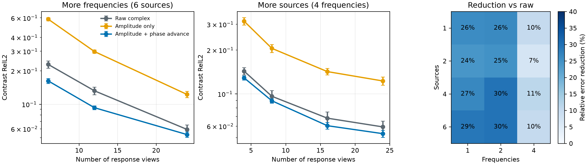
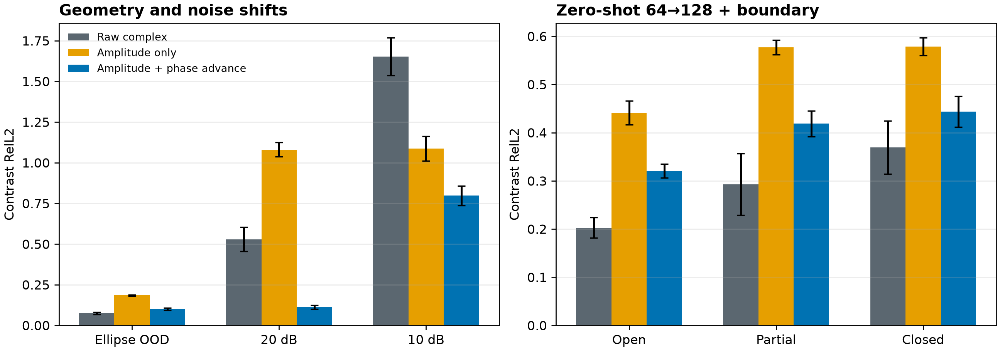
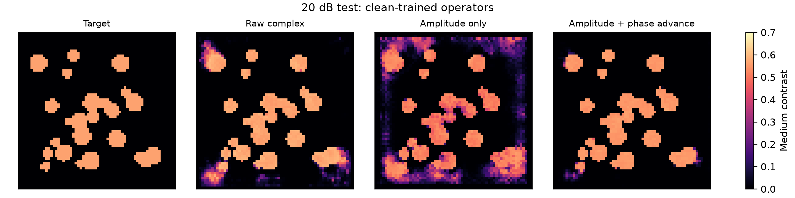

# Wave Set Operator M0：可变观测预算下的波动系统表征

> 历史证据 / 技术参考（2026-10-05 归档标记）：保留原实验、数值和复现路径。
> 文内“当前/下一步/待完成”描述属于当时阶段，不是现行任务；请先读[三条 Wave as Prompt 路线](../docs/wave_as_prompt/README.md)。

> 日期：2026-09-22
> 证据等级：三 seed、system-held-out、matched architecture。当前支持 observation-efficiency claim，
> 不支持 universal OOD 或通用场生成 claim。

## 1. 这轮真正回答的问题

给定同一个未知波动系统产生的若干复响应场，模型能否用同一套参数处理不同 source 数、frequency 数和
输入顺序，并从更少观测中恢复隐藏系统？

旧 POC 把固定的 24 个 views 沿 channel 拼接。它证明了表示中含有足够信息，却无法公平比较不同观测预算：
输入通道数和参数化会随 view 数变化。M0 改为 shared view encoder 加 permutation-invariant set operator。

## 2. 最小物理 token

对复场 $u$，先用每个 view 的 RMS 幅值 $r$ 归一化：

$$
a(x)=\log\left(1+\frac{|u(x)|}{r}\right).
$$

在固定物理间距 $\delta$ 上计算两个方向的 soft phase advance：

$$
p_x(x)=\frac{u(x+\delta e_x)\overline{u(x)}}{|u(x+\delta e_x)\overline{u(x)}|+0.05r^2},
$$

$$
p_y(x)=\frac{u(x+\delta e_y)\overline{u(x)}}{|u(x+\delta e_y)\overline{u(x)}|+0.05r^2}.
$$

最终每个 response view 只有五个实通道：归一化幅值、$p_x$ 的实部和虚部、$p_y$ 的实部和虚部。
实现不做 phase unwrapping，也不使用已知 source travel time。

## 3. Shared slot set operator

同一个卷积 backbone 独立编码每个 view。每个空间尺度上，四个 learned slots 对无序 views 做 soft attention，
再与 view-wise mean 和 standard deviation 拼接并投影。聚合对输入顺序不敏感，参数量不随 view 数增长。

训练时随机采样 source-frequency rectangle；一半 step 使用完整 6-source、4-frequency context，一半使用
较小随机预算。所有预算共用约 0.98M trainable parameters。

这不是 Transformer 堆叠。它只表达一个必要事实：复杂波场在同一点可能包含多个传播分量，不能在进入
decoder 前只取一个无条件均值。

## 4. 三 seed 主结果

### 4.1 Full context 不是主要优势区间

| 表示 | 24-view RelL2 |
|---|---:|
| Raw complex | 0.0593 ± 0.0057 |
| Amplitude only | 0.1226 ± 0.0080 |
| Amplitude + phase advance | **0.0533 ± 0.0030** |

phase token 相对 raw 只降低 10.1%，且逐系统 cluster bootstrap 的 95% 区间跨过零。不能把 full-context
端点写成显著击败 strong raw。相对 amplitude-only 降低 56.5%，说明局部相位包含幅值缺失的信息。

### 4.2 真正稳定的效应是 frequency observation efficiency

| Sources × frequencies | Raw | Amplitude | Phase token | 相对 raw |
|---|---:|---:|---:|---:|
| 1 × 1 | 0.519 | 0.958 | **0.384** | 25.9% |
| 2 × 1 | 0.347 | 0.805 | **0.263** | 24.1% |
| 4 × 1 | 0.258 | 0.645 | **0.190** | 26.5% |
| 6 × 1 | 0.228 | 0.584 | **0.162** | 28.9% |
| 6 × 2 | 0.132 | 0.298 | **0.093** | 29.6% |
| 6 × 4 | 0.059 | 0.123 | **0.053** | 10.1% |

对每个 source 只有 1--2 个频率时，phase token 相对 strong raw 稳定降低 24--30%；每个 source 有 4 个
频率后，两者趋同。最可信的解释是：数据充分时 shared network 能从 real/imag 自己学出局部相位关系；
观测稀缺时，显式 phase advance 提供了更高效的坐标。

## 5. Shift 与 failure boundary

| 条件 | Raw | Amplitude | Phase token |
|---|---:|---:|---:|
| Ellipse OOD | **0.073** | 0.184 | 0.100 |
| IID 20 dB | 0.529 | 1.081 | **0.112** |
| IID 10 dB | 1.653 | 1.087 | **0.797** |
| 128-grid open | **0.203** | 0.441 | 0.320 |
| 128-grid partial | **0.293** | 0.577 | 0.419 |
| 128-grid closed | **0.369** | 0.578 | 0.444 |

20 dB 是最强的 shift 正结果：clean-trained phase token 仍为 0.112，分别比 raw 和 amplitude 降低约
78.8% 与 89.6%。10 dB 虽相对更好，但 0.797 的绝对误差不可用，必须记为失败边界。

clean ellipse 与 128-grid boundary 上 raw 更强。这说明当前 phase token 不是通用 OOD 表示；固定局部
差分在网格、频率采样和强反射改变时仍有 bias。它相对 amplitude 始终更好，但不能以此回避 strong raw。

## 6. 关键归因与已停止路线

| 尝试 | 结果 | 决策 |
|---|---|---|
| Mean/std set pooling | frozen low/high 0.308/0.382 | 信息压缩过强 |
| 4-slot 后立即压回窄 feature | frozen 0.321/0.429；finetune low 0.114 | 容量可用但冻结可读性弱 |
| Masked cross-view prediction | frozen 0.346/0.397 | 可预测 response 不等于介质可读 |
| 保留全部 slot-stack | 13M probe，frozen 0.298/0.408 | 容量增加，无跨组收益 |
| Multi-scale metadata FiLM | frozen 0.323/0.420 | metadata 缺失不是唯一瓶颈 |
| Learned coordinate basis | mixed-domain 平均改善约 7.8% | 有机制信号，绝对误差仍高 |
| 13-channel multi-scale token | finetune low 0.114 | 不优于最小 5-channel token |
| Instance-contrastive pretraining | pretrained 0.0639；scratch 0.0491 | 只加速早期收敛，不是核心贡献 |

因此 M0 冻结为：single-scale 5-channel token、shared four-slot aggregation、从头 task training。不要继续
扫更多 slot、basis 或辅助 loss，除非出现新的 acquisition 信息或新的 self-supervised identifiability 目标。

## 7. 下一步最值得做什么

1. 把 frequency-poor regime 定义为主问题：固定总观测成本，比较增加 source 与增加 frequency 的价值；
2. 做 noise-aware training，检验 20 dB 优势能否扩展到 10 dB，同时不牺牲 clean；
3. 用不同 source layout 或第二物理域验证 measurement-efficiency scaling，而非只增加同分布系统；
4. 若回到 unseen complex-field query，先通过 true-medium oracle decoder gate，不能把 medium recovery
   自动等同于完整场生成。

机器可读结果位于 `artifacts/wave_set_m0/summary/`；正式配置为
`configs/wave_set_operator_m0_formal_20260922.json`。
